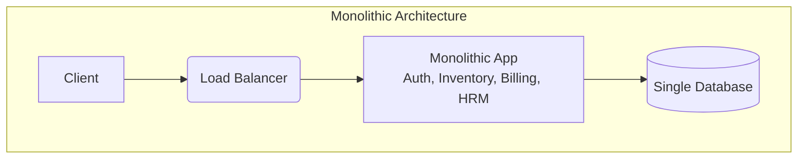
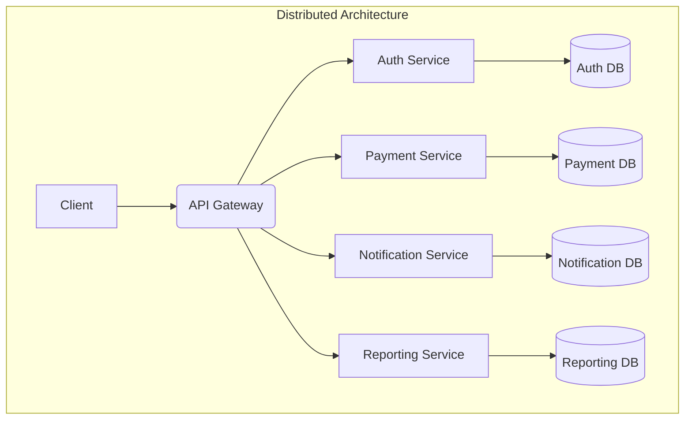

# Chapter 1 — System Design Introduction
Practical System Design in Bangla

## 1.1 System Design (সিস্টেম ডিজাইন) কী?
System Design বা সিস্টেম ডিজাইন হলো এমন একটি প্রক্রিয়া (Process) যেখানে একটি সফটওয়্যার সিস্টেম কীভাবে কাজ করবে, কীভাবে স্কেল (scale) বা বৃদ্ধি পাবে, কীভাবে ডেটা সিকিউর (secure) থাকবে এবং ভবিষ্যতের বিপুল পরিমাণ ইউজার বা ডেটা কীভাবে সামলাবে—তার সম্পূর্ণ আর্কিটেকচার ও ইনফ্রাস্ট্রাকচারের পূর্বপরিকল্পনা করা হয়।

সহজ ও প্রাঞ্জল বাংলায় বলতে গেলে:
> "একটি সফটওয়্যার মানে শুধুমাত্র কিছু কোড লেখা নয়। সম্পূর্ণ সিস্টেমটি ভবিষ্যতে বড় হলে কীভাবে কোনো সমস্যা ছাড়াই অত্যন্ত দ্রুত এবং কার্যকরভাবে (efficiently) চলবে, সেই ব্লু-প্রিন্ট তৈরি করাই হলো System Design।"

ধরুন, আপনি একটি ছোট ই-কমার্স (E-commerce) বা ইআরপি (ERP) সফটওয়্যার তৈরি করলেন।
**প্রাথমিক অবস্থা:**
- মাত্র ১০ জন ইউজার।
- একটি সাধারণ সার্ভার।
- একটি মাত্র ডাটাবেজ (Database)।
সবকিছু খুব ভালোভাবেই চলছিল। কোনো স্লোনেস বা ডিলে (Delay) ছিল না।

**২ বছর পর বর্তমান অবস্থা:**
- ইউজারের সংখ্যা ৫০,০০০ ছাড়িয়ে গেছে।
- প্রতিদিন হাজার হাজার ট্রানজ্যাকশন (Transaction) হচ্ছে।
- একটি নতুন মোবাইল অ্যাপ যুক্ত হয়েছে।
- একাধিক পেমেন্ট গেটওয়ের (Payment API) ইন্টিগ্রেশন হয়েছে।
- রিয়েল-টাইম (Real-time) রিপোর্টিংয়ের দরকার পড়ছে।

ঠিক এই পর্যায়ে এসে আপনার সিস্টেম ধীরগতি (Slow) হতে শুরু করল। সার্ভার ক্র্যাশ করা বা ডাটাবেজ লক হয়ে যাওয়া নিত্যনৈমিত্তিক ব্যাপার হয়ে দাঁড়ালো। এখান থেকেই শুরু হয় **"System Design"** এর আসল প্রয়োজনীয়তা।

---

## 1.2 কেন System Design গুরুত্বপূর্ণ?

System Design হলো একটি সফটওয়্যার সিস্টেমের **আর্কিটেকচার, কম্পোনেন্ট, ডাটা ফ্লো, স্কেলিং, সিকিউরিটি এবং ইন্টিগ্রেশন** কীভাবে কাজ করবে তার পরিকল্পনা। একটি ভালো System Design ছাড়া বড় সফটওয়্যার প্রজেক্ট দীর্ঘমেয়াদে টিকিয়ে রাখা কঠিন হয়ে যায়।

## ১. Scalability (স্কেল করার সক্ষমতা)

শুরুর দিকে ১,০০০ ইউজার থাকলেও ভবিষ্যতে ১০ লাখ ইউজার হতে পারে। ভালো System Design সিস্টেমকে বেশি ট্রাফিক এবং ডাটা হ্যান্ডেল করতে সাহায্য করে।

উদাহরণ:

* ছোট অ্যাপ: Single Server
* বড় অ্যাপ: Load Balancer + Multiple Servers + Caching + Database Sharding

---

## ২. Performance (উচ্চ পারফরম্যান্স)

ভালো ডিজাইন সিস্টেমকে দ্রুত রেসপন্স করতে সাহায্য করে।

উদাহরণ:

* Database Indexing
* Caching
* Asynchronous Processing
* CDN ব্যবহার

যদি ডিজাইন ভালো না হয়, তাহলে:

* API Slow হবে
* Database Bottleneck হবে
* User Experience খারাপ হবে

---

## ৩. Reliability (নির্ভরযোগ্যতা)

সিস্টেমের কোনো অংশ Fail করলেও পুরো সিস্টেম বন্ধ হয়ে যাবে না।

উদাহরণ:

* Redundant Servers
* Database Replication
* Failover Mechanism
* Message Queue

যেমন:
Netflix এবং Amazon তাদের সিস্টেমকে এমনভাবে ডিজাইন করে যাতে একটি সার্ভার নষ্ট হলেও সার্ভিস চালু থাকে।

---

## ৪. Maintainability (সহজে পরিবর্তন ও রক্ষণাবেক্ষণ)

একটি ERP বা Microservices Project-এ প্রতিনিয়ত নতুন Feature যোগ হয়।

ভালো System Design থাকলে:

* নতুন Feature যোগ করা সহজ হয়।
* Bug Fix দ্রুত করা যায়।
* Code Reuse করা যায়।
* নতুন Developer দ্রুত Onboard হতে পারে।

---

## ৫. Security (নিরাপত্তা)

System Design-এর মাধ্যমেই নির্ধারণ করা হয়:

* Authentication
* Authorization
* Encryption
* Audit Logging
* API Security
* Rate Limiting

খারাপ ডিজাইনের কারণে:

* Data Leak
* Unauthorized Access
* System Breach

ঘটতে পারে।

---

## ৬. Cost Optimization (খরচ কমানো)

ভালো System Design Infrastructure Cost কমায়।

উদাহরণ:

* Caching ব্যবহার করলে Database Load কমে।
* Auto Scaling ব্যবহার করলে অপ্রয়োজনীয় Server Cost কমে।
* Queue ব্যবহার করলে Peak Load সামলানো সহজ হয়।

---

## ৭. High Availability (সর্বদা সচল থাকা)

ব্যাংকিং, ERP, টেলিকম, Microfinance-এর মতো সিস্টেমে Downtime খুব ব্যয়বহুল।

ভালো System Design নিশ্চিত করে:

* 99.9% বা তার বেশি Uptime
* Disaster Recovery
* Backup Strategy
* Geo Redundancy

---

## ৮. Business Growth Support

Business বড় হওয়ার সাথে সাথে System-ও বড় হয়।

উদাহরণ:
একটি Microfinance Software:

* ১০,০০০ Customer → ৭০ লাখ Customer
* ১ Branch → ২,০০০+ Branch
* কয়েক হাজার Transaction → কোটি কোটি Transaction

ভালো System Design না থাকলে পুরো সিস্টেম Rebuild করতে হতে পারে।

---

# Software Development Lifecycle-এ System Design-এর অবস্থান

```text
Requirements
      ↓
System Design
      ↓
Database Design
      ↓
Development
      ↓
Testing
      ↓
Deployment
      ↓
Maintenance
```

---

## 1.3 Real World Example (বাস্তব উদাহরণ)
একটি কোম্পানি প্রথমে একটি সাধারণ মনোলিথিক (Monolithic) ইআরপি তৈরি করেছিল।

**প্রাথমিক সেটআপ (Initial Setup):**
- ASP.NET অ্যাপ্লিকেশন।
- একটি মাত্র SQL Server।
- IIS হোস্টিং।
- ২০ জন ইউজার।
সিস্টেম খুব দ্রুত (Fast) কাজ করছিল।

**৩ বছর পরে সিস্টেমের অবস্থা:**
- ৩০০ এর বেশি ব্রাঞ্চ।
- ১০,০০০ এর বেশি কনকারেন্ট (Concurrent) বা এককালীন ইউজার।
- মোবাইল অ্যাপ এবং পেমেন্ট গেটওয়ে যুক্ত হয়েছে।
- SMS ইন্টিগ্রেশন এবং রিপোর্টিং সার্ভার যুক্ত হয়েছে।

**যেসব সমস্যা শুরু হলো:**
- API টাইমআউট (Timeout) হতে শুরু করলো।
- ডাটাবেজে ডেডলক (Deadlock) লেগেই থাকতো।
- সার্ভারের CPU প্রায়ই ১০০% হয়ে যেত।
- মাঝে মাঝেই পুরো সার্ভার ক্র্যাশ করতো।
- লগইন করতে অনেক সময় লাগতো এবং একটি রিপোর্ট জেনারেট হতে ৫ মিনিটের বেশি সময় লাগতো।

**কারণ কী?**
কারণ, সিস্টেমটি শুরুতে "ছোট স্কেল (Small scale)" এর কথা ভেবে ডিজাইন করা হয়েছিল। ভবিষ্যতের বিশাল লোডের কথা চিন্তায় আনা হয়নি।

---

## 1.4 Software Development vs System Design
অনেকেই প্রোগ্রামিং আর সিস্টেম ডিজাইনকে একই জিনিস মনে করে থাকেন। কিন্তু তারা সম্পূর্ণ আলাদা দক্ষতা (Skill)।

| Programming (প্রোগ্রামিং) | System Design (সিস্টেম ডিজাইন) |
| --- | --- |
| ছোট বা নির্দিষ্ট ফাংশন লেখা | পুরো সিস্টেমের আর্কিটেকচার ডিজাইন করা |
| লজিক এবং অ্যালগরিদম নিয়ে কাজ করা | স্কেলেবিলিটি এবং ইনফ্রাস্ট্রাকচার নিয়ে ভাবা |
| ফিচার ইমপ্লিমেন্ট করা | রিলায়েবিলিটি (Reliability) এবং পারফরম্যান্স নিয়ে কাজ করা |
| ক্লাস এবং অবজেক্ট ডিজাইন | ক্যাশিং, ডাটাবেজ পার্টিশনিং এবং সার্ভার ক্লাস্টারিং |

---

## 1.5 একজন System Designer কী চিন্তা করেন?
একজন সিনিয়র সফটওয়্যার ইঞ্জিনিয়ার বা আর্কিটেক্ট কোড লেখার আগে সাধারণত যেসব বিষয়ে গভীরভাবে চিন্তা করেন:
- ভবিষ্যতে যখন ১ লাখ ইউজার হবে, তখন এই সিস্টেম কি কাজ করবে?
- ডাটাবেজ যদি কোনো কারণে ফেইল (Fail) করে, তবে ব্যাকআপ ডাটাবেজ কীভাবে কাজ শুরু করবে?
- সার্ভার ক্র্যাশ হলে রিকভারি (Recovery) কীভাবে হবে?
- API স্লো হলে কীভাবে ক্যাশিং (Caching) করে সেটি অপটিমাইজ (Optimize) করব?
- সিকিউরিটি ব্রিচ (Security breach) বা হ্যাকিং হলে ডাটা কীভাবে সুরক্ষিত রাখব?

---

## 1.6 Monolith vs Distributed System (আর্কিটেকচার স্টাইল)

### মনোলিথিক আর্কিটেকচার (Monolithic Architecture)
মনোলিথিক সিস্টেমে পুরো সফটওয়্যারের সবকিছু একটিমাত্র অ্যাপ্লিকেশনের ভেতরেই থাকে। 
যেমন একটি ইআরপি এর ভেতরেই Authentication, Inventory, Billing এবং HRM থাকে।



**সুবিধা:**
- তৈরি করা এবং ডেপ্লয় (Deploy) করা খুব সহজ।
- ছোট প্রজেক্টের জন্য খুব দ্রুত কাজ করা যায়।

**সমস্যা:**
- কোডবেস অনেক বড় হয়ে গেলে মেইনটেইন করা কঠিন হয়ে যায়।
- স্কেল করা কঠিন।
- সিস্টেমের যেকোনো এক জায়গায় বাগ (Bug) থাকলে পুরো সিস্টেম ডাউন (Single point of failure) হয়ে যেতে পারে।

### ডিস্ট্রিবিউটেড সিস্টেম (Distributed Architecture / Microservices)
এই পদ্ধতিতে একটি বড় সিস্টেমকে ভেঙে ছোট ছোট স্বাধীন সার্ভিসে (Independent Service) রূপান্তর করা হয়।
যেমন: Auth Service, Payment Service, Notification Service ইত্যাদি।



**সুবিধা:**
- প্রতিটি সার্ভিস স্বাধীনভাবে স্কেল করা যায়।
- একটি সার্ভিস ক্র্যাশ করলে অন্য সার্ভিসগুলোতে কোনো প্রভাব পড়ে না।
- ভিন্ন ভিন্ন টিম আলাদা আলাদা সার্ভিস নিয়ে কাজ করতে পারে।

**সমস্যা:**
- আর্কিটেকচার এবং ডেপ্লয়মেন্ট অনেক জটিল (Complex)।
- ডাটা কনসিস্টেন্সি (Data Consistency) রক্ষা করা কঠিন।

---

## 1.7 Chapter Summary (সারসংক্ষেপ)
এই চ্যাপ্টারে আমরা শিখলাম:
- **System Design কী:** এটি শুধুমাত্র কোড নয়, পুরো সিস্টেমকে নিরবচ্ছিন্নভাবে পরিচালনার ব্লু-প্রিন্ট।
- **প্রয়োজনীয়তা:** ট্রাফিক এবং ডেটা বাড়লে সিস্টেম যাতে স্লো বা ক্র্যাশ না করে।
- **মনোলিথিক বনাম মাইক্রোসার্ভিস:** একটি সিস্টেমে সবকিছু একসাথে রাখা বনাম ছোট ছোট স্বাধীন সার্ভিসে ভাগ করে কাজ করা।
- **এন্টারপ্রাইজ মাইন্ডসেট:** একজন জুনিয়র ডেভেলপার শুধু ফিচার নিয়ে ভাবেন, আর একজন আর্কিটেক্ট সিস্টেমের ভবিষ্যৎ, সিকিউরিটি এবং রিলায়েবিলিটি নিয়ে চিন্তা করেন।
