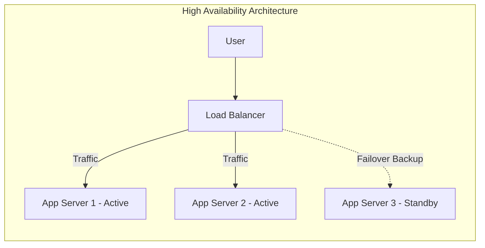
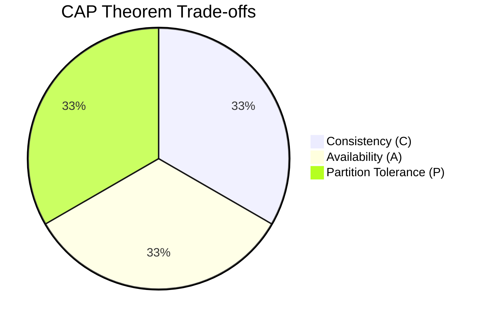

# Chapter 3 — Core Architecture Concepts
Scalability, Reliability, Availability & CAP Theorem
Practical System Design in Bangla

## 3.1 Introduction (ভূমিকা)
একটি সফটওয়্যার সিস্টেম যখন তৈরি করা হয়, শুরুতে এটি অনেক ছোট থাকে। 
ধরুন:
- মাত্র ১০ জন ইউজার।
- একটি সাধারণ সার্ভার।
- একটি মাত্র ডাটাবেজ।

এই অবস্থায় সবকিছু খুব মসৃণভাবে (smoothly) চলে। কোনো ল্যাগ বা ডিলে (delay) থাকে না। কিন্তু কয়েক বছর পর যখন সিস্টেমটি বড় হতে শুরু করে, তখন চিত্রটি পুরোপুরি বদলে যায়:
- লাখ লাখ ইউজার প্রতিদিন সিস্টেমে প্রবেশ করে।
- মাল্টিপল API কল হয়।
- মোবাইল অ্যাপ এবং থার্ড-পার্টি ইন্টিগ্রেশন (Third-party integration) যুক্ত হয়।
- রিয়েল-টাইম প্রসেসিং (Real-time processing) এবং নোটিফিকেশন সার্ভিস (Notification service) যুক্ত হয়।

তখন সিস্টেম ডিজাইনের আসল চ্যালেঞ্জ শুরু হয়। কারণ একটি এন্টারপ্রাইজ সিস্টেম (Enterprise System) শুধুমাত্র "ফিচার" দিয়ে টিকে থাকতে পারে না। একটি বড় সিস্টেমকে টিকে থাকতে হলে নিচের বিষয়গুলো শক্তভাবে সামলাতে হয়:
- **Heavy Traffic:** হঠাৎ করে ট্রাফিক বেড়ে যাওয়া।
- **Server Failure:** সার্ভার ক্র্যাশ করা।
- **Database Crash:** ডাটাবেজ লক হয়ে যাওয়া বা ক্র্যাশ করা।
- **Network Issue:** নেটওয়ার্কে সমস্যা হওয়া।
- **Security Attack:** হ্যাকিং বা ডিডস (DDoS) অ্যাটাক।

এই চ্যাপ্টারে আমরা সেই কোর আর্কিটেকচার কনসেপ্টগুলো (Core Architecture Concepts) নিয়ে বিস্তারিত জানব যেগুলো ছাড়া কোনো বড় সিস্টেম ডিজাইন করা একেবারে অসম্ভব।

---

## 3.2 Scalability (স্কেলেবিলিটি) কী?
Scalability বা প্রসারণযোগ্যতা হলো একটি সিস্টেমের সেই ক্ষমতা, যার মাধ্যমে এটি ভবিষ্যতে বৃদ্ধি পাওয়া ডেটা বা ট্রাফিক খুব সহজেই হ্যান্ডেল করতে পারে, কোনো পারফরম্যান্স ডিগ্রেডেশন (Performance degradation) বা সিস্টেম স্লো না করেই।

সহজ ভাষায়:
আজ আপনার সিস্টেমটি ১০০ জন ইউজার হ্যান্ডেল করছে। আগামী বছর যদি:
- ১ লাখ ইউজার হয়।
- ১০ লাখ রিকোয়েস্ট আসে।
- ম্যাসিভ ডেটা (Massive data) তৈরি হয়।
তাহলেও যদি আপনার সিস্টেম একইভাবে স্মুথলি কাজ করতে পারে, তবে বুঝতে হবে আপনার সিস্টেমটি **Scalable (স্কেলেবল)**।

---

## 3.3 Scalability কেন গুরুত্বপূর্ণ?
বেশিরভাগ সিস্টেম শুরুতেই খুব ফাস্ট (fast) থাকে। কারণ তখন ডেটা এবং ইউজারের পরিমাণ অনেক কম থাকে। কিন্তু যখনই স্কেল বা ইউজারের সংখ্যা বাড়তে শুরু করে, তখন সিস্টেমে নানা ধরনের সমস্যা দেখা দেয়:
- রেসপন্স টাইম (Response time) স্লো হয়ে যায়।
- ডাটাবেজে ডেডলক (Database deadlock) তৈরি হয়।
- API রিকোয়েস্ট টাইমআউট (Timeout) হতে থাকে।
- সার্ভারের মেমোরি ওভারফ্লো (Memory overflow) এবং CPU স্পাইক (CPU Spike) করে সিস্টেম ক্র্যাশ করে।

### Real Example — ERP System (বাস্তব উদাহরণ)
একটি গার্মেন্টস ফ্যাক্টরির ERP সিস্টেম শুরু হয়েছিল মাত্র:
- ৩০ জন ইউজার নিয়ে।
- একটি মাত্র ব্রাঞ্চ।
- একটি সিঙ্গেল সার্ভার।

৩ বছর পর কোম্পানির পরিধি বাড়ল:
- ২০০ এর বেশি ফ্যাক্টরি ব্রাঞ্চ।
- ২০,০০০ এর বেশি কর্মচারী।
- বায়োমেট্রিক ডিভাইস ইন্টিগ্রেশন।
- লাইভ রিপোর্টিং সিস্টেম।

**সমস্যা:**
সিস্টেমে লগইন করতে প্রচুর সময় লাগতো (Login delay)। রিপোর্ট তৈরি করতে গিয়ে টাইমআউট হয়ে যেত। ডাটাবেজে ডেডলক সৃষ্টি হতো এবং মাঝে মাঝেই IIS সার্ভার ক্র্যাশ করতো। 
**কারণ:** সিস্টেমটি স্কেলেবল আর্কিটেকচার (Scalable Architecture) দিয়ে তৈরি ছিল না। এটি ছোট স্কেলের কথা ভেবে বানানো হয়েছিল।

---

## 3.4 Types of Scalability (স্কেলেবিলিটির প্রকারভেদ)
সিস্টেম ডিজাইনে সাধারণত দুইভাবে স্কেলেবিলিটি অর্জন করা হয়:
1. **Vertical Scaling (Scale Up):** সার্ভারের ক্ষমতা বা হার্ডওয়্যার বাড়ানো।
2. **Horizontal Scaling (Scale Out):** সার্ভারের সংখ্যা বাড়ানো।

```mermaid
graph TD
    subgraph Vertical Scaling (Scale Up)
        A[Small Server<br>4GB RAM, 2 Core] -->|Upgrade| B[Big Server<br>64GB RAM, 16 Core]
    end
    
    subgraph Horizontal Scaling (Scale Out)
        C[Small Server 1] -->|Add More Servers| D[Load Balancer]
        D --> E[Server 1]
        D --> F[Server 2]
        D --> G[Server 3]
        D --> H[Server 4]
    end
```

---

## 3.5 Vertical Scaling (Scale Up) - বিস্তারিত
এখানে বিদ্যমান সার্ভারের (Existing server) রিসোর্স বা ক্ষমতা বৃদ্ধি করা হয়। 
যেমন: 
- RAM ৮ জিবি থেকে ৬৪ জিবি করা।
- CPU কোর ৪টি থেকে ৩২টি করা।
- হার্ডডিস্ক SSD তে আপগ্রেড করা।

**সুবিধা:**
- এটি করা অত্যন্ত সহজ।
- কোডে বা ডেপ্লয়মেন্টে (Deployment) কোনো পরিবর্তনের প্রয়োজন হয় না।
- কনফিগারেশন খুবই সাধারণ থাকে।

**সমস্যা:**
- এটি অনেক ব্যয়বহুল (Expensive)।
- হার্ডওয়্যার আপগ্রেড করার একটি নির্দিষ্ট লিমিট থাকে (আপনি চাইলেই একটি মেশিনে অসীম RAM বসাতে পারবেন না)।
- **Single Point of Failure (SPOF):** সার্ভারটি কোনো কারণে ক্র্যাশ করলে পুরো সিস্টেম ডাউন হয়ে যাবে।

---

## 3.6 Horizontal Scaling (Scale Out) - বিস্তারিত
এখানে সার্ভারের ক্ষমতা না বাড়িয়ে, বরং একাধিক নতুন সার্ভার যুক্ত করা হয়। এবং একটি **Load Balancer (লোড ব্যালেন্সার)** ব্যবহার করে ট্রাফিকগুলো সব সার্ভারের মধ্যে সমানভাবে ভাগ করে দেওয়া হয়।

**Architecture Flow:**
`Client Request -> Load Balancer -> Server 1 / Server 2 / Server 3`

**সুবিধা:**
- এটি Highly Scalable (যত খুশি সার্ভার বাড়ানো যায়)।
- Fault Tolerant (একটি সার্ভার নষ্ট হলে বাকিগুলো দিয়ে সিস্টেম চলতে থাকে)।
- Enterprise System এর জন্য সবচেয়ে উপযোগী।

**সমস্যা:**
- আর্কিটেকচারটি বেশ জটিল (Complex)।
- ইউজারের সেশন (Session) ম্যানেজ করা কঠিন হয়ে যায়।
- সব সার্ভার একসাথে মনিটরিং করা কিছুটা কষ্টসাধ্য।

---

## 3.7 Reliability (নির্ভরযোগ্যতা) কী?
Reliability বা নির্ভরযোগ্যতা হলো একটি সিস্টেম কতটা ধারাবাহিকভাবে এবং নির্ভুলভাবে (consistently & accurately) তার কাজ করতে পারে তার পরিমাপ। 

**উদাহরণ:**
পেমেন্ট সিস্টেমে যদি এমন হয় যে:
- ইউজারের অ্যাকাউন্ট থেকে টাকা কাটা গেছে।
- কিন্তু ট্রানজ্যাকশন (Transaction) ডাটাবেজে সেভ হয়নি।
তাহলে এই সিস্টেমটি মোটেও Reliable বা নির্ভরযোগ্য নয়।

**একটি Reliable System এর বৈশিষ্ট্য:**
- Consistent (ধারাবাহিক ফলাফল দেয়)।
- Predictable (আচরণ অনুমানযোগ্য)।
- Fault Resistant (ভুল বা ফেইলিওর সামলাতে পারে)।

---

## 3.8 Availability (প্রাপ্যতা বা এভেইলেবিলিটি) কী?
Availability হলো একটি সিস্টেম তার ইউজারদের জন্য কতটুকু সময় অ্যাক্সেসযোগ্য বা ব্যবহারযোগ্য (Accessible/Usable) থাকে। 

Availability পরিমাপের ফর্মুলা:
`Availability = Uptime / (Uptime + Downtime)`

**উদাহরণ:**
যদি কোনো সিস্টেম বছরে ৩৬৪ দিন আপ থাকে এবং ১ দিন ডাউন থাকে, তবে তার Availability:
`364 / 365 = 99.7%`

### Availability Levels (এভেইলেবিলিটির মানদণ্ড)
| Availability Level | Downtime Per Year (বছরে ডাউনটাইম) |
| --- | --- |
| 99% | প্রায় ৩.৬৫ দিন |
| 99.9% | প্রায় ৮.৭ ঘন্টা |
| 99.99% | প্রায় ৫২ মিনিট |
| 99.999% (Five Nines) | প্রায় ৫ মিনিট |



---

## 3.9 Fault Tolerance (ফল্ট টলারেন্স) কী?
Fault Tolerance বা ত্রুটি সহনশীলতা মানে হলো সিস্টেমের কোনো একটি অংশ (Component) ফেইল করলেও যেন পুরো সিস্টেম ডাউন না হয়ে যায়। সিস্টেম যেন তার কাজ চালিয়ে যেতে পারে।

**বাস্তব উদাহরণ:**
একটি ফুড ডেলিভারি অ্যাপ্লিকেশনে যদি নোটিফিকেশন সার্ভিস (Notification Service) ক্র্যাশ করে, তবে শুধু SMS বা পুশ নোটিফিকেশন যাওয়া বন্ধ হবে। কিন্তু ইউজারের অর্ডার করা এবং পেমেন্ট সিস্টেম যেন ঠিকমতো কাজ করে। এটাই হলো Fault Tolerance।

---

## 3.10 Single Point of Failure (SPOF)
SPOF বলতে সিস্টেমের এমন কোনো একটি নির্দিষ্ট অংশকে বোঝায়, যেটি ফেইল করলে পুরো সিস্টেম পুরোপুরি বন্ধ হয়ে যায়।
বড় সিস্টেমে কোনোভাবেই SPOF রাখা যাবে না।

**SPOF এর উদাহরণ:**
- শুধুমাত্র একটি ডাটাবেজ সার্ভার থাকা।
- শুধুমাত্র একটি অ্যাপ সার্ভার থাকা।
- একটি মাত্র লোড ব্যালেন্সার থাকা।

---

## 3.11 CAP Theorem (ক্যাপ থিওরেম)
ডিস্ট্রিবিউটেড সিস্টেমের (Distributed System) সবচেয়ে গুরুত্বপূর্ণ একটি থিওরি হলো CAP Theorem। এটি অনুযায়ী, একটি ডিস্ট্রিবিউটেড সিস্টেম একই সাথে নিচের ৩টি গ্যারান্টি পুরোপুরি দিতে পারে না, যেকোনো ২টি দিতে পারে:

1. **C = Consistency (ধারাবাহিকতা):** প্রতিটি নোড বা সার্ভার সবসময় একই এবং লেটেস্ট (Latest) ডেটা দেখাবে।
2. **A = Availability (প্রাপ্যতা):** প্রতিটি রিকোয়েস্টের একটি সফল বা ব্যর্থ রেসপন্স সবসময় পাওয়া যাবে, সিস্টেম কখনো হ্যাং করবে না।
3. **P = Partition Tolerance (পার্টিশন টলারেন্স):** নেটওয়ার্কের কোনো সমস্যার কারণে দুই বা ততোধিক সার্ভারের মধ্যে যোগাযোগ বিচ্ছিন্ন হলেও সিস্টেম কাজ চালিয়ে যেতে পারবে।



### CAP Theorem এর বাস্তবতা
যেহেতু ডিস্ট্রিবিউটেড সিস্টেমে নেটওয়ার্ক ইস্যু (Network Issue) হওয়াটা অনিবার্য, তাই **Partition Tolerance (P) সবসময়ের জন্য বাধ্যতামূলক**। 
ফলে আমাদের দুটি অপশনের মধ্যে যেকোনো একটি বেছে নিতে হয়:
- **CP System (Consistency + Partition Tolerance):** 
  ব্যাংকিং সিস্টেমে এটি ব্যবহার হয়। নেটওয়ার্ক ডাউন থাকলে সিস্টেম এরর দিবে (Availability কমবে), কিন্তু ভুল ব্যালেন্স দেখাবে না।
- **AP System (Availability + Partition Tolerance):** 
  সোশ্যাল মিডিয়াতে (যেমন ফেসবুক) এটি ব্যবহার হয়। পোস্ট সাথে সাথে আপডেট না হলেও সিস্টেম সবসময় রেসপন্স করবে এবং চলবে।

---

## 3.12 Chapter Summary (সারসংক্ষেপ)
এই চ্যাপ্টারে আমরা বিস্তারিতভাবে শিখলাম:
- **Scalability:** সিস্টেম কীভাবে বড় ট্রাফিক হ্যান্ডেল করতে পারে (Vertical vs Horizontal)।
- **Reliability ও Availability:** সিস্টেমের নির্ভরযোগ্যতা এবং এটি কতটুকু সময় সচল থাকে।
- **Fault Tolerance ও SPOF:** সিস্টেমের কোনো অংশ নষ্ট হলেও কাজ চালিয়ে যাওয়ার ক্ষমতা এবং এর ডিজাইনের গুরুত্ব।
- **CAP Theorem:** ডিস্ট্রিবিউটেড সিস্টেমের সবচেয়ে মৌলিক থিওরি এবং এর ট্রেড-অফ (Trade-offs)।

এই কনসেপ্টগুলো মাথায় রাখা একজন সল্যুশন আর্কিটেক্ট (Solution Architect) বা সিনিয়র ইঞ্জিনিয়ারের প্রধান কাজ। পরবর্তী চ্যাপ্টারে আমরা ডাটাবেজ স্কেলিং নিয়ে বিস্তারিত জানব।