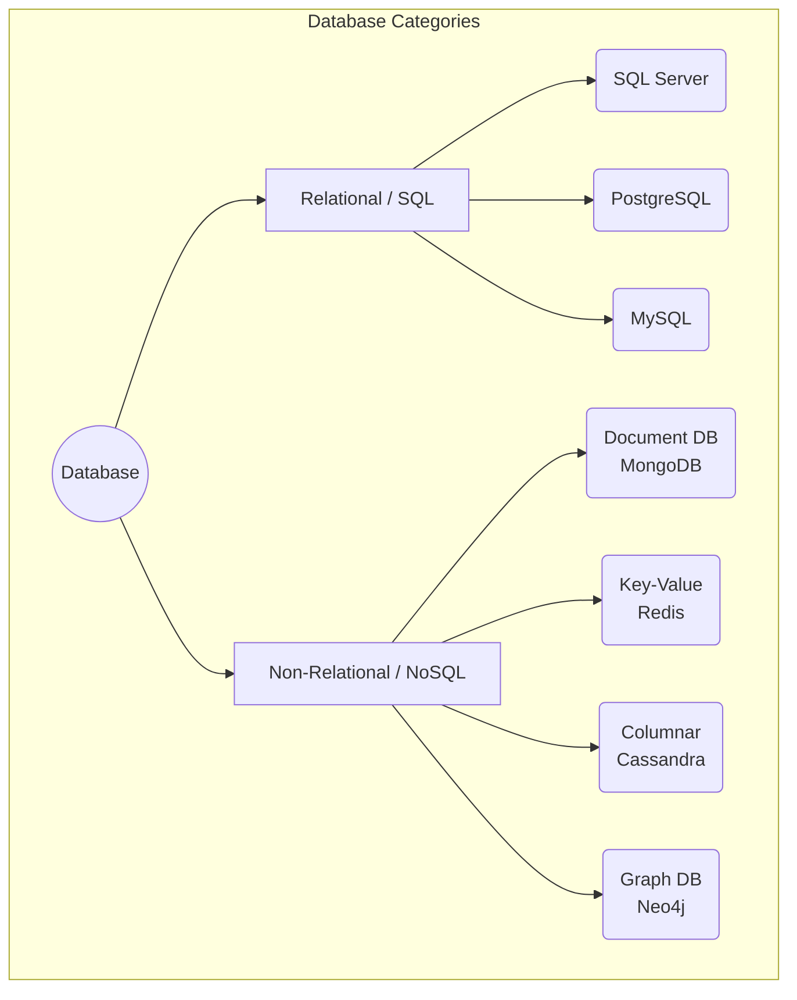
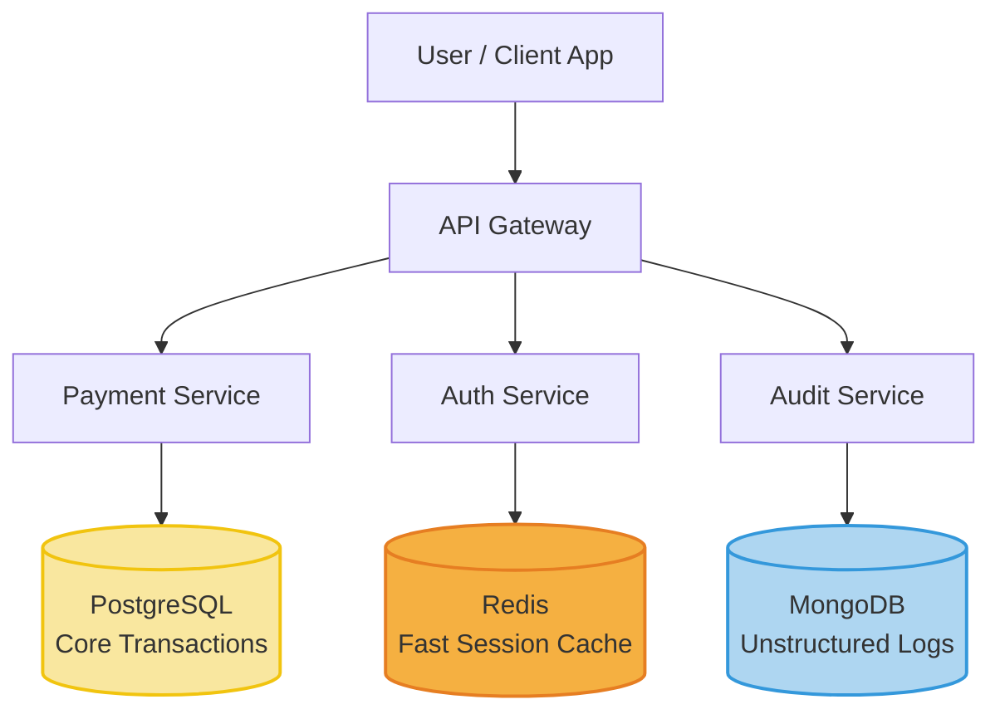
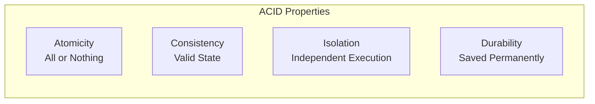
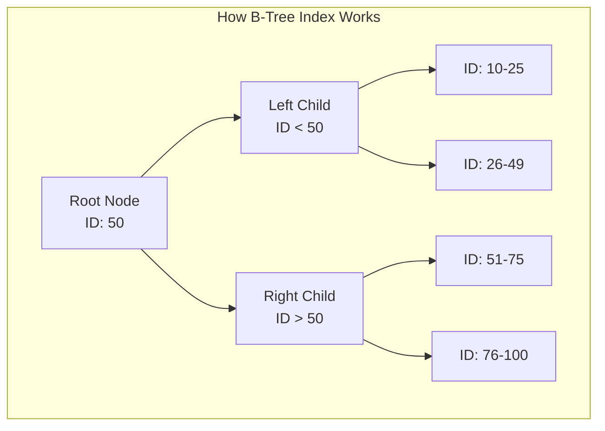

# Chapter 4 — Database Design Fundamentals
SQL, NoSQL, Indexing, Transactions & Enterprise Database Thinking
Practical System Design in Bangla

## 4.1 Introduction (ভূমিকা)
একটি সফটওয়্যার সিস্টেমের প্রাণ বা হার্ট (Heart) হলো তার ডাটাবেজ (Database)। 
অ্যাপ্লিকেশনের কোড ভুল হলে বা স্লো হলে তা পরিবর্তন করা তুলনামূলকভাবে সহজ। কিন্তু ডাটাবেজ ডিজাইনে যদি বড় ধরনের কোনো ভুল থাকে, তবে তার প্রভাব পুরো সিস্টেমের ওপর ভয়াবহ হতে পারে।

কারণ একটি ডাটাবেজ শুধু ডেটা সেভ করে না, এটি হ্যান্ডেল করে:
- **Business Data:** গুরুত্বপূর্ণ ব্যাবসায়িক তথ্য।
- **Transactions:** টাকা বা অর্ডারের লেনদেন।
- **Reporting & Analytics:** মাস বা বছর শেষের বিশাল বিশাল রিপোর্ট।
- **Concurrency:** একই সময়ে হাজার হাজার ইউজারের রিকোয়েস্ট।

অনেক জুনিয়র ডেভেলপার মনে করে: *"কয়েকটি টেবিল (Table) তৈরি করলেই ডাটাবেজ ডিজাইন শেষ।"*
কিন্তু এন্টারপ্রাইজ লেভেলে (Enterprise Level) ডাটাবেজ ডিজাইন মানে হলো স্কেলেবিলিটি (Scalability), পারফরম্যান্স (Performance), কনকারেন্সি (Concurrency), ইনডেক্সিং (Indexing) এবং ব্যাকআপ রিকভারি (Backup & Recovery) একসাথে মেইনটেইন করা।

---

## 4.2 Real Production Story — Bad Database Design (ডাটাবেজ ডিজাইনের ভুল এবং তার পরিণতি)
একটি ইআরপি (ERP) সিস্টেমের শুরুতে:
- ইউজার ছিল ২০ জন।
- একটি মাত্র ব্রাঞ্চ।
- সিস্টেমটি খুবই ফাস্ট (Fast) কাজ করছিল।

**ডাটাবেজের অবস্থা ছিল এমন:**
- কোনো ইনডেক্সিং (Indexing) ছিল না।
- টেবিলগুলো ছিল বিশাল, কোনো সম্পর্ক (Normalization) ঠিকমতো ছিল না।
- সব ফিল্ডে অযথাই `VARCHAR(MAX)` ব্যবহার করা হয়েছিল।
- পুরনো ডেটা আর্কাইভ (Archive) করার কোনো মেকানিজম ছিল না।

**৩ বছর পর সিস্টেমের অবস্থা:**
- ১৫০০ এর বেশি ব্রাঞ্চ যুক্ত হয়েছে।
- কোটি কোটি ট্রানজ্যাকশন হচ্ছে।
- API কল করতে গেলেই টাইমআউট (Timeout) দেখাচ্ছে।
- একটি সাধারণ রিপোর্ট লোড হতে ৫-১০ মিনিট সময় নিচ্ছে।
- প্রায়ই ডেডলক (Deadlock) তৈরি হয়ে সিস্টেম হ্যাং করে যাচ্ছে।

**সমাধান:** 
পুরো ডাটাবেজটিকে নতুন করে রিডিজাইন (Redesign) করতে হয়েছিল, যা ছিল অত্যন্ত ব্যয়বহুল এবং সময়সাপেক্ষ। একটি ভুল ডাটাবেজ আর্কিটেকচার পুরো কোম্পানিকে ব্যবসায়িক ক্ষতির মুখে ফেলতে পারে।

---

## 4.3 Database কী এবং এর প্রকারভেদ
Database হলো সুসংগঠিতভাবে ডেটা সংরক্ষণ করার একটি ব্যবস্থা। প্রধানত ডাটাবেজ দুই প্রকারের হয়ে থাকে:

1. **Relational Database (SQL):** SQL Server, PostgreSQL, MySQL, Oracle.
2. **Non-Relational Database (NoSQL):** MongoDB, Cassandra, Redis, DynamoDB.

---

## 4.4 SQL Database (রিলেশনাল ডাটাবেজ)
SQL ডাটাবেজগুলো একটি নির্দিষ্ট টেবিল স্ট্রাকচার (Table Structure) বা স্কিমা (Schema) মেনে চলে। ডেটা রো (Row) এবং কলাম (Column) আকারে সেভ হয়।

**মূল বৈশিষ্ট্য:**
- **Structured Schema:** টেবিলের কলাম আগে থেকেই ঠিক করা থাকে। কলামের বাইরে কোনো ডেটা ঢোকানো যায় না।
- **ACID Transactions:** ডেটার কনসিস্টেন্সি (Consistency) বা নির্ভরযোগ্যতা শতভাগ নিশ্চিত করে।
- **Relationship Support:** Foreign Key এর মাধ্যমে একাধিক টেবিলের (যেমন: User এবং Order টেবিল) মধ্যে চমৎকার সম্পর্ক তৈরি করা যায়।

> **কখন SQL ব্যবহার করবেন?**
> যখন সিস্টেমে ট্রানজ্যাকশন, রিপোর্ট এবং ডেটার নির্ভুলতা সবচেয়ে বেশি জরুরি। যেমন: ব্যাংকিং সিস্টেম (Banking System), অ্যাকাউন্টিং (Accounting / ERP), ইনভেন্টরি ম্যানেজমেন্ট (Inventory)।

---

## 4.5 NoSQL Database (নন-রিলেশনাল ডাটাবেজ)
NoSQL ডাটাবেজে কোনো ফিক্সড স্কিমা (Fixed Schema) থাকে না। ডেটাগুলো সাধারণত JSON ডকুমেন্টের মতো করে সেভ হয়।

**মূল বৈশিষ্ট্য:**
- **Flexible Schema:** যেকোনো সময় ডেটার ফিল্ড পরিবর্তন করা যায়। আগের ডেটার ওপর কোনো প্রভাব পড়ে না।
- **Horizontally Scalable:** অনেকগুলো সার্ভারে খুব সহজেই ডেটা ছড়িয়ে (Distributed) দেওয়া যায়।
- **High Write Throughput:** প্রতি সেকেন্ডে লক্ষ লক্ষ ডেটা রাইট (Write) করার ক্ষমতা রাখে।

> **কখন NoSQL ব্যবহার করবেন?**
> যখন সিস্টেমে প্রচুর পরিমাণে আনস্ট্রাকচার্ড ডেটা (Unstructured Data) এবং হাই স্কেল (High Scale) দরকার হয়। যেমন: সোশ্যাল মিডিয়া (ফেসবুকের পোস্ট বা কমেন্ট), রিয়েল-টাইম এনালিটিক্স (Real-time Analytics), আইওটি (IoT Sensor Data)।

### SQL vs NoSQL: একটি তুলনামূলক চিত্র

| বৈশিষ্ট্য (Feature) | SQL (যেমন: PostgreSQL) | NoSQL (যেমন: MongoDB) |
| --- | --- | --- |
| **Schema (স্কিমা)** | ফিক্সড বা নির্দিষ্ট | ফ্লেক্সিবল বা পরিবর্তনশীল |
| **Transaction** | ১০০% ACID গ্যারান্টি দেয় | খুবই লিমিটেড সাপোর্ট |
| **Scaling (স্কেলিং)** | ভার্টিক্যালি স্কেল করা সহজ | হরাইজন্টালি স্কেল করা খুব সহজ |
| **Relationship** | Foreign Key দিয়ে অত্যন্ত শক্তিশালী | সাধারণত রেফারেন্স দিয়ে করা হয় (দুর্বল) |
| **Data Format** | Row এবং Column (টেবিল) | JSON, Key-Value, Graph |

---

## 4.6 Hybrid Database Architecture (হাইব্রিড আর্কিটেকচার)
বড় বড় এন্টারপ্রাইজ সিস্টেমে সাধারণত একটিমাত্র ডাটাবেজ দিয়ে সব কাজ করা হয় না। কাজের ধরন অনুযায়ী একাধিক ডাটাবেজ একসাথে ব্যবহার করা হয়। একে পলিগ্লট পারসিস্টেন্স (Polyglot Persistence) বলা হয়।

**বাস্তব উদাহরণ (Fintech System):**
- **Transactions:** টাকার লেনদেনের জন্য `SQL Server` বা `PostgreSQL` ব্যবহার হয়।
- **Cache / Session:** ইউজারের লগইন সেশন দ্রুত লোড করার জন্য `Redis` ব্যবহার হয়।
- **Activity Logging:** ইউজার সিস্টেমে কোথায় কোথায় ক্লিক করছে, তার লগ রাখার জন্য `MongoDB` ব্যবহার হয়।

---

## 4.7 Transactions এবং ACID Properties
একটি Transaction হলো একাধিক ডেটাবেজ অপারেশনের একটি বান্ডেল, যা একটি একক ইউনিট হিসেবে কাজ করে।

**উদাহরণ (টাকা ট্রান্সফার):**
১. রহিম এর অ্যাকাউন্ট থেকে ১০০০ টাকা কাটা হবে।
২. করিম এর অ্যাকাউন্টে ১০০০ টাকা যোগ হবে।

এই দুটি কাজ মিলে একটি Transaction। যদি কোনো কারণে ২ নম্বর কাজটি ব্যর্থ হয়, তবে ১ নম্বর কাজটি বাতিল (Rollback) হয়ে যাবে। রহিমের টাকা ফেরত চলে আসবে। ডাটাবেজে এই নিশ্চয়তা দেওয়ার জন্য **ACID Properties** ব্যবহার করা হয়।

- **A = Atomicity (অ্যাটমিসিটি):** সব কাজ সফল হবে, অথবা কোনো কাজই হবে না। অর্ধেক ট্রানজ্যাকশন কখনো সেভ হবে না।
- **C = Consistency (কনসিস্টেন্সি):** ডেটা সবসময় একটি সঠিক এবং ভ্যালিড অবস্থায় (Valid state) থাকবে।
- **I = Isolation (আইসোলেশন):** একাধিক ইউজার একই সাথে ডেটাবেজে ট্রানজ্যাকশন করলেও একটির প্রভাব আরেকটির ওপর পড়বে না।
- **D = Durability (ডিউরেবিলিটি):** একবার ট্রানজ্যাকশন সেভ (Commit) হয়ে গেলে, সার্ভার রিস্টার্ট নিলেও সেই ডেটা হারিয়ে যাবে না।

---

## 4.8 Indexing (ইনডেক্সিং) এবং Query Optimization
বইয়ের পেছনে যেমন একটি Index পেজ থাকে, যা দিয়ে যেকোনো টপিক খুব দ্রুত খুঁজে বের করা যায়, ডাটাবেজের Index-ও ঠিক একইভাবে কাজ করে। সাধারণত ডাটাবেজে B-Tree (Balanced Tree) ডেটা স্ট্রাকচার ব্যবহার করে ইনডেক্সিং করা হয়।

### ইনডেক্স ছাড়া (Full Table Scan):
আপনি যদি ১০ লাখ ইউজারের একটি টেবিল থেকে রহিমের নাম খুঁজতে যান, ডাটাবেজকে ১ থেকে ১০ লাখ পর্যন্ত সবগুলো রো (Row) স্ক্যান করে চেক করতে হবে। এটি ডাটাবেজকে ভয়াবহ স্লো করে দেয়। একে বলা হয় O(N) কমপ্লেক্সিটি।

### ইনডেক্স ব্যবহার করলে (Index Seek):
ডাটাবেজ সরাসরি ইনডেক্সিং ট্রি (B-Tree) ব্যবহার করে মাত্র কয়েক মিলি-সেকেন্ডের মধ্যে রহিমের ডেটা খুঁজে বের করে আনবে। এটি O(log N) কমপ্লেক্সিটিতে কাজ করে, যা অত্যন্ত দ্রুত।

**সতর্কতা (Over Indexing Problem):**
অতিরিক্ত ইনডেক্স তৈরি করলে ডেটা রিড (Read/Select) ফাস্ট হয় ঠিকই, কিন্তু নতুন ডেটা ইনসার্ট (Insert) বা আপডেট (Update) করার সময় ডাটাবেজ চরম স্লো হয়ে যায়। কারণ প্রতিটি ইনসার্টের সময় সবগুলো ইনডেক্স রি-ক্যালকুলেট (Re-calculate) করতে হয়। 
এন্টারপ্রাইজ ডাটাবেজ অ্যাডমিনিস্ট্রেটরদের (DBA) গোল্ডেন রুল হলো: *"Every index has a cost. Use them wisely."*

---

## 4.9 Chapter Summary (সারসংক্ষেপ)
এই চ্যাপ্টারে আমরা শিখলাম:
- **Database Design এর গুরুত্ব:** কেন একটি ভুল ডিজাইন পুরো সিস্টেমকে ধসিয়ে দিতে পারে।
- **SQL vs NoSQL:** ডাটাবেজের প্রকারভেদ এবং প্রোজেক্ট অনুযায়ী সঠিক ডাটাবেজ নির্বাচন।
- **Hybrid Database:** বড় সিস্টেমে একাধিক ভিন্ন প্রযুক্তির ডাটাবেজের ব্যবহার।
- **Transactions & ACID:** ব্যাংকিং ও ইআরপি সিস্টেমে ডেটার ১০০% কনসিস্টেন্সি কীভাবে মেইনটেইন করা হয়।
- **Indexing & B-Tree:** কীভাবে ফুল টেবিল স্ক্যান (Full Table Scan) এড়িয়ে কুয়েরি পারফরম্যান্স (Query performance) হাজার গুণ ফাস্ট করা যায়।

পরবর্তী চ্যাপ্টারে আমরা ডাটাবেজের অ্যাডভান্সড স্কেলিং (Advanced Database Scaling), পার্টিশনিং (Partitioning) এবং রিড রেপ্লিকা (Read Replica) নিয়ে বিস্তারিত জানব।