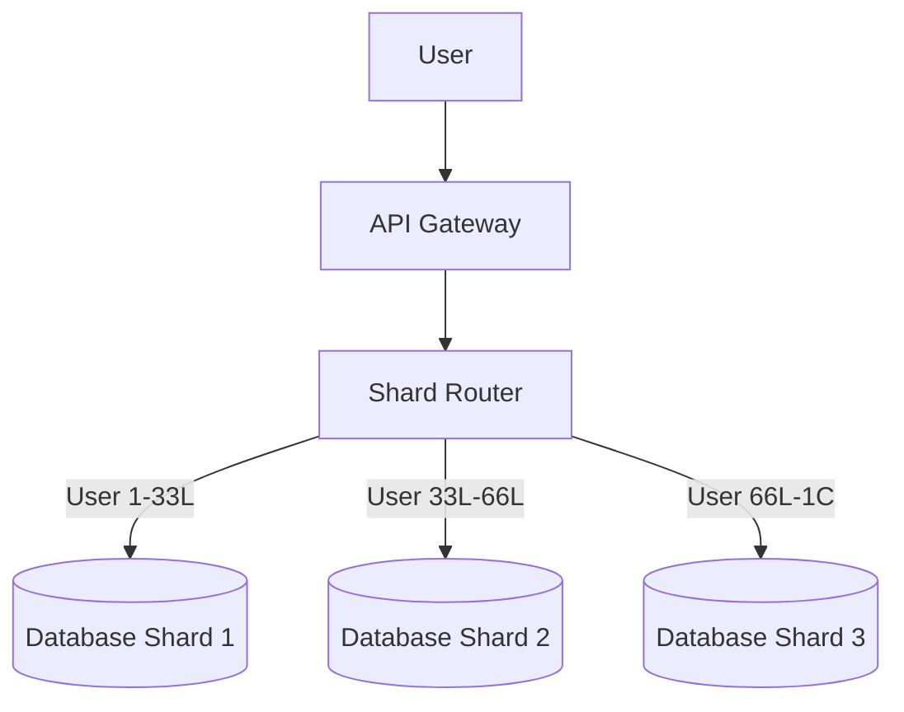

# Chapter 5 — Advanced Database Scaling & High Performance Architecture
Partitioning, Sharding, Replication, CQRS & Billion Scale Data Systems
Practical System Design in Bangla

## 5.1 Introduction (ভূমিকা)
ডাটাবেজ ডিজাইন করা এক জিনিস, কিন্তু ডাটাবেজকে স্কেল (Scale) করা সম্পূর্ণ আলাদা এবং অত্যন্ত জটিল একটি দক্ষতা (Skill)।
ছোট সিস্টেমে:
- একটিমাত্র ডাটাবেজ থাকে।
- ১০টি টেবিল থাকে।
- ১০০ জন ইউজার থাকে।
এ অবস্থায় সবকিছু চমৎকারভাবে কাজ করে। কিন্তু যখন সিস্টেম বড় হয়ে যায়:
- লাখো ইউজার একসাথে সিস্টেমে ঢোকে।
- কোটি কোটি ট্রানজ্যাকশন হতে থাকে।
- রিয়েল-টাইম এনালিটিক্স এবং মোবাইল API এর রিকোয়েস্ট আসতে থাকে।

ঠিক তখন ডাটাবেজ হয়ে যায় পুরো সিস্টেমের সবচেয়ে বড় বটলনেক (Bottleneck) বা বাধা। কারণ সার্ভার খুব সহজে স্কেল করা গেলেও, ডাটাবেজ স্কেল করা অনেক কঠিন।

---

## 5.2 Database Scaling কেন এত কঠিন?
সার্ভার (যেমন API Server) স্কেল করা খুব সহজ, কারণ তারা সাধারণত স্টেটলেস (Stateless) হয়। কিন্তু ডাটাবেজের ভেতরে স্টেট বা ডেটা থাকে। ডাটাবেজ স্কেলিং কঠিন হওয়ার মূল কারণগুলো হলো:
1. **Data Consistency (ধারাবাহিকতা):** ডেটা একাধিক সার্ভারে ছড়িয়ে দিলেও সব জায়গায় যেন একই ডেটা দেখায়, তা নিশ্চিত করা খুব কঠিন।
2. **Transaction Safety:** ব্যাংকের লেনদেনের মতো বিষয়গুলো যেন কোনোভাবেই মাঝপথে আটকে না যায় তা নিশ্চিত করতে হয়।
3. **Concurrency:** একই সময়ে একাধিক ইউজার একই ডেটা মডিফাই করার চেষ্টা করলে কে আগে সুযোগ পাবে, তা সামলানো।

---

## 5.3 Vertical vs Horizontal Database Scaling

### Vertical Scaling (Scale Up)
আপনার বিদ্যমান ডাটাবেজ সার্ভারের সিপিইউ (CPU), র‍্যাম (RAM) এবং এসএসডি (SSD) বাড়িয়ে দেওয়া।
- **সমস্যা:** এর একটি নির্দিষ্ট লিমিট আছে এবং এটি অত্যন্ত ব্যয়বহুল। এছাড়া সার্ভার ক্র্যাশ করলে সব ডেটা অফলাইন হয়ে যায় (Single Point of Failure)।

### Horizontal Scaling (Scale Out)
ডাটাবেজের ডেটাগুলোকে অনেকগুলো ছোট ছোট ডাটাবেজ সার্ভারে ভাগ করে দেওয়া।
- **সুবিধা:** এটি আনলিমিটেড স্কেল (Unlimited Scale) করা যায় এবং ফল্ট টলারেন্ট (Fault tolerant)।

---

## 5.4 Database Partitioning (পার্টিশনিং)
Partitioning মানে হলো একটি বিশাল টেবিলকে লজিক্যালি ছোট ছোট ভাগে ভাগ করে দেওয়া, যাতে কুয়েরি খুব দ্রুত কাজ করে।

**উদাহরণ (Range Partitioning):**
ধরি একটি `Transactions` টেবিলে ১০ কোটি ডেটা আছে। আমরা এটিকে মাস অনুযায়ী ভাগ করতে পারি:
- Partition 1: January Data
- Partition 2: February Data
- Partition 3: March Data

**সুবিধা:** 
যখন কোনো ইউজার শুধু ফেব্রুয়ারির ডেটা খুঁজবে, তখন ডাটাবেজকে ১০ কোটি ডেটা স্ক্যান করতে হবে না। সে সরাসরি Partition 2 থেকে ডেটা নিয়ে আসবে। এতে পারফরম্যান্স ম্যাজিকের মতো ইম্প্রুভ করে।

---

## 5.5 Database Sharding (শার্ডিং)
Sharding হলো ডাটাবেজকে হরাইজন্টালি (Horizontally) ভাগ করা। অর্থাৎ, ডেটাগুলোকে ফিজিক্যালি (Physically) আলাদা আলাদা ডাটাবেজ সার্ভারে স্টোর করা।

**কীভাবে কাজ করে?**
ধরি, আমাদের ১ কোটি ইউজার আছে। আমরা ৩টি ডাটাবেজ (Shard) তৈরি করলাম:
- **Shard 1 (DB 1):** User ID 1 থেকে 33 Lakh পর্যন্ত।
- **Shard 2 (DB 2):** User ID 33 Lakh থেকে 66 Lakh পর্যন্ত।
- **Shard 3 (DB 3):** User ID 66 Lakh থেকে 1 Crore পর্যন্ত।



**Sharding এর চ্যালেঞ্জ:**
- এক Shard এর ডেটার সাথে অন্য Shard এর ডেটা জয়েন (JOIN) করা যায় না।
- ডিস্ট্রিবিউটেড ট্রানজ্যাকশন (Distributed transaction) মেইনটেইন করা অত্যন্ত জটিল।

---

## 5.6 Database Replication (রেপ্লিকেশন)
Replication মানে হলো মূল ডাটাবেজের ডেটা হুবহু কপি করে অন্য একাধিক ডাটাবেজ সার্ভারে রাখা।

**Master-Slave (বা Primary-Replica) Architecture:**
- **Primary DB (Master):** শুধুমাত্র নতুন ডেটা ইনসার্ট (Insert/Write) করার জন্য ব্যবহার হয়।
- **Replica DB (Slave):** শুধুমাত্র ডেটা রিড (Read/Select) করার জন্য ব্যবহার হয়।

**কেন এটি গুরুত্বপূর্ণ?**
বেশিরভাগ সিস্টেমে (যেমন ই-কমার্স বা সোশ্যাল মিডিয়া) Write এর চেয়ে Read অনেক বেশি হয়। Read Replica ব্যবহার করলে Primary ডাটাবেজের ওপর থেকে প্রচুর লোড কমে যায়।

```mermaid
graph LR
    API[Application API] -->|Write (Insert/Update)| Primary[(Primary Database)]
    Primary -->|Async Sync| Replica1[(Read Replica 1)]
    Primary -->|Async Sync| Replica2[(Read Replica 2)]
    API -->|Read (Select)| Replica1
    API -->|Read (Select)| Replica2
```

---

## 5.7 CQRS Pattern (সি-কিউ-আর-এস)
CQRS এর পূর্ণরূপ হলো **Command Query Responsibility Segregation**।
এর মূল কথা হলো: ডেটা Write করার লজিক এবং ডেটা Read (Report) করার লজিক সম্পূর্ণ আলাদা করে ফেলা।

**বাস্তব উদাহরণ (ERP System):**
ইআরপি সিস্টেমে যখন মাসের শেষে বিশাল রিপোর্ট (Report) জেনারেট করা হয়, তখন পুরো ডাটাবেজ স্লো হয়ে যায়। এর সমাধান হিসেবে CQRS ব্যবহার করা হয়:
- **Write Database:** শুধুমাত্র ট্রানজ্যাকশনের জন্য (খুবই দ্রুত কাজ করে)।
- **Read Database (Reporting):** ব্যাকগ্রাউন্ডে মেসেজ কিউ (Kafka/RabbitMQ) এর মাধ্যমে Write DB থেকে ডেটা এখানে সিঙ্ক (Sync) হয়। সব ভারী রিপোর্ট এখান থেকে জেনারেট হয়, ফলে মেইন সিস্টেমে কোনো সমস্যা হয় না।

---

## 5.8 Chapter Summary (সারসংক্ষেপ)
এই চ্যাপ্টারে আমরা ডাটাবেজ স্কেলিং এর কোর কনসেপ্টগুলো শিখলাম:
- **Vertical vs Horizontal Scaling:** ডাটাবেজ সার্ভার বড় করা বনাম সার্ভারের সংখ্যা বাড়ানো।
- **Partitioning:** একটি বড় টেবিলকে লজিক্যাল ছোট অংশে ভাগ করে কুয়েরি ফাস্ট করা।
- **Sharding:** বিশাল ডেটাকে একাধিক ফিজিক্যাল সার্ভারে ডিস্ট্রিবিউট করা।
- **Replication ও Read Replica:** রিড এবং রাইট অপারেশন আলাদা করে পারফরম্যান্স বৃদ্ধি করা।
- **CQRS:** ট্রানজ্যাকশন এবং রিপোর্টিং ডাটাবেজ পুরোপুরি আলাদা করে ফেলা।
