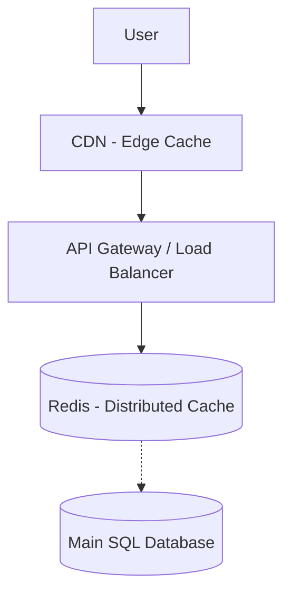

# Chapter 6 — Caching Architecture & Performance Engineering
Redis, Distributed Cache, CDN, Cache Invalidation & Real Production Scaling
Practical System Design in Bangla

## 6.1 Introduction (ভূমিকা)
একটি সিস্টেম স্লো (Slow) হওয়ার সবচেয়ে সাধারণ এবং প্রধান কারণ হলো: 
> "প্রতিটি রিকোয়েস্ট সরাসরি ডাটাবেজে হিট করছে।"

ছোট সিস্টেমে এটি কোনো সমস্যা নয়। কিন্তু সিস্টেম যখন বড় হয় এবং ট্রাফিক বাড়ে, তখন ডাটাবেজে একই ডেটার জন্য বারবার কুয়েরি (Query) আসতে থাকে। এর ফলে:
- ডাটাবেজ ওভারলোড (Overload) হয়ে যায়।
- CPU স্পাইক (Spike) করে ১০০% এ চলে যায়।
- API রেসপন্স স্লো হয়ে যায় বা টাইমআউট (Timeout) মারে।

এই সমস্যার চূড়ান্ত সমাধান হলো **Caching (ক্যাশিং)**। ক্যাশিং ব্যবহার করে আমরা আমাদের সিস্টেমকে ১০ থেকে ১০০ গুণ পর্যন্ত ফাস্ট (Faster) করতে পারি।

---

## 6.2 Caching (ক্যাশিং) কী?
ক্যাশিং হলো এমন একটি টেকনিক যেখানে ফ্রিকোয়েন্টলি ব্যবহৃত (Frequently used) বা বারবার প্রয়োজন হয় এমন ডেটাকে অত্যন্ত দ্রুতগতি সম্পন্ন একটি অস্থায়ী স্টোরেজে (Temporary Storage) সেভ করে রাখা হয়।

**মূল থিওরি:**
- **ডাটাবেজ:** পার্মানেন্ট বা স্থায়ী, কিন্তু ডেটা পড়ে আনতে বেশ সময় লাগে (ধীরগতি)।
- **ক্যাশ:** টেম্পোরারি বা অস্থায়ী, কিন্তু এটি র‍্যাম (RAM) থেকে চলে বলে এর গতি অকল্পনীয় রকমের ফাস্ট (ন্যানোসেকেন্ড বা মিলি-সেকেন্ড)।

---

## 6.3 Real Production Story — Disaster without Cache (ক্যাশ ছাড়া প্রোডাকশন বিপর্যয়)
একটি ইআরপি (ERP) সিস্টেমে প্রতিদিন ৫০০০ কনকারেন্ট (Concurrent) ইউজার লগইন করতো।
সিস্টেমের ড্যাশবোর্ডে (Dashboard) বেশ কিছু ভারী SQL কুয়েরি ছিল, যেগুলো কোম্পানির সারা মাসের আয়-ব্যয় এবং স্টক রিপোর্ট দেখাতো।

**সমস্যা:**
প্রতিবার কোনো ইউজার ড্যাশবোর্ডে গেলেই সরাসরি ডাটাবেজে হিট হতো। 
একই রিপোর্ট বারবার ডাটাবেজ থেকে ক্যালকুলেট করার কারণে ডাটাবেজের CPU ৯৫%+ ব্যবহার হতে থাকে। ফলাফল হিসেবে পুরো সিস্টেম হ্যাং (hang) করে যায় এবং একটি পেজ লোড হতে ৮-১২ সেকেন্ড সময় নিতে থাকে।

**সমাধান (Solution):**
এখানে Redis Cache ইমপ্লিমেন্ট (Implement) করা হয়। ড্যাশবোর্ডের ডেটা একবার ডাটাবেজ থেকে ক্যালকুলেট করে Redis-এ ৫ মিনিটের জন্য (TTL) সেভ করে রাখা হয়। পরবর্তী ৫ মিনিটে যত ইউজার ড্যাশবোর্ডে আসে, সবাই সরাসরি Redis থেকে ডেটা দেখতে পায়, ডাটাবেজে কোনো হিট যায় না।
**ফলাফল:** ১২ সেকেন্ডের রেসপন্স টাইম কমে ২০০ মিলি-সেকেন্ডে নেমে আসে!

---

## 6.4 Cache Types (ক্যাশের প্রকারভেদ)

1. **In-Memory Cache (ইন-মেমোরি ক্যাশ):** 
   এটি অ্যাপ্লিকেশন সার্ভারের নিজস্ব র‍্যামের (RAM) মধ্যে থাকে। যেমন .NET এর MemoryCache বা Java এর HashMap। এটি সবচেয়ে ফাস্ট হলেও একটি বড় সমস্যা হলো—সার্ভার রিস্টার্ট দিলে সব ক্যাশ মুছে যায় এবং একাধিক সার্ভারের মধ্যে ক্যাশ শেয়ার করা যায় না।

2. **Distributed Cache (ডিস্ট্রিবিউটেড ক্যাশ - Redis):** 
   একাধিক সার্ভার মিলে একটি কমন (Common) ক্যাশ সার্ভার ব্যবহার করে। এটি স্কেলেবল সিস্টেমের জন্য সবচেয়ে জনপ্রিয়। **Redis (Remote Dictionary Server)** হলো পৃথিবীর সবচেয়ে ফাস্ট এবং বহুল ব্যবহৃত ডিস্ট্রিবিউটেড ক্যাশ।

3. **CDN Cache (সিডিএন ক্যাশ):** 
   যেকোনো স্ট্যাটিক ফাইল (Static Files) যেমন ইমেজ, ভিডিও, CSS বা JS ফাইলগুলো পৃথিবীর বিভিন্ন প্রান্তের সার্ভারে ক্যাশ করে রাখা হয়, যাতে ইউজার খুব দ্রুত তা ডাউনলোড করতে পারে।

---

## 6.5 Cache Patterns (ক্যাশিং প্যাটার্ন)
সিস্টেমে কীভাবে ক্যাশ ব্যবহার করা হবে তার বেশ কিছু প্যাটার্ন আছে।

### 1. Cache Aside (Lazy Loading) - সবচেয়ে বেশি ব্যবহৃত
**যেভাবে কাজ করে:**
- ইউজার API কল করলে সিস্টেম প্রথমে Redis (Cache) এ চেক করে।
- ডেটা পাওয়া গেলে (Cache Hit) সরাসরি ইউজারকে রিটার্ন করে।
- ডেটা না পাওয়া গেলে (Cache Miss) ডাটাবেজ থেকে ডেটা আনে, Redis এ সেভ করে এবং তারপর ইউজারকে দেয়।

### 2. Write Through Cache
এখানে কোনো নতুন ডেটা তৈরি বা আপডেট করার সময় একই সাথে ডাটাবেজ এবং ক্যাশ দুই জায়গাতেই আপডেট করা হয়। ফলে ডাটাবেজ এবং ক্যাশ সবসময় সিঙ্ক (Sync) থাকে।

---

## 6.6 Cache Invalidation Problem (ক্যাশ ইনভ্যালিডেশন)
কম্পিউটার সায়েন্সে একটি বিখ্যাত প্রবাদ আছে:
> "There are only two hard things in Computer Science: cache invalidation and naming things."

**ক্যাশ ইনভ্যালিডেশন কী?**
ধরুন, ইউজারের প্রোফাইল ডেটা Redis এ ক্যাশ করা আছে। ইউজার তার নাম পরিবর্তন করল (ডাটাবেজে আপডেট হলো)। কিন্তু ক্যাশ যদি আপডেট না হয়, তবে ইউজার তার আগের নামই দেখতে পাবে।
সঠিক সময়ে ক্যাশ মুছে ফেলা বা আপডেট করাকেই Cache Invalidation বলে।

**সমাধান (TTL - Time To Live):**
প্রতিটি ক্যাশ ডেটার একটি এক্সপায়ারি টাইম (Expiry time) বা TTL সেট করে দেওয়া হয়। যেমন ৫ মিনিট। ৫ মিনিট পর ক্যাশটি স্বয়ংক্রিয়ভাবে মুছে যাবে এবং ডাটাবেজ থেকে নতুন ডেটা এসে আবার সেভ হবে।

---

## 6.7 Cache Stampede Problem (ক্যাশ স্ট্যাম্পেড)
বড় সিস্টেমে এটি একটি ভয়াবহ সমস্যা।
ধরুন, ই-কমার্সের একটি জনপ্রিয় প্রোডাক্টের পেজ ক্যাশ করা আছে এবং এর TTL ৫ মিনিট।
৫ মিনিট পর ঠিক যখন ক্যাশটি এক্সপায়ার (Expire) হলো, ওই একই মুহূর্তে ২০ হাজার ইউজার প্রোডাক্ট পেজটিতে ভিজিট করল। যেহেতু ক্যাশ খালি, তাই ২০ হাজার রিকোয়েস্ট একই সাথে সরাসরি ডাটাবেজে হিট করবে এবং ডাটাবেজ সাথে সাথে ক্র্যাশ করবে!

**সমাধান:**
- **Cache Locking:** প্রথম রিকোয়েস্টটিকে ডাটাবেজে পাঠিয়ে বাকি রিকোয়েস্টগুলোকে কয়েক মিলি-সেকেন্ড অপেক্ষা করানো হয়।
- **Cache Pre-warming:** ক্যাশ এক্সপায়ার হওয়ার আগেই ব্যাকগ্রাউন্ড ওয়ার্কার দিয়ে নতুন ক্যাশ জেনারেট করে রাখা।

---

## 6.8 CDN (Content Delivery Network) - বিস্তারিত
CDN হলো গ্লোবাল এজ সার্ভারের (Global Edge Servers) একটি নেটওয়ার্ক। 
আপনার মেইন সার্ভার যদি আমেরিকায় থাকে, তবে বাংলাদেশ থেকে একজন ইউজারের একটি ইমেজ ডাউনলোড করতে অনেক সময় লাগবে (High Latency)।
CDN ব্যবহার করলে ওই ইমেজটি বাংলাদেশের কোনো লোকাল সার্ভারে (যেমন Cloudflare বা AWS CloudFront) ক্যাশ হয়ে থাকবে, ফলে ইউজার চোখের পলকে ইমেজটি দেখতে পাবে।

---

## 6.9 Chapter Summary (সারসংক্ষেপ)
এই চ্যাপ্টারে আমরা শিখলাম:
- **ক্যাশিং এর গুরুত্ব:** কীভাবে সিস্টেমকে বহুগুণ ফাস্ট করা যায়।
- **Redis ও Distributed Cache:** মাল্টিপল সার্ভারে কীভাবে ক্যাশ মেইনটেইন করতে হয়।
- **Cache Patterns (Cache Aside):** প্রোডাকশনে ক্যাশ ইমপ্লিমেন্ট করার সঠিক উপায়।
- **Cache Invalidation ও TTL:** পুরোনো ডেটা মুছে ফেলার কৌশল।
- **Cache Stampede:** ক্যাশ এক্সপায়ার হওয়ার পর ডাটাবেজ ক্র্যাশ ঠেকানোর পদ্ধতি।
- **CDN:** গ্লোবাল ইউজারদের জন্য স্ট্যাটিক অ্যাসেট দ্রুত ডেলিভারি দেওয়া।
