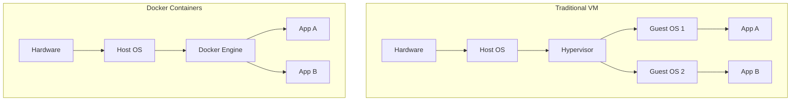

# Chapter 15 — Docker & Kubernetes
Containerization & Orchestration
Practical System Design in Bangla

## 15.1 Introduction
Traditional software deployment এ সবচেয়ে বড় সমস্যা ছিল:
"It works on my machine, but not in production!"
Development PC তে code ঠিকভাবে চলে, কিন্তু server এ deploy করলে environment mismatch, missing library বা OS version এর কারণে crash করে।
এই সমস্যার সমাধান হলো **Containerization** (Docker) এবং **Orchestration** (Kubernetes)।

## 15.2 Docker কী?
Docker হলো একটি tool যা application এবং তার সমস্ত dependencies (libraries, runtime, OS components) কে একটি standard unit বা **Container** এ প্যাক করে।



### কেন Docker?
- **Consistency:** Dev, Test এবং Production এ একই environment।
- **Lightweight:** VM এর মত পুরো OS রান করতে হয় না।
- **Fast Startup:** কয়েক সেকেন্ডে container চালু হয়।

## 15.3 Kubernetes (K8s) কী?
যখন production এ হাজার হাজার Docker container রান করে, তখন তাদের manage করার জন্য একটি system দরকার হয়। 
Kubernetes হলো একটি open-source container orchestration platform যা auto-scaling, load balancing এবং self-healing manage করে।

### Kubernetes Architecture

```mermaid
graph TD
    subgraph Control Plane (Master)
        A[API Server]
        B[Scheduler]
        C[Controller Manager]
        D[(etcd)]
    end
    
    subgraph Worker Node 1
        E[Kubelet]
        F[Kube-proxy]
        G[Pod 1]
        H[Pod 2]
    end
    
    subgraph Worker Node 2
        I[Kubelet]
        J[Kube-proxy]
        K[Pod 3]
    end
    
    A <--> E
    A <--> I
```

## 15.4 Core K8s Concepts
1. **Pod:** Kubernetes এর সবচেয়ে ছোট unit। একটি Pod এর ভেতর এক বা একাধিক container থাকতে পারে।
2. **Deployment:** Pod এর replica manage করে এবং rolling update নিশ্চিত করে।
3. **Service:** Pod গুলোর জন্য stable IP এবং Load Balancing provide করে।
4. **Ingress:** External traffic কে cluster এর ভেতরের Service এ route করে।

## 15.5 Real Production Story - Scaling with K8s
**Problem:** একটি e-commerce সাইটে campaign এর সময় হঠাৎ 10x traffic বেড়ে যায়। Server CPU 100% হয়ে crash করতো।
**Solution:** Kubernetes এর **HPA (Horizontal Pod Autoscaler)** ব্যবহার করে CPU usage 70% এর বেশি হলে স্বয়ংক্রিয়ভাবে নতুন Pod (container) তৈরি করার ব্যবস্থা করা হয়। Campaign শেষে traffic কমলে Pod গুলো নিজে থেকেই scale down হয়ে যায়।

## 15.6 Chapter Summary
এই chapter এ আমরা শিখলাম:
- Docker এর ধারণা এবং Containerization
- Virtual Machine vs Docker
- Kubernetes Architecture
- K8s Core Components (Pod, Service, Deployment)
- Auto-scaling in Production
