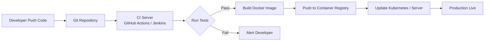

# Chapter 16 — CI/CD Pipeline
Continuous Integration and Continuous Deployment
Practical System Design in Bangla

## 16.1 Introduction
আগেকার দিনে software deploy করা মানেই ছিল বিশাল ভয়ের ব্যাপার। Server down করতে হতো, ফাইল manually copy করতে হতো, এবং ভুল হলে আবার rollback করতে হতো।
আধুনিক System Design এ এই পুরো process টিকে automated করা হয় **CI/CD** এর মাধ্যমে।

## 16.2 CI/CD কী?
- **Continuous Integration (CI):** যখনই কোনো developer code push করে, সাথে সাথে স্বয়ংক্রিয়ভাবে build তৈরি হয় এবং automated testing (Unit/Integration Test) রান করে।
- **Continuous Deployment/Delivery (CD):** CI সফল হলে নতুন code স্বয়ংক্রিয়ভাবে Staging বা Production server এ deploy করা হয়।

## 16.3 CI/CD Pipeline Architecture

## 16.4 Tools Used in CI/CD
1. **Source Control:** GitHub, GitLab, Bitbucket.
2. **CI Servers:** Jenkins, GitHub Actions, GitLab CI.
3. **Container Registry:** Docker Hub, AWS ECR.
4. **Deployment:** ArgoCD, Ansible, Terraform.

## 16.5 Deployment Strategies
Production এ downtime কমানোর জন্য বিভিন্ন deployment strategy ব্যবহার করা হয়:

### 1. Blue-Green Deployment
দুটি identical environment থাকে (Blue এবং Green)। একটিতে live traffic থাকে, অন্যটিতে নতুন version deploy করা হয়। সফল হলে traffic নতুনটিতে switch করা হয়।

### 2. Canary Release
নতুন version টি শুধুমাত্র ১০% user এর কাছে release করা হয়। যদি কোনো error না আসে, তাহলে ধীরে ধীরে ১০০% user এর জন্য release করা হয়।

## 16.6 Real Production Insight - Zero Downtime
**Problem:** একটি banking application এ update দিলে ১০ মিনিট downtime থাকতো।
**Solution:** CI/CD pipeline এবং Kubernetes এর মাধ্যমে **Rolling Update** implement করা হয়। এতে পুরনো Pod গুলো এক এক করে বন্ধ হয় এবং নতুন Pod চালু হয়, যার ফলে user কোনো downtime অনুভব করে না।

## 16.7 Chapter Summary
এই chapter এ আমরা শিখলাম:
- CI এবং CD এর পার্থক্য
- Automated build & testing
- Deployment Strategies (Blue-Green, Canary)
- Zero downtime deployment in production
