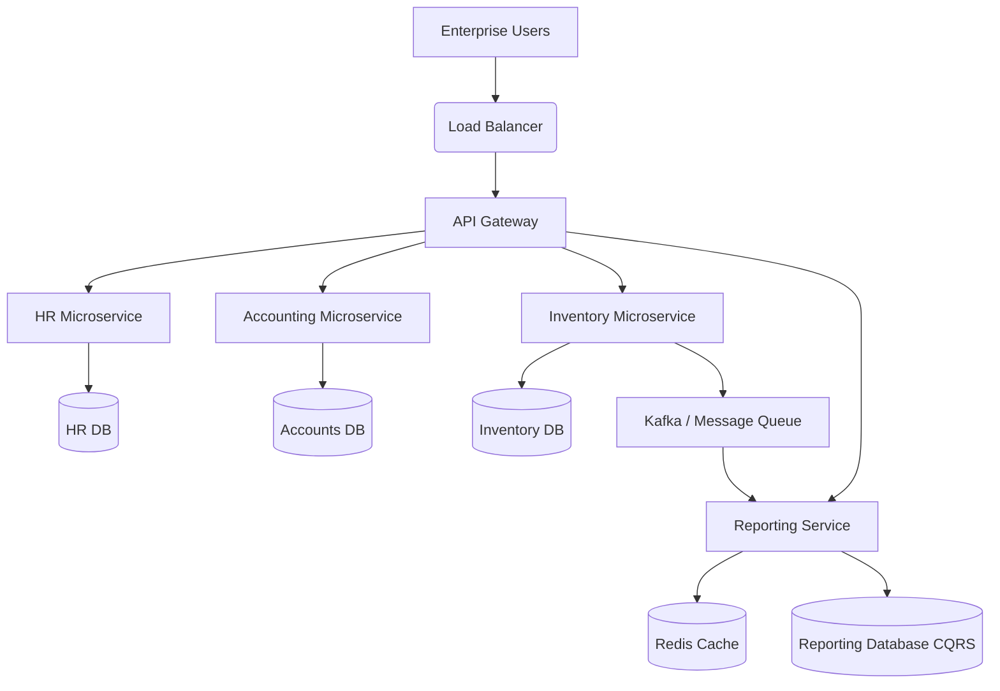

# Chapter 17 — ERP System Design
Enterprise Resource Planning Architecture
Practical System Design in Bangla

## 17.1 Introduction
ERP (Enterprise Resource Planning) System হলো এমন একটি software যা একটি বিশাল প্রতিষ্ঠানের Accounting, HR, Inventory, Production এবং CRM একসাথে manage করে।
ERP system design করা অত্যন্ত কঠিন কারণ এতে হাজার হাজার table, জটিল business logic এবং heavy reporting থাকে।

## 17.2 Core Challenges
- **Massive Database Scale:** লাখো transaction, inventory stock calculation।
- **Reporting Bottleneck:** Report generate করতে database overload হয়ে যায়।
- **Concurrency Control:** একই product একাধিক শাখা থেকে বিক্রি করার সময় deadlock হতে পারে।
- **Role-Based Access Control (RBAC):** কে কোন menu দেখতে পারবে তার strict permission।

## 17.3 High-Level ERP Architecture

## 17.4 Scaling Strategies for ERP
1. **CQRS Pattern:** Transaction এর জন্য একটি database (SQL Server) এবং Reporting এর জন্য আরেকটি database (PostgreSQL/MongoDB) ব্যবহার করা।
2. **Caching:** Dashboard এবং Permission tree Redis এ cache করে রাখা।
3. **Database Sharding:** Branch অনুযায়ী বা অর্থবছর (Fiscal Year) অনুযায়ী database partition করা।

## 17.5 Real Production Example
**Problem:** মাস শেষে (Month-end closing) একসাথে সব branch থেকে ledger report generate করার কারণে পুরো ERP system hang হয়ে যেত।
**Solution:** Async processing এবং Message Queue ব্যবহার করা হয়। User report request করলে তা RabbitMQ তে চলে যায়। Background worker report তৈরি করে Notification পাঠায়। ফলে API timeout বন্ধ হয়।
