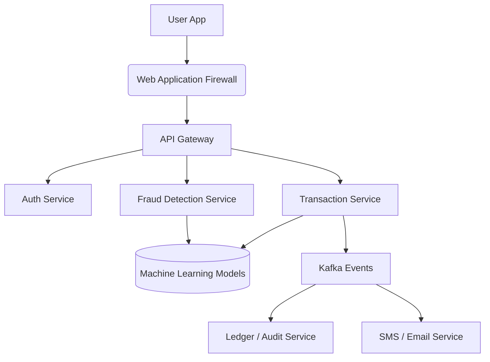

# Chapter 18 — Fintech System Design
Banking and Financial Software Architecture
Practical System Design in Bangla

## 18.1 Introduction
Fintech (Financial Technology) system ডিজাইন করা সাধারণ system ডিজাইন থেকে অনেক আলাদা। এখানে একটি ভুল মানে লক্ষ লক্ষ টাকার লোকসান।
Fintech system (যেমন Mobile Banking, Payment Gateway, Core Banking) এ Security এবং Consistency সবচেয়ে বেশি অগ্রাধিকার পায়।

## 18.2 Core Fintech Requirements
- **ACID Transactions:** Database এ transaction যেন কোনোভাবেই অর্ধেক সম্পন্ন না হয় (Atomicity)।
- **Idempotency:** একই payment request দুইবার hit করলেও যেন একবারই টাকা কাটে।
- **Security:** 2FA/MFA, Data Encryption at rest, JWT validation।
- **Audit Logs:** কে কখন কোন transaction করেছে তার Immutable log থাকতে হবে।

## 18.3 Fintech Architecture Diagram

## 18.4 Handling Idempotency
ধরি, user payment button এ দুইবার click করল অথবা network error এর কারণে retry হলো।
**Solution:** 
প্রতিটি request এ একটি Unique `Idempotency-Key` (UUID) পাঠাতে হবে।
API প্রথমে check করবে এই Key দিয়ে আগে transaction হয়েছে কিনা। হলে পুরোনো response টাই return করবে, নতুন করে টাকা কাটবে না।

## 18.5 Real Production Story - Deadlock in Banking
**Problem:** বেতন দেওয়ার দিন (Salary day) একই company account থেকে হাজার হাজার কর্মচারীর account এ টাকা ট্রান্সফার হওয়ার সময় SQL Server এ Deadlock হতো।
**Solution:** Transaction scope ছোট করা হয় এবং `Row-Level Lock` এর সিরিয়াল ঠিক করে দেওয়া হয়। এছাড়া Bulk transfer এর জন্য Message Queue ব্যবহার করে background এ process করা হয়।
