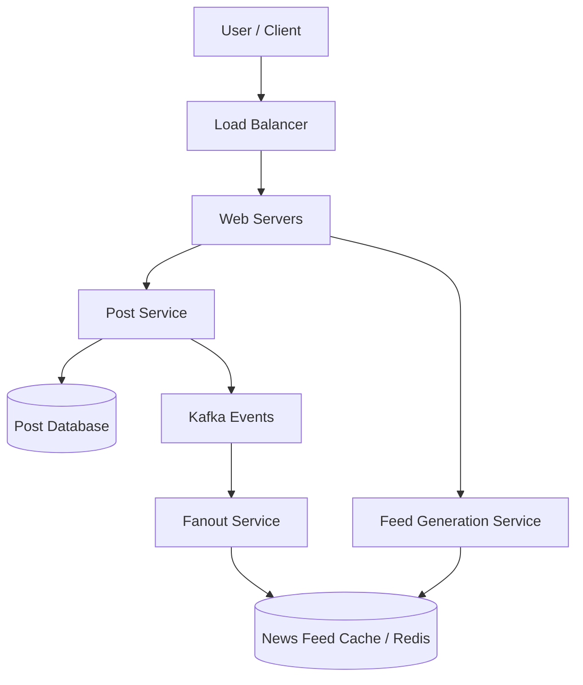

# Chapter 19 — Facebook News Feed Case Study
Social Media Architecture and Scalability
Practical System Design in Bangla

## 19.1 Introduction
Facebook News Feed হলো পৃথিবীর সবচেয়ে heavily scaled system গুলোর মধ্যে অন্যতম। বিলিয়ন বিলিয়ন user যখন লগইন করে, তাদের বন্ধুদের পোস্ট, লাইক, ছবি ইত্যাদি একটি সাজানো ফিডে দেখাতে হয়, এবং সেটিও কয়েক মিলি-সেকেন্ডের মধ্যে।

## 19.2 High Level Architecture

## 19.3 The Fanout Concept
যখন কোনো বিখ্যাত ব্যক্তি (ধরি Cristiano Ronaldo) কোনো পোস্ট করে, তখন তার লক্ষ লক্ষ follower এর ফিডে সেই পোস্টটি পাঠাতে হয়।
এই প্রক্রিয়াকে বলা হয় **Fanout**।

### Fanout On Write (Push Model)
User যখন পোস্ট করে, সাথে সাথেই তার সব বন্ধুদের ফিড ক্যাশে (Cache) আপডেট করে দেওয়া হয়।
- **সুবিধা:** রিড (Read) অনেক ফাস্ট হয়।
- **সমস্যা:** অনেক বন্ধু থাকলে write করতে অনেক সময় লাগে।

### Fanout On Read (Pull Model)
User যখন ফিড স্ক্রল করে, তখন সার্ভার dynamically তার বন্ধুদের পোস্টগুলো ডাটাবেজ থেকে নিয়ে ফিড তৈরি করে।
- **সুবিধা:** Write ফাস্ট হয়।
- **সমস্যা:** Read slow হতে পারে।

**Facebook Hybrid Approach:** সাধারণ ইউজারদের জন্য Push Model ব্যবহার করা হয়, কিন্তু সেলিব্রিটিদের (যাদের ফলোয়ার অনেক) জন্য Pull Model ব্যবহার করা হয়।

## 19.4 Data Storage Strategy
- **User Data:** Relational Database (MySQL)
- **Post Data:** NoSQL (Cassandra / HBase)
- **Images/Videos:** CDN (Content Delivery Network) + Blob Storage
- **Feed Cache:** Redis / Memcached

## 19.5 Chapter Summary
News Feed ডিজাইনে সবচেয়ে বড় চ্যালেঞ্জ হলো data read speed। Fanout strategy এবং caching এর সঠিক ব্যবহারেই Facebook এত দ্রুত কাজ করে।
