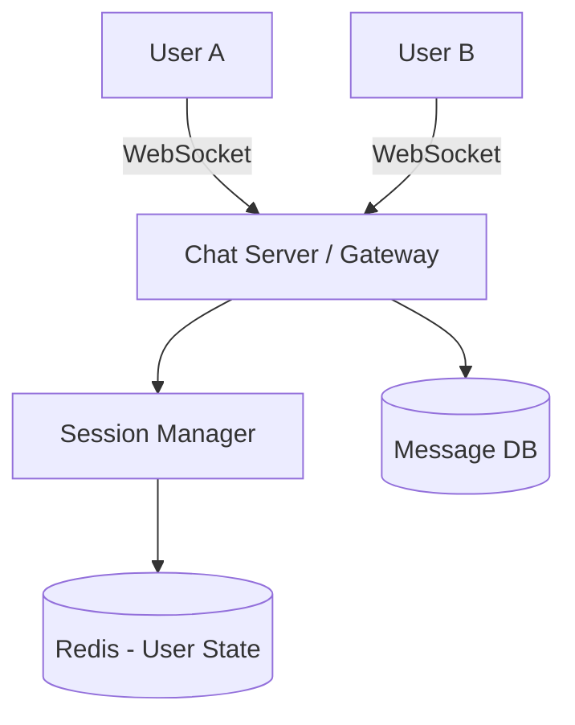

# Chapter 20 — WhatsApp Chat System Case Study
Real-time Messaging Architecture
Practical System Design in Bangla

## 20.1 Introduction
WhatsApp এর মত একটি মেসেজিং অ্যাপ্লিকেশনে বিলিয়ন বিলিয়ন মেসেজ প্রতিদিন আদান-প্রদান হয়। এই সিস্টেমের মূল চ্যালেঞ্জ হলো রিয়েল-টাইম (Real-time) ডেটা ডেলিভারি এবং এন্ড-টু-এন্ড এনক্রিপশন (End-to-End Encryption) নিশ্চিত করা।

## 20.2 High Level Architecture

## 20.3 Real-time Connection Management
HTTP request/response মডেল দিয়ে রিয়েল-টাইম চ্যাট তৈরি করা যায় না। এর জন্য প্রয়োজন **WebSocket**।
- ব্যবহারকারী অনলাইনে আসলে Chat Server এর সাথে একটি Persistent Connection (WebSocket) তৈরি হয়।
- সার্ভার সেই কানেকশনগুলো মেমোরিতে (বা Redis এ) সেভ করে রাখে।

## 20.4 Handling Offline Users
যদি User B অফলাইনে থাকে, তবে মেসেজটি সরাসরি ডেলিভারি করা সম্ভব নয়।
- মেসেজটি প্রথমে Database (যেমন Cassandra) এ সেভ করা হয়।
- User B অনলাইনে আসার সাথে সাথে Chat Server Database থেকে পেন্ডিং মেসেজগুলো টেনে এনে তাকে ডেলিভারি করে দেয় এবং ডাটাবেজ থেকে মুছে ফেলে।

## 20.5 Security (End-to-End Encryption)
WhatsApp এ সার্ভার নিজেও মেসেজ পড়তে পারে না।
- User A মেসেজ পাঠানোর আগে একটি Public Key দিয়ে এনক্রিপ্ট করে।
- সার্ভার এনক্রিপ্টেড ডাটাটি User B কে পাঠিয়ে দেয়।
- শুধুমাত্র User B তার Private Key দিয়ে সেটি ডিক্রিপ্ট করতে পারে।
