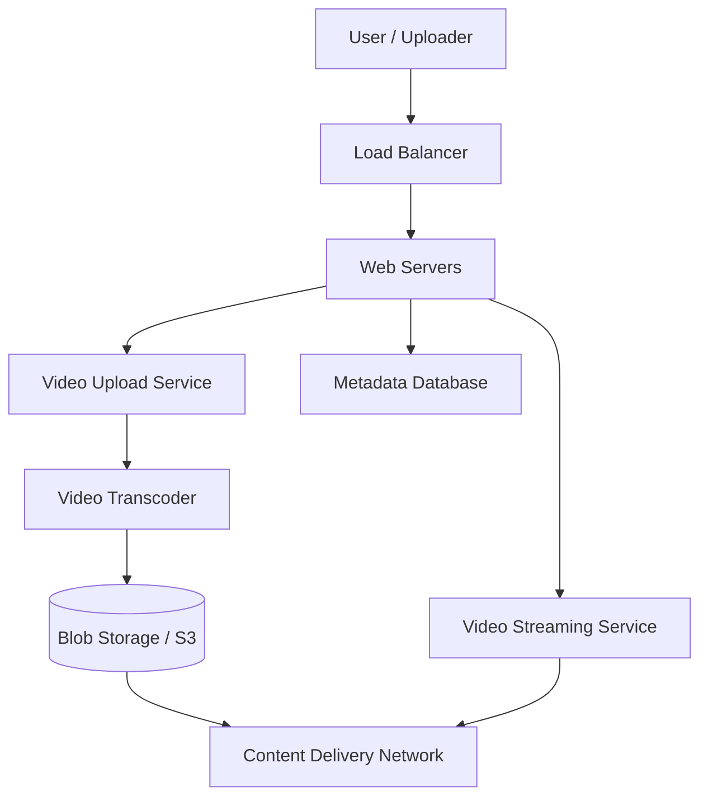

# Chapter 21 — YouTube Architecture Case Study
Video Streaming and Storage Architecture
Practical System Design in Bangla

## 21.1 Introduction
YouTube এর সবচেয়ে বড় চ্যালেঞ্জ হলো প্রতিদিন লক্ষ লক্ষ ঘন্টার ভিডিও প্রসেস করা, স্টোর করা এবং বাফারিং ছাড়াই ব্যবহারকারীর কাছে পৌঁছানো।

## 21.2 High Level Architecture

## 21.3 The Video Encoding Process
যখন একজন ইউজার ভিডিও আপলোড করে, সেটি সরাসরি প্লে করা যায় না।
- ভিডিওটি প্রথমে **Transcoding Service** এ যায়।
- সেখানে ভিডিওটিকে বিভিন্ন রেজোলিউশনে (1080p, 720p, 480p) এবং বিভিন্ন ফরম্যাটে কনভার্ট করা হয়।
- এই কাজটি করা হয় background workers (RabbitMQ/Kafka) এর মাধ্যমে।

## 21.4 Storage and Delivery (CDN)
এত বিশাল সাইজের ভিডিও একটি ডাটাবেজে রাখা সম্ভব না। তাই ভিডিওগুলো **Blob Storage** (যেমন AWS S3) এ সেভ করা হয়।
কিন্তু ইউজাররা যেন দ্রুত ভিডিও দেখতে পারে তাই পৃথিবীর বিভিন্ন প্রান্তে **CDN (Content Delivery Network)** এর সার্ভারে এই ভিডিওগুলোর ক্যাশ (Cache) রাখা হয়।

## 21.5 Metadata Storage
ভিডিওর টাইটেল, ডেসক্রিপশন, লাইক এবং কমেন্টগুলো সাধারণত Relational Database (যেমন MySQL) এ Sharding করে রাখা হয়।
