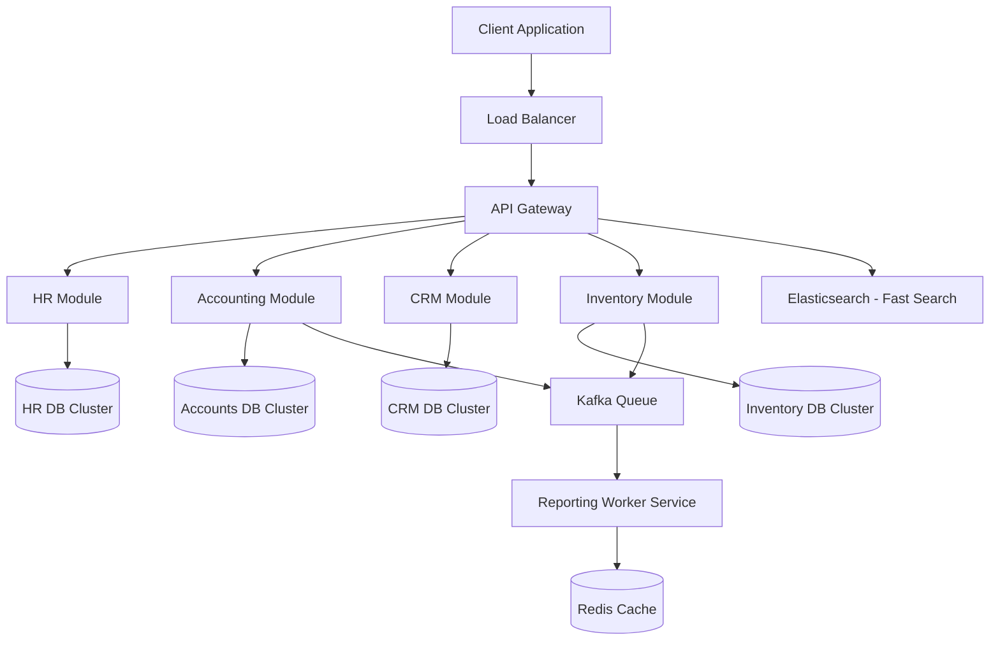

# Chapter 22 — Large Scale ERP Architecture Case Study
Enterprise Application Architecture Breakdown
Practical System Design in Bangla

## 22.1 Introduction
বড় বড় মাল্টিন্যাশনাল কোম্পানিগুলোতে (যেমন Garments, Manufacturing) হাজার হাজার ইউজার একই সময়ে ERP (Enterprise Resource Planning) সিস্টেমে কাজ করে। এই ধরনের সিস্টেমে Data Consistency এবং Reporting অনেক বড় চ্যালেঞ্জ।

## 22.2 Multi-Tenant vs Single-Tenant
ERP সিস্টেমে সাধারণত **Multi-Tenant Architecture** ব্যবহার করা হয়।
- **Shared Database, Shared Schema:** সব কোম্পানির ডাটা এক ডাটাবেজে থাকে (TenantID দিয়ে আলাদা করা হয়)। 
- **Isolated Database:** বড় ক্লায়েন্টদের জন্য আলাদা আলাদা Database সার্ভার দেওয়া হয়।

## 22.3 High Level Architecture

## 22.4 Solving the Reporting Bottleneck (CQRS)
ERP তে সবচেয়ে বড় সমস্যা হলো Report generate করা। 
- Transaction এর ডাটাবেজে (Write DB) Report এর query চললে পুরো সিস্টেম ধীর হয়ে যায়।
- তাই **CQRS (Command Query Responsibility Segregation)** ব্যবহার করা হয়।
- Write এর জন্য SQL Server/PostgreSQL এবং Read/Reporting এর জন্য আলাদা Replica Database বা Elasticsearch ব্যবহার করা হয়।

## 22.5 Caching and Audit Trail
- **Redis Cache:** Permission tree, Role-Based Access Control (RBAC) এবং ঘন ঘন ব্যবহার করা Dropdown data গুলো Redis এ ক্যাশ করা থাকে।
- **Audit Logs:** ERP তে "কে কখন কোন ডেটা পরিবর্তন করেছে" তা ট্রাক করার জন্য Event Sourcing বা Audit Log Table মেইনটেইন করা হয়, যা NoSQL (MongoDB) তে রাখা ভালো।
