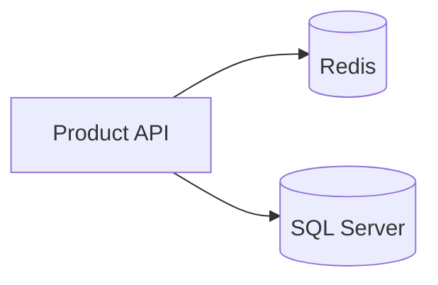

# Practical System Design in Bangla

**প্র্যাকটিক্যাল সিস্টেম ডিজাইন** — Scalable Software Architecture, Microservices, Database Scaling, Caching, DevOps, AI ও Real Production Experience

© 2026 Md. Sajidur Rahman. All rights reserved.

This repository contains the manuscript and the build pipeline that produces two editions from the same Markdown source:

| Edition | Output | Notes |
| --- | --- | --- |
| **Web** | `dist/web/index.html` | Static multi-page site: sidebar navigation, "এই অধ্যায়ে" outline, offline full-text search, light/dark theme, mobile layout. Works from any static host or straight from disk. |
| **Print (book)** | `dist/print/Practical-System-Design-in-Bangla-B5.pdf` | B5 trim (176 × 250 mm), full-bleed cover and part openers, page numbers, TOC with real page numbers, PDF bookmarks. |
| **Print (A4)** | `dist/print/Practical-System-Design-in-Bangla-A4.pdf` | Same content on A4 for home/office printing. |

The print HTML (`dist/print/book-b5.html`, `book-a4.html`) is also kept, so it can be opened in a browser and printed directly.

## Building

Requirements: Node.js 18+ and Google Chrome or Microsoft Edge (used headless to render diagrams and PDFs; set `CHROME_PATH` if it is not in a standard location).

```bash
npm install
npm run build          # web + both PDFs
npm run build:web      # web edition only (fast, ~2 s once diagrams are cached)
npm run build:pdf      # both PDFs
npm run build:pdf:book # B5 book PDF only
npm run check          # web build that fails on any diagram error
```

Diagrams are rendered once to SVG and cached in `build/.cache/` (keyed by content), so rebuilding is fast.

## Book structure

```
book.config.mjs          Metadata (title, author, edition) and the reading order: front matter, 8 parts, appendices
manuscript/
  00-front/              Copyright, dedication, preface, how to read, meet the team
  part-1-foundation/     Ch 1–3   ভিত্তি
  part-2-data/           Ch 4–6   ডেটা ও স্টোরেজ
  part-3-backend/        Ch 7–12  Backend ও Distributed System
  part-4-platform/       Ch 13–14 Platform ও Delivery
  part-5-ai/             Ch 15–17 AI যুগের System Design
  part-6-enterprise/     Ch 18–19 Enterprise System
  part-7-case-studies/   Ch 20–24 বাস্তব কেস স্টাডি (24 = capstone)
  part-8-interview/      Ch 25    Interview ও Career
  99-back/               Appendix A (Q&A), B (toolkit), C (glossary), D (references)
assets/                  Images referenced from the manuscript
build/                   Build pipeline (build.mjs, lib/, styles/, web/)
legacy/                  Earlier generated HTML/Markdown and helper scripts, kept for reference
```

## Writing conventions

**Front matter** (top of every chapter file):

```yaml
---
chapter: 7
title: API Design & Backend Architecture      # English title (PDF bookmarks, subtitle line)
bn: API Design ও Backend Architecture          # Display title
subtitle: REST, GraphQL, gRPC, …
---
```

Appendices use `letter: A`; front matter files use `kind: front` and `slug:`.

**Callouts** — GitHub-style blockquotes become styled boxes:

```markdown
> [!STORY] রেজাল্টের সকাল
> গল্পের অংশ…
```

Types: `GOALS`, `STORY`, `ARCHITECT`, `CASE`, `AI`, `WARNING`, `TIP`, `INTERVIEW`, `EXERCISE`, `QUOTE`.

**Diagrams** — Mermaid code blocks are pre-rendered to SVG and numbered automatically (চিত্র 7.3). Add a caption with a `%% caption:` line, and use the shared colour classes so every diagram speaks the same visual language:

````markdown

````

Classes: `client`, `svc`, `db`, `cache`, `queue`, `ai` (use a hexagon `{{"…"}}`), `infra`, `ext`, `human`, `bad`, `good`, `note`.

Practical rules learned while building the book:
- Always quote labels that contain parentheses, colons or Bangla punctuation: `A["Server (Primary)"]`.
- Keep horizontal chains to 4–5 nodes; use two `direction LR` subgraph rows for longer flows.
- Use diamonds `{"…"}` only for short yes/no questions.
- In `stateDiagram` labels avoid a second `:`; in `sequenceDiagram` avoid `;` (it ends a statement).
- Keep diagrams outside callout blockquotes (diagrams inside `>` blocks are not rendered).

**Images** — `` becomes a numbered figure; the file is copied into both editions.

## Characters

The stories follow a fictional company, **নদী টেক লিমিটেড**, and its team: নুসরাত (principal architect), রাফি (junior backend engineer), তানভীর (SRE), মিতু (product manager), করিম চৌধুরী (CTO) and আয়েশা (ML/AI engineer). Real-world incidents are summarised from public postmortems and reports; sources are listed in Appendix D.
