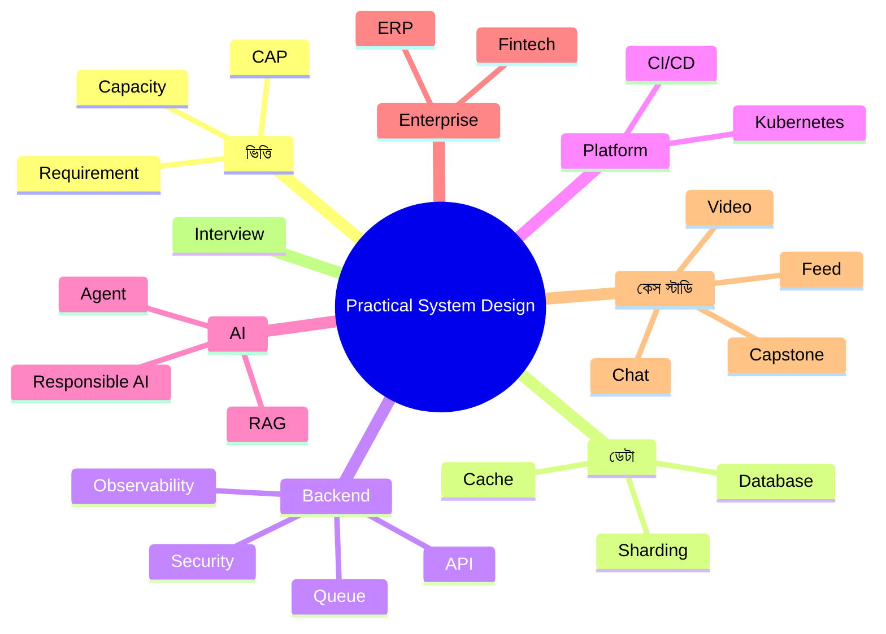

## যে প্রশ্ন থেকে এই বইয়ের শুরু

প্রায় প্রতিটি software team-এ একটি মুহূর্ত আসে। Feature সব কাজ করছে, client খুশি, demo সফল। তারপর একদিন সকালে ব্যবহারকারী দশগুণ বেড়ে যায়। Login page ঘুরতে থাকে, report আর আসে না, database CPU ১০০%-এ আটকে থাকে। আর team-এর সবাই একে অপরের দিকে তাকিয়ে ভাবে: **"আমরা তো code ঠিকই লিখেছিলাম। তাহলে ভুলটা কোথায়?"**

ভুলটা প্রায়ই code-এ থাকে না। ভুলটা থাকে **design-এ**: কোন কাজ কোথায় হবে, কোন data কোথায় থাকবে, কোন request অপেক্ষা করবে আর কোনটা queue-তে যাবে, কোন অংশ ভেঙে পড়লে বাকিটা কীভাবে টিকে থাকবে। এই সিদ্ধান্তগুলোর নামই System Design।

এই বই সেই সিদ্ধান্তগুলো নেওয়া শেখানোর জন্য লেখা।

## কাদের জন্য এই বই

- **Junior ও mid-level developer**, যারা feature লিখতে পারেন, কিন্তু "বড় system" কীভাবে ভাবতে হয় তা শিখতে চান।
- **Senior engineer ও team lead**, যারা architecture review, capacity planning আর production incident সামলান।
- **Solution architect**, যারা ERP, fintech, e-commerce বা সরকারি সেবার মতো বড় system design করেন।
- **Interview প্রার্থী**, যারা দেশে বা বিদেশে System Design interview-এর জন্য প্রস্তুতি নিচ্ছেন।
- **AI নিয়ে কাজ শুরু করা engineer**, যারা জানতে চান LLM, RAG বা AI agent production-এ কীভাবে নিরাপদে চালাতে হয়।

এই বই পড়তে কোনো নির্দিষ্ট programming language জানা জরুরি নয়। তবে web application, database এবং API সম্পর্কে প্রাথমিক ধারণা থাকলে পড়া সহজ হবে।

## কেন বাংলায়

System Design-এর ভালো বই প্রায় সবই ইংরেজিতে। ইংরেজি পড়তে পারা আর একটি জটিল trade-off নিজের ভাষায় **অনুভব করা** এক জিনিস নয়। আমরা যখন সহকর্মীর সাথে whiteboard-এর সামনে দাঁড়িয়ে আলোচনা করি, তখন বলি "ভাই, এই report query-টা main database-এ চালালে সবাই আটকে যাবে।" এই বই ঠিক সেই ভাষায় লেখা।

তাই বইয়ের ভাষা ইচ্ছাকৃতভাবেই মিশ্র। ব্যাখ্যা বাংলায়, কিন্তু technical শব্দগুলো ইংরেজিতেই রাখা হয়েছে: Cache, Sharding, Load Balancer, Idempotency। কারণ documentation, error message, interview আর code review-তে আপনি এই শব্দগুলোই দেখবেন। জোর করে অনুবাদ করলে বোঝা কঠিন হতো। পরিশিষ্ট C-তে প্রতিটি গুরুত্বপূর্ণ শব্দের সহজ বাংলা ব্যাখ্যা দেওয়া আছে।

## এই বই অন্যরকম কেন

**১. মানুষের গল্প দিয়ে শেখা।** প্রতিটি অধ্যায় শুরু হয় একটি গল্প দিয়ে। "নদী টেক" নামের একটি কাল্পনিক software company-র কয়েকজন মানুষ আছেন: একজন অভিজ্ঞ architect, একজন কৌতূহলী junior developer, একজন on-call SRE, একজন product manager, একজন CTO আর একজন ML engineer। তাদের ভুল, তর্ক, রাত জাগা আর শেখার মধ্য দিয়ে প্রতিটি ধারণা এসেছে। System Design শেষ পর্যন্ত মানুষেরই কাজ: মানুষ requirement দেয়, মানুষ সিদ্ধান্ত নেয়, মানুষই রাত দুইটায় alert পেয়ে ঘুম থেকে ওঠে।

**২. বাস্তব incident।** GitLab-এর database মুছে যাওয়া, GitHub-এর ৪৩ সেকেন্ডের network partition থেকে ২৪ ঘণ্টার সমস্যা, Knight Capital-এর ৪৫ মিনিটে ৪৪০ মিলিয়ন ডলার হারানো, Bangladesh Bank-এর রিজার্ভ চুরি, AI chatbot-এর ভুল তথ্যের জন্য আদালতে কোম্পানির দায়: প্রতিটি ঘটনা থেকে কী শেখার আছে, তা architecture-এর ভাষায় বিশ্লেষণ করা হয়েছে।

**৩. পরিষ্কার diagram।** বইয়ে ১৫০টিরও বেশি diagram আছে। প্রতিটি diagram একই রঙের ভাষা মেনে আঁকা: database সবুজ, cache কমলা, queue হলুদ, AI বেগুনি, সমস্যা লাল। ফলে কয়েকটি অধ্যায় পড়ার পর diagram দেখেই system চেনা যাবে।

**৪. AI যুগের জন্য প্রস্তুত।** এখন প্রায় প্রতিটি product-এ কোনো না কোনো AI feature যুক্ত হচ্ছে। তাই একটি পুরো পর্ব (পর্ব ৫) LLM application architecture, RAG, AI agent, MLOps এবং Responsible AI নিয়ে। প্রতিটি অধ্যায়ে "AI কোণ" নামে একটি অংশ আছে, যেখানে দেখানো হয়েছে সেই বিষয়ে AI কী বদলে দিচ্ছে আর কী বদলাচ্ছে না।

**৫. Interview ও career।** প্রতিটি অধ্যায়ের শেষে interview প্রশ্ন, সাধারণ ভুল আর নিজে করে দেখার মতো exercise আছে। পর্ব ৮ এবং পরিশিষ্ট A সম্পূর্ণভাবে interview প্রস্তুতির জন্য।

## একটি স্বীকারোক্তি

System Design-এ কোনো "সঠিক উত্তর" নেই। আছে trade-off। আজ যে design সঠিক, দুই বছর পরে সেটাই bottleneck হতে পারে। এই বইয়ে আপনি বারবার একটি বাক্য পাবেন: **"এটা নির্ভর করে (It depends)।"** এটা এড়িয়ে যাওয়ার কৌশল নয়। একজন architect-এর আসল কাজ হলো ঠিক কীসের উপর নির্ভর করে, সেটা স্পষ্ট করে বলতে পারা।

> [!QUOTE]
> ভালো architecture মানে সবচেয়ে আধুনিক technology নয়। ভালো architecture মানে এমন সিদ্ধান্ত, যেটা আপনার team, আপনার budget আর আপনার ব্যবহারকারীর বাস্তবতার সাথে মেলে, এবং ভুল হলে ফিরে আসার পথ রাখে।

আশা করি বইটি আপনার পরবর্তী design review, পরবর্তী incident আর পরবর্তী interview-তে সাহস যোগাবে।

**Md. Sajidur Rahman**
ঢাকা, ২০২৬
