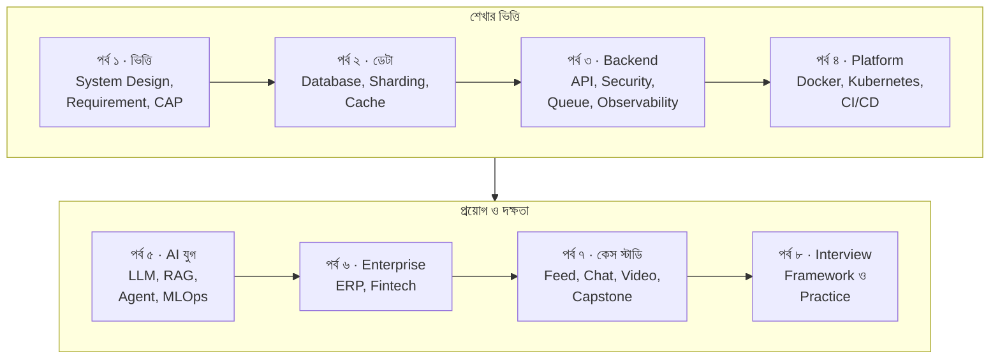
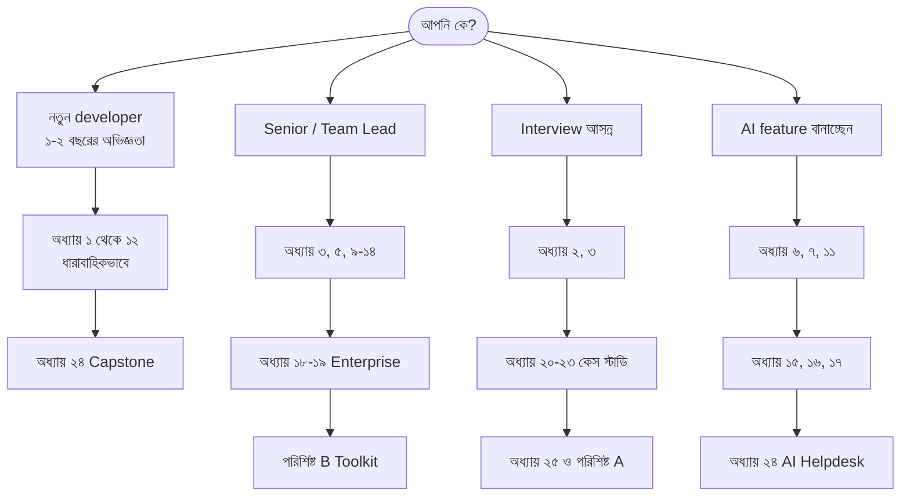
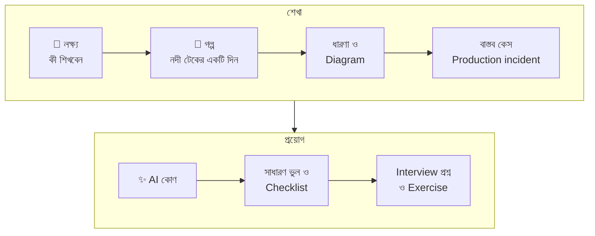
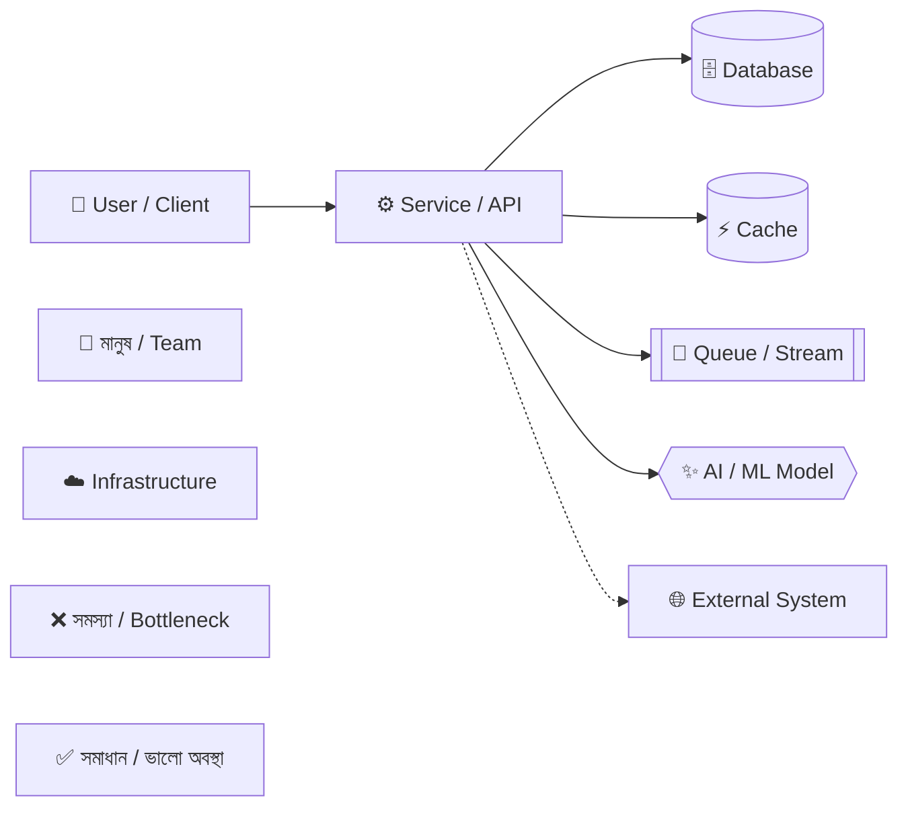

## বইয়ের মানচিত্র

বইটি আটটি পর্বে সাজানো। প্রতিটি পর্ব আগের পর্বের উপর দাঁড়িয়ে আছে, ঠিক যেমন একটি system-এর layer একে অপরের উপর দাঁড়িয়ে থাকে।

## আপনার জন্য কোন পথ?

সবাইকে প্রথম থেকে শেষ পর্যন্ত পড়তে হবে না। নিজের লক্ষ্য অনুযায়ী পথ বেছে নিন।

| আপনি যদি… | শুরু করুন | সময় লাগবে (আনুমানিক) |
| --- | --- | --- |
| System Design-এ একেবারে নতুন | অধ্যায় ১ থেকে ধারাবাহিকভাবে | ৬-৮ সপ্তাহ, দিনে ১ ঘণ্টা |
| Production system চালান | অধ্যায় ৩, তারপর যে সমস্যা এখন আপনার টেবিলে | প্রয়োজন অনুযায়ী |
| আগামী মাসে interview | অধ্যায় ২, ৩, ২০-২৫ এবং পরিশিষ্ট A | ২-৩ সপ্তাহ |
| AI product বানাচ্ছেন | অধ্যায় ১৫-১৭, তারপর ৬, ৭, ১১ | ১-২ সপ্তাহ |

## প্রতিটি অধ্যায়ের গঠন

প্রায় প্রতিটি অধ্যায় একই কাঠামো মেনে চলে, যাতে আপনি দ্রুত দরকারি অংশে যেতে পারেন।

বইয়ে কয়েক ধরনের রঙিন বাক্স আছে। প্রতিটির আলাদা উদ্দেশ্য:

> [!GOALS]
> - অধ্যায়ের শুরুতে কী কী শিখবেন তার তালিকা
> - পড়া শেষে নিজেকে যাচাই করার জন্যও ব্যবহার করুন

> [!STORY] নদী টেকের গল্প
> গল্পের অংশ। এখানে চরিত্ররা একটি বাস্তব সমস্যার মুখোমুখি হয়, যার সমাধান অধ্যায়ে শেখানো হয়।

> [!ARCHITECT]
> অভিজ্ঞ architect-এর দৃষ্টিভঙ্গি: trade-off, সিদ্ধান্ত নেওয়ার কৌশল এবং যেসব কথা সাধারণত বইয়ে লেখা থাকে না।

> [!CASE]
> বাস্তব পৃথিবীর কোনো প্রতিষ্ঠানের প্রকাশিত incident বা architecture থেকে শিক্ষা।

> [!AI]
> এই বিষয়ে AI কী পরিবর্তন আনছে: সুযোগ, ঝুঁকি এবং বাস্তব প্রয়োগ।

> [!WARNING]
> এমন ভুল যা production-এ বড় ক্ষতি করতে পারে।

> [!TIP]
> ছোট কিন্তু কাজের কৌশল।

> [!INTERVIEW]
> Interview-তে এই বিষয়ে কী জিজ্ঞেস করা হয় এবং কীভাবে উত্তর দিলে ভালো হয়।

> [!EXERCISE]
> নিজে চেষ্টা করার মতো design সমস্যা। উত্তর দেখার আগে কাগজে আঁকুন।

## Diagram পড়ার নিয়ম

বইয়ের সব architecture diagram একই রঙের ভাষা মেনে আঁকা। নিচের চিত্রটি একবার মনোযোগ দিয়ে দেখুন; পুরো বই জুড়ে এই রঙগুলো একই অর্থ বহন করবে।

- **কঠিন তীর (→)** মানে synchronous call: একজন অপেক্ষা করছে উত্তরের জন্য।
- **ডটেড তীর (⇢)** মানে asynchronous বা external call: পাঠিয়ে দেওয়া হলো, উত্তরের জন্য বসে থাকা হচ্ছে না।
- **সিলিন্ডার** আকৃতি মানে data যেখানে স্থায়ীভাবে বা অস্থায়ীভাবে থাকে।
- **ষড়ভুজ** আকৃতি মানে AI বা ML model।

## সংখ্যা ও একক

বইয়ে বাংলা ও ইংরেজি দুই ধরনের সংখ্যাই ব্যবহার করা হয়েছে। গল্প ও ব্যাখ্যায় বাংলা সংখ্যা, আর হিসাব, code ও metric-এ ইংরেজি সংখ্যা। কিছু প্রচলিত একক:

| একক | অর্থ | মনে রাখার কৌশল |
| --- | --- | --- |
| RPS / QPS | Requests / Queries Per Second | প্রতি সেকেন্ডে কতগুলো অনুরোধ |
| ms | millisecond (১ সেকেন্ডের ১০০০ ভাগের ১ ভাগ) | চোখের পলক ≈ ১০০-১৫০ ms |
| p95, p99 latency | ১০০টি request-এর মধ্যে ৯৫ বা ৯৯টি এর চেয়ে দ্রুত | গড় নয়, "খারাপ দিনের" অভিজ্ঞতা |
| 99.9% availability | বছরে প্রায় ৮.৭৬ ঘণ্টা downtime | প্রতিটি অতিরিক্ত ৯ খরচ বাড়ায় |
| লাখ / কোটি | 100K / 10M | ১০ লাখ = ১ million |

এবার চলুন, নদী টেকের মানুষগুলোর সাথে পরিচিত হই।
