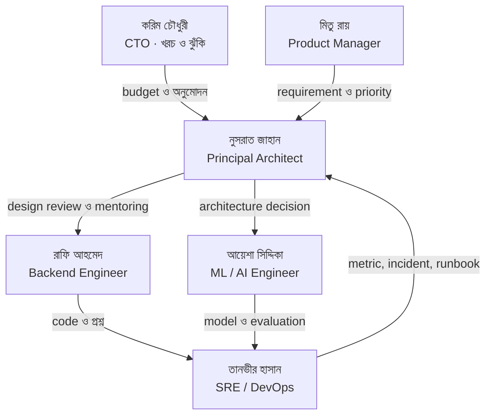
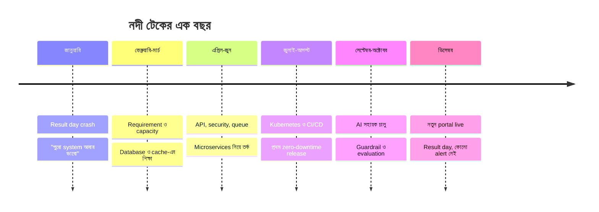

## একটি কাল্পনিক company, বাস্তব সমস্যা

ঢাকার কারওয়ান বাজারের একটি বারোতলা ভবনের সপ্তম তলায় **নদী টেক লিমিটেড**। প্রায় আশিজন engineer, তিনটি বড় product, আর অসংখ্য client project। দেয়ালে একটি বড় whiteboard, যেখানে কেউ কখনো পুরোপুরি মুছে ফেলে না; পুরনো diagram-এর উপর নতুন diagram আঁকা হয়। Team-এর ভাষায় ওটা "স্মৃতির দেয়াল"।

নদী টেক কাল্পনিক, কিন্তু এর প্রতিটি সমস্যা বাস্তব। বাংলাদেশের software industry-তে যারা কাজ করেন, তারা প্রায় প্রতিটি গল্পেই নিজের চেনা কোনো রাতের কথা মনে করতে পারবেন।

### নদী টেকের product

| Product | কী করে | কোন অধ্যায়ে বেশি আসবে |
| --- | --- | --- |
| **Admission & Result Portal** | একটি বিশ্ববিদ্যালয় গ্রুপের অনলাইন ভর্তি, পেমেন্ট ও রেজাল্ট | ১, ২, ৬, ২৪ |
| **নদী ERP** | গার্মেন্টস ও manufacturing গ্রুপের HR, Accounts, Inventory | ৪, ৫, ১০, ১৮ |
| **নদীপে (NodiPay)** | Microfinance ও merchant payment platform | ৭, ৮, ১১, ১৯ |
| **নদী বাজার** | ঈদ ও উৎসবকেন্দ্রিক e-commerce marketplace | ৩, ৬, ৯, ১৩ |
| **নদী সহায়ক** | AI-চালিত customer support ও document assistant | ১৫, ১৬, ১৭ |

## চরিত্র পরিচিতি

> [!STORY] নুসরাত জাহান · Principal Software Architect
> চৌদ্দ বছরের অভিজ্ঞতা। Banking software দিয়ে career শুরু, তারপর ERP, তারপর fintech। কথা কম বলেন, কিন্তু প্রশ্ন করেন বেশি। তাঁর প্রিয় বাক্য: **"Diagram না আঁকলে বুঝব কীভাবে আমরা একই জিনিস নিয়ে কথা বলছি?"** নুসরাতের ডেস্কে একটি পুরনো notebook থাকে, যেখানে প্রতিটি বড় incident-এর পর তিনি এক পাতায় লিখে রাখেন কী ভুল হয়েছিল। Team সেটাকে বলে "নুসরাতের নোটবুক"।

> [!STORY] রাফি আহমেদ · Junior Backend Engineer
> এক বছর আগে বিশ্ববিদ্যালয় থেকে পাস করে যোগ দিয়েছে। ASP.NET Core আর SQL দারুণ লেখে, competitive programming-এ পুরস্কারও আছে। কিন্তু "এটা scale করবে তো?" প্রশ্নের উত্তর এখনো জানে না। রাফি এই বইয়ে পাঠকের প্রতিনিধি: যে প্রশ্নগুলো আপনার মনে আসবে, সেগুলো রাফিই জিজ্ঞেস করবে।

> [!STORY] তানভীর হাসান · SRE ও DevOps Lead
> নদী টেকের production যে কয়জন মানুষের জন্য বেঁচে আছে, তানভীর তাদের একজন। Phone-এ PagerDuty-র alert tone শুনলে team-এর বাকিরা ভয় পায়, তানভীর চা বানাতে যায়। তাঁর নীতি: **"যেটা measure করি না, সেটা ঠিক করতেও পারি না।"**

> [!STORY] মিতু রায় · Product Manager
> ব্যবহারকারী আর ব্যবসার কণ্ঠস্বর। Deadline নিয়ে কঠোর, কিন্তু যুক্তি শুনতে প্রস্তুত। মিতুর প্রশ্নগুলো সহজ কিন্তু কঠিন: "ব্যবহারকারী কী দেখবে?", "না করলে কী ক্ষতি?", "কবে দিতে পারবে?"

> [!STORY] করিম চৌধুরী · Chief Technology Officer
> নদী টেকের প্রতিষ্ঠাতাদের একজন। একসময় নিজেই code লিখতেন, এখন board meeting-এ cloud bill ব্যাখ্যা করেন। প্রতিটি architecture proposal-এ করিম সাহেবের তিনটি প্রশ্ন থাকবেই: **"কত খরচ? কত ঝুঁকি? ভুল হলে ফেরত আসার পথ কী?"**

> [!STORY] আয়েশা সিদ্দিকা · ML ও AI Engineer
> Statistics-এ পড়াশোনা, তারপর data science, এখন LLM application। নদী টেকে AI নিয়ে সবচেয়ে উচ্ছ্বসিত মানুষ, আবার সবচেয়ে সতর্কও। আয়েশার মতে: **"Model ভুল করবেই। প্রশ্ন হলো, ভুল করলে system কী করবে?"**

## Team কীভাবে কাজ করে

নদী টেকে প্রতিটি বড় সিদ্ধান্ত একটি **Architecture Decision Record (ADR)**-এ লেখা হয়: সমস্যা কী ছিল, কোন কোন বিকল্প ভাবা হয়েছিল, কোনটা বেছে নেওয়া হলো এবং কেন। পরিশিষ্ট B-তে ADR-এর একটি template দেওয়া আছে। বইয়ের বিভিন্ন জায়গায় আপনি নুসরাতের লেখা ADR-এর অংশ দেখতে পাবেন।

## গল্পের যাত্রা

বইয়ের গল্প শুরু হয় একটি সংকট দিয়ে। অধ্যায় ১-এ নদী টেকের বানানো Admission & Result Portal রেজাল্ট প্রকাশের দিন ভেঙে পড়ে। হাজার হাজার শিক্ষার্থী রেজাল্ট দেখতে পারে না, কারো কারো টাকা কেটে যায় কিন্তু রসিদ আসে না। সেই রাতে করিম সাহেব নুসরাতকে একটি কাজ দেন: "পুরো system-টা আবার ভাবো। এবার এমনভাবে, যাতে এটা আর কখনো না হয়।"

পরের অধ্যায়গুলোতে team একটি একটি করে শেখে: requirement কীভাবে বুঝতে হয়, database কেন আটকে যায়, cache কখন মিথ্যা বলে, queue কীভাবে payment বাঁচায়, monitoring ছাড়া কেন অন্ধ, আর AI chatbot কীভাবে সাহায্যও করতে পারে, বিপদও ডাকতে পারে। অধ্যায় ২৪-এ সেই একই portal সম্পূর্ণ নতুন করে design করা হয়, বইয়ের সব শিক্ষা একসাথে ব্যবহার করে।

চলুন, শুরু করা যাক সেই রেজাল্টের দিন থেকে।
