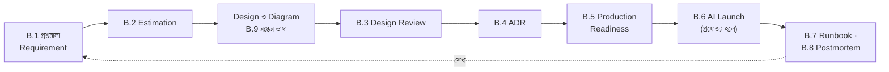

এই পরিশিষ্টের প্রতিটি অংশ নদী টেকের team-এর মতো আপনিও copy করে নিজের প্রয়োজনে বদলে নিতে পারেন। এগুলো বইয়ের বিভিন্ন অধ্যায়ের শিক্ষাকে কাজের তালিকায় রূপ দিয়েছে।



## B.1 Requirement Discovery প্রশ্নমালা

*অধ্যায় ২*

**ব্যবসা ও মানুষ**
- System-টি কোন সমস্যা সমাধান করছে? সফলতা কীভাবে মাপা হবে?
- কারা ব্যবহার করবেন (ভূমিকা অনুযায়ী)? কোন device, কোন network-এ?
- কী ভুল হলে সবচেয়ে বড় ক্ষতি (টাকা, আস্থা, আইন, মানুষের জীবন)?

**Traffic ও data**
- DAU কত? স্বাভাবিক দিনের peak কখন?
- **সবচেয়ে খারাপ দিনটা দেখতে কেমন?** (তারিখ, সময়, মিনিট ধরে)
- Read:write অনুপাত? কোন data কতদিন রাখতে হবে?
- Data-র বৃদ্ধির হার? Archive-এর নিয়ম?

**মান (NFR)**
- কোন কাজের latency কত (p95/p99)?
- কতটুকু downtime গ্রহণযোগ্য? RPO ও RTO?
- কোন data-তে strong consistency লাগবে, কোথায় eventual চলবে?

**নিরাপত্তা ও নিয়ম**
- কোন data সংবেদনশীল? কে কী দেখতে পারবেন?
- কোন আইন, নিয়ন্ত্রক নির্দেশনা বা চুক্তির শর্ত প্রযোজ্য? Data কোথায় রাখা যাবে?

**Constraint**
- Budget (মাসিক ও প্রাথমিক)? Deadline?
- Team-এর দক্ষতা ও আকার? কে চালাবেন?
- কোন বিদ্যমান system-এর সাথে যুক্ত হতে হবে?

## B.2 Estimation Cheat Sheet

*অধ্যায় ২*

| বিষয় | মান |
| --- | --- |
| দিনে সেকেন্ড | 86,400 ≈ 10^5 |
| দিনে ১০ লাখ request | ≈ 12 RPS (গড়) |
| Peak factor (সাধারণ) | গড়ের ২-৫ গুণ; বিশেষ দিনে শত-হাজার গুণ |
| 1 KB × 10 লাখ | 1 GB |
| 1 MB × 10 লাখ | 1 TB |
| Little's Law | Concurrency = RPS × গড় latency (সেকেন্ড) |
| Storage-এর অতিরিক্ত | Index +৩০-১০০%, প্রতিটি replica ও backup আলাদা |

| Availability | বছরে downtime | মাসে downtime |
| --- | --- | --- |
| 99% | ৩.৬৫ দিন | ৭.৩ ঘণ্টা |
| 99.9% | ৮.৭৬ ঘণ্টা | ৪৩.৮ মিনিট |
| 99.95% | ৪.৩৮ ঘণ্টা | ২১.৯ মিনিট |
| 99.99% | ৫২.৬ মিনিট | ৪.৪ মিনিট |

| Latency (মোটামুটি) | সময় |
| --- | --- |
| RAM থেকে পড়া | ~100 ns |
| SSD random read | ~0.1 ms |
| একই data center-এ round trip / Redis GET | ~0.5 ms |
| Indexed SQL query | ~1-5 ms |
| ঢাকা → সিঙ্গাপুর round trip | ~40-60 ms |
| ঢাকা → ইউরোপ/আমেরিকা round trip | ~150-300 ms |
| LLM-এর একটি উত্তর | ~1-10 s |

## B.3 Design Review Checklist

*পুরো বই*

**Requirement**
- [ ] Functional, non-functional ও constraint লিখিত, সংখ্যাসহ
- [ ] "সবচেয়ে খারাপ দিন" সংজ্ঞায়িত ও capacity হিসাব করা

**Architecture**
- [ ] প্রতিটি component-এর দায়িত্ব স্পষ্ট; diagram হালনাগাদ
- [ ] SPOF তালিকা ও সমাধান (মানুষসহ)
- [ ] Sync বনাম async-এর সিদ্ধান্ত যুক্তিসহ
- [ ] প্রতিটি data store-এর consistency মডেল লেখা

**Data**
- [ ] Data model, constraint ও index পর্যালোচিত
- [ ] বৃদ্ধি, partition ও archive-এর পরিকল্পনা
- [ ] Backup, restore drill, RPO/RTO যাচাই

**নির্ভরযোগ্যতা**
- [ ] প্রতিটি external call-এ timeout, retry নীতি, circuit breaker
- [ ] Idempotency (API, consumer, payment)
- [ ] Load test worst-day লক্ষ্যের উপর
- [ ] Graceful degradation ও load shedding-এর অগ্রাধিকার

**নিরাপত্তা**
- [ ] Threat model (STRIDE)
- [ ] Object-level authorization ও tenant isolation
- [ ] Secret management, encryption, audit

**Operations**
- [ ] SLO, dashboard, alert ও runbook
- [ ] CI/CD, rollback, migration-এর কৌশল
- [ ] খরচের আনুমানিক হিসাব ও budget alert

## B.4 Architecture Decision Record (ADR) Template

*অধ্যায় ১৭, ২৪*

```text
ADR-[নম্বর]: [সিদ্ধান্তের সংক্ষিপ্ত শিরোনাম]
তারিখ    : [YYYY-MM-DD]
অবস্থা    : প্রস্তাবিত | গৃহীত | প্রতিস্থাপিত (ADR-xx দ্বারা) | বাতিল
সিদ্ধান্তদাতা: [নাম]   পর্যালোচক: [নাম]

প্রসঙ্গ
  কী সমস্যা? কোন requirement বা সংখ্যা এই সিদ্ধান্তকে চালিত করছে?

বিবেচিত বিকল্প
  (ক) …  সুবিধা / অসুবিধা / খরচ
  (খ) …
  (গ) …

সিদ্ধান্ত
  কোনটি বেছে নেওয়া হলো।

কারণ
  কেন এটি, এই প্রসঙ্গে। কোন trade-off সচেতনভাবে গ্রহণ করা হলো।

পরিণতি
  এখন কী করতে হবে, কোন ঝুঁকি থাকল, কোন অবস্থায় এই সিদ্ধান্ত আবার বিবেচনা করা হবে।
```

## B.5 Production Readiness Checklist

*অধ্যায় ৯, ১২, ১৩, ১৪*

- [ ] অন্তত দুটি instance, ভিন্ন zone-এ; PodDisruptionBudget
- [ ] Liveness ও readiness আলাদা; graceful shutdown ও draining
- [ ] Resource request/limit; autoscaling নিয়ম ও সীমা
- [ ] Structured log + trace ID; RED metric; distributed tracing
- [ ] SLO ও burn-rate alert; প্রতিটি alert-এর runbook
- [ ] Secret vault-এ; image scan; least privilege
- [ ] Backup ও restore পরীক্ষিত
- [ ] Rollback এক ধাপে; feature flag দিয়ে kill switch
- [ ] On-call rotation ও escalation পথ
- [ ] Load test রিপোর্ট

## B.6 AI Feature Launch Checklist

*অধ্যায় ১৫-১৭*

- [ ] Use case ও ঝুঁকির মূল্যায়ন: ভুল উত্তরের ক্ষতি কতটা, কার উপর
- [ ] তথ্যের উৎস অনুমোদিত, হালনাগাদ, encoding ও OCR যাচাই করা
- [ ] Retrieval-এ permission ও tenant filter
- [ ] Prompt version-controlled; structured output যাচাই
- [ ] Golden dataset (উত্তরহীন প্রশ্ন ও আক্রমণাত্মক প্রশ্নসহ); CI-তে eval
- [ ] Grounding check, citation, "জানি না" পথ, মানুষের কাছে হস্তান্তর
- [ ] Input/output guardrail; prompt injection পরীক্ষা
- [ ] Agent হলে: সংকীর্ণ tool, idempotent write, budget, ঝুঁকিপূর্ণ কাজে মানুষের অনুমোদন
- [ ] Token budget, খরচের alert, AI gateway, fallback
- [ ] Observability: trace, খরচ, feedback, PII masking
- [ ] User-কে জানানো যে তিনি AI-এর সাথে কথা বলছেন
- [ ] Feature flag ও kill switch; canary rollout

## B.7 Incident Runbook Template

*অধ্যায় ১২*

```text
Alert: [নাম ও শর্ত, যেমন: checkout error rate > 2% (5 মিনিট)]
প্রভাব: ব্যবহারকারী কী অনুভব করছেন?
Dashboard: [link]

প্রথম ৫ মিনিট
  ১. গত ১ ঘণ্টায় কোনো deploy বা config পরিবর্তন? থাকলে rollback বিবেচনা।
  ২. Dependency-র অবস্থা (database, payment gateway, queue lag)।
  ৩. Severity নির্ধারণ; SEV1/2 হলে incident channel ও commander।

প্রশমনের বিকল্প
  - Rollback: [command / pipeline link]
  - Feature flag বন্ধ: [flag নাম]
  - Scale up: [কীভাবে]
  - Load shedding: [কোন feature বন্ধ করা যায়]

Escalation: [কাকে, কখন]
যোগাযোগ: [status page, client-কে কে জানাবেন]
```

## B.8 Blameless Postmortem Template

*অধ্যায় ১২*

```text
শিরোনাম ও severity
সারসংক্ষেপ (৩ বাক্যে)
প্রভাব: সময়কাল, ক্ষতিগ্রস্ত ব্যবহারকারী, আর্থিক বা অন্যান্য প্রভাব
Timeline: শনাক্ত → প্রশমন → সমাধান (মিনিট ধরে)
মূল কারণ ও সহায়ক কারণ (system ও প্রক্রিয়া, ব্যক্তি নয়)
কী ভালো হয়েছে
কোথায় ভাগ্য সহায় ছিল
Action item: [কাজ] — [মালিক] — [তারিখ]
শিক্ষা
```

## B.9 Diagram-এর রঙের ভাষা

*বইটি কীভাবে পড়বেন*

| Class | অর্থ | রঙ |
| --- | --- | --- |
| `client` | ব্যবহারকারী, app | আকাশি |
| `svc` | Service, API | নীলচে বেগুনি |
| `db` | Database, স্থায়ী storage | সবুজ |
| `cache` | Cache, in-memory | কমলা |
| `queue` | Queue, stream | হলুদ |
| `ai` | AI বা ML model (ষড়ভুজ) | বেগুনি |
| `infra` | Infrastructure (LB, gateway, CDN) | ধূসর-নীল |
| `ext` | বাইরের system (ডটেড) | হালকা ধূসর |
| `human` | মানুষ ও team | গোলাপি |
| `bad` / `good` | সমস্যা / সমাধান | লাল / সবুজ |

এই বইয়ের diagram-গুলো Mermaid-এ লেখা। নিজের document-এ একই ভাষা ব্যবহার করলে পুরো team একই চোখে diagram পড়বে।

## B.10 প্রস্তাবিত Tool

| কাজ | Tool |
| --- | --- |
| Diagram | Draw.io (diagrams.net), Excalidraw, Mermaid, PlantUML, Figma, Lucidchart |
| Container ও orchestration | Docker, Docker Compose, Kubernetes (AKS/EKS/GKE), Helm |
| CI/CD ও GitOps | GitHub Actions, GitLab CI, Azure DevOps, Argo CD |
| Infrastructure as Code | Terraform, Bicep, Pulumi |
| Database | SQL Server Management Studio, SQL Server Profiler / Extended Events, pgAdmin, Azure Data Studio |
| Cache ও queue | RedisInsight, RabbitMQ Management UI, Kafka UI |
| Observability | OpenTelemetry, Prometheus, Grafana, Loki, Tempo/Jaeger, Seq, Sentry |
| Load test | k6, JMeter, Locust, NBomber (.NET) |
| Security | OWASP ZAP, Trivy, Dependabot/Renovate, gitleaks |
| AI | pgvector, Azure AI Search / OpenSearch, evaluation framework (যেমন Ragas, promptfoo), AI gateway |
