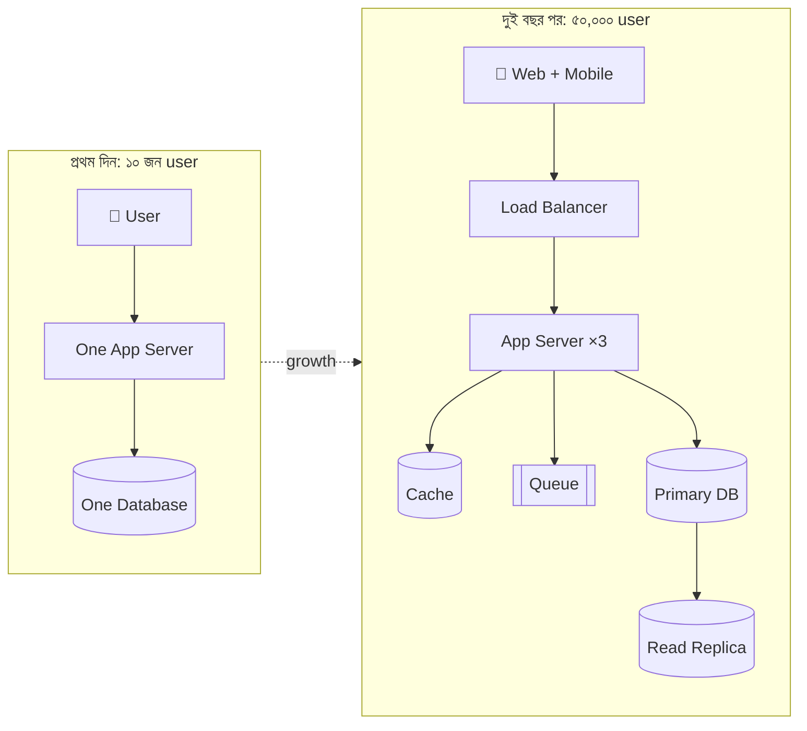
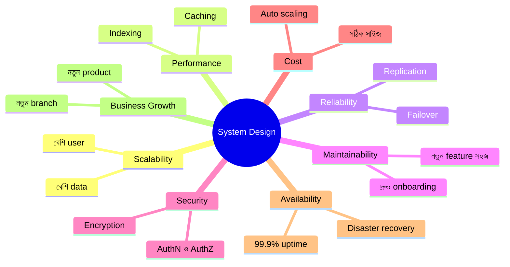
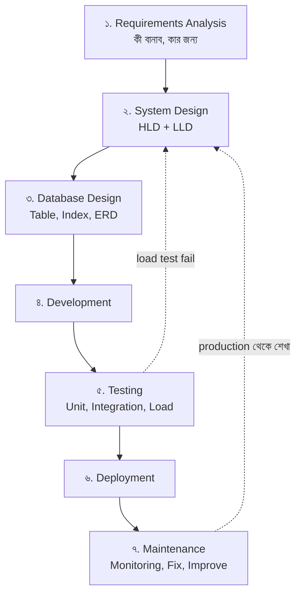
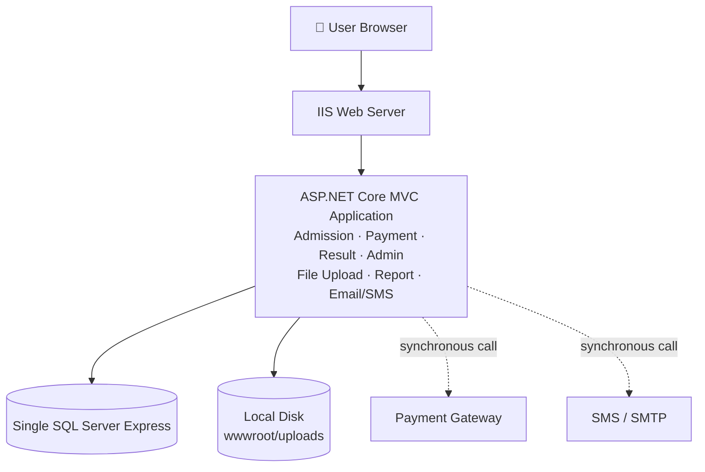
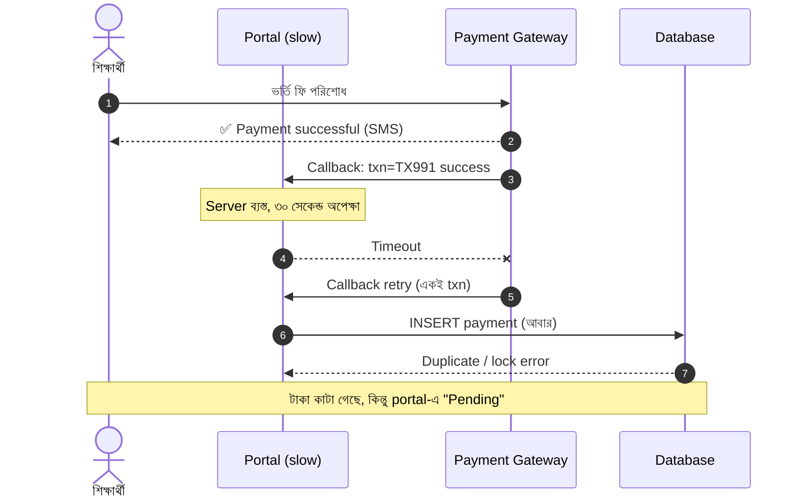
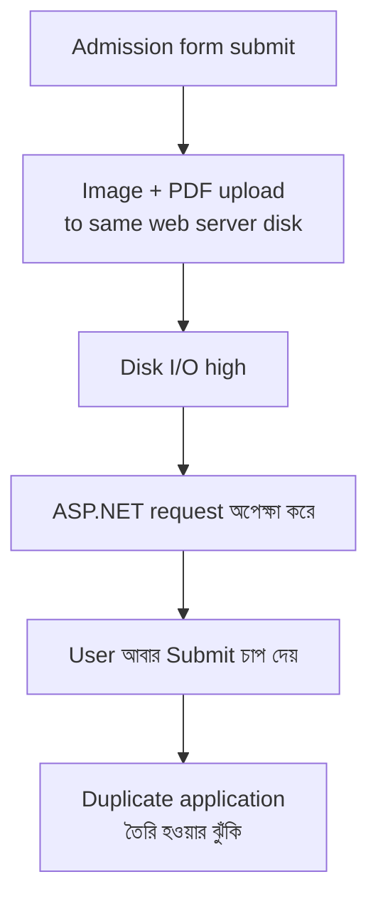
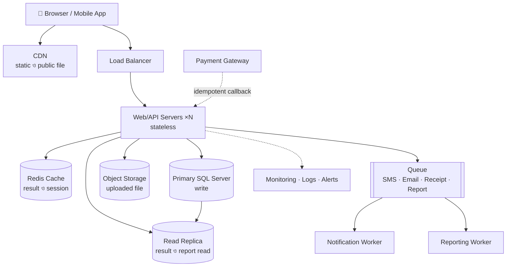
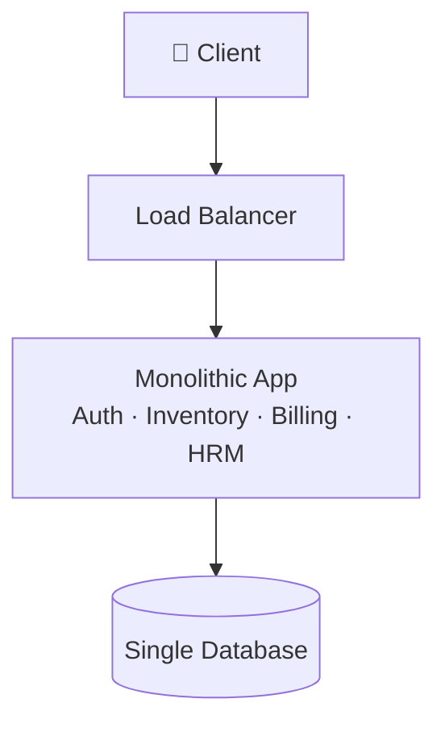
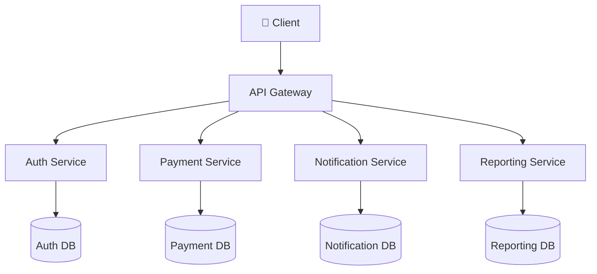

> [!GOALS]
> - System Design কী এবং কেন এটি programming থেকে আলাদা দক্ষতা
> - SDLC-এ System Design-এর অবস্থান, High-Level ও Low-Level Design
> - একটি বাস্তব portal কেন peak traffic-এ ভেঙে পড়ে
> - Monolith বনাম Distributed architecture-এর trade-off
> - একজন architect code লেখার আগে কোন প্রশ্নগুলো করেন
> - AI কীভাবে system design-এর কাজ বদলে দিচ্ছে

> [!STORY] রেজাল্টের সকাল
> সকাল ৯টা ৫ মিনিট। নদী টেকের অফিসে তখনো অর্ধেক চেয়ার খালি। রাফি নিজের ডেস্কে বসে চা খাচ্ছিল আর গর্ব নিয়ে ভাবছিল, তার লেখা Result module আজ প্রথমবার হাজার হাজার শিক্ষার্থী ব্যবহার করবে।
>
> ৯টা ১০-এ তানভীরের phone বেজে উঠল। তারপর আবার। তারপর একটানা। Dashboard-এ login API-এর response time ৩০০ millisecond থেকে লাফিয়ে ১২ সেকেন্ড। Database CPU ৯৮%। Facebook-এ শিক্ষার্থীরা screenshot দিয়ে post করছে: "ভার্সিটির সাইট আবার ডাউন!"
>
> ৯টা ৩০-এ মিতু দৌড়ে এলেন: "কিছু অভিভাবক বলছেন টাকা কেটে গেছে, কিন্তু portal-এ এখনো payment pending দেখাচ্ছে!" রাফি তাকিয়ে রইল। তার code-এ তো কোনো bug নেই। Test-এ সবকিছু ঠিকঠাক চলেছিল।
>
> সেদিন রাত এগারোটায়, সব ঠান্ডা হওয়ার পর, করিম সাহেব নুসরাতকে ডেকে বললেন, "Code-এ ভুল ছিল না, এটা আমি বুঝি। কিন্তু তাহলে ভুলটা কোথায়?"
>
> নুসরাত whiteboard-এ একটি বাক্স আঁকলেন, তার ভেতরে লিখলেন "সব কিছু", আর বললেন, "ভুলটা এখানে। আমরা পুরো system-কে একটি বাক্সে রেখেছিলাম। ভুলটা design-এ।"

এই অধ্যায়ে আমরা বুঝব নুসরাত কী বোঝাতে চেয়েছিলেন।

## 1.1 System Design (সিস্টেম ডিজাইন) কী?

System Design বা সিস্টেম ডিজাইন হলো একটি সফটওয়্যার সিস্টেমের সম্পূর্ণ কাঠামো (architecture) পরিকল্পনা করার প্রক্রিয়া, যেখানে নির্ধারণ করা হয়: সিস্টেমটি কীভাবে কাজ করবে, কীভাবে বিভিন্ন অংশ (components) একে অপরের সাথে যোগাযোগ করবে, কীভাবে এটি ভবিষ্যতে বৃদ্ধি পাবে (scalability), কীভাবে ডেটা নিরাপদ থাকবে (security), এবং কীভাবে বড় পরিমাণ ব্যবহারকারী ও ডেটা কার্যকরভাবে পরিচালনা করবে।

সহজ ও প্রাঞ্জল বাংলায় বলতে গেলে:

> [!QUOTE]
> System Design হলো একটি সফটওয়্যার সিস্টেমের ভবিষ্যৎ রূপ কেমন হবে, সেটির পূর্ণাঙ্গ নকশা বা ব্লু-প্রিন্ট তৈরি করার প্রক্রিয়া, যাতে এটি বর্তমান ও ভবিষ্যতের চাহিদা অনুযায়ী দ্রুত, নির্ভরযোগ্য এবং সম্প্রসারণযোগ্যভাবে কাজ করতে পারে।

একটি বাড়ির কথা ভাবুন। একতলা বাড়ি বানাতে হয়তো একজন অভিজ্ঞ রাজমিস্ত্রিই যথেষ্ট। কিন্তু বিশতলা ভবন বানাতে হলে আগে থেকেই ঠিক করতে হয় ভিত কত গভীর হবে, লিফট কয়টা লাগবে, আগুন লাগলে মানুষ কোন সিঁড়ি দিয়ে নামবে, পানির ট্যাংক কোথায় বসবে। ভবন উঠে যাওয়ার পর ভিত বদলানো প্রায় অসম্ভব। Software-এর ক্ষেত্রেও ঠিক তাই।

ধরুন, আপনি একটি ছোট ই-কমার্স (E-commerce) বা ইআরপি (ERP) সফটওয়্যার তৈরি করলেন।

**প্রাথমিক অবস্থা:**
- মাত্র ১০ জন ইউজার।
- একটি সাধারণ সার্ভার।
- একটি মাত্র ডাটাবেজ (Database)।
- সীমিত ফিচার।

এই অবস্থায় সিস্টেমটি খুবই দ্রুত এবং স্থিতিশীলভাবে (stable) কাজ করছিল।

**২ বছর পর বর্তমান অবস্থা:**
- ইউজারের সংখ্যা ৫০,০০০ ছাড়িয়ে গেছে।
- প্রতিদিন হাজার হাজার ট্রানজ্যাকশন (Transaction) হচ্ছে।
- একটি নতুন মোবাইল অ্যাপ যুক্ত হয়েছে।
- একাধিক পেমেন্ট গেটওয়ের (Payment API) ইন্টিগ্রেশন হয়েছে।
- রিয়েল-টাইম (Real-time) রিপোর্টিংয়ের দরকার পড়ছে।

এই পর্যায়ে এসে পূর্বের সরল আর্কিটেকচার আর কার্যকর থাকে না। সিস্টেম ধীরে ধীরে স্লো হয়ে যায়, ডাটাবেজে লকিং সমস্যা দেখা দেয়, সার্ভার অতিরিক্ত লোড নিতে পারে না, এমনকি কিছু ক্ষেত্রে সিস্টেম ক্র্যাশও করতে পারে। ঠিক এই জায়গা থেকেই **System Design**-এর প্রকৃত প্রয়োজনীয়তা স্পষ্ট হয়ে ওঠে। কারণ একটি ভালো System Design আগেই এসব স্কেলিং, পারফরম্যান্স এবং নির্ভরযোগ্যতার (reliability) সমস্যা সমাধানের জন্য কাঠামো তৈরি করে রাখে, যাতে ভবিষ্যতে সিস্টেম বড় হলেও তা নির্বিঘ্নে পরিচালিত হতে পারে।



## 1.2 কেন System Design গুরুত্বপূর্ণ?

System Design হলো একটি সফটওয়্যার সিস্টেমের **আর্কিটেকচার, কম্পোনেন্ট, ডাটা ফ্লো, স্কেলিং, সিকিউরিটি এবং ইন্টিগ্রেশন** কীভাবে কাজ করবে তার পরিকল্পনা। একটি ভালো System Design ছাড়া বড় সফটওয়্যার প্রজেক্ট দীর্ঘমেয়াদে টিকিয়ে রাখা কঠিন হয়ে যায়। নিচের আটটি স্তম্ভ প্রায় প্রতিটি design সিদ্ধান্তে কোনো না কোনোভাবে উপস্থিত থাকে।



### ১. Scalability (স্কেল করার সক্ষমতা)

শুরুর দিকে ১,০০০ ইউজার থাকলেও ভবিষ্যতে ১০ লাখ ইউজার হতে পারে। ভালো System Design সিস্টেমকে বেশি ট্রাফিক এবং ডাটা হ্যান্ডেল করতে সাহায্য করে।

- ছোট অ্যাপ: Single Server
- বড় অ্যাপ: Load Balancer + Multiple Servers + Caching + Database Sharding

### ২. Performance (উচ্চ পারফরম্যান্স)

ভালো ডিজাইন সিস্টেমকে দ্রুত রেসপন্স করতে সাহায্য করে। Database Indexing, Caching, Asynchronous Processing এবং CDN এর প্রধান হাতিয়ার। ডিজাইন ভালো না হলে API slow হবে, database bottleneck তৈরি হবে, এবং শেষ পর্যন্ত user experience খারাপ হবে।

### ৩. Reliability (নির্ভরযোগ্যতা)

সিস্টেমের কোনো অংশ fail করলেও পুরো সিস্টেম বন্ধ হয়ে যাবে না। Redundant server, database replication, failover mechanism এবং message queue এখানে মূল ভূমিকা রাখে। Netflix এবং Amazon তাদের সিস্টেমকে এমনভাবে ডিজাইন করে যাতে একটি সার্ভার, এমনকি একটি পুরো data center নষ্ট হলেও সার্ভিস চালু থাকে।

### ৪. Maintainability (সহজে পরিবর্তন ও রক্ষণাবেক্ষণ)

একটি ERP বা Microservices project-এ প্রতিনিয়ত নতুন feature যোগ হয়। ভালো System Design থাকলে নতুন feature যোগ করা সহজ হয়, bug fix দ্রুত করা যায়, code reuse করা যায় এবং নতুন developer দ্রুত onboard হতে পারে।

### ৫. Security (নিরাপত্তা)

System Design-এর মাধ্যমেই নির্ধারণ করা হয় Authentication, Authorization, Encryption, Audit Logging, API Security এবং Rate Limiting কীভাবে কাজ করবে। খারাপ ডিজাইনের কারণে data leak, unauthorized access বা পুরো system breach ঘটতে পারে। Security পরে "যোগ করা" যায় না; এটা শুরু থেকেই design-এর অংশ হতে হয়।

### ৬. Cost Optimization (খরচ কমানো)

ভালো System Design infrastructure cost কমায়। Caching ব্যবহার করলে database load কমে, auto scaling ব্যবহার করলে অপ্রয়োজনীয় server cost কমে, আর queue ব্যবহার করলে peak load সামলাতে বড় server কিনতে হয় না।

### ৭. High Availability (সর্বদা সচল থাকা)

ব্যাংকিং, ERP, টেলিকম, Microfinance-এর মতো সিস্টেমে downtime খুব ব্যয়বহুল। ভালো System Design নিশ্চিত করে 99.9% বা তার বেশি uptime, disaster recovery, backup strategy এবং প্রয়োজনে geo redundancy।

### ৮. Business Growth Support

Business বড় হওয়ার সাথে সাথে system-ও বড় হয়। একটি Microfinance software-এর উদাহরণ:

| মাত্রা | শুরুতে | কয়েক বছর পর |
| --- | --- | --- |
| Customer | ১০,০০০ | ৭০ লাখ |
| Branch | ১টি | ২,০০০+ |
| Transaction | দিনে কয়েক হাজার | মাসে কোটি কোটি |

ভালো System Design না থাকলে এই বৃদ্ধির কোনো এক পর্যায়ে পুরো system rebuild করতে হতে পারে, যা সময়, টাকা আর client-এর আস্থা তিনটিই কেড়ে নেয়।

## 1.3 SDLC-এ System Design-এর অবস্থান

Software Development Lifecycle (SDLC)-এ System Design আসে requirement বোঝার ঠিক পরে এবং code লেখার আগে। এখানে নেওয়া সিদ্ধান্তগুলোই পরের সব ধাপের ভিত্তি।




System Design সাধারণত দুই স্তরে করা হয়:

| | High-Level Design (HLD) | Low-Level Design (LLD) |
| --- | --- | --- |
| প্রশ্ন | কোন কোন বড় অংশ থাকবে, কীভাবে যুক্ত হবে? | প্রতিটি অংশের ভেতরে কী থাকবে? |
| উদাহরণ | Load balancer, service, database, cache, queue | Class, table schema, API contract, index |
| দর্শক | Architect, CTO, সব team | Developer, reviewer |
| Diagram | Architecture diagram, data flow | Class diagram, ERD, sequence diagram |
| ভুল হলে | পুরো system বদলাতে হয় | একটি module বদলাতে হয় |

> [!TIP]
> Database Design সাধারণত System Design-এর Low-Level Design (LLD)-এর একটি গুরুত্বপূর্ণ অংশ। তবে বড় system-এ কোন database ব্যবহার হবে (SQL না NoSQL, একটা না একাধিক), সেটা HLD-এর সিদ্ধান্ত।

## 1.4 Real World Example: নদী টেকের Admission & Result Portal

এবার ফিরে যাই অধ্যায়ের শুরুর গল্পে। নদী টেক একটি বিশ্ববিদ্যালয় গ্রুপের জন্য একটি ছোট **Online Admission & Result Portal** তৈরি করেছিল। শুরুতে লক্ষ্য ছিল খুব সাধারণ: শিক্ষার্থীরা অনলাইনে ভর্তি ফর্ম পূরণ করবে, ফি পেমেন্ট করবে, আর পরে একই পোর্টাল থেকে রেজাল্ট দেখতে পারবে। প্রথম ভার্সনে সিস্টেমটি ভালোই কাজ করছিল, কারণ ব্যবহারকারী কম ছিল এবং একই সময়ে খুব বেশি ট্রাফিক আসতো না।

**Business Problem:**
- ভর্তি ফর্ম অনলাইনে জমা নিতে হবে।
- আবেদনকারীর ছবি, জন্মসনদ এবং মার্কশিট আপলোড করতে হবে।
- ভর্তি ফি অনলাইনে পেমেন্ট করতে হবে।
- পেমেন্ট সফল হলে রসিদ তৈরি করতে হবে।
- পরীক্ষার ফলাফল প্রকাশের দিনে শিক্ষার্থী ও অভিভাবকরা লগইন করে ফলাফল দেখবে।
- অ্যাডমিন প্যানেল থেকে আবেদন, পেমেন্ট, ফলাফল এবং রিপোর্ট ম্যানেজ করতে হবে।

**প্রাথমিক টেক স্ট্যাক (Initial Tech Stack):**

| Layer | Technology |
| --- | --- |
| Frontend | HTML, CSS, Bootstrap, jQuery |
| Backend ও API | ASP.NET Core MVC, একই অ্যাপ্লিকেশনের Controller |
| Database ও ORM | SQL Server Express, Entity Framework Core |
| Hosting | IIS on a single Windows Server |
| File Storage | একই সার্ভারের `wwwroot/uploads` ফোল্ডার |
| Authentication | Cookie-based login session |
| Payment | Third-party payment gateway API |
| Email/SMS | সরাসরি অ্যাপ্লিকেশন থেকে SMTP এবং SMS API call |
| Reporting | SQL query থেকে synchronously PDF/Excel generate |

**প্রাথমিক সিস্টেম স্ট্রাকচার:**



**শুরুতে বাস্তব লোড:**
- ১টি ক্যাম্পাস, প্রায় ৫০০ শিক্ষার্থী।
- দিনে ৫০-১০০টি ভর্তি ফর্ম সাবমিট।
- একই সময়ে সর্বোচ্চ ২০-৩০ জন ইউজার।
- ফাইল আপলোড খুব কম; রিপোর্ট সাধারণত অ্যাডমিনরা অফিস সময়ে চালাতেন।

এই অবস্থায় সিস্টেমটি দ্রুত মনে হচ্ছিল। কারণ Web Server, Database, File Storage এবং Reporting সব একই মেশিনে থাকলেও লোড খুব কম ছিল।

**২ বছর পরে সিস্টেমের অবস্থা:**
- ১২টি ক্যাম্পাস একই পোর্টাল ব্যবহার করতে শুরু করলো।
- ভর্তি মৌসুমে দিনে ৮,০০০-১০,০০০ আবেদন জমা পড়তে লাগলো।
- ফলাফল প্রকাশের প্রথম ৩০ মিনিটে ২০,০০০+ request আসতে লাগলো।
- একই সময়ে ৩,০০০-৫,০০০ concurrent user লগইন করার চেষ্টা করছিল।
- প্রতিটি আবেদনকারীর ছবি, ডকুমেন্ট, মার্কশিট এবং পেমেন্ট রসিদ জমা হচ্ছিল।
- অ্যাডমিনরা একই সময়ে admission report, payment report এবং result summary generate করছিলেন।

**Production Day Timeline (তানভীরের incident log থেকে):**

```text
09:00 AM  Result publish করার ঘোষণা দেওয়া হলো।
09:05 AM  শিক্ষার্থী ও অভিভাবকরা একসাথে login page refresh করতে শুরু করলো।
09:10 AM  Login API response time 300ms থেকে 8-12 seconds হয়ে গেল।
09:15 AM  SQL Server CPU 95%-100% এ চলে গেল।
09:20 AM  Payment callback queue না থাকায় gateway থেকে আসা callback request timeout হতে লাগলো।
09:25 AM  Admin panel থেকে report download করার চেষ্টা করলে application pool recycle হলো।
09:30 AM  কিছু user payment successful SMS পেল, কিন্তু portal-এ payment pending দেখাচ্ছিল।
09:45 AM  IIS restart দেওয়া হলো, কিন্তু restart-এর পরে pending SMS/email process হারিয়ে গেল।
10:15 AM  Team result page সাময়িকভাবে বন্ধ করে শুধু notice দেখাতে বাধ্য হলো।
```

### Database-এর বাস্তব চাপ

| Table | শুরুতে | দুই বছর পর |
| --- | --- | --- |
| `Students` | ৫০০ row | ১,৫০,০০০+ row |
| `Applications` | কয়েকশো | ভর্তি মৌসুম শেষে ২,৫০,০০০+ |
| `Payments` | দিনে কয়েকটি | প্রতিদিন ২০,০০০+ record |
| `UploadedFiles` | কয়েক হাজার | ৮-১০ লক্ষ file metadata |
| `Results` | কয়েক হাজার | প্রতি পরীক্ষায় কয়েক লক্ষ insert/update |
| `AuditLogs` | ছোট | login, payment, admin action মিলিয়ে দ্রুত বড় হচ্ছিল |

**Slow Query-এর উদাহরণ:**

```sql
SELECT s.StudentId, s.Name, r.TotalMark, r.Grade, p.PaymentStatus
FROM Students s
JOIN Results r ON s.StudentId = r.StudentId
LEFT JOIN Payments p ON s.StudentId = p.StudentId
WHERE s.RollNo = @RollNo AND r.ExamId = @ExamId;
```

এই query দেখতে ছোট, কিন্তু `RollNo`, `ExamId`, `StudentId`-এ proper index না থাকলে result publish day-তে একই query হাজার হাজার বার চলতে থাকে। প্রতিবার SQL Server পুরো table scan করে। ফলে database CPU, memory এবং disk I/O একসাথে চাপের মধ্যে পড়ে। মাত্র দুটি index পুরো ছবি বদলে দিতে পারতো:

```sql
CREATE UNIQUE INDEX IX_Students_RollNo ON Students (RollNo) INCLUDE (Name);
CREATE INDEX IX_Results_Student_Exam ON Results (StudentId, ExamId) INCLUDE (TotalMark, Grade);
```

### Payment Failure Scenario

সবচেয়ে বিপজ্জনক সমস্যা ছিল payment। কারণ এখানে মানুষের টাকা জড়িত।



এখানে সমস্যাটি শুধু coding bug নয়। এটি **design problem**। Payment callback অবশ্যই **idempotent** হতে হবে (একই callback দশবার এলেও ফলাফল একবারই হবে), transaction reference unique হতে হবে, আর receipt generation background worker দিয়ে নির্ভরযোগ্যভাবে করতে হবে। এই ধারণাগুলো আমরা অধ্যায় ৭, ১১ এবং ১৯-এ বিস্তারিত দেখব।

### File Upload Failure Scenario



ভালো ডিজাইনে file upload সরাসরি object storage-এ যাবে, database-এ শুধু file URL বা object key থাকবে, এবং duplicate submit ঠেকাতে application tracking number বা idempotency key থাকবে।

### যেসব সমস্যা শুরু হলো

- Login page slow হয়ে গেল, কারণ session এবং user validation একই database-এ চাপ তৈরি করছিল।
- Result publish করার সময় database-এর `Students`, `Results`, `Payments` টেবিলে heavy read শুরু হলো।
- Admission form submit করার সময় file upload slow হয়ে গেল, কারণ web server disk I/O busy হয়ে যাচ্ছিল।
- Payment gateway callback দেরিতে process হওয়ায় অনেক payment successful হলেও receipt pending দেখাচ্ছিল।
- Report generate করার query main transactional database-এ চলছিল, তাই normal user request block হচ্ছিল।
- SMS এবং email synchronous হওয়ায় form submit বা payment confirmation response আটকে থাকতো।
- একটি বড় Excel report generate হলে IIS worker process-এর memory usage বেড়ে যেত।
- Database backup চলার সময় application আরও slow হয়ে যেত।
- Server restart হলে uploaded file, running request এবং pending notification process সব একসাথে প্রভাবিত হতো।

### মূল ডিজাইন সমস্যা (Root Cause)

- Web application, API, background কাজ, report generation এবং file serving একই server-এ ছিল।
- Database read/write workload আলাদা করা হয়নি।
- Static file বা uploaded document আলাদা object storage-এ রাখা হয়নি।
- Payment callback idempotent করা হয়নি, তাই retry এলে duplicate বা pending state তৈরি হতো।
- SMS/email পাঠানোর জন্য queue ব্যবহার করা হয়নি।
- Result page cache করা হয়নি, অথচ result publish day-তে বেশিরভাগ request একই ধরনের data read করছিল।
- Monitoring, logging, alerting এবং performance metric ঠিকভাবে ছিল না।
- Capacity planning করা হয়নি: peak traffic, storage growth, database size, backup window, report load আগে থেকে হিসাব করা হয়নি।

### ভালো System Design হলে structure এমন হতে পারতো



**Recommended Tech Structure:**
- **Frontend:** React বা Razor Pages, কিন্তু static assets CDN থেকে serve করা।
- **Backend API:** ASP.NET Core Web API, stateless design।
- **Database:** SQL Server Standard/Enterprise with indexing, backup strategy, read replica।
- **Cache:** Redis, বিশেষ করে result view, session/token cache এবং frequently-read lookup data-এর জন্য।
- **Queue:** RabbitMQ, Azure Service Bus বা AWS SQS; payment receipt, SMS, email, report generation async করার জন্য।
- **File Storage:** Azure Blob Storage, AWS S3 বা MinIO; web server local disk নয়।
- **Load Balancer:** Nginx, IIS ARR, Azure Application Gateway বা AWS ALB।
- **Background Worker:** .NET Worker Service বা Hangfire।
- **Monitoring ও Logging:** Application Insights, Prometheus/Grafana অথবা ELK stack; Serilog দিয়ে structured logging।

**Problem বনাম Design Fix Mapping:**

| Real Problem | Better Design Decision | বিস্তারিত |
| --- | --- | --- |
| Result page বারবার একই data read করছে | Redis cache + read replica | অধ্যায় ৫, ৬ |
| Payment callback timeout হচ্ছে | Idempotent callback + queue + retry policy | অধ্যায় ৭, ১১ |
| SMS/email পাঠাতে request আটকে যাচ্ছে | Background worker + message queue | অধ্যায় ১১ |
| Report generation database block করছে | Reporting worker + read replica + pre-generated report | অধ্যায় ৫ |
| File upload web server slow করছে | Object storage + signed upload URL | অধ্যায় ২৩ |
| Login traffic database চাপাচ্ছে | Stateless auth/token cache + rate limiting | অধ্যায় ৭, ৮ |
| Server restart হলে pending কাজ হারিয়ে যাচ্ছে | Durable queue + worker retry | অধ্যায় ১১ |
| Problem কোথায় হচ্ছে বোঝা যাচ্ছে না | Centralized logging + metrics + tracing | অধ্যায় ১২ |

**এই Example থেকে শেখার বিষয়:**
- Small user দিয়ে test করলে system fast মনে হতে পারে, কিন্তু peak traffic আলাদা জিনিস।
- Feature working মানেই system production-ready নয়।
- একই server-এ সব কাজ রাখলে একটি কাজের চাপ অন্য সব কাজকে ধীর করে দেয়।
- Payment, notification, report এবং file upload সাধারণ request-response flow থেকে আলাদা করে ভাবতে হয়।
- Database design শুধু table বানানো নয়; indexing, read/write separation, backup, archive এবং query pattern বুঝতে হয়।

**কারণ কী?** প্রথম ডিজাইনটি শুধু feature complete করার জন্য বানানো হয়েছিল, কিন্তু peak load, file growth, payment reliability, report workload, notification delay এবং database scaling নিয়ে আগেই ভাবা হয়নি। System Design-এর কাজ হলো শুধু code কোথায় লেখা হবে তা ঠিক করা নয়; বরং কোন কাজ কোন component করবে, কোন data কোথায় থাকবে, কোন request synchronous হবে, কোন কাজ queue-তে যাবে, এবং বেশি চাপ এলে system কীভাবে stable থাকবে তা আগে থেকেই ঠিক করা।

> [!CASE] Healthcare.gov, ২০১৩: যখন একটি দেশের portal প্রথম দিনেই ভেঙে পড়ে
> ২০১৩ সালের ১ অক্টোবর যুক্তরাষ্ট্র সরকার স্বাস্থ্যবীমা কেনার জন্য Healthcare.gov চালু করে। প্রথম দিনেই প্রত্যাশার কয়েকগুণ বেশি মানুষ একসাথে ঢুকে পড়ে। Login আর account তৈরির অংশ ভেঙে পড়ে। প্রকাশিত প্রতিবেদন অনুযায়ী প্রথম দিনে মাত্র হাতেগোনা কয়েকজন enrollment শেষ করতে পেরেছিলেন।
>
> পরে যে বিশেষজ্ঞ দলটি site উদ্ধারে নামে, তারা প্রথমেই আবিষ্কার করে: পুরো system-এর অবস্থা একসাথে দেখার মতো কোনো dashboard বা monitoring ছিল না। কোন অংশ ধীর, কোথায় error, কেউ নিশ্চিত জানত না। তাদের প্রথম কাজগুলোর একটি ছিল monitoring বসানো, তারপর caching আর capacity বাড়ানো।
>
> **শিক্ষা:** বড় প্রতিষ্ঠান, বড় budget, অনেক contractor থাকলেও end-to-end design, load test আর observability না থাকলে ফলাফল একই। আমাদের দেশে SSC/HSC রেজাল্ট বা বিশ্ববিদ্যালয় ভর্তির দিনে ওয়েবসাইটে ঢুকতে না পারার অভিজ্ঞতা অনেকেরই আছে। সমস্যার মূল প্রায় সবসময় একই জায়গায়।

## 1.5 Software Development বনাম System Design

অনেকেই প্রোগ্রামিং আর সিস্টেম ডিজাইনকে একই জিনিস মনে করে থাকেন। কিন্তু তারা সম্পূর্ণ আলাদা দক্ষতা (Skill)। একজন অসাধারণ programmer-ও খারাপ system design করতে পারেন, ঠিক যেমন একজন দক্ষ রাজমিস্ত্রি ভবনের নকশা না-ও জানতে পারেন।

| Programming (প্রোগ্রামিং) | System Design (সিস্টেম ডিজাইন) |
| --- | --- |
| ছোট বা নির্দিষ্ট ফাংশন লেখা | পুরো সিস্টেমের আর্কিটেকচার ডিজাইন করা |
| লজিক এবং অ্যালগরিদম নিয়ে কাজ করা | স্কেলেবিলিটি এবং ইনফ্রাস্ট্রাকচার নিয়ে ভাবা |
| ফিচার ইমপ্লিমেন্ট করা | রিলায়েবিলিটি (Reliability) এবং পারফরম্যান্স নিয়ে কাজ করা |
| ক্লাস এবং অবজেক্ট ডিজাইন | ক্যাশিং, ডাটাবেজ পার্টিশনিং এবং সার্ভার ক্লাস্টারিং |
| "কোড কি সঠিক?" | "এক লাখ মানুষ একসাথে এলে কি টিকবে?" |
| একটি সঠিক উত্তর থাকে | শুধু trade-off থাকে |

## 1.6 একজন System Designer কী চিন্তা করেন?

একজন সিনিয়র সফটওয়্যার ইঞ্জিনিয়ার বা আর্কিটেক্ট কোড লেখার আগে সাধারণত যেসব বিষয়ে গভীরভাবে চিন্তা করেন:

- ভবিষ্যতে যখন ১ লাখ ইউজার হবে, তখন এই সিস্টেম কি কাজ করবে?
- ডাটাবেজ যদি কোনো কারণে fail করে, তবে ব্যাকআপ ডাটাবেজ কীভাবে কাজ শুরু করবে?
- সার্ভার ক্র্যাশ হলে recovery কীভাবে হবে?
- API স্লো হলে কীভাবে caching করে সেটি optimize করব?
- Security breach বা হ্যাকিং হলে ডাটা কীভাবে সুরক্ষিত রাখব?

**Admission Portal-এর ক্ষেত্রে একজন System Designer আগে কী প্রশ্ন করতেন?**

- Result publish day-তে peak concurrent user কত হতে পারে?
- একই result data কি cache করা যাবে?
- Payment success হলে source of truth কোনটি: gateway, database, না receipt table?
- File upload web server দিয়ে যাবে, নাকি direct object storage-এ যাবে?
- Report কি live database থেকে generate হবে, নাকি background process-এ তৈরি হবে?
- SMS/email fail হলে retry হবে কীভাবে?
- Database backup কখন চলবে, এবং backup চলার সময় user request slow হবে কি না?
- Server down হলে কোন data হারানো যাবে না?
- Monitoring dashboard-এ কোন metric দেখে team বুঝবে system বিপদে আছে?

> [!ARCHITECT] প্রশ্নের তালিকাটাই design
> নুসরাত রাফিকে বললেন, "তুমি যখন এই প্রশ্নগুলোর উত্তর লিখে ফেলবে, দেখবে diagram নিজে থেকেই আঁকা হয়ে গেছে। ভালো architect প্রথমে উত্তর খোঁজেন না, প্রথমে সঠিক প্রশ্ন খোঁজেন।" অধ্যায় ২-এ আমরা এই প্রশ্নগুলোকে একটি পদ্ধতিতে সাজাব।

## 1.7 Monolith বনাম Distributed System

### মনোলিথিক আর্কিটেকচার (Monolithic Architecture)

মনোলিথিক সিস্টেমে পুরো সফটওয়্যারের সবকিছু একটিমাত্র অ্যাপ্লিকেশনের ভেতরেই থাকে। যেমন একটি ইআরপি-এর ভেতরেই Authentication, Inventory, Billing এবং HRM থাকে। একটি build, একটি deploy, একটি database।



**সুবিধা:**
- তৈরি করা এবং deploy করা খুব সহজ।
- ছোট প্রজেক্টের জন্য খুব দ্রুত কাজ করা যায়।
- Debug করা সহজ, কারণ সব code এক জায়গায়।
- একটি database transaction দিয়েই consistency রক্ষা করা যায়।

**সমস্যা:**
- কোডবেস অনেক বড় হয়ে গেলে মেইনটেইন করা কঠিন হয়ে যায়।
- শুধু একটি অংশ (যেমন Report) বেশি load নিলেও পুরো application scale করতে হয়।
- একটি module-এ memory leak বা crash হলে পুরো system ডাউন হয়ে যেতে পারে।

### ডিস্ট্রিবিউটেড সিস্টেম (Distributed Architecture / Microservices)

এই পদ্ধতিতে একটি বড় সিস্টেমকে ভেঙে ছোট ছোট স্বাধীন সার্ভিসে (Independent Service) রূপান্তর করা হয়। যেমন: Auth Service, Payment Service, Notification Service ইত্যাদি।



**সুবিধা:**
- প্রতিটি সার্ভিস স্বাধীনভাবে scale করা যায়।
- একটি সার্ভিস crash করলে অন্য সার্ভিসগুলোতে প্রভাব সীমিত থাকে।
- ভিন্ন ভিন্ন টিম আলাদা আলাদা সার্ভিস নিয়ে স্বাধীনভাবে কাজ ও deploy করতে পারে।

**সমস্যা:**
- আর্কিটেকচার, deployment এবং monitoring অনেক জটিল।
- Network call বাড়ে, তাই latency ও failure-এর সম্ভাবনাও বাড়ে।
- Data consistency রক্ষা করা কঠিন; একটি transaction কয়েকটি database জুড়ে চালানো যায় না।

### তাহলে কোনটা বেছে নেব?

| পরিস্থিতি | পরামর্শ |
| --- | --- |
| নতুন product, ছোট team (২-১০ জন) | **Modular Monolith** দিয়ে শুরু করুন |
| একটি module-এর load বাকিদের চেয়ে অনেক বেশি | শুধু সেই module আলাদা service করুন |
| অনেকগুলো স্বাধীন team, আলাদা release cycle | Microservices বিবেচনা করুন |
| Strong consistency সবচেয়ে জরুরি (যেমন ledger) | যতদূর সম্ভব এক database-এর ভেতরে রাখুন |

> [!WARNING]
> Microservices কোনো পুরস্কার নয়। অনেক team "আধুনিক" দেখানোর জন্য শুরুতেই দশটা service বানিয়ে ফেলে, তারপর distributed debugging, network failure আর data inconsistency-র মধ্যে হারিয়ে যায়। অধ্যায় ১০-এ আমরা দেখব কীভাবে Amazon Prime Video-র একটি team microservices থেকে monolith-এ ফিরে গিয়ে খরচ প্রায় ৯০% কমিয়েছিল।

## 1.8 AI কোণ: AI কি System Design বদলে দিচ্ছে?

> [!AI] AI যুগে System Design-এর দুটি নতুন দিক
> **১. AI এখন system-এর একটি component।** Chatbot, document summarization, fraud detection, recommendation: এখন অনেক product-এ একটি LLM বা ML model থাকে। এটি একটি নতুন ধরনের dependency, যেটা ধীর (কয়েক সেকেন্ড পর্যন্ত), দামি (প্রতি request-এ টাকা), এবং মাঝে মাঝে আত্মবিশ্বাসের সাথে ভুল উত্তর দেয়। তাই এটিকে database বা payment gateway-এর মতোই সাবধানে design করতে হয়: timeout, fallback, cache, rate limit, monitoring সব লাগে। পর্ব ৫-এ এ নিয়ে বিস্তারিত আলোচনা আছে।
>
> **২. AI এখন architect-এর সহকর্মী।** Requirement থেকে প্রশ্নের তালিকা বানানো, capacity হিসাব যাচাই করা, diagram-এর প্রথম খসড়া তৈরি, ADR লেখা: এসব কাজে AI সত্যিই সময় বাঁচায়। কিন্তু AI আপনার client-এর result day-র traffic pattern, আপনার team-এর দক্ষতা বা আপনার budget জানে না। **সিদ্ধান্ত আর তার দায় মানুষের।** অধ্যায় ১৭-এ দেখব কীভাবে AI-কে সহকর্মী হিসেবে কাজে লাগাতে হয়, অন্ধভাবে বিশ্বাস না করে।

## 1.9 সাধারণ ভুল

- **"পরে scale করব"** ভেবে শুরুতে কোনো capacity হিসাব না করা। পরে scale করা যায়, কিন্তু কিছু সিদ্ধান্ত (যেমন data model, file storage, payment flow) পরে বদলানো খুব ব্যয়বহুল।
- **উল্টো ভুল: over-engineering।** ৫০০ user-এর জন্য Kubernetes, Kafka আর ১৫টি microservice। এতে খরচ ও জটিলতা বাড়ে, ব্যবসায়িক মূল্য বাড়ে না।
- **শুধু happy path design করা।** Payment fail হলে, SMS না গেলে, server restart হলে কী হবে, তা না ভাবা।
- **Average দেখে সিদ্ধান্ত নেওয়া।** গড়ে দিনে ১০,০০০ request মানে কিছুই না, যদি তার অর্ধেক আসে প্রথম ১৫ মিনিটে।
- **Monitoring ছাড়া production-এ যাওয়া।** সমস্যা হলে কোথায় হচ্ছে, কেউ জানে না।

## 1.10 Interview প্রশ্ন

> [!INTERVIEW]
> 1. System Design এবং Programming-এর মধ্যে পার্থক্য কী? একটি উদাহরণ দিন।
> 2. High-Level Design আর Low-Level Design-এর পার্থক্য কী? প্রত্যেকটিতে কোন diagram ব্যবহার করবেন?
> 3. Monolith কখন microservices-এর চেয়ে ভালো পছন্দ?
> 4. একটি result portal peak time-এ crash করছে। প্রথম ৩০ মিনিটে আপনি কী কী করবেন, আর দীর্ঘমেয়াদে কী বদলাবেন?
> 5. Payment callback কেন idempotent হতে হবে?
>
> **টিপস:** উত্তর দেওয়ার সময় সরাসরি technology-র নাম দিয়ে শুরু করবেন না। আগে সমস্যা ও constraint বলুন ("result day-তে read-heavy traffic, একই data বারবার পড়া হচ্ছে"), তারপর সমাধান ("তাই cache ও read replica")।

## 1.11 নিজে করে দেখুন

> [!EXERCISE] আপনার নিজের system
> আপনি এখন যে project-এ কাজ করছেন (বা সম্প্রতি করেছেন), সেটির একটি diagram কাগজে আঁকুন। তারপর এই পাঁচটি প্রশ্নের উত্তর লিখুন:
> 1. Peak time-এ কতজন user একসাথে থাকে? এই সংখ্যা কি আপনি আসলেই জানেন, নাকি অনুমান?
> 2. কোন একটি component বন্ধ হলে পুরো system বন্ধ হয়ে যায়?
> 3. কোন কাজগুলো synchronous, যেগুলো আসলে background-এ হতে পারতো?
> 4. সবচেয়ে ধীর API কোনটি, এবং কেন?
> 5. Production-এ সমস্যা হলে সবার আগে কে জানতে পারে: আপনার team, নাকি আপনার user?
>
> পঞ্চম প্রশ্নের উত্তর যদি "user" হয়, অধ্যায় ১২ আপনার জন্য সবচেয়ে জরুরি।

## 1.12 Chapter Summary (সারসংক্ষেপ)

- **System Design কী:** এটি শুধুমাত্র কোড নয়, পুরো সিস্টেমকে নিরবচ্ছিন্নভাবে পরিচালনার ব্লু-প্রিন্ট।
- **প্রয়োজনীয়তা:** ট্রাফিক এবং ডেটা বাড়লে সিস্টেম যাতে স্লো বা ক্র্যাশ না করে, এবং ভুল হলেও টিকে থাকে।
- **SDLC-এ অবস্থান:** Requirement-এর পরে, code-এর আগে; HLD পুরো ছবি দেখায়, LLD ভেতরের বিস্তারিত।
- **Admission Portal-এর শিক্ষা:** একই server-এ সব কাজ, index-বিহীন query, non-idempotent payment আর monitoring-এর অভাব মিলে একটি সাধারণ দিনকে দুর্যোগে পরিণত করে।
- **মনোলিথিক বনাম মাইক্রোসার্ভিস:** একটি সিস্টেমে সবকিছু একসাথে রাখা বনাম ছোট ছোট স্বাধীন সার্ভিসে ভাগ করা; ছোট শুরু করুন, প্রয়োজন হলে ভাঙুন।
- **এন্টারপ্রাইজ মাইন্ডসেট:** একজন জুনিয়র ডেভেলপার শুধু ফিচার নিয়ে ভাবেন, আর একজন আর্কিটেক্ট সিস্টেমের ভবিষ্যৎ, ব্যর্থতা, সিকিউরিটি এবং রিলায়েবিলিটি নিয়ে চিন্তা করেন।

> [!ARCHITECT] নুসরাতের নোটবুক · Result Day Incident
> **কী হয়েছিল:** Result publish-এর ১০ মিনিটের মধ্যে login ও result API অচল; কিছু payment-এর receipt আটকে গেল।
> **মূল কারণ:** একটি server-এ সব কাজ; index-বিহীন result query; synchronous SMS ও report; non-idempotent payment callback; কোনো load test বা alert নেই।
> **তাৎক্ষণিক পদক্ষেপ:** দুটি index; result page-এ ৫ মিনিটের cache; report বন্ধ রাখা; pending payment হাতে reconcile করা।
> **দীর্ঘমেয়াদি সিদ্ধান্ত:** Portal নতুন করে design করা হবে। প্রথম ধাপ: requirement আর capacity সঠিকভাবে বোঝা।
> **নিজের জন্য নোট:** পরের বার প্রথম দিনেই জিজ্ঞেস করব, "সবচেয়ে খারাপ দিনটা দেখতে কেমন?"
