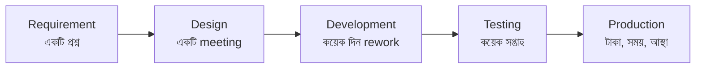
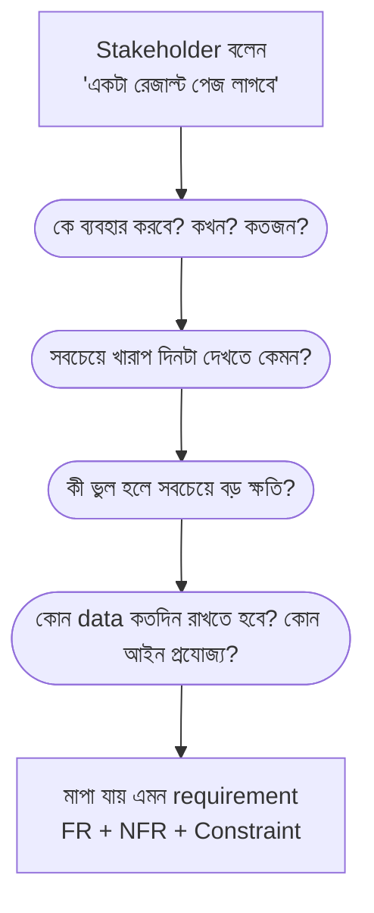
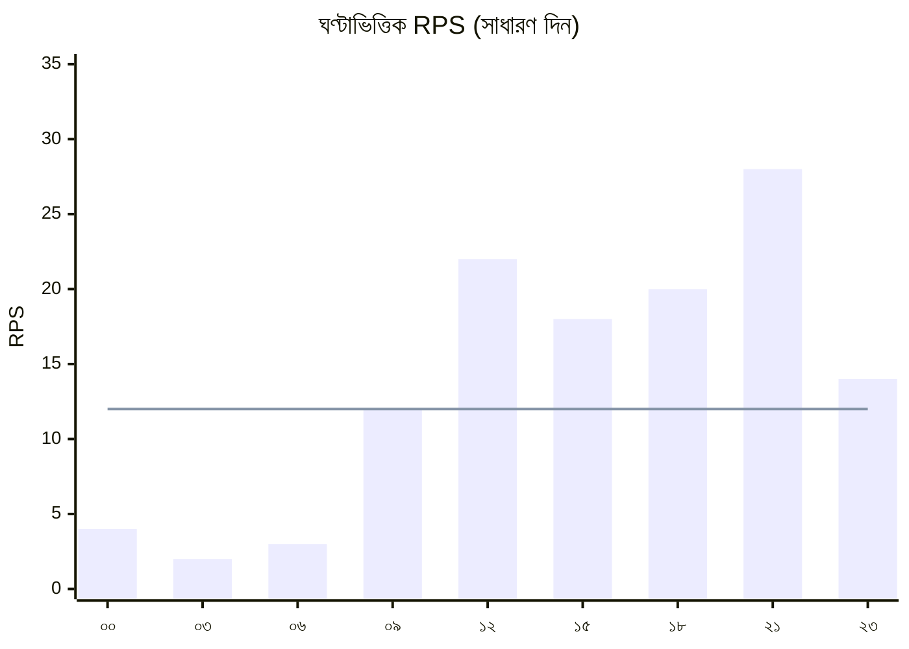
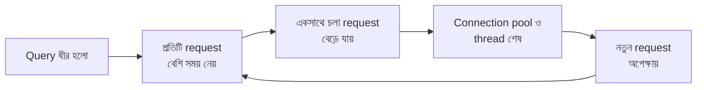
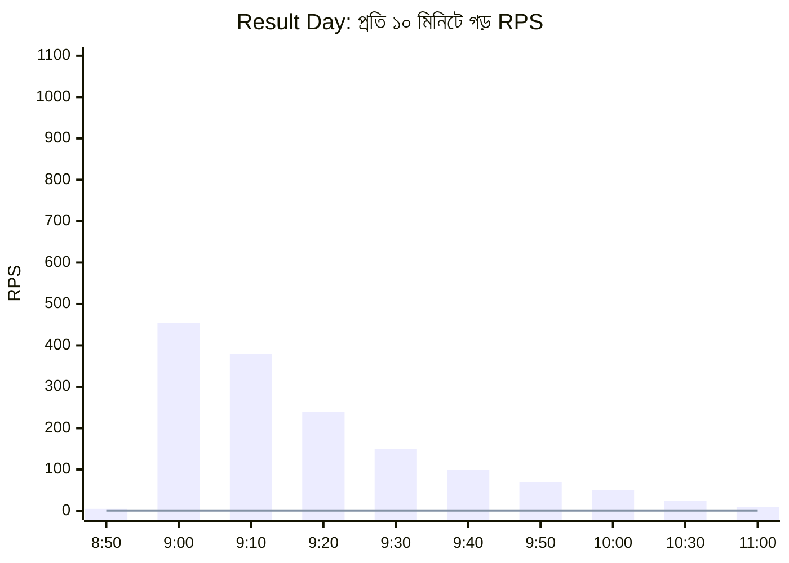

> [!GOALS]
> - Functional ও Non-Functional requirement আলাদা করা এবং মাপা যায় এমনভাবে লেখা
> - Stakeholder-এর কাছ থেকে সঠিক প্রশ্ন করে আসল চাহিদা বের করা
> - DAU, RPS, peak factor, storage ও bandwidth হিসাব করা
> - Little's Law দিয়ে concurrency ও server সংখ্যা অনুমান করা
> - AI feature-এর জন্য token ও খরচের capacity planning
> - একটি পূর্ণাঙ্গ worked example: Admission Portal-এর result day

> [!STORY] "আমাদের শুধু একটা রেজাল্ট পেজ লাগবে"
> Crash-এর তিন দিন পর নুসরাত আর মিতু বিশ্ববিদ্যালয়ের রেজিস্ট্রার অফিসে বসেছিলেন। রেজিস্ট্রার সাহেব হাসিমুখে বললেন, "আমাদের চাহিদা খুব সাধারণ। একটা রেজাল্ট পেজ, আর ভর্তির ফর্ম।"
>
> নুসরাত notebook খুললেন। "রেজাল্ট কখন প্রকাশ হয়? সকালে না রাতে?"
> "সকাল ন'টায়। আগের রাতে ফেসবুকে ঘোষণা দিই।"
> "তাহলে ন'টা বাজার আগেই কতজন অপেক্ষা করে থাকে, জানেন?"
> রেজিস্ট্রার একটু থামলেন। "সবাই, মানে… দেড় লাখ শিক্ষার্থী।"
> "আর রেজাল্ট দেখার পর কতজন মার্কশিট PDF ডাউনলোড করে?"
> "প্রায় সবাই। অভিভাবকরাও করেন, আলাদা ফোন থেকে।"
>
> ফেরার পথে রিকশায় মিতু বললেন, "উনি বললেন 'সাধারণ চাহিদা', কিন্তু তুমি তো দেখি আধঘণ্টায় পুরো আলাদা একটা system বের করে ফেললে।"
> নুসরাত হাসলেন। "Requirement কেউ লিখে দেয় না, মিতু। খুঁড়ে বের করতে হয়।"

## 2.1 কেন Requirement Analysis গুরুত্বপূর্ণ?

অনেক সফটওয়্যার প্রজেক্ট ফেইল (fail) বা ব্যর্থ হয় খারাপ কোডিংয়ের কারণে নয়, বরং ইউজারের রিকোয়ারমেন্ট (Requirement) বা চাহিদা ভুল বোঝার কারণে। বাস্তবে সিস্টেম ডিজাইনের সবচেয়ে বিপজ্জনক পরিস্থিতি হলো:

> [!QUOTE]
> ডেভেলপার এমন একটি সিস্টেম তৈরি করেছে, যা দেখতে অনেক সুন্দর, কিন্তু ক্লায়েন্ট বা বিজনেস ঠিক যা চেয়েছিল, এটি তা করতে পারে না।

সিস্টেম ডিজাইনের সর্বপ্রথম এবং সবচেয়ে গুরুত্বপূর্ণ ধাপ হলো ক্লায়েন্টের বা সিস্টেমের রিকোয়ারমেন্ট নিখুঁতভাবে বোঝা। একটি ভুল requirement-এর খরচ সময়ের সাথে বাড়তে থাকে: design-এর সময় ধরা পড়লে একটি meeting, development-এর সময় ধরা পড়লে কয়েক সপ্তাহের rework, আর production-এ ধরা পড়লে client-এর আস্থা।



## 2.2 Functional বনাম Non-Functional Requirement

সিস্টেম ডিজাইনে রিকোয়ারমেন্ট সাধারণত দুই ধরনের হয়ে থাকে।

### ১. Functional Requirement (ফাংশনাল রিকোয়ারমেন্ট)

এগুলো সরাসরি ফিচারের (Feature) সাথে যুক্ত। অর্থাৎ, সিস্টেম **কী কাজ** করবে।

**উদাহরণ (Food Delivery App):**
- ইউজার রেস্টুরেন্টের মেনু দেখতে পারবে।
- ইউজার কার্টে খাবার অ্যাড করে অর্ডার কনফার্ম করতে পারবে।
- রাইডার ট্র্যাকিং (Rider tracking) ম্যাপের মাধ্যমে দেখা যাবে।
- বিকাশ বা কার্ডের মাধ্যমে পেমেন্ট করা যাবে।

### ২. Non-Functional Requirement (নন-ফাংশনাল রিকোয়ারমেন্ট)

এগুলো সিস্টেমের গুণগত মান (Quality) এবং পারফরম্যান্স (Performance) ডিফাইন করে। অর্থাৎ, সিস্টেম কাজগুলো **কত ভালোভাবে** বা **কত দ্রুত** করবে।

**উদাহরণ:**
- সিস্টেমটি একসাথে ১০ লাখ ইউজারের চাপ নিতে পারবে (Scalability)।
- একটি API-এর রেসপন্স টাইম ২০০ মিলি-সেকেন্ডের নিচে হবে (Performance)।
- সিস্টেমটি বছরে ৯৯.৯৯% সময় চালু থাকবে (High Availability)।
- ডেটাবেজ হ্যাক হওয়া থেকে সুরক্ষিত থাকবে (Security)।

> [!TIP]
> "সিস্টেমকে অবশ্যই ১ মিলিয়ন ইউজার সাপোর্ট করতে হবে": এটি কোনো ফাংশনাল রিকোয়ারমেন্ট নয়, এটি একটি নন-ফাংশনাল স্কেলেবিলিটি (Scalability) রিকোয়ারমেন্ট। মনে রাখার সহজ উপায়: Functional = **ক্রিয়া** (দেখা, কেনা, পাঠানো), Non-Functional = **বিশেষণ** (দ্রুত, নিরাপদ, সবসময় চালু)।

### Non-Functional Requirement মাপা যায় এমনভাবে লিখুন

"System fast হতে হবে" কোনো requirement নয়; এটি একটি ইচ্ছা। Requirement হতে হলে সেটা **মাপা ও test করা যায়** এমন হতে হবে।

| অস্পষ্ট (ইচ্ছা) | মাপা যায় এমন (Requirement) |
| --- | --- |
| Result page দ্রুত load হবে | Peak time-এ result API-এর p95 latency < 500 ms |
| System সবসময় চালু থাকবে | ভর্তি মৌসুমে মাসিক availability ≥ 99.9% |
| অনেক user সামলাবে | ১০ মিনিটে ২ লাখ request (≈ 350 RPS, spike 1,000 RPS) |
| Payment নিরাপদ হবে | কোনো payment দুইবার কাটবে না; সব callback idempotent |
| Data হারাবে না | RPO ≤ 5 মিনিট, RTO ≤ 30 মিনিট |

> [!TIP]
> **RPO (Recovery Point Objective):** দুর্ঘটনা ঘটলে সর্বোচ্চ কতটুকু সময়ের data হারানো মেনে নেওয়া যায়। **RTO (Recovery Time Objective):** কত সময়ের মধ্যে system আবার চালু হতে হবে। অধ্যায় ৯-এ এগুলো বিস্তারিত আসবে।

## 2.3 Real World Problem: Requirement Failure

একটি ইআরপি (ERP) সফটওয়্যারে ক্লায়েন্টের রিকোয়ারমেন্ট ছিল: "আমাদের একটি ইনভেন্টরি রিপোর্ট (Inventory Report) লাগবে।"

ডেভেলপার একটি সুন্দর রিপোর্ট পেজ বানিয়ে দিল। কিন্তু যখন প্রোডাকশনে (Production) রিপোর্টটি রান করা হলো, তখন দেখা গেল:
- রিপোর্ট তৈরি হতে প্রায় ৪ মিনিট সময় লাগছে।
- একসাথে ৫০০ জন ইউজার রিপোর্ট জেনারেট করার চেষ্টা করলে পুরো ডাটাবেজ হ্যাং (hang) হয়ে যাচ্ছে।

**কারণ কী?** শুরুতে শুধুমাত্র ফাংশনাল রিকোয়ারমেন্ট নিয়ে ভাবা হয়েছিল, নন-ফাংশনাল রিকোয়ারমেন্ট (যেমন পারফরম্যান্স) নিয়ে কেউ ভাবেনি।

**সঠিক রিকোয়ারমেন্ট হওয়া উচিত ছিল:**
- রিপোর্টটি সর্বোচ্চ ১০ সেকেন্ডের মধ্যে জেনারেট হতে হবে।
- একসাথে ১০০ জন ইউজার কোনো সমস্যা ছাড়াই রিপোর্ট দেখতে পারবে।
- রিপোর্টটি ব্যাকগ্রাউন্ডে তৈরি হবে (Async processing) এবং পরে নোটিফিকেশন আসবে।
- রিপোর্ট চলার সময় অর্ডার নেওয়ার কাজ (transaction) ধীর হবে না।

শেষ লাইনটিই সবচেয়ে গুরুত্বপূর্ণ, এবং client কখনো নিজে থেকে এটা বলবেন না।

## 2.4 Requirement খুঁড়ে বের করার কৌশল

Stakeholder সাধারণত **সমাধান** বলেন ("একটা report page"), **সমস্যা** নয় ("মাস শেষে stock মেলাতে তিন দিন লাগে")। Architect-এর কাজ সমাধান থেকে পেছনে হেঁটে আসল সমস্যা ও constraint খুঁজে বের করা।



**নুসরাতের পাঁচটি প্রশ্ন** (প্রায় সব project-এ কাজে লাগে):

1. **কে?** কারা ব্যবহার করবে? শিক্ষার্থী, অভিভাবক, admin, অন্য system?
2. **কখন ও কতজন?** স্বাভাবিক দিনে কত, আর সবচেয়ে ব্যস্ত ১৫ মিনিটে কত?
3. **সবচেয়ে খারাপ দিন?** Result day, ঈদের sale, বেতনের দিন, মাস শেষের closing।
4. **কী ভুল হলে সবচেয়ে বড় ক্ষতি?** ভুল রেজাল্ট দেখানো? টাকা দুইবার কাটা? Data leak?
5. **কোন নিয়ম মানতে হবে?** Bangladesh Bank guideline, data retention, audit, ব্যক্তিগত তথ্য সুরক্ষা।

> [!ARCHITECT] Requirement-কে তিন ভাগে লিখুন
> **Functional (FR):** কী করবে। **Non-Functional (NFR):** কত ভালোভাবে করবে, সংখ্যা দিয়ে। **Constraint:** যা বদলানো যাবে না, যেমন "Budget মাসে ২ লাখ টাকার নিচে", "Team .NET জানে", "Data দেশের বাইরে রাখা যাবে না"। Constraint প্রায়ই design-এর উপর সবচেয়ে বড় প্রভাব ফেলে, অথচ সবচেয়ে কম লেখা হয়।

## 2.5 Capacity Planning (ক্যাপাসিটি প্ল্যানিং) কী?

ক্যাপাসিটি প্ল্যানিং হলো: ভবিষ্যতে আপনার সিস্টেমটি ঠিক কতটা ডেটা, ট্রাফিক বা লোড (Load) হ্যান্ডেল করবে, তার একটি আগাম গাণিতিক হিসাব বা এস্টিমেশন (Estimation) করা। সঠিক ক্যাপাসিটি প্ল্যানিং ছাড়া একটি স্কেলেবল আর্কিটেকচার ডিজাইন করা অসম্ভব।

- **Under-estimation (কম হিসাব করা):** ট্রাফিক বেশি আসলে সার্ভার ক্র্যাশ করবে।
- **Over-estimation (বেশি হিসাব করা):** অযথাই সার্ভারের পেছনে অনেক বেশি টাকা নষ্ট হবে।

লক্ষ্য নিখুঁত সংখ্যা নয়। লক্ষ্য হলো **সঠিক মাত্রা (order of magnitude)**: আমরা কি ১০ RPS-এর কথা বলছি, নাকি ১০,০০০? এই দুইয়ের design সম্পূর্ণ আলাদা।

### হিসাবের জন্য কাজের সংখ্যা

| বিষয় | মান | মনে রাখার কৌশল |
| --- | --- | --- |
| এক দিনে সেকেন্ড | 86,400 | ≈ 10^5 ধরে নিন |
| এক মাসে সেকেন্ড | ≈ 2.6 million | ≈ 2.5 × 10^6 |
| ১ million request/day | ≈ 12 RPS (গড়) | দিনে ১০ লাখ ≈ সেকেন্ডে ১২ |
| 1 KB × 1 million | 1 GB | |
| 1 MB × 1 million | 1 TB | |

**Latency-র মোটামুটি মান (বাস্তবে hardware অনুযায়ী বদলায়):**

| কাজ | সময় |
| --- | --- |
| Memory (RAM) থেকে পড়া | ~100 ns |
| Redis থেকে একটি key পড়া (একই data center) | ~0.5 ms |
| SSD থেকে random read | ~0.1 ms |
| Index দিয়ে একটি simple SQL query | ~1-5 ms |
| Index ছাড়া বড় table scan | শত ms থেকে কয়েক সেকেন্ড |
| একই data center-এ network round trip | ~0.5 ms |
| ঢাকা থেকে সিঙ্গাপুর round trip | ~40-60 ms |
| ঢাকা থেকে আমেরিকা round trip | ~200-300 ms |
| LLM API থেকে একটি উত্তর | ~1-10 s |

> [!TIP]
> শেষ লাইনটা লক্ষ্য করুন। একটি LLM call একটি indexed SQL query-র চেয়ে প্রায় **এক হাজার গুণ** ধীর। AI feature design করার সময় এই সংখ্যাটা মাথায় রাখলে অনেক ভুল এড়ানো যায়।

## 2.6 Basic Capacity Estimation (কিভাবে ট্রাফিক হিসাব করবেন?)

ধরি, আপনি একটি ই-কমার্স অ্যাপ্লিকেশন তৈরি করছেন।

- মোট ইউজার: ১ লাখ।
- ডেইলি অ্যাক্টিভ ইউজার (DAU): মোট ইউজারের ২০%।
- প্রতিদিন একেকজন ইউজার গড়ে ৫০টি রিকোয়েস্ট (API call) করে।

**প্রতিদিনের মোট রিকোয়েস্ট (Daily Request):**

```text
100,000 (users) × 0.2 (active rate) × 50 (requests) = 1,000,000 requests/day (১০ লাখ)
```

**Requests Per Second (RPS):** সাধারণত সব ট্রাফিক সারাদিনে সমানভাবে আসে না। ধরি, পিক আওয়ারে (Peak Hour) মোট ট্রাফিকের ১০% মাত্র ১ ঘণ্টার মধ্যেই চলে আসে।

```text
Peak hour traffic = 1,000,000 × 10% = 100,000 requests
Peak RPS          = 100,000 / 3,600 s ≈ 28 requests/second
Average RPS       = 1,000,000 / 86,400 ≈ 12 requests/second
```

এটাই হলো সিস্টেম ডিজাইনের ভিত্তি। এই RPS অনুযায়ী আপনার সার্ভার এবং ডাটাবেজ নির্বাচন করতে হবে। লক্ষ্য করুন, peak RPS গড়ের প্রায় আড়াই গুণ। এই অনুপাতকে বলে **peak factor**।



*(রেখাটি দিনের গড় ১২ RPS; চূড়া প্রায় ২৮ RPS।)*

### Read বনাম Write অনুপাত

বেশিরভাগ system-এ read অনেক বেশি, write কম। E-commerce-এ মানুষ ১০০টি product দেখে, ১টি কেনে। এই অনুপাত design ঠিক করে দেয়:

- **Read-heavy (100:1):** Cache, read replica, CDN সবচেয়ে বেশি কাজে আসে।
- **Write-heavy (log, IoT, chat):** Queue, batch write, partitioning, write-optimized database (অধ্যায় ৪-৫)।

## 2.7 Storage ও Bandwidth Estimation

ধরি, প্রতিটি ট্রানজ্যাকশনের ডেটা সাইজ গড়ে ৫ কিলোবাইট (5 KB), প্রতিদিন ২০ লাখ (2 million) ট্রানজ্যাকশন হয়।

```text
প্রতিদিনের ডেটা : 2,000,000 × 5 KB = 10 GB/day
১ বছরের ডেটা    : 10 GB × 365 = 3,650 GB ≈ 3.6 TB
Index ও overhead : সাধারণত মূল data-র 30-100% যোগ করুন → ≈ 5-7 TB
Replica ও backup : প্রতিটি copy আলাদা জায়গা নেয় → মোট 15-20 TB
```

এখন একজন আর্কিটেক্ট বুঝতে পারবেন যে:
- এই বিশাল ডেটার জন্য ডাটাবেজ পার্টিশনিং (Partitioning) করতে হবে কি না।
- পুরনো ডেটা আর্কাইভে (Archive) পাঠাতে হবে কি না।
- Backup নিতে কত সময় লাগবে, আর সেই সময় system ধীর হবে কি না।

**Bandwidth:** একটি result page-এর সাইজ যদি 50 KB হয় এবং peak-এ 1,000 RPS আসে:

```text
50 KB × 1,000 = 50 MB/s ≈ 400 Mbps
```

একটি সাধারণ server-এর network port এতে ভরে যেতে পারে। তাই static অংশ CDN থেকে দিতে হবে, আর response compress করতে হবে।

## 2.8 Little's Law: কতগুলো request একসাথে চলছে?

Queueing theory-র একটি সহজ কিন্তু শক্তিশালী সূত্র:

```text
Concurrent requests (L) = Arrival rate (λ, RPS) × Average time in system (W, seconds)
```

উদাহরণ: 300 RPS আসছে, প্রতিটি request গড়ে 0.2 সেকেন্ড নেয়:

```text
L = 300 × 0.2 = 60 টি request একই মুহূর্তে চলছে
```

এখন যদি database ধীর হয়ে প্রতিটি request 2 সেকেন্ড নেয়:

```text
L = 300 × 2 = 600 টি request একসাথে
```

একই traffic, কিন্তু server-এ দশগুণ বেশি thread, connection আর memory লাগছে। এভাবেই একটি ধীর query পুরো system-কে টেনে নামায়: latency বাড়ে → concurrency বাড়ে → connection pool ফুরিয়ে যায় → আরো latency। অধ্যায় ১-এর result day-তে ঠিক এটাই হয়েছিল।



## 2.9 Peak Traffic Thinking (পিক ট্রাফিকের পরিকল্পনা)

ট্রাফিক সব সময় এক রকম থাকে না। বাংলাদেশের প্রেক্ষাপটে কিছু পরিচিত peak:
- ঈদের আগের ফ্ল্যাশ সেল (Flash sale)।
- বেতনের দিন (Salary day) ব্যাংকিং ও mobile financial service-এ চাপ।
- বিশ্ববিদ্যালয়ে ভর্তি বা পাবলিক পরীক্ষার রেজাল্টের দিন।
- বিপিএল বা বিশ্বকাপের খেলার সময় streaming।
- সরকারি কোনো সুবিধার অনলাইন নিবন্ধনের প্রথম দিন।

**রিয়েল এক্সাম্পল:** একটি পেমেন্ট গেটওয়েতে স্বাভাবিক দিনে RPS থাকে ২০০। কিন্তু ঈদের ক্যাম্পেইনের সময় RPS বেড়ে ৮০০০+ হয়ে যায়। সিস্টেমটি ক্র্যাশ করেছিল কারণ:
- কোনো লোড টেস্ট (Load test) করা হয়নি।
- রিকোয়েস্ট হ্যান্ডেল করার জন্য কোনো মেসেজ কিউ (Message Queue) ছিল না।
- Campaign-এর তারিখ marketing team জানত, engineering team জানত না।

> [!CASE] Pokémon GO, ২০১৬: worst case-এর দশগুণ
> ২০১৬ সালে Pokémon GO চালু হওয়ার পর Google Cloud-এর প্রকাশিত বিবরণ অনুযায়ী খেলোয়াড়দের traffic প্রাথমিক লক্ষ্যমাত্রার প্রায় ৫০ গুণ এবং তাদের হিসাব করা "worst case"-এর প্রায় ১০ গুণে পৌঁছেছিল। প্রথম কয়েক সপ্তাহ login সমস্যা ও server overload ছিল নিয়মিত ঘটনা। Container-ভিত্তিক infrastructure দ্রুত বাড়াতে পারায় শেষ পর্যন্ত system টিকে যায়।
>
> **শিক্ষা:** Capacity estimate সবসময় ভুল হবে। তাই design-এ দুটি জিনিস রাখতে হয়: (১) দ্রুত scale করার পথ (stateless server, auto scaling), এবং (২) অতিরিক্ত চাপে সুন্দরভাবে "না" বলার ব্যবস্থা (rate limiting, waiting room, queue)। অধ্যায় ৯-এ এগুলো দেখব।

## 2.10 Worked Example: Admission Portal-এর Result Day

এবার সব একসাথে প্রয়োগ করি। নুসরাতের notebook থেকে:

**ধারণা (Assumptions):**
- মোট শিক্ষার্থী: 150,000
- Result day-তে প্রথম ঘণ্টায় দেখবে: 70%
- প্রতিজন গড়ে 5টি request করে (login, result, marksheet PDF, refresh)
- প্রথম ঘণ্টার traffic-এর 40% আসে প্রথম ১০ মিনিটে
- অভিভাবকদের আলাদা device ধরে অতিরিক্ত 30%

```text
প্রথম ঘণ্টার request   = 150,000 × 0.7 × 5 × 1.3 ≈ 682,500
প্রথম ১০ মিনিটে        = 682,500 × 0.4 ≈ 273,000
প্রথম ১০ মিনিটের গড় RPS = 273,000 / 600 ≈ 455 RPS
Spike factor ×2        → design target ≈ 1,000 RPS
```

তুলনার জন্য, একটি **সাধারণ দিনে**:

```text
150,000 × 5% (active) × 10 requests / 86,400 s ≈ 0.9 RPS
```

> [!WARNING]
> সাধারণ দিনে ১ RPS, result day-তে ১,০০০ RPS। **হাজার গুণ পার্থক্য।** নদী টেকের প্রথম design সাধারণ দিনের জন্য বানানো হয়েছিল, আর test-ও সাধারণ দিনের মতো load দিয়ে করা হয়েছিল। এই একটি হিসাব আগে করা থাকলে result day-র crash এড়ানো যেত।

**এই সংখ্যা থেকে design সিদ্ধান্ত:**

| হিসাব | সিদ্ধান্ত |
| --- | --- |
| 1,000 RPS, প্রায় সবই একই result data read | Result আগে থেকে cache-এ লোড (cache warm-up), read replica |
| Marksheet PDF প্রায় সবাই নেবে | PDF আগেই তৈরি করে object storage + CDN-এ রাখা |
| Login spike | Token-ভিত্তিক stateless auth, rate limiting |
| ভর্তি মৌসুমে দিনে 10,000 আবেদন × 3 file × 500 KB ≈ 15 GB/day | Object storage, database-এ শুধু file key |
| Payment callback spike | Queue + idempotent processing |



## 2.11 AI কোণ: AI feature-এর Capacity Planning

> [!AI] Token-ও একটি capacity
> নদী টেক যখন portal-এ একটি AI সহায়ক যোগ করার কথা ভাবল ("ভর্তির যোগ্যতা কী?", "ফি কত?" ধরনের প্রশ্নের উত্তর দেবে), আয়েশা প্রথমেই একটি হিসাব করলেন:
>
> ```text
> দিনে প্রশ্ন         : 20,000
> প্রতি প্রশ্নে token   : ~1,500 input (প্রশ্ন + context) + ~300 output
> দৈনিক token         : 20,000 × 1,800 ≈ 36 million tokens
> Peak (ভর্তির শেষ দিন) : স্বাভাবিকের ৫ গুণ
> ```
>
> এই সংখ্যা থেকে তিনটি সিদ্ধান্ত এলো: (১) LLM provider-এর rate limit (tokens per minute) peak সামলাতে পারবে কি না যাচাই করা, (২) একই প্রশ্ন বারবার এলে উত্তর cache করা, (৩) মাসিক budget-এর একটি সীমা ঠিক করা এবং সীমা ছুঁলে alert।
>
> **AI দিয়ে requirement বিশ্লেষণ:** Meeting-এর transcript বা client-এর email LLM-কে দিয়ে "এখান থেকে অস্পষ্ট বা অনুপস্থিত non-functional requirement-এর তালিকা দাও" বললে প্রায়ই কাজের প্রশ্ন বেরিয়ে আসে। কিন্তু সংখ্যাগুলো (peak user, budget) AI জানে না, অনুমান করে বানিয়ে দিতে পারে। সংখ্যা সবসময় মানুষের কাছ থেকে নিশ্চিত করুন।

## 2.12 System Design Requirement Checklist

একজন সল্যুশন আর্কিটেক্ট (Solution Architect) সাধারণত রিকোয়ারমেন্ট বোঝার জন্য এই চেকলিস্টটি (Checklist) ফলো করেন:

1. **Business:** সিস্টেমের মূল উদ্দেশ্য কী? টার্গেট ইউজার কারা? সফলতা কীভাবে মাপা হবে?
2. **Traffic:** প্রতিদিন কতজন ইউজার অ্যাক্টিভ থাকবে? পিক টাইমে লোড কেমন? Read:write অনুপাত কত?
3. **Data:** কী পরিমাণ ডেটা স্টোর করতে হবে? এর গ্রোথ রেট কেমন? কতদিন রাখতে হবে?
4. **Performance:** কোন API-এর রেসপন্স টাইম কত হওয়া উচিত (p95/p99)?
5. **Availability:** কতটুকু downtime মেনে নেওয়া যায়? RPO ও RTO কত?
6. **Security:** পেমেন্ট বা সেনসিটিভ ডেটা এনক্রিপ্ট করার প্রয়োজন আছে কি না? কে কী দেখতে পারবে?
7. **Integration:** কোন external system-এর উপর নির্ভরতা আছে (payment, SMS, government API)? সেগুলো fail করলে কী হবে?
8. **Constraint:** Budget, team-এর দক্ষতা, deadline, আইনগত সীমাবদ্ধতা।
9. **Evolution:** আগামী ২-৩ বছরে কী কী বদলাতে পারে?

## 2.13 সাধারণ ভুল

- **গড় দিয়ে design করা।** Peak factor ও spike বিবেচনা না করা।
- **NFR না লেখা।** "Fast", "secure", "scalable" লিখে ছেড়ে দেওয়া।
- **শুধু client-এর সাথে কথা বলা।** আসল ব্যবহারকারী (শিক্ষার্থী, branch officer, cashier) এর সাথে কথা না বলা।
- **Storage-এ index, replica, backup ভুলে যাওয়া।** মূল data-র ২-৩ গুণ জায়গা লাগে।
- **Estimate একবার করে ভুলে যাওয়া।** প্রতি ৩-৬ মাসে বাস্তব metric দিয়ে হিসাব আপডেট করতে হয়।

## 2.14 Interview প্রশ্ন

> [!INTERVIEW]
> 1. Functional ও Non-Functional requirement-এর পার্থক্য উদাহরণসহ বলুন।
> 2. একটি URL shortener দিনে 100 million নতুন link তৈরি করে। Write RPS এবং ৫ বছরের storage হিসাব করুন (প্রতি record 500 bytes ধরে)।
> 3. Little's Law কী? এটি server sizing-এ কীভাবে কাজে লাগে?
> 4. Peak factor কেন গুরুত্বপূর্ণ? একটি উদাহরণ দিন।
> 5. RPO ও RTO-র পার্থক্য কী? একটি banking system-এর জন্য কোনটা বেশি কঠোর হবে?
>
> **প্রশ্ন ২-এর সমাধানের রূপরেখা:** 100M / 86,400 ≈ 1,160 write RPS (peak ধরলে ~2,500)। Storage: 100M × 500 B = 50 GB/day → ৫ বছরে ≈ 91 TB (replica বাদে)। Interview-তে নিখুঁত গণিতের চেয়ে পরিষ্কার ধাপ বেশি গুরুত্বপূর্ণ।

## 2.15 নিজে করে দেখুন

> [!EXERCISE] বেতনের দিনের Mobile Banking
> একটি mobile financial service-এর ৮০ লাখ সক্রিয় গ্রাহক আছে। মাসের শেষ কর্মদিবসে বিকেল ৪টা থেকে ৬টার মধ্যে বেতন আসে এবং ৩০% গ্রাহক অন্তত ২টি transaction (cash out, send money) করেন। প্রতিটি transaction-এ গড়ে ৮টি API call হয়।
> 1. ওই দুই ঘণ্টার গড় RPS কত?
> 2. Peak factor ৩ ধরলে design target কত?
> 3. প্রতিটি request গড়ে 150 ms নিলে Little's Law অনুযায়ী একসাথে কতগুলো request চলবে?
> 4. কোন তিনটি non-functional requirement এখানে সবচেয়ে কঠোর হবে, এবং কেন?

## 2.16 Chapter Summary (সারসংক্ষেপ)

- **Functional ও Non-functional Requirement:** সিস্টেম কী করবে এবং কতটা ভালোভাবে করবে; NFR সবসময় সংখ্যা দিয়ে লিখুন।
- **Requirement discovery:** Stakeholder সমাধান বলেন, architect সমস্যা খোঁজেন; "সবচেয়ে খারাপ দিন" প্রশ্নটি কখনো বাদ দেবেন না।
- **Capacity Planning:** DAU → daily request → average RPS → peak RPS; সঠিক মাত্রা জানা নিখুঁত সংখ্যার চেয়ে জরুরি।
- **Storage ও Bandwidth:** Index, replica ও backup যোগ করে হিসাব করুন।
- **Little's Law:** ধীর component concurrency বাড়ায় এবং পুরো system-কে টেনে নামায়।
- **Peak Traffic:** Admission portal-এ সাধারণ দিন আর result day-র পার্থক্য হাজার গুণ।
- **AI capacity:** Token, rate limit আর মাসিক খরচও capacity planning-এর অংশ।

> [!ARCHITECT] নুসরাতের নোটবুক · Requirement Workshop
> রেজিস্ট্রার অফিসের এক ঘণ্টার আলোচনা থেকে তিনটি সংখ্যা পেলাম যা কোনো document-এ লেখা ছিল না: ১.৫ লাখ শিক্ষার্থী, সকাল ৯টা, প্রায় সবাই PDF নেয়। Design target: ১,০০০ RPS, p95 < 500 ms, payment-এ শূন্য duplicate। পরের ধাপ: এই সংখ্যাগুলো সামলাতে কোন architecture ধারণাগুলো লাগবে, team-কে বোঝানো।
