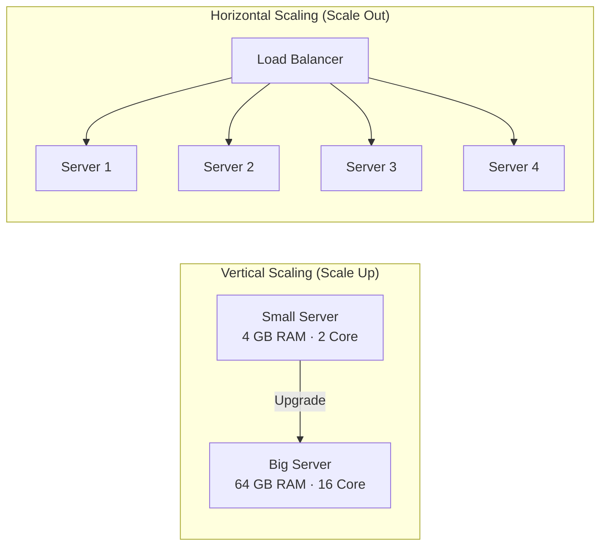
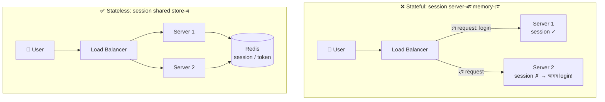
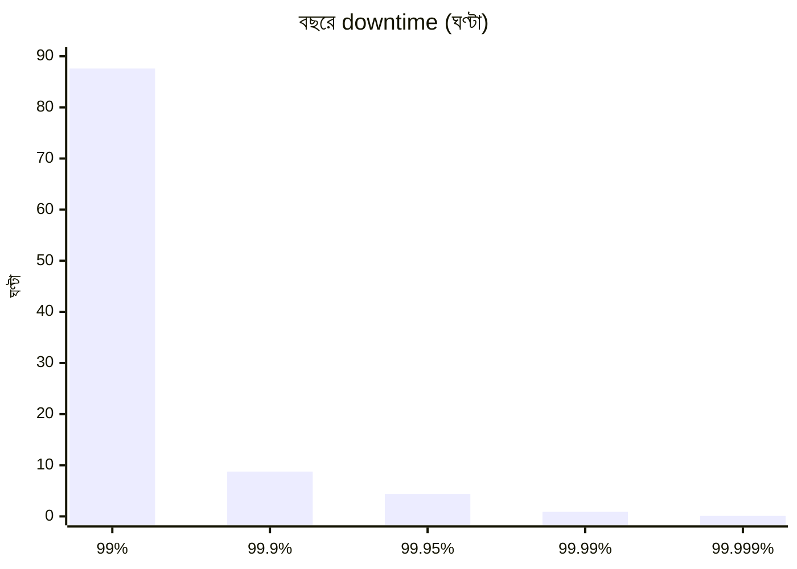
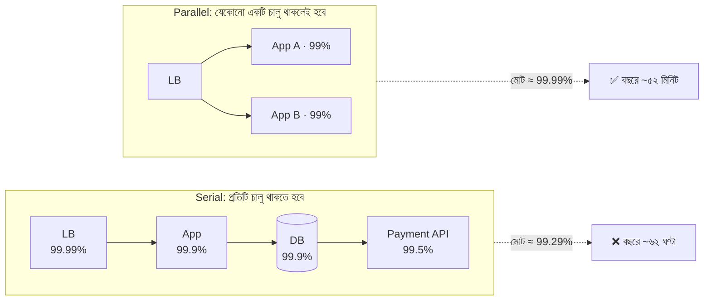
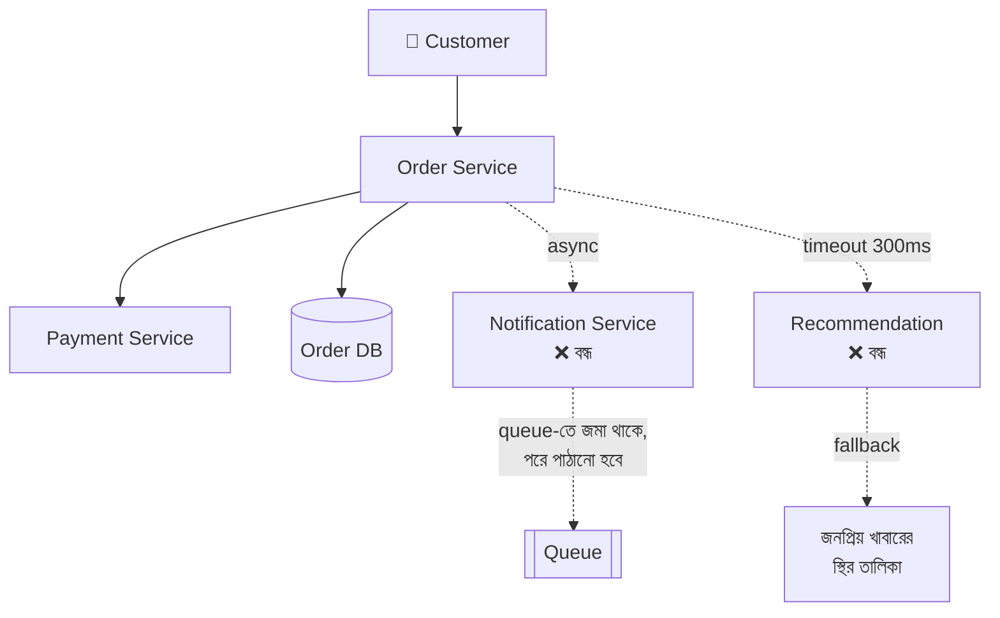
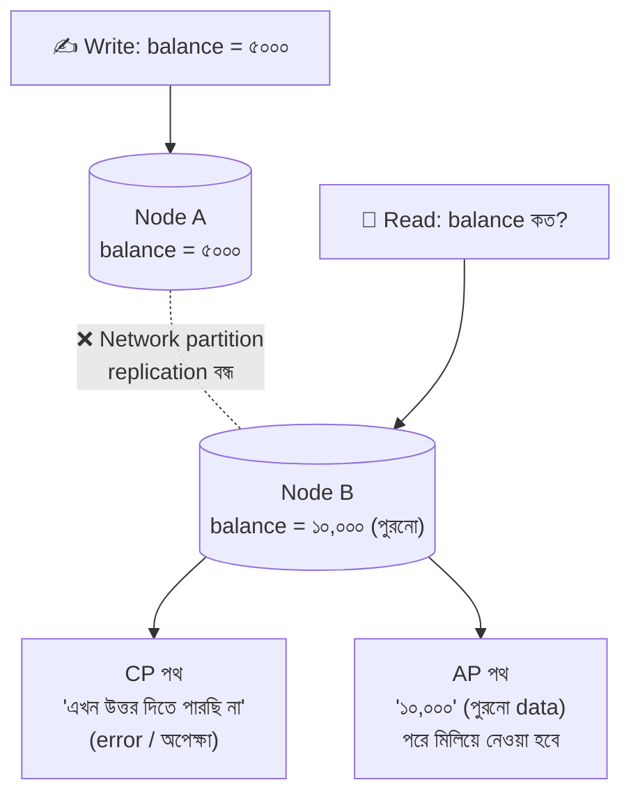

> [!GOALS]
> - Scalability কী এবং Vertical বনাম Horizontal scaling-এর trade-off
> - Stateless design কেন horizontal scaling-এর পূর্বশর্ত
> - Reliability ও Availability-র পার্থক্য এবং availability-র গণিত
> - Fault tolerance, graceful degradation ও Single Point of Failure
> - CAP Theorem, PACELC এবং বাস্তব জীবনের consistency model
> - GitHub-এর ২০১৮ সালের ৪৩ সেকেন্ডের partition থেকে শিক্ষা

> [!STORY] "আরেকটা বড় server কিনে ফেলি"
> ঈদের দুই সপ্তাহ আগে নদী বাজারের weekly meeting। গত বছর চাঁদরাতের sale-এ site চল্লিশ মিনিট বন্ধ ছিল। এবার করিম সাহেব সমাধান নিয়ে এসেছেন: "সবচেয়ে বড় server-টা ভাড়া নাও। ৬৪ core, ৫১২ GB RAM। টাকা নিয়ে ভেবো না।"
>
> তানভীর মাথা নাড়লেন, "ভাই, server বড় হলে কাজ হবে, কিন্তু ওই একটা server-ই যদি চাঁদরাতে বসে যায়?"
>
> রাফি একটু সাহস করে বলল, "আমরা তো তিনটা ছোট server রেখে load balancer দিতে পারি। কিন্তু তাহলে login session-এর কী হবে? এখন তো session server-এর memory-তে থাকে।"
>
> নুসরাত whiteboard-এ দুটি ছবি আঁকলেন। একটিতে একটি বিশাল বাক্স, অন্যটিতে অনেকগুলো ছোট বাক্স। "দুটোই সঠিক উত্তর হতে পারে। প্রশ্ন হলো, কোন ব্যর্থতা আমরা সহ্য করতে পারি আর কোনটা পারি না।"

## 3.1 Introduction (ভূমিকা)

একটি সফটওয়্যার সিস্টেম যখন তৈরি করা হয়, শুরুতে এটি অনেক ছোট থাকে: হয়তো মাত্র ১০ জন ইউজার, একটি সাধারণ সার্ভার, একটি মাত্র ডাটাবেজ। এই অবস্থায় সবকিছু খুব মসৃণভাবে (smoothly) চলে। কিন্তু কয়েক বছর পর যখন সিস্টেমটি বড় হতে শুরু করে, তখন চিত্রটি পুরোপুরি বদলে যায়: লাখ লাখ ইউজার, মাল্টিপল API কল, মোবাইল অ্যাপ ও থার্ড-পার্টি ইন্টিগ্রেশন, রিয়েল-টাইম প্রসেসিং এবং নোটিফিকেশন।

একটি এন্টারপ্রাইজ সিস্টেম শুধুমাত্র "ফিচার" দিয়ে টিকে থাকতে পারে না। টিকে থাকতে হলে নিচের বিষয়গুলো শক্তভাবে সামলাতে হয়:

- **Heavy Traffic:** হঠাৎ করে ট্রাফিক বেড়ে যাওয়া।
- **Server Failure:** সার্ভার ক্র্যাশ করা।
- **Database Crash:** ডাটাবেজ লক হয়ে যাওয়া বা ক্র্যাশ করা।
- **Network Issue:** নেটওয়ার্কে সমস্যা হওয়া।
- **Security Attack:** হ্যাকিং বা DDoS অ্যাটাক।

এই চ্যাপ্টারে আমরা সেই কোর আর্কিটেকচার কনসেপ্টগুলো নিয়ে জানব, যেগুলো ছাড়া কোনো বড় সিস্টেম ডিজাইন করা প্রায় অসম্ভব। পরের সব অধ্যায় এই ধারণাগুলোর উপর দাঁড়িয়ে আছে।

## 3.2 Scalability (স্কেলেবিলিটি) কী?

Scalability বা প্রসারণযোগ্যতা হলো একটি সিস্টেমের সেই ক্ষমতা, যার মাধ্যমে এটি বৃদ্ধি পাওয়া ডেটা বা ট্রাফিক সামলাতে পারে, performance উল্লেখযোগ্যভাবে খারাপ না করে, এবং **খরচ মোটামুটি load-এর অনুপাতে বাড়িয়ে**।

আজ আপনার সিস্টেম ১০০ জন ইউজার হ্যান্ডেল করছে। আগামী বছর যদি ১ লাখ ইউজার হয়, ১০ লাখ রিকোয়েস্ট আসে, ম্যাসিভ ডেটা তৈরি হয়, তাহলেও যদি শুধু resource যোগ করে system একইভাবে চালানো যায়, তবে সিস্টেমটি **Scalable**।

> [!TIP]
> Scalability আর Performance এক জিনিস নয়। **Performance** প্রশ্ন করে: "একজন user-এর জন্য system কত দ্রুত?" **Scalability** প্রশ্ন করে: "user দশগুণ হলে কী হয়?" একটি system একজন user-এর জন্য খুব দ্রুত হয়েও scalable না হতে পারে।

## 3.3 Scalability কেন গুরুত্বপূর্ণ?

বেশিরভাগ সিস্টেম শুরুতেই খুব fast থাকে, কারণ তখন ডেটা এবং ইউজারের পরিমাণ কম। কিন্তু স্কেল বাড়তে শুরু করলে নানা ধরনের সমস্যা দেখা দেয়:

- রেসপন্স টাইম স্লো হয়ে যায়।
- ডাটাবেজে deadlock তৈরি হয়।
- API রিকোয়েস্ট timeout হতে থাকে।
- সার্ভারের memory overflow এবং CPU spike করে সিস্টেম ক্র্যাশ করে।

### Real Example: গার্মেন্টস ERP

একটি গার্মেন্টস ফ্যাক্টরির ERP সিস্টেম শুরু হয়েছিল মাত্র ৩০ জন ইউজার, একটি ব্রাঞ্চ এবং একটি সিঙ্গেল সার্ভার নিয়ে। ৩ বছর পর কোম্পানির পরিধি বাড়ল: ২০০-র বেশি ফ্যাক্টরি ব্রাঞ্চ, ২০,০০০-এর বেশি কর্মচারী, বায়োমেট্রিক ডিভাইস ইন্টিগ্রেশন এবং লাইভ রিপোর্টিং সিস্টেম।

**সমস্যা:** লগইন করতে প্রচুর সময় লাগতো। সকাল ৮টায় ২০,০০০ কর্মচারীর attendance data একসাথে biometric device থেকে আসতো, আর ঠিক তখনই HR team রিপোর্ট চালাতো। রিপোর্ট timeout হয়ে যেত, ডাটাবেজে deadlock হতো, মাঝে মাঝেই IIS সার্ভার ক্র্যাশ করতো।

**কারণ:** সিস্টেমটি ছোট স্কেলের কথা ভেবে বানানো হয়েছিল। Attendance ingestion, reporting আর সাধারণ transaction একই server ও একই database-এ প্রতিযোগিতা করছিল।

## 3.4 Types of Scalability (স্কেলেবিলিটির প্রকারভেদ)

সিস্টেম ডিজাইনে সাধারণত দুইভাবে স্কেলেবিলিটি অর্জন করা হয়:

1. **Vertical Scaling (Scale Up):** একটি সার্ভারের ক্ষমতা বা হার্ডওয়্যার বাড়ানো।
2. **Horizontal Scaling (Scale Out):** সার্ভারের সংখ্যা বাড়ানো।



## 3.5 Vertical Scaling (Scale Up): বিস্তারিত

এখানে বিদ্যমান সার্ভারের resource বা ক্ষমতা বৃদ্ধি করা হয়: RAM ৮ জিবি থেকে ৬৪ জিবি, CPU কোর ৪টি থেকে ৩২টি, হার্ডডিস্ক থেকে SSD বা NVMe।

**সুবিধা:**
- এটি করা অত্যন্ত সহজ।
- কোডে বা deployment-এ কোনো পরিবর্তনের প্রয়োজন হয় না।
- কনফিগারেশন খুবই সাধারণ থাকে; database-এর জন্য বিশেষভাবে কার্যকর।

**সমস্যা:**
- বড় হার্ডওয়্যারের দাম অনুপাতের চেয়ে বেশি হারে বাড়ে।
- হার্ডওয়্যার আপগ্রেড করার একটি নির্দিষ্ট লিমিট থাকে।
- **Single Point of Failure (SPOF):** সার্ভারটি ক্র্যাশ করলে পুরো সিস্টেম ডাউন হয়ে যাবে।
- Upgrade করার সময় প্রায়ই downtime লাগে।

> [!CASE] Stack Overflow: vertical scaling-এর পক্ষে একটি শক্ত যুক্তি
> ২০১৬ সালে Stack Overflow-এর engineering team তাদের infrastructure প্রকাশ করে। বিশ্বের সবচেয়ে বেশি দেখা website-গুলোর একটি হয়েও তারা মাসে শত কোটির বেশি page view সামলাচ্ছিল মাত্র নয়টি web server আর অল্প কয়েকটি শক্তিশালী SQL Server দিয়ে। Microservices নয়, বিশাল cluster নয়; বরং ভালোভাবে tune করা monolith, খুব দক্ষ caching এবং বড় hardware।
>
> **শিক্ষা:** Horizontal scaling সবসময় প্রথম উত্তর নয়। Query optimize করা, cache যোগ করা আর বড় server নেওয়া প্রায়ই সবচেয়ে সস্তা ও সহজ সমাধান। তবে Stack Overflow-ও প্রতিটি গুরুত্বপূর্ণ server-এর জন্য redundancy রেখেছিল, যাতে একটি নষ্ট হলে অন্যটি দায়িত্ব নিতে পারে।

## 3.6 Horizontal Scaling (Scale Out): বিস্তারিত

এখানে সার্ভারের ক্ষমতা না বাড়িয়ে একাধিক নতুন সার্ভার যুক্ত করা হয়, এবং একটি **Load Balancer** ব্যবহার করে ট্রাফিক সব সার্ভারের মধ্যে ভাগ করে দেওয়া হয়।

**সুবিধা:**
- প্রায় সীমাহীনভাবে বাড়ানো যায়; cloud-এ auto scaling দিয়ে মিনিটের মধ্যে।
- Fault tolerant: একটি সার্ভার নষ্ট হলে বাকিগুলো দিয়ে সিস্টেম চলতে থাকে।
- ছোট ছোট server সস্তা, এবং প্রয়োজন শেষে বন্ধ করা যায়।

**সমস্যা:**
- আর্কিটেকচার বেশ জটিল।
- ইউজারের session ও local state ম্যানেজ করা কঠিন।
- সব সার্ভার একসাথে monitoring ও deployment করা কষ্টসাধ্য।
- Database-কে horizontal scale করা application server-এর চেয়ে অনেক কঠিন (অধ্যায় ৫)।

### Stateless Design: Horizontal Scaling-এর পূর্বশর্ত

রাফির প্রশ্নটা ছিল সঠিক। Session যদি server-এর memory-তে থাকে, তাহলে user-এর প্রথম request Server 1-এ গেলে login হয়, দ্বিতীয় request Server 2-এ গেলে server তাকে চেনে না।



Stateless হওয়ার উপায়:
- Session Redis-এর মতো shared store-এ রাখা, অথবা signed token (JWT) ব্যবহার করা (অধ্যায় ৮)।
- Uploaded file local disk-এ না রেখে object storage-এ রাখা।
- In-memory cache-কে "শুধু গতি বাড়ানোর জন্য" ব্যবহার করা, একমাত্র সত্যের উৎস হিসেবে নয়।
- Background job server-এর timer-এ না রেখে queue-তে রাখা।

> [!ARCHITECT] নদী বাজারের সিদ্ধান্ত
> নুসরাতের ADR: "Application server stateless করা হবে (session → Redis, upload → object storage) এবং তিনটি মাঝারি server load balancer-এর পেছনে রাখা হবে। Database আপাতত vertical scale করা হবে (বড় instance + read replica), কারণ database ভাগ করা অনেক বড় কাজ এবং এই ঈদের আগে তা ঝুঁকিপূর্ণ।" করিম সাহেব খুশি হলেন, কারণ মাসিক খরচ তাঁর প্রস্তাবিত বিশাল server-এর চেয়ে কম পড়ল।

## 3.7 Reliability (নির্ভরযোগ্যতা) কী?

Reliability হলো একটি সিস্টেম কতটা ধারাবাহিকভাবে এবং নির্ভুলভাবে তার কাজ করতে পারে তার পরিমাপ। Reliability প্রশ্ন করে: **"System যা করার কথা, তা কি সঠিকভাবে করছে?"**

পেমেন্ট সিস্টেমে যদি এমন হয় যে ইউজারের অ্যাকাউন্ট থেকে টাকা কাটা গেছে, কিন্তু ট্রানজ্যাকশন ডাটাবেজে সেভ হয়নি, তাহলে system চালু থাকলেও এটি নির্ভরযোগ্য নয়।

**একটি Reliable System-এর বৈশিষ্ট্য:**
- **Consistent:** একই input-এ ধারাবাহিক ফলাফল দেয়।
- **Predictable:** আচরণ অনুমানযোগ্য, load বাড়লেও।
- **Fault Resistant:** hardware, software বা মানুষের ভুল সামলাতে পারে।
- **Recoverable:** ভুল হলে data নষ্ট না করে আগের সঠিক অবস্থায় ফিরতে পারে।

## 3.8 Availability (প্রাপ্যতা) কী?

Availability হলো একটি সিস্টেম তার ইউজারদের জন্য কতটুকু সময় ব্যবহারযোগ্য থাকে। Availability প্রশ্ন করে: **"System কি এখন উত্তর দিচ্ছে?"**

```text
Availability = Uptime / (Uptime + Downtime)
উদাহরণ: বছরে ৩৬৪ দিন আপ, ১ দিন ডাউন → 364 / 365 ≈ 99.7%
```

| Availability Level | বছরে Downtime | মাসে Downtime | কোথায় সাধারণত |
| --- | --- | --- | --- |
| 99% (two nines) | প্রায় ৩.৬৫ দিন | ~৭.৩ ঘণ্টা | Internal tool |
| 99.9% (three nines) | প্রায় ৮.৭৬ ঘণ্টা | ~৪৩ মিনিট | বেশিরভাগ business app |
| 99.99% (four nines) | প্রায় ৫২ মিনিট | ~৪.৩ মিনিট | Payment, banking |
| 99.999% (five nines) | প্রায় ৫.৩ মিনিট | ~২৬ সেকেন্ড | Telecom core, critical infra |



> [!WARNING]
> Reliability ও Availability আলাদা। একটি system ১০০% available হয়েও ভুল ব্যালেন্স দেখাতে পারে (available কিন্তু unreliable)। আবার একটি system ভুল তথ্য দেওয়ার চেয়ে বন্ধ থাকাকে বেছে নিতে পারে (reliable কিন্তু কম available)। Banking-এ দ্বিতীয়টিই সঠিক।

### Availability-র গণিত: Dependency গুণ হয়

একটি request যদি পরপর কয়েকটি component-এর মধ্য দিয়ে যায়, প্রত্যেকটিকেই চালু থাকতে হবে। তাই availability **গুণ** হয়:

```text
Load Balancer (99.99%) × App (99.9%) × Database (99.9%) × Payment API (99.5%)
= 0.9999 × 0.999 × 0.999 × 0.995 ≈ 99.29%  → বছরে প্রায় ৬২ ঘণ্টা downtime!
```

আর একই component দুটি **parallel** (redundant) রাখলে, দুটোই একসাথে নষ্ট হলে তবেই সমস্যা:

```text
একটি server 99% → দুটি redundant: 1 − (0.01 × 0.01) = 99.99%
```



এই গণিত থেকে দুটি গুরুত্বপূর্ণ শিক্ষা: (১) প্রতিটি নতুন synchronous dependency আপনার availability কমায়, এবং (২) redundancy-ই availability বাড়ানোর প্রধান উপায়।

## 3.9 Fault Tolerance (ফল্ট টলারেন্স) কী?

Fault Tolerance মানে সিস্টেমের কোনো একটি অংশ ফেইল করলেও পুরো সিস্টেম ডাউন না হওয়া। সম্পূর্ণ fault tolerance (কোনো অংশ নষ্ট হলেও user কিছুই টের পাবে না) ব্যয়বহুল। অনেক সময় যথেষ্ট হলো **Graceful Degradation**: কিছু feature সাময়িকভাবে বন্ধ, কিন্তু মূল কাজ চালু।

**বাস্তব উদাহরণ:** একটি ফুড ডেলিভারি অ্যাপ্লিকেশনে Notification Service ক্র্যাশ করলে শুধু SMS বা push notification যাওয়া বন্ধ হবে, কিন্তু অর্ডার আর পেমেন্ট ঠিকমতো কাজ করবে। Recommendation service বন্ধ হলে "আপনার জন্য" অংশে জনপ্রিয় খাবারের একটি স্থির তালিকা দেখাবে।



## 3.10 Single Point of Failure (SPOF)

SPOF হলো সিস্টেমের এমন কোনো অংশ, যেটি ফেইল করলে পুরো সিস্টেম বন্ধ হয়ে যায়। বড় সিস্টেমে SPOF খুঁজে বের করা architect-এর একটি নিয়মিত কাজ।

| SPOF | সমাধান |
| --- | --- |
| একটি মাত্র app server | একাধিক server + load balancer |
| একটি মাত্র database server | Replication + automatic failover |
| একটি মাত্র load balancer | Active-passive LB জোড়া বা cloud managed LB |
| একটি data center / availability zone | Multi-AZ deployment |
| একটি DNS provider বা একটি payment gateway | Secondary provider, fallback |
| একটি SSL certificate যা কেউ renew করে না | Automatic renewal + expiry alert |
| **শুধু একজন মানুষ জানেন deploy কীভাবে করতে হয়** | Runbook, automation, knowledge sharing |

> [!ARCHITECT] মানুষও SPOF
> তালিকার শেষ লাইনটা হাসির মনে হলেও সবচেয়ে বাস্তব। নদী টেকে একসময় শুধু তানভীর জানতেন production database-এর backup কীভাবে restore করতে হয়। তানভীর ছুটিতে গেলে team ভয়ে থাকত। নুসরাতের নিয়ম: প্রতিটি গুরুত্বপূর্ণ কাজের একটি লিখিত runbook থাকবে এবং অন্তত দুজন মানুষ সেটা নিজের হাতে একবার করে দেখবেন। Architecture শুধু server-এর নয়, team-এরও।

## 3.11 CAP Theorem (ক্যাপ থিওরেম)

Distributed system-এর সবচেয়ে আলোচিত থিওরি হলো CAP Theorem। এর তিনটি অক্ষর:

1. **C = Consistency:** প্রতিটি read সর্বশেষ write-এর ফলাফল দেখবে; সব node একই data দেখাবে।
2. **A = Availability:** প্রতিটি request-এর একটি (non-error) response পাওয়া যাবে।
3. **P = Partition Tolerance:** Network-এর কারণে node-গুলোর মধ্যে যোগাযোগ বিচ্ছিন্ন হলেও system কাজ চালিয়ে যাবে।

Theorem বলে: **Network partition ঘটলে আপনাকে Consistency আর Availability-র মধ্যে একটি বেছে নিতে হবে।** যেহেতু distributed system-এ network সমস্যা অনিবার্য, তাই P বাদ দেওয়ার উপায় নেই। আসল প্রশ্ন হলো: partition-এর সময় system কী করবে?



### CAP-এর বাস্তবতা

- **CP System (Consistency + Partition Tolerance):** Banking ledger, inventory reservation, seat booking। Network সমস্যায় system error দেবে বা অপেক্ষা করাবে, কিন্তু ভুল balance দেখাবে না বা একই seat দুজনকে বিক্রি করবে না।
- **AP System (Availability + Partition Tolerance):** Social media feed, product catalog, like count। Post সাথে সাথে সবার কাছে না পৌঁছালেও system সবসময় উত্তর দেবে, পরে data মিলে যাবে (**eventual consistency**)।

একই product-এর ভেতরেও আলাদা অংশ আলাদা সিদ্ধান্ত নিতে পারে। নদী বাজারে product-এর বিবরণ ও review AP হতে পারে, কিন্তু stock reservation আর payment অবশ্যই CP।

> [!CASE] GitHub, অক্টোবর ২০১৮: ৪৩ সেকেন্ডের partition, ২৪ ঘণ্টার মাশুল
> ২০১৮ সালের ২১ অক্টোবর রুটিন maintenance-এর সময় GitHub-এর US East Coast-এর network hub আর প্রধান data center-এর মধ্যে মাত্র **৪৩ সেকেন্ড** যোগাযোগ বিচ্ছিন্ন ছিল। এই সময়ে তাদের MySQL topology management tool স্বয়ংক্রিয়ভাবে West Coast-এর database-কে primary বানিয়ে ফেলে। Connectivity ফিরে আসার পর দেখা গেল দুই জায়গাতেই এমন কিছু write আছে যা অন্য জায়গায় নেই।
>
> GitHub-এর সামনে দুটি পথ ছিল: দ্রুত service চালু করা (কিছু ব্যবহারকারীর data হারানো বা অসঙ্গতির ঝুঁকি নিয়ে), অথবা data-র সঠিকতা নিশ্চিত করা (দীর্ঘ সময় ধরে degraded service দিয়ে)। তারা **data integrity**-কে বেছে নেয়। ফলাফল: প্রায় **২৪ ঘণ্টা ১১ মিনিট** degraded service, কিন্তু ব্যবহারকারীর data রক্ষা।
>
> **শিক্ষা:** CAP শুধু পরীক্ষার প্রশ্ন নয়। এটা মাঝরাতে একটি team-এর নেওয়া সত্যিকারের সিদ্ধান্ত। আর automatic failover-এরও ঝুঁকি আছে: খুব দ্রুত failover করলে ছোট্ট network সমস্যাও বড় data inconsistency-তে পরিণত হতে পারে।

### PACELC: CAP-এর পূর্ণ রূপ

CAP শুধু partition-এর সময়ের কথা বলে। কিন্তু partition না থাকলেও একটি trade-off থাকে। **PACELC** বলে:

```text
If Partition (P) → choose Availability (A) or Consistency (C)
Else (E)         → choose Latency (L) or Consistency (C)
```

অর্থাৎ স্বাভাবিক সময়েও, সব replica-কে update করে তারপর উত্তর দিলে (strong consistency) latency বাড়ে; শুধু একটিতে লিখে উত্তর দিলে দ্রুত হয়, কিন্তু অন্য replica কিছুক্ষণ পুরনো থাকে।

## 3.12 Consistency Model: বাস্তবে কতটুকু consistency দরকার?

| Model | অর্থ | উদাহরণ |
| --- | --- | --- |
| **Strong consistency** | Write-এর পর সবাই সাথে সাথে নতুন মান দেখবে | Bank balance, stock reservation |
| **Read-your-writes** | অন্তত যে লিখেছে, সে নিজের নতুন মান দেখবে | Profile update করার পর নিজের profile |
| **Monotonic reads** | একবার নতুন মান দেখলে আর পুরনো মানে ফিরবে না | Comment thread |
| **Eventual consistency** | কিছু সময় পর সবাই একই মান দেখবে | Like count, view count, feed |

> [!TIP]
> Read replica ব্যবহার করলে একটি সাধারণ সমস্যা হয়: user profile update করে page refresh করলে পুরনো তথ্য দেখে (কারণ read গেছে replica-তে, যেটা তখনো update পায়নি)। সমাধান: write-এর পর কয়েক সেকেন্ড ওই user-এর read primary থেকে করা (read-your-writes)। অধ্যায় ৫-এ বিস্তারিত।

## 3.13 AI কোণ: LLM provider-ও একটি dependency

> [!AI] আপনার availability কি OpenAI বা অন্য কোনো provider-এর হাতে?
> নদী টেকের AI সহায়ক একটি বাইরের LLM API ব্যবহার করে। আয়েশা availability হিসাব করে দেখালেন: Portal (99.9%) × LLM API (ধরা যাক 99.5%) = প্রায় 99.4%। অর্থাৎ AI feature যোগ করায় পুরো "প্রশ্ন জিজ্ঞেস করা" flow-এর availability কমে গেছে।
>
> সমাধান হিসেবে তিনটি কৌশল নেওয়া হলো:
> - **Graceful degradation:** LLM সাড়া না দিলে FAQ search থেকে উত্তর দেখানো, সাথে "সহায়ক এখন ব্যস্ত" বার্তা।
> - **Redundancy:** দুটি আলাদা provider বা একটি self-hosted ছোট model-কে fallback রাখা (অধ্যায় ১৫-এর AI Gateway)।
> - **Async যেখানে সম্ভব:** Document summary-র মতো কাজ queue-তে, যাতে LLM ধীর হলেও user আটকে না থাকে।
>
> আরেকটি সূক্ষ্ম বিষয়: LLM-এর উত্তর **non-deterministic**; একই প্রশ্নে ভিন্ন উত্তর আসতে পারে। Reliability-র সংজ্ঞা ("একই input-এ একই ফলাফল") AI-এর ক্ষেত্রে নতুন করে ভাবতে হয়। এজন্যই AI system-এ evaluation ও guardrail লাগে (অধ্যায় ১৫-১৬)।

## 3.14 সাধারণ ভুল

- **Scaling মানেই microservices ভাবা।** অনেক সময় একটি index বা একটি cache যথেষ্ট।
- **Application stateless না করে load balancer বসানো।** Session হারায়, file হারায়।
- **শুধু server-এর redundancy রাখা,** কিন্তু database, load balancer বা DNS-এর নয়।
- **Availability হিসাবে external dependency ভুলে যাওয়া।** Payment gateway, SMS provider, LLM API সবই হিসাবে আসবে।
- **সব data-কে strong consistency দেওয়া।** অপ্রয়োজনীয় latency ও খরচ।
- **মানুষকে SPOF হিসেবে না দেখা।** একজনের মাথায় থাকা জ্ঞান একটি ঝুঁকি।

## 3.15 Interview প্রশ্ন

> [!INTERVIEW]
> 1. Vertical ও Horizontal scaling-এর পার্থক্য কী? কখন কোনটা বেছে নেবেন?
> 2. Stateless service কী? Horizontal scaling-এর জন্য এটি কেন জরুরি?
> 3. তিনটি component যথাক্রমে 99.9%, 99.95% ও 99.99% available। Serial chain-এ মোট availability কত?
> 4. CAP Theorem ব্যাখ্যা করুন। একটি ticket booking system CP হবে না AP? কেন?
> 5. Eventual consistency কোথায় গ্রহণযোগ্য, কোথায় নয়? দুটি করে উদাহরণ দিন।
> 6. PACELC CAP-এর সাথে কী যোগ করে?
>
> **প্রশ্ন ৩-এর উত্তর:** 0.999 × 0.9995 × 0.9999 ≈ 0.9984 → প্রায় 99.84%, বছরে প্রায় ১৪ ঘণ্টা downtime। লক্ষ্য করুন, মোট availability সবচেয়ে দুর্বল component-এর চেয়েও কম।

## 3.16 নিজে করে দেখুন

> [!EXERCISE] SPOF শিকার
> আপনার বর্তমান project-এর architecture diagram নিন (অধ্যায় ১-এর exercise থেকে)। প্রতিটি component-এর পাশে লিখুন: "এটা বন্ধ হলে কী হবে?" যেগুলোর উত্তর "সব বন্ধ", সেগুলো লাল দাগ দিন। তারপর প্রতিটি লাল component-এর জন্য একটি সমাধান ও তার আনুমানিক মাসিক খরচ লিখুন। শেষে একটি তালিকা যোগ করুন: কোন কাজগুলো team-এ শুধু একজন মানুষ জানেন?

## 3.17 Chapter Summary (সারসংক্ষেপ)

- **Scalability:** Load বাড়লে resource যোগ করে system চালানোর ক্ষমতা; Vertical সহজ কিন্তু সীমিত ও SPOF, Horizontal নমনীয় কিন্তু জটিল।
- **Stateless design:** Horizontal scaling-এর পূর্বশর্ত; session, file ও job বাইরে রাখুন।
- **Reliability বনাম Availability:** সঠিকভাবে কাজ করা বনাম চালু থাকা; দুটো আলাদা লক্ষ্য।
- **Availability-র গণিত:** Serial dependency গুণ হয়ে কমায়, parallel redundancy বাড়ায়।
- **Fault Tolerance ও SPOF:** Graceful degradation দিয়ে মূল কাজ চালু রাখা; মানুষও SPOF হতে পারে।
- **CAP ও PACELC:** Partition-এ C বা A বেছে নিতে হয়; স্বাভাবিক সময়ে latency বনাম consistency।
- **AI dependency:** বাইরের LLM API availability কমায়; fallback ও degradation পরিকল্পনা জরুরি।

> [!ARCHITECT] নুসরাতের নোটবুক · চাঁদরাতের প্রস্তুতি
> সিদ্ধান্ত: App server stateless + ৩টি instance; database vertical scale + read replica; checkout ও stock CP, catalog ও review AP। SPOF তালিকায় পাওয়া গেছে ৭টি, যার ৩টি মানুষ। চাঁদরাতে site চালু ছিল পুরো রাত। পরের চ্যালেঞ্জ: database নিজেই এখন সবচেয়ে বড় bottleneck।
