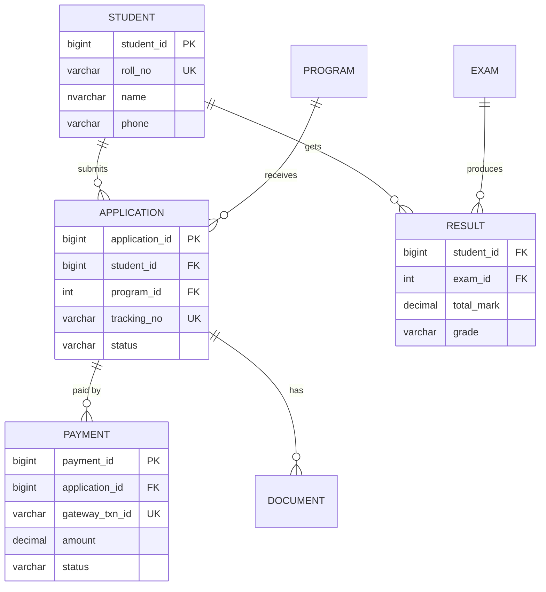
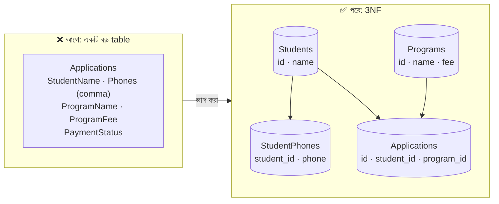
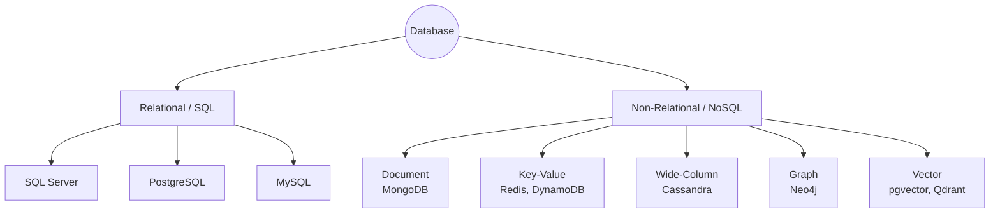
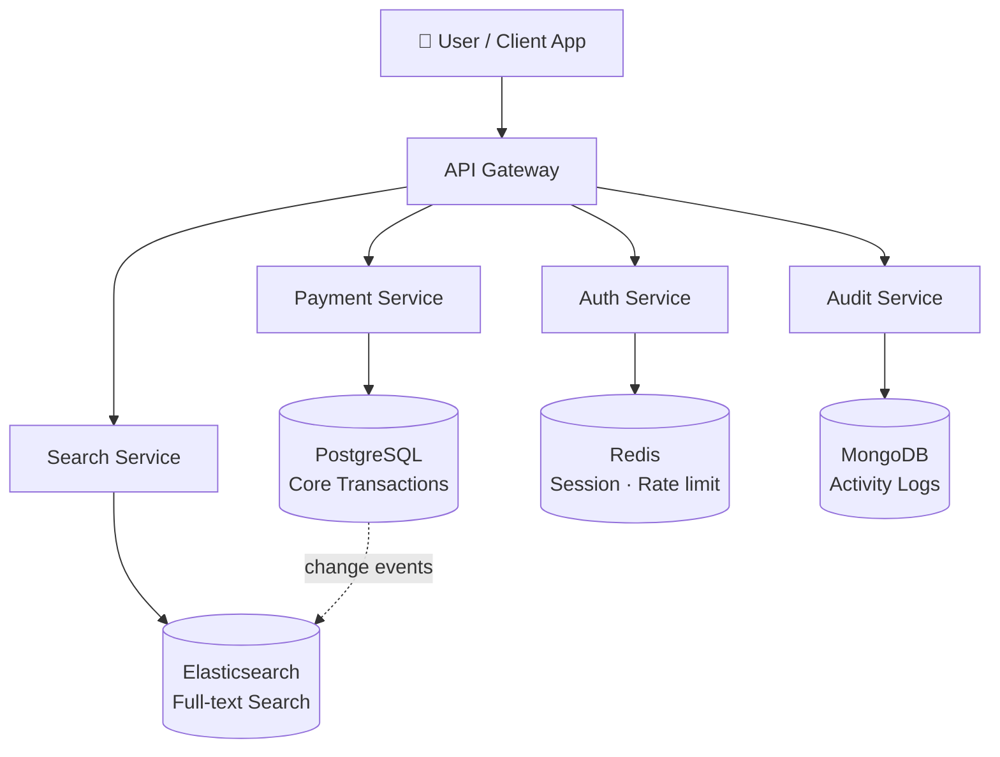
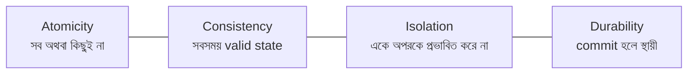
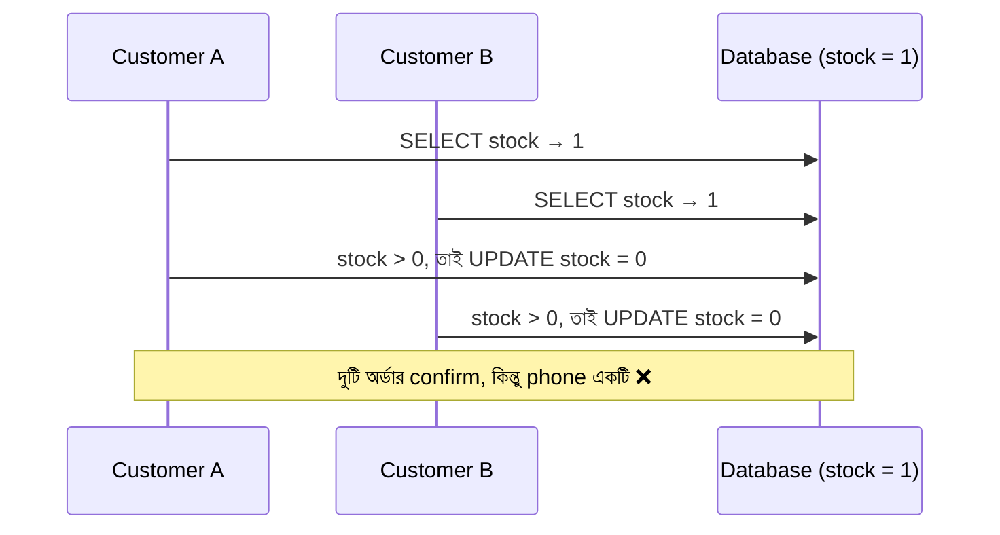
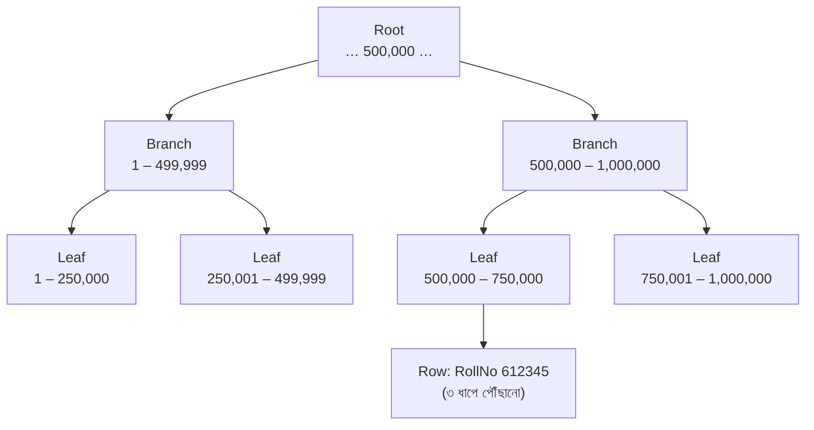

> [!GOALS]
> - একটি ভালো data model ও ERD কীভাবে তৈরি করতে হয়
> - Normalization কখন করবেন, কখন ইচ্ছা করে ভাঙবেন
> - SQL বনাম NoSQL এবং Polyglot Persistence
> - ACID, isolation level, locking ও overselling-এর মতো race condition
> - Index কীভাবে কাজ করে, composite ও covering index, query anti-pattern
> - Backup ও recovery: GitLab-এর ২০১৭ সালের শিক্ষা

> [!STORY] মাসের শেষ দিন, রাত দশটা
> নদী ERP-র এক client-এর accounts team মাস শেষের closing করছে। একটি "Ledger Summary" report ছয় মিনিট ধরে ঘুরছে। ঠিক সেই সময় warehouse থেকে ফোন: "Stock entry দিতে পারছি না, screen আটকে আছে।"
>
> রাফি report-এর query খুলল। শুরুতেই `SELECT *`, তারপর চারটি table-এর join, `WHERE YEAR(TransactionDate) = 2026`, আর `Description LIKE '%salary%'`। নুসরাত পাশে এসে বসলেন। "Execution plan দেখেছ?"
>
> রাফি জীবনে প্রথমবার execution plan খুলল। লাল রঙে লেখা: **Table Scan, 4.2 crore rows।** নুসরাত হেসে বললেন, "তোমার query database-কে বলছে, 'চার কোটি খাতার প্রতিটি পাতা উল্টে দেখো।' আর ওদিকে warehouse-এর লোকেরা সেই খাতাতেই লিখতে চাইছে।"

## 4.1 Introduction (ভূমিকা)

একটি সফটওয়্যার সিস্টেমের প্রাণ হলো তার ডাটাবেজ। অ্যাপ্লিকেশনের কোড ভুল হলে বা স্লো হলে তা পরিবর্তন করা তুলনামূলকভাবে সহজ। কিন্তু ডাটাবেজ ডিজাইনে বড় কোনো ভুল থাকলে তার প্রভাব পুরো সিস্টেমের ওপর ভয়াবহ হতে পারে, কারণ data টিকে থাকে code-এর চেয়ে অনেক বেশি দিন। Code প্রতি সপ্তাহে বদলায়; দশ বছর আগের transaction এখনো audit-এ লাগে।

একটি ডাটাবেজ শুধু ডেটা সেভ করে না, এটি হ্যান্ডেল করে:
- **Business Data:** গুরুত্বপূর্ণ ব্যবসায়িক তথ্য।
- **Transactions:** টাকা বা অর্ডারের লেনদেন।
- **Reporting & Analytics:** মাস বা বছর শেষের বিশাল রিপোর্ট।
- **Concurrency:** একই সময়ে হাজার হাজার ইউজারের রিকোয়েস্ট।

অনেক জুনিয়র ডেভেলপার মনে করেন: *"কয়েকটি টেবিল তৈরি করলেই ডাটাবেজ ডিজাইন শেষ।"* কিন্তু এন্টারপ্রাইজ লেভেলে ডাটাবেজ ডিজাইন মানে হলো data model, scalability, performance, concurrency, indexing এবং backup ও recovery একসাথে মেইনটেইন করা।

## 4.2 Real Production Story: খারাপ ডাটাবেজ ডিজাইনের পরিণতি

একটি ইআরপি সিস্টেমের শুরুতে ইউজার ছিল ২০ জন, একটি মাত্র ব্রাঞ্চ, এবং সিস্টেমটি খুবই fast কাজ করছিল। কিন্তু ডাটাবেজের অবস্থা ছিল এমন:
- কোনো indexing ছিল না।
- টেবিলগুলো ছিল বিশাল, normalization ঠিকমতো ছিল না।
- সব ফিল্ডে অযথাই `VARCHAR(MAX)` ব্যবহার করা হয়েছিল।
- পুরনো ডেটা archive করার কোনো mechanism ছিল না।

**৩ বছর পর:** ১৫০০-র বেশি ব্রাঞ্চ, কোটি কোটি ট্রানজ্যাকশন, API কল করতে গেলেই timeout, একটি সাধারণ রিপোর্ট লোড হতে ৫-১০ মিনিট, আর প্রায়ই deadlock-এ সিস্টেম হ্যাং।

**সমাধান:** পুরো ডাটাবেজটিকে নতুন করে redesign করতে হয়েছিল, চলমান ব্যবসা বন্ধ না করে, ১৫০০ ব্রাঞ্চের data migrate করে। প্রকল্পটি নয় মাস সময় নেয়। একটি ভুল ডাটাবেজ আর্কিটেকচার পুরো কোম্পানিকে ব্যবসায়িক ক্ষতির মুখে ফেলতে পারে।

## 4.3 Data Modeling: Table বানানোর আগে

ভালো database design শুরু হয় table দিয়ে নয়, **business entity ও তাদের সম্পর্ক** দিয়ে। Admission Portal-এর মূল entity গুলো দেখা যাক:



লক্ষ্য করুন `gateway_txn_id`-তে **Unique Key (UK)**। অধ্যায় ১-এর duplicate payment সমস্যার প্রথম প্রতিরক্ষা এই একটি constraint: একই gateway transaction দুইবার insert হতেই পারবে না। ভালো data model নিজেই অনেক bug আটকে দেয়।

### Normalization: কেন এবং কতটুকু

Normalization মানে data-কে এমনভাবে ভাগ করা যাতে একই তথ্য একাধিক জায়গায় না থাকে।

| Normal Form | মূল নিয়ম | উদাহরণে ভাঙন |
| --- | --- | --- |
| **1NF** | প্রতিটি cell-এ একটি মান; repeating group নেই | `Phones = "017.., 018.."` এক cell-এ |
| **2NF** | পুরো primary key-র উপর নির্ভরতা | `(StudentId, ExamId)` key-তে `StudentName` রাখা |
| **3NF** | Non-key column অন্য non-key-এর উপর নির্ভর করবে না | Application-এ `ProgramName` ও `ProgramFee` দুটোই রাখা |



**Denormalization কখন?** Read-heavy report বা dashboard-এ বারবার join এড়াতে ইচ্ছা করে কিছু data duplicate করা হয়। যেমন invoice-এ product-এর **তখনকার** দাম লিখে রাখা (পরে দাম বদলালেও পুরনো invoice বদলাবে না)। এটা ভুল নয়, এটা সচেতন সিদ্ধান্ত।

> [!ARCHITECT] Normalize for writes, denormalize for reads
> Transaction-এর database (OLTP) সাধারণত normalized রাখুন, যাতে data সঠিক থাকে। Report-এর জন্য আলাদা denormalized table বা reporting database তৈরি করুন (অধ্যায় ৫-এর CQRS)। একই table দিয়ে দুই কাজ করতে গেলেই মাসের শেষে warehouse আটকে যায়।

## 4.4 Database-এর প্রকারভেদ

Database হলো সুসংগঠিতভাবে ডেটা সংরক্ষণ করার একটি ব্যবস্থা। প্রধানত দুই প্রকার:

1. **Relational Database (SQL):** SQL Server, PostgreSQL, MySQL, Oracle।
2. **Non-Relational Database (NoSQL):** MongoDB, Cassandra, Redis, DynamoDB, Neo4j।



### SQL Database (রিলেশনাল)

SQL ডাটাবেজ একটি নির্দিষ্ট schema মেনে চলে। ডেটা row এবং column আকারে সেভ হয়।

- **Structured Schema:** টেবিলের কলাম আগে থেকেই ঠিক করা থাকে।
- **ACID Transactions:** ডেটার consistency নিশ্চিত করে।
- **Relationship Support:** Foreign Key দিয়ে টেবিলের মধ্যে সম্পর্ক এবং শক্তিশালী JOIN।

**কখন SQL?** যখন ট্রানজ্যাকশন, রিপোর্ট এবং ডেটার নির্ভুলতা সবচেয়ে বেশি জরুরি: ব্যাংকিং, অ্যাকাউন্টিং ও ERP, ইনভেন্টরি।

### NoSQL Database (নন-রিলেশনাল)

NoSQL ডাটাবেজে সাধারণত fixed schema থাকে না; ডেটা JSON document, key-value, wide-column বা graph আকারে থাকে।

- **Flexible Schema:** যেকোনো সময় নতুন field যোগ করা যায়।
- **Horizontally Scalable:** অনেকগুলো server-এ data ছড়িয়ে দেওয়া সহজ।
- **High Write Throughput:** প্রতি সেকেন্ডে বিপুল পরিমাণ write।

**কখন NoSQL?** প্রচুর পরিমাণে semi-structured ডেটা এবং high scale: সোশ্যাল মিডিয়ার post ও comment, real-time analytics, IoT sensor data, chat message, session।

| বৈশিষ্ট্য | SQL (যেমন PostgreSQL) | NoSQL (যেমন MongoDB, Cassandra) |
| --- | --- | --- |
| Schema | Fixed, migration দিয়ে বদলাতে হয় | Flexible |
| Transaction | পূর্ণ ACID | সীমিত বা single-document (ধরন অনুযায়ী) |
| Scaling | Vertical সহজ; horizontal কঠিন | Horizontal সহজ |
| Relationship | Foreign Key ও JOIN | সাধারণত embed বা application-level reference |
| Query | যেকোনো প্রশ্ন, ad-hoc report | Access pattern আগে থেকে জানতে হয় |
| Data Format | Row ও Column | JSON, Key-Value, Column family, Graph |

> [!TIP]
> NoSQL বেছে নেওয়ার সবচেয়ে বড় পূর্বশর্ত: আপনি আগে থেকে জানেন data **কীভাবে পড়া হবে**। Cassandra-তে table design করা হয় query অনুযায়ী। যদি আপনার business প্রতি মাসে নতুন ধরনের report চায়, relational database সাধারণত নিরাপদ পছন্দ।

## 4.5 Polyglot Persistence: একাধিক database একসাথে

বড় এন্টারপ্রাইজ সিস্টেমে সাধারণত একটিমাত্র ডাটাবেজ দিয়ে সব কাজ করা হয় না। কাজের ধরন অনুযায়ী একাধিক ডাটাবেজ একসাথে ব্যবহার করা হয়। একে **Polyglot Persistence** বলা হয়।

**বাস্তব উদাহরণ (Fintech System):** টাকার লেনদেনের জন্য PostgreSQL বা SQL Server, লগইন session ও rate limit-এর জন্য Redis, ইউজারের activity log-এর জন্য MongoDB, আর লেনদেন খোঁজার জন্য Elasticsearch।



> [!WARNING]
> প্রতিটি নতুন database মানে নতুন backup, নতুন monitoring, নতুন security patch, নতুন দক্ষতা। পাঁচজনের team-এর জন্য পাঁচটি database প্রায়ই বোঝা। PostgreSQL-এর মতো একটি শক্তিশালী database অনেক কাজ (JSON, full-text search, এমনকি vector search) একাই করতে পারে। নতুন database তখনই আনুন যখন বর্তমানটা সত্যিই পারছে না।

## 4.6 Transactions এবং ACID Properties

একটি Transaction হলো একাধিক ডেটাবেজ অপারেশনের একটি বান্ডেল, যা একটি একক ইউনিট হিসেবে কাজ করে।

**উদাহরণ (টাকা ট্রান্সফার):** (১) রহিমের অ্যাকাউন্ট থেকে ১০০০ টাকা কাটা হবে, (২) করিমের অ্যাকাউন্টে ১০০০ টাকা যোগ হবে। দুটি মিলে একটি transaction। ২ নম্বর ব্যর্থ হলে ১ নম্বরও rollback হবে।

```sql
BEGIN TRANSACTION;
  UPDATE Accounts SET Balance = Balance - 1000 WHERE AccountId = @Rahim AND Balance >= 1000;
  IF @@ROWCOUNT = 0 BEGIN ROLLBACK; THROW 50001, 'Insufficient balance', 1; END
  UPDATE Accounts SET Balance = Balance + 1000 WHERE AccountId = @Karim;
COMMIT;
```



- **A = Atomicity:** সব কাজ সফল হবে, অথবা কোনো কাজই হবে না।
- **C = Consistency:** ডেটা সবসময় নিয়ম মেনে (constraint, foreign key) valid অবস্থায় থাকবে।
- **I = Isolation:** একাধিক transaction একসাথে চললেও ফলাফল এমন হবে যেন তারা আলাদাভাবে চলেছে (isolation level অনুযায়ী)।
- **D = Durability:** Commit হয়ে গেলে server restart নিলেও data হারাবে না।

### Isolation Level ও Anomaly

Isolation যত কঠোর, তত নিরাপদ, কিন্তু তত বেশি locking ও অপেক্ষা।

| Isolation Level | Dirty Read | Non-repeatable Read | Phantom Read | ব্যবহার |
| --- | --- | --- | --- | --- |
| Read Uncommitted | সম্ভব | সম্ভব | সম্ভব | প্রায় কখনো না |
| Read Committed (অনেক DB-র default) | না | সম্ভব | সম্ভব | সাধারণ OLTP |
| Repeatable Read | না | না | সম্ভব | আর্থিক হিসাব |
| Serializable | না | না | না | অত্যন্ত সংবেদনশীল কাজ |
| Snapshot / RCSI | না | না (snapshot-এর ভেতরে) | না (snapshot-এর ভেতরে) | Read যাতে write-কে block না করে |

> [!TIP]
> SQL Server-এ `READ_COMMITTED_SNAPSHOT` চালু করলে read আর write একে অপরকে block করে না (row version ব্যবহার করে)। মাসের শেষের report আর warehouse-এর stock entry-র সংঘর্ষ কমাতে এটি প্রায়ই প্রথম সহজ সমাধান। তবে tempdb-র উপর চাপ বাড়ে, তাই আগে test করুন।

### Race Condition: শেষ product-টা দুজনের কাছে বিক্রি

নদী বাজারে stock-এ মাত্র ১টি phone। দুজন customer একই মুহূর্তে কিনতে চাইলেন।



তিনটি সাধারণ সমাধান:

```sql
-- ১. Atomic conditional update (সবচেয়ে সহজ ও কার্যকর)
UPDATE Products SET Stock = Stock - 1 WHERE ProductId = @Id AND Stock >= 1;
-- affected rows = 0 হলে "Stock শেষ"

-- ২. Optimistic concurrency: version মিলিয়ে update
UPDATE Products SET Stock = @NewStock, Version = Version + 1
WHERE ProductId = @Id AND Version = @VersionIReadEarlier;

-- ৩. Pessimistic lock: পড়ার সময়ই row lock (contention বেশি হলে)
SELECT Stock FROM Products WITH (UPDLOCK, ROWLOCK) WHERE ProductId = @Id;
```

| পদ্ধতি | কখন ভালো | ঝুঁকি |
| --- | --- | --- |
| Atomic conditional update | Counter, stock, balance | Logic জটিল হলে প্রকাশ করা কঠিন |
| Optimistic (version/rowversion) | সংঘর্ষ কম, user form edit | সংঘর্ষ হলে retry বা user-কে জানাতে হয় |
| Pessimistic lock | সংঘর্ষ খুব বেশি, ছোট transaction | Deadlock ও অপেক্ষা |

> [!WARNING]
> **Deadlock** হয় যখন দুটি transaction একে অপরের lock করা resource-এর জন্য অপেক্ষা করে। প্রতিরোধের নিয়ম: (১) সব transaction-এ একই ক্রমে table/row lock করুন, (২) transaction ছোট রাখুন, (৩) transaction-এর ভেতরে কখনো external API call বা user input-এর জন্য অপেক্ষা করবেন না।

## 4.7 Indexing এবং Query Optimization

বইয়ের পেছনে যেমন একটি Index থাকে, যা দিয়ে যেকোনো টপিক দ্রুত খুঁজে পাওয়া যায়, ডাটাবেজের index-ও ঠিক তেমন। সাধারণত **B-Tree** data structure দিয়ে index তৈরি হয়।

**Index ছাড়া (Full Table Scan):** ১০ লাখ ইউজারের টেবিল থেকে রহিমকে খুঁজতে ডাটাবেজ সবগুলো row পড়ে দেখে: O(N)।

**Index থাকলে (Index Seek):** B-Tree ধরে মাত্র কয়েকটি ধাপে row খুঁজে পায়: O(log N)। ১০ লাখ row-তে মোটামুটি ৩-৪টি page পড়া।



### Composite Index ও Left-Prefix Rule

`(BranchId, TransactionDate)`-এর উপর একটি composite index থাকলে:

| Query-র WHERE | Index কাজে লাগবে? |
| --- | --- |
| `BranchId = 5` | হ্যাঁ (প্রথম column) |
| `BranchId = 5 AND TransactionDate >= '2026-01-01'` | হ্যাঁ, সবচেয়ে ভালোভাবে |
| `TransactionDate >= '2026-01-01'` (শুধু) | সাধারণত না (প্রথম column নেই) |

Index-এর column ক্রম ঠিক করুন query অনুযায়ী: সাধারণত **equality condition আগে, range condition পরে**।

**Covering Index:** Query-র দরকারি সব column index-এর ভেতরেই থাকলে database মূল table-এ যেতেই হয় না:

```sql
CREATE INDEX IX_Txn_Branch_Date ON Transactions (BranchId, TransactionDate)
INCLUDE (Amount, AccountId);
```

### রাফির Query: কী ভুল ছিল

```sql
-- ❌ আগে
SELECT * FROM Transactions t
WHERE YEAR(t.TransactionDate) = 2026          -- column-এ function → index অকেজো
  AND t.Description LIKE '%salary%';          -- শুরুতে % → index অকেজো

-- ✅ পরে
SELECT t.TransactionId, t.Amount, t.AccountId  -- শুধু দরকারি column
FROM Transactions t
WHERE t.BranchId = @BranchId
  AND t.TransactionDate >= '2026-01-01' AND t.TransactionDate < '2027-01-01'  -- sargable range
  AND t.CategoryId = @SalaryCategoryId;        -- free text-এর বদলে category
```

**সাধারণ Query Anti-pattern:**
- `SELECT *`: অপ্রয়োজনীয় data, covering index অকেজো।
- `WHERE` column-এ function (`YEAR()`, `CONVERT()`, `LOWER()`)।
- শুরুতে wildcard দিয়ে `LIKE '%x%'`: full-text search ব্যবহার করুন।
- **N+1 query:** loop-এর ভেতরে প্রতি row-এর জন্য আলাদা query (ORM-এ খুব সাধারণ)।
- Implicit type conversion: `NVARCHAR` column-কে `VARCHAR` parameter দিয়ে তুলনা।
- Pagination-এ বড় `OFFSET` (অধ্যায় ৭-এ cursor pagination)।

**Over Indexing Problem:** অতিরিক্ত index থাকলে read fast হয়, কিন্তু প্রতিটি insert/update-এ সবগুলো index update করতে হয়, ফলে write ধীর হয় এবং storage বাড়ে। DBA-দের সোনালি নিয়ম: *"Every index has a cost. Use them wisely."* অব্যবহৃত index নিয়মিত খুঁজে বাদ দিন।

## 4.8 Backup ও Recovery: Durability-ই যথেষ্ট নয়

ACID-এর Durability বলে commit হওয়া data server restart-এ হারাবে না। কিন্তু কেউ যদি ভুল করে table মুছে ফেলে, disk নষ্ট হয়, বা ransomware আক্রমণ করে? তখন একমাত্র ভরসা backup।

> [!CASE] GitLab, জানুয়ারি ২০১৭: পাঁচটি backup, একটিও কাজ করেনি
> ২০১৭ সালের ৩১ জানুয়ারি রাতে GitLab.com-এর একজন engineer replication সমস্যা ঠিক করতে গিয়ে, ক্লান্ত অবস্থায়, ভুল server-এ একটি command চালিয়ে **production database-এর data directory মুছে ফেলেন**। কয়েক সেকেন্ডের মধ্যে বুঝতে পারলেও ততক্ষণে প্রায় ৩০০ GB data-র বেশিরভাগ চলে গেছে।
>
> তারপর team আবিষ্কার করে, তাদের পাঁচটি আলাদা backup ও replication ব্যবস্থার কোনোটিই নির্ভরযোগ্যভাবে কাজ করছিল না: কিছু backup নীরবে fail করছিল, কারণ সতর্কবার্তা পাঠানোর email-ই block হচ্ছিল। শেষ পর্যন্ত প্রায় ছয় ঘণ্টা পুরনো একটি snapshot থেকে data ফিরিয়ে আনা হয়; ওই ছয় ঘণ্টার issue, comment ও project-এর data স্থায়ীভাবে হারিয়ে যায়। GitLab পুরো recovery প্রক্রিয়া public-এ livestream করে এবং বিস্তারিত postmortem প্রকাশ করে।
>
> **শিক্ষা:** (১) যে backup কখনো restore করে দেখা হয়নি, সেটা backup নয়, আশা। (২) Backup fail হলে alert যেন সত্যিই কারো কাছে পৌঁছায়। (৩) Production-এ destructive command চালানোর আগে prompt বা hostname-এ রঙ দিয়ে পরিষ্কার পার্থক্য রাখুন। (৪) ক্লান্ত মানুষ ভুল করবেই; system এমনভাবে design করুন যাতে একটি ভুল command সব শেষ করতে না পারে। (৫) দোষারোপ নয়, শেখা: GitLab-এর blameless postmortem-এর কারণেই আজ আমরা এটা থেকে শিখতে পারছি।

**Backup-এর মূলনীতি:**
- **3-2-1 Rule:** ৩টি copy, ২ ধরনের storage-এ, ১টি অন্য location-এ (offsite/অন্য region)।
- **Point-in-Time Recovery (PITR):** Full backup + transaction log backup, যাতে "গতকাল বিকেল ৪:১৫-র অবস্থায়" ফেরা যায়।
- **নিয়মিত Restore Drill:** প্রতি মাসে অন্তত একবার backup থেকে আলাদা server-এ restore করে যাচাই।
- **RPO ও RTO মেলানো:** RPO ৫ মিনিট হলে প্রতি ৫ মিনিটে log backup লাগবে (অধ্যায় ২)।
- **Immutable backup:** Ransomware যাতে backup-ও মুছতে না পারে।

## 4.9 AI কোণ: Database ও AI

> [!AI] Vector, Text-to-SQL আর execution plan
> **Vector column:** AI search বা RAG (অধ্যায় ১৫)-এর জন্য text-কে embedding নামের সংখ্যার তালিকায় রূপান্তর করে রাখতে হয়। ছোট থেকে মাঝারি scale-এ এর জন্য আলাদা database লাগে না; PostgreSQL-এর `pgvector` extension দিয়ে একই database-এ vector রাখা ও "অর্থের দিক থেকে কাছাকাছি" document খোঁজা যায়।
>
> **Text-to-SQL-এর লোভ ও বিপদ:** "Manager নিজের ভাষায় প্রশ্ন করবেন, AI SQL লিখে report দেবে": শুনতে দারুণ। কিন্তু AI-এর লেখা query ভুল join করে ভুল সংখ্যা দেখাতে পারে, অথবা ভয়ংকর ধীর query চালিয়ে production database বসিয়ে দিতে পারে। নিরাপদ নকশা: শুধু **read-only replica**-তে, শুধু নির্দিষ্ট view-তে access, query timeout ও row limit, এবং গুরুত্বপূর্ণ সংখ্যার ক্ষেত্রে মানুষের যাচাই। অধ্যায় ১৮-এ ERP-র AI সহায়কে এটি দেখব।
>
> **AI দিয়ে শেখা:** রাফির মতো নতুনদের জন্য execution plan পড়া কঠিন। Plan-এর XML বা screenshot AI-কে দিয়ে "এই plan-এর সবচেয়ে ব্যয়বহুল অংশ কোনটা এবং কেন?" জিজ্ঞেস করা একটি ভালো শেখার কৌশল। কিন্তু সুপারিশ করা index production-এ বসানোর আগে write load-এর উপর প্রভাব নিজে মেপে দেখুন।

## 4.10 সাধারণ ভুল

- সব column-এ `VARCHAR(MAX)` / `NVARCHAR(MAX)` ব্যবহার করা।
- Unique constraint না দিয়ে application code-এ duplicate ঠেকানোর চেষ্টা করা।
- টাকার হিসাবে `FLOAT` ব্যবহার করা (rounding error); `DECIMAL` ব্যবহার করুন।
- Time zone ছাড়া date রাখা; বহু-দেশীয় system-এ UTC রাখুন।
- Soft delete (`IsDeleted`) করে সব query-তে filter দিতে ভুলে যাওয়া।
- Report ও transaction একই database-এ, একই সময়ে চালানো।
- Backup নেওয়া, কিন্তু কখনো restore test না করা।

## 4.11 Interview প্রশ্ন

> [!INTERVIEW]
> 1. Normalization কী? কখন denormalize করবেন?
> 2. ACID-এর প্রতিটি অক্ষর একটি বাস্তব উদাহরণ দিয়ে ব্যাখ্যা করুন।
> 3. Isolation level কী? Read Committed ও Serializable-এর পার্থক্য কী?
> 4. শেষ stock দুজনের কাছে বিক্রি হওয়া কীভাবে ঠেকাবেন? অন্তত দুটি উপায় বলুন।
> 5. Composite index `(A, B)` থাকলে `WHERE B = ?` query-তে কি index কাজ করবে? কেন?
> 6. SQL ও NoSQL-এর মধ্যে কীভাবে বেছে নেবেন? Chat message store করতে কোনটা নেবেন?
> 7. RPO ৫ মিনিট রাখতে backup strategy কেমন হবে?

## 4.12 নিজে করে দেখুন

> [!EXERCISE] Library Management System
> একটি বিশ্ববিদ্যালয়ের লাইব্রেরির জন্য ERD আঁকুন: বই, বইয়ের প্রতিটি কপি, সদস্য (ছাত্র ও শিক্ষক), ধার নেওয়া, ফেরত দেওয়া, জরিমানা। তারপর:
> 1. কোন column-গুলোতে unique constraint লাগবে?
> 2. "একটি কপি একই সময়ে দুজনকে ধার দেওয়া যাবে না" নিয়মটি database স্তরে কীভাবে নিশ্চিত করবেন?
> 3. "গত ৩০ দিনে কোন বিভাগের ছাত্ররা সবচেয়ে বেশি বই নিয়েছে" query-র জন্য কোন index লাগবে?

## 4.13 Chapter Summary (সারসংক্ষেপ)

- **Data model আগে, table পরে:** Entity, সম্পর্ক ও constraint নিজেই অনেক bug আটকায়।
- **Normalization:** Write-এর সঠিকতার জন্য normalize, read-এর গতির জন্য সচেতনভাবে denormalize।
- **SQL বনাম NoSQL:** নির্ভুলতা ও ad-hoc query-তে SQL; জানা access pattern ও বিশাল scale-এ NoSQL; প্রয়োজনে polyglot।
- **ACID ও Isolation:** কঠোরতা বাড়লে নিরাপত্তা বাড়ে, concurrency কমে; race condition আটকাতে atomic update বা optimistic concurrency।
- **Indexing:** B-Tree, composite index-এর column ক্রম, covering index, এবং sargable query।
- **Backup:** Restore না করা backup কোনো backup নয়; 3-2-1, PITR, restore drill।

> [!ARCHITECT] নুসরাতের নোটবুক · Month-end Closing
> রাফির report query: ৬ মিনিট → ২.৮ সেকেন্ড (composite covering index + sargable date range + `SELECT *` বাদ)। `READ_COMMITTED_SNAPSHOT` চালু করায় warehouse আর আটকায়নি। কিন্তু data প্রতি মাসে ৮% করে বাড়ছে; এক বছর পর এই index-ও যথেষ্ট হবে না। পরের আলোচনা: partitioning, read replica আর reporting database আলাদা করা।
