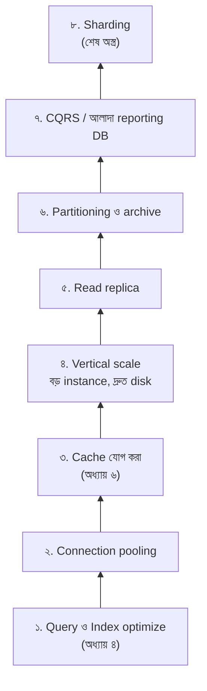
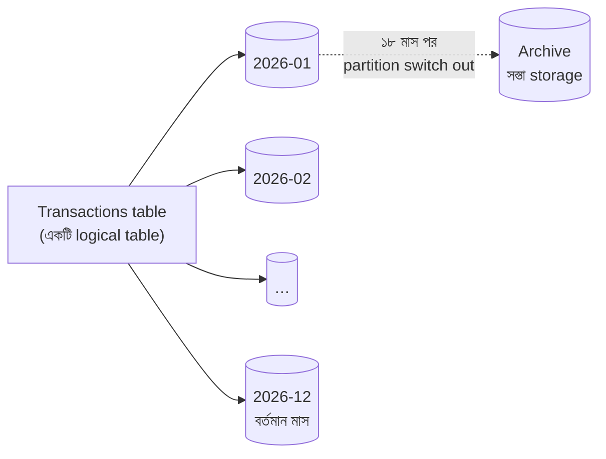
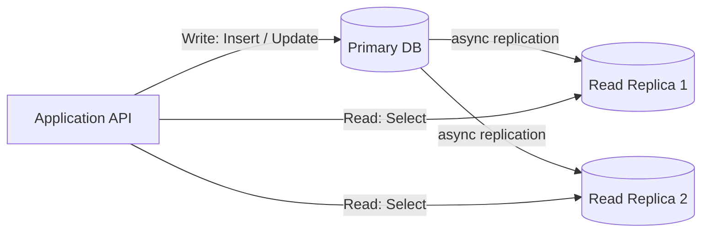
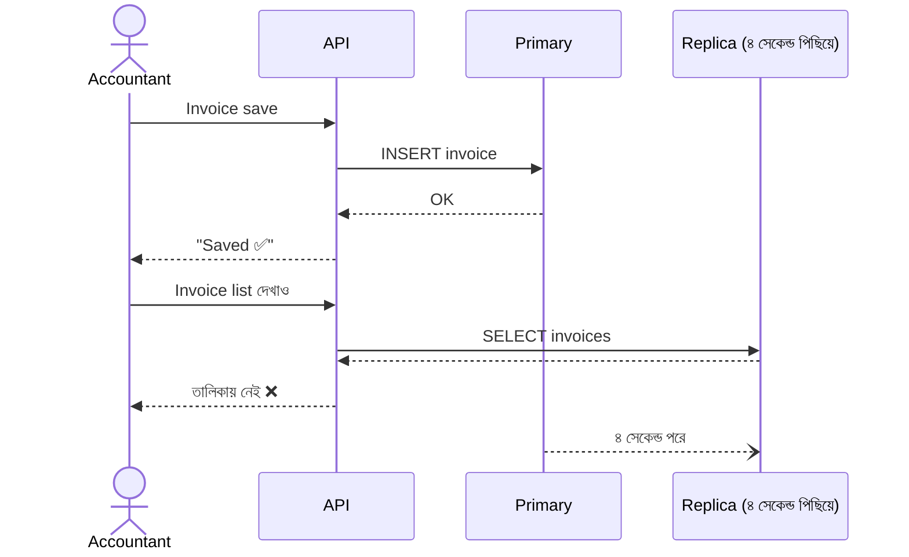
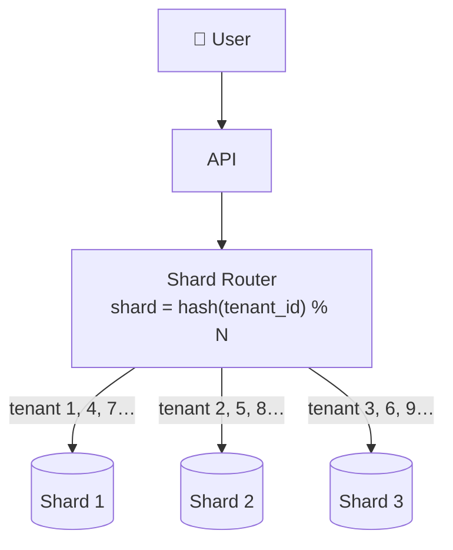
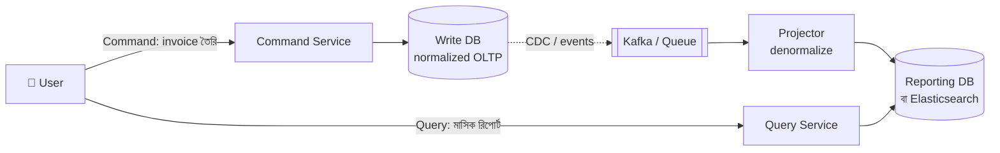

> [!GOALS]
> - Database scaling-এর "সিঁড়ি": কোন ধাপ আগে, কোনটা শেষে
> - Partitioning-এর ধরন এবং পুরনো data archive করার কৌশল
> - Replication, replication lag ও read-your-writes সমস্যা
> - Sharding: shard key বাছাই, hot shard এবং resharding-এর যন্ত্রণা
> - Distributed ID, connection pooling ও CQRS
> - Notion কীভাবে তাদের PostgreSQL shard করেছিল

> [!STORY] "আমার invoice হারিয়ে গেছে!"
> নদী ERP-তে নতুন read replica যোগ করার পরদিন support team-এর কাছে এক অদ্ভুত অভিযোগ এলো। চট্টগ্রাম branch-এর এক accountant invoice save করে list page-এ গিয়ে দেখলেন invoice নেই। আবার তৈরি করলেন। এবার দুটোই দেখা যাচ্ছে।
>
> রাফি log দেখে অবাক। "Invoice তো প্রথমবারেই save হয়েছিল! তাহলে list-এ দেখাল না কেন?"
>
> তানভীর dashboard খুলে একটি graph দেখালেন: **Replication lag: 4.2 seconds**। "Save হয়েছে primary-তে। List পড়েছে replica থেকে। Replica তখনো চার সেকেন্ড পিছিয়ে ছিল।"
>
> নুসরাত শান্তভাবে বললেন, "Read replica বিনা মূল্যে আসে না, রাফি। আমরা consistency-র একটা অংশ বিক্রি করে speed কিনেছি। এখন ঠিক করতে হবে কোন জায়গায় সেই দাম দেওয়া চলবে না।"

## 5.1 Introduction (ভূমিকা)

ডাটাবেজ ডিজাইন করা এক জিনিস, কিন্তু ডাটাবেজকে scale করা সম্পূর্ণ আলাদা এবং জটিল একটি দক্ষতা। ছোট সিস্টেমে একটি ডাটাবেজ, ১০টি টেবিল, ১০০ জন ইউজার, সবকিছু চমৎকার। কিন্তু যখন লাখো ইউজার একসাথে ঢোকে, কোটি কোটি ট্রানজ্যাকশন হয়, real-time analytics আর mobile API-এর request আসে, তখন ডাটাবেজই হয়ে যায় পুরো সিস্টেমের সবচেয়ে বড় bottleneck। কারণ application server সহজে scale করা গেলেও, ডাটাবেজ scale করা অনেক কঠিন।

## 5.2 Database Scaling কেন এত কঠিন?

API server সাধারণত **stateless**, তাই নতুন copy চালু করলেই হয়। কিন্তু ডাটাবেজের ভেতরে **state** বা data থাকে। কঠিন হওয়ার মূল কারণ:

1. **Data Consistency:** ডেটা একাধিক সার্ভারে ছড়িয়ে দিলেও সব জায়গায় যেন সঠিক ডেটা দেখায়।
2. **Transaction Safety:** একাধিক সার্ভার জুড়ে transaction-কে all-or-nothing রাখা খুব কঠিন।
3. **Concurrency:** একই ডেটা একাধিক জায়গা থেকে একসাথে বদলানোর সংঘর্ষ সামলানো।
4. **Data movement:** কোটি কোটি row এক সার্ভার থেকে অন্য সার্ভারে সরানো, system চালু রেখে।

## 5.3 Scaling-এর সিঁড়ি: আগে সস্তা ধাপ

অভিজ্ঞ architect-রা database scale করার সময় একটি সিঁড়ি মেনে চলেন। প্রতিটি উপরের ধাপ বেশি শক্তিশালী, কিন্তু বেশি জটিল ও ব্যয়বহুল। নিচের ধাপ শেষ না করে উপরে লাফ দেওয়া সবচেয়ে সাধারণ ভুল।



> [!ARCHITECT] Sharding শেষ অস্ত্র কেন
> Sharding একবার করলে ফেরা প্রায় অসম্ভব। JOIN, foreign key, transaction, unique constraint, report: সব কিছু নতুন করে ভাবতে হয়। নুসরাতের নিয়ম: "যতক্ষণ একটি বড় server আর কয়েকটি replica দিয়ে চলে, ততক্ষণ shard নয়। Shard করার সিদ্ধান্ত নেবে data-র আকার আর write load, ফ্যাশন নয়।"

## 5.4 Vertical বনাম Horizontal Database Scaling

**Vertical Scaling (Scale Up):** বিদ্যমান ডাটাবেজ সার্ভারের CPU, RAM ও SSD বাড়ানো। Database-এর জন্য এটি প্রায়ই সবচেয়ে কার্যকর প্রথম পদক্ষেপ, কারণ বেশি RAM মানে বেশি data memory-তে থাকে, disk-এ কম যেতে হয়। **সমস্যা:** নির্দিষ্ট সীমা আছে, ব্যয়বহুল, এবং একটি server-এ সব data মানে SPOF (replication দিয়ে কমানো যায়)।

**Horizontal Scaling (Scale Out):** ডেটা বা কাজ অনেকগুলো সার্ভারে ভাগ করা। Read-এর জন্য replica, write ও data size-এর জন্য sharding। **সুবিধা:** প্রায় সীমাহীন scale ও fault tolerance। **সমস্যা:** জটিলতা।

## 5.5 Database Partitioning (পার্টিশনিং)

Partitioning মানে একটি বিশাল টেবিলকে **একই database server-এর ভেতরে** ছোট ছোট ভাগে ভাগ করা। Application-এর কাছে এটি একটি table-ই; ভেতরে database বুঝে নেয় কোন ভাগে খুঁজতে হবে।

**উদাহরণ (Range Partitioning):** `Transactions` টেবিলে ১০ কোটি row। মাস অনুযায়ী ভাগ করলে: Partition 1 = January, Partition 2 = February, …। কেউ শুধু ফেব্রুয়ারির ডেটা খুঁজলে database অন্য partition ছুঁয়েও দেখে না। একে বলে **Partition Pruning**।

| ধরন | ভাগের ভিত্তি | উপযুক্ত যেখানে |
| --- | --- | --- |
| **Range** | তারিখ, ID-র পরিসর | Transaction, log, অর্থবছর |
| **List** | নির্দিষ্ট মানের তালিকা | Region, branch group, দেশ |
| **Hash** | Key-এর hash | সমানভাবে ছড়ানো, hotspot এড়ানো |



**Partitioning-এর সবচেয়ে বড় উপহার: Archive।** পুরনো একটি পুরো মাসের partition এক মুহূর্তে অন্য table-এ সরিয়ে (partition switch) archive করা যায়, কোটি কোটি row `DELETE` করার বদলে। `DELETE` করলে log ফুলে যায়, lock হয়, ঘণ্টার পর ঘণ্টা লাগে।

> [!WARNING]
> Partition key query-তে না থাকলে partitioning উল্টো ক্ষতি করে: database-কে সব partition খুঁজতে হয়। যেমন তারিখ দিয়ে partition করে `WHERE CustomerId = ?` দিয়ে খুঁজলে প্রতিটি partition-এ যেতে হবে। Partition key বাছাই করুন সবচেয়ে বেশি ব্যবহৃত query দেখে।

## 5.6 Database Replication (রেপ্লিকেশন)

Replication মানে মূল ডাটাবেজের ডেটা কপি করে অন্য এক বা একাধিক সার্ভারে রাখা।

**Primary-Replica Architecture:**
- **Primary:** সব write (Insert/Update/Delete) এখানে যায়।
- **Replica:** Primary-র change log অনুসরণ করে নিজেকে update রাখে; read (Select) এখান থেকে করা যায়।

বেশিরভাগ সিস্টেমে write-এর চেয়ে read অনেক বেশি হয়, তাই read replica primary-র উপর থেকে প্রচুর load কমায়। পাশাপাশি primary নষ্ট হলে replica-কে primary বানানো যায় (**failover**)।



### Synchronous বনাম Asynchronous Replication

| | Synchronous | Asynchronous |
| --- | --- | --- |
| কীভাবে | Replica-ও লিখলে তবেই commit সফল | Primary লিখেই সফল; replica পরে ধরে |
| Data হারানোর ঝুঁকি | প্রায় শূন্য | Failover-এ শেষ কয়েক সেকেন্ডের data হারাতে পারে |
| Latency | বাড়ে (replica-র জন্য অপেক্ষা) | কম |
| ব্যবহার | একই data center-এ HA জোড়া, ledger | Read replica, দূরের region |

### Replication Lag ও Read-Your-Writes

গল্পের সমস্যাটি ঠিক এটাই। Async replication-এ replica কিছুক্ষণ পিছিয়ে থাকতে পারে।



**সমাধানের কৌশল:**
- **Read-your-writes routing:** কোনো user write করলে পরের কয়েক সেকেন্ড (বা session-এর বাকি সময়) তার read primary থেকে।
- **গুরুত্বপূর্ণ read সবসময় primary থেকে:** Balance, stock, payment status।
- **Lag-aware routing:** Replica-র lag একটি সীমার (যেমন ১ সেকেন্ড) বেশি হলে সেটাকে read pool থেকে সরিয়ে দেওয়া।
- **UI কৌশল:** Save-এর পর server-এর ফেরত দেওয়া object দিয়েই list-এ নতুন item যোগ করা।

> [!TIP]
> Replication lag একটি metric হিসেবে সবসময় dashboard-এ রাখুন এবং alert দিন। Lag সাধারণত বাড়ে বড় batch update, long-running transaction বা replica-তে ভারী report চালানোর সময়।

## 5.7 Database Sharding (শার্ডিং)

Sharding হলো ডেটাকে **physically আলাদা database server-এ** ভাগ করা। প্রতিটি shard পুরো data-র একটি অংশ রাখে এবং নিজেই একটি স্বাধীন database (সাধারণত নিজের replica সহ)।



### Shard Key: সবচেয়ে গুরুত্বপূর্ণ সিদ্ধান্ত

ভালো shard key-র বৈশিষ্ট্য:
1. **বেশিরভাগ query-তে থাকে**, যাতে প্রতিটি request একটি shard-এই শেষ হয়।
2. **Data ও load সমানভাবে ছড়ায়**, কোনো shard অতিরিক্ত গরম না হয়।
3. **সম্পর্কিত data একসাথে রাখে**, যাতে JOIN ও transaction এক shard-এর ভেতরে হয়।

| কৌশল | কীভাবে | সুবিধা | সমস্যা |
| --- | --- | --- | --- |
| **Range** | User ID 1-33 লাখ → Shard 1… | সহজ, range query ভালো | নতুন user সব শেষ shard-এ: hotspot |
| **Hash** | `hash(key) % N` | সমান বণ্টন | Shard সংখ্যা বদলালে প্রায় সব data সরাতে হয় |
| **Directory / Lookup** | একটি table বলে কোন key কোন shard-এ | নমনীয়, বড় tenant আলাদা করা যায় | Lookup service নিজেই critical |
| **Tenant-based** | প্রতিটি client company একটি shard-এ | SaaS/ERP-তে স্বাভাবিক, isolation | বড় tenant আর ছোট tenant অসমান |

> [!WARNING] Hot Shard
> নদী ERP-তে tenant দিয়ে shard করার পর দেখা গেল একটি গার্মেন্টস গ্রুপ একাই বাকি ৪০টি client-এর সমান data তৈরি করে। তাদের shard সবসময় গরম। সমাধান: directory-ভিত্তিক routing, যাতে বড় tenant-কে নিজস্ব dedicated shard দেওয়া যায়। Social media-তে একই সমস্যা হয় celebrity account-এ (অধ্যায় ২১)।

**Sharding-এর চ্যালেঞ্জ:**
- Cross-shard JOIN করা যায় না; application-এ জোড়া লাগাতে হয়।
- Cross-shard transaction অত্যন্ত জটিল (অধ্যায় ১০-এর Saga)।
- Global unique constraint (যেমন email সব shard মিলিয়ে unique) নিশ্চিত করা কঠিন।
- Report-এর জন্য সব shard থেকে data একত্র করতে হয়।
- **Resharding:** Shard সংখ্যা বাড়ানো মানে চালু system-এ বিপুল data সরানো।

> [!CASE] Notion, ২০২১: একটি PostgreSQL থেকে ৪৮০টি logical shard
> Notion দীর্ঘদিন একটি বিশাল PostgreSQL database দিয়ে চলছিল। ২০২০-এর দিকে database-এর CPU প্রায়ই সর্বোচ্চে পৌঁছাতে থাকে, আর PostgreSQL-এর রক্ষণাবেক্ষণ প্রক্রিয়া (VACUUM) পিছিয়ে পড়ছিল। তাদের প্রকাশিত বিবরণ অনুযায়ী, তারা **workspace ID**-কে shard key বানায়, কারণ Notion-এর প্রায় সব data কোনো একটি workspace-এর ভেতরে থাকে। তারা **৪৮০টি logical shard** তৈরি করে, যেগুলো **৩২টি physical database**-এ ভাগ করে রাখা হয়।
>
> কেন ৪৮০? কারণ সংখ্যাটি অনেকগুলো সংখ্যা দিয়ে বিভাজ্য। ভবিষ্যতে physical database বাড়ানোর সময় logical shard-গুলো সমানভাবে নতুন server-এ সরানো যাবে, application-এর routing logic না বদলে। Migration-এর সময় তারা কিছুদিন পুরনো ও নতুন দুই জায়গাতেই লিখেছে (double-write), data মিলিয়ে দেখেছে, তারপর read সরিয়েছে।
>
> **শিক্ষা:** (১) Shard key business-এর স্বাভাবিক সীমানা থেকে আসে (workspace, tenant, branch)। (২) Physical server-এর চেয়ে অনেক বেশি logical shard বানিয়ে রাখুন, ভবিষ্যতে সরানো সহজ হবে। (৩) Migration হলো একটি ধাপে ধাপে, যাচাইসহ যাত্রা, এক রাতের কাজ নয়।

## 5.8 Distributed ID: Auto-increment যখন কাজ করে না

একটি database-এ `IDENTITY` বা auto-increment চমৎকার। কিন্তু একাধিক shard-এ প্রত্যেকে নিজের মতো 1, 2, 3… দিলে ID মিলে যাবে।

| পদ্ধতি | বৈশিষ্ট্য |
| --- | --- |
| **UUID v4** | Random, কোথাও সমন্বয় লাগে না; কিন্তু index-এ এলোমেলো insert, সাইজ বড় |
| **UUID v7 / ULID** | সময়-ক্রমিক UUID; index-বান্ধব, তবু globally unique |
| **Snowflake ID** | 64-bit: সময় + machine ID + sequence; ছোট, সময়-ক্রমিক (Twitter-এর জনপ্রিয় করা) |
| **ID-তে shard নম্বর** | ID দেখেই বোঝা যায় কোন shard-এ আছে |

## 5.9 Connection Pooling: নীরব ঘাতক

প্রতিটি database connection server-এ memory নেয়। ৫০টি app instance × ১০০ connection = ৫,০০০ connection, যা অনেক database সহজে সামলাতে পারে না। অধ্যায় ২-এর Little's Law মনে করুন: query ধীর হলে একসাথে বেশি connection লাগে, pool শেষ হয়, request অপেক্ষায় পড়ে।

**সমাধান:** Application-এ সঠিক pool size, এবং database-এর সামনে **PgBouncer** (PostgreSQL) বা RDS Proxy-র মতো connection pooler, যা হাজার হাজার client connection-কে অল্প কিছু আসল database connection-এ মিলিয়ে দেয়।

## 5.10 CQRS Pattern

CQRS-এর পূর্ণরূপ **Command Query Responsibility Segregation**। মূল কথা: data **লেখার** model আর data **পড়ার** model আলাদা।

**বাস্তব উদাহরণ (ERP):** মাসের শেষে বিশাল রিপোর্ট চললে পুরো ডাটাবেজ স্লো হয়ে যায়। CQRS-এ:
- **Write Database:** Normalized, শুধু transaction-এর জন্য, দ্রুত ও ছোট।
- **Read Database (Reporting):** Denormalized, রিপোর্টের প্রশ্ন অনুযায়ী সাজানো; Write DB-র পরিবর্তন queue বা **CDC (Change Data Capture)** দিয়ে এখানে আসে।



**CQRS-এর দাম:** Reporting data কয়েক সেকেন্ড বা মিনিট পিছিয়ে থাকে (eventual consistency), এবং একটি অতিরিক্ত pipeline চালাতে ও monitor করতে হয়। তাই সব system-এ নয়; যেখানে read ও write-এর চাহিদা সত্যিই সংঘর্ষ করে, সেখানে।

## 5.11 AI কোণ: Embedding-ও data, এবং বড় data

> [!AI] Vector data-র capacity planning
> AI search বা RAG-এর জন্য প্রতিটি document-কে কয়েকটি অংশে (chunk) ভাগ করে প্রতিটির embedding রাখতে হয়। আয়েশার হিসাব:
>
> ```text
> ১০ লাখ chunk × 1,536 dimension × 4 byte ≈ 6 GB (শুধু vector)
> HNSW index-এর overhead (সাধারণত আরো অনেকখানি) + metadata
> ```
>
> Vector index সাধারণত memory-তে থাকলে দ্রুত হয়, তাই এটি RAM-এর হিসাবে বড় প্রভাব ফেলে। Multi-tenant system-এ vector data-ও tenant দিয়ে ভাগ করুন (filter বা আলাদা collection), নাহলে এক client-এর document অন্য client-এর search-এ চলে আসতে পারে, যা একটি গুরুতর data leak। অধ্যায় ১৫-এ বিস্তারিত।
>
> **Anomaly detection:** Query latency, replication lag আর connection সংখ্যার মতো metric-এ ML-ভিত্তিক anomaly detection অনেক monitoring tool-এ এখন আছে। এটি "স্বাভাবিকের চেয়ে আলাদা" আচরণ আগেভাগে ধরতে পারে, যেমন প্রতি সোমবার সকালের lag বৃদ্ধি। তবে threshold-ভিত্তিক মৌলিক alert আগে ঠিক করুন।

## 5.12 সাধারণ ভুল

- Query ও index ঠিক না করে সরাসরি sharding-এ ঝাঁপ দেওয়া।
- Replica থেকে balance বা stock পড়া।
- Replication lag monitor না করা।
- Range shard key হিসেবে auto-increment ID বা তারিখ নেওয়া: সব নতুন write এক shard-এ।
- কম সংখ্যক shard দিয়ে শুরু করা, যাতে পরে resharding-এ বিপুল data সরাতে হয়।
- `DELETE` দিয়ে কোটি row archive করা, partition switch না করে।
- Connection pool-এর হিসাব না করে instance সংখ্যা বাড়ানো।

## 5.13 Interview প্রশ্ন

> [!INTERVIEW]
> 1. Partitioning ও Sharding-এর পার্থক্য কী?
> 2. Replication lag কী? এর কারণে কী সমস্যা হতে পারে এবং কীভাবে সামলাবেন?
> 3. একটি multi-tenant SaaS-এর জন্য shard key কী হবে? বড় tenant-এর সমস্যা কীভাবে মেটাবেন?
> 4. Hash-based sharding-এ shard সংখ্যা ৪ থেকে ৫ করলে কী হয়? এর সমাধান কী (ইঙ্গিত: consistent hashing, logical shard)?
> 5. CQRS কখন ব্যবহার করবেন, আর কখন এটি অপ্রয়োজনীয় জটিলতা?
> 6. Distributed system-এ unique ID কীভাবে তৈরি করবেন?

## 5.14 নিজে করে দেখুন

> [!EXERCISE] Microfinance-এর ৭০ লাখ গ্রাহক
> একটি microfinance প্রতিষ্ঠানের ২,০০০ branch, ৭০ লাখ গ্রাহক, প্রতিদিন ১৫ লাখ কিস্তি আদায়ের transaction। ৯০% query একটি নির্দিষ্ট branch-এর ভেতরে, কিন্তু head office প্রতিদিন সকালে সব branch-এর consolidated report চায়।
> 1. Scaling সিঁড়ির কোন ধাপগুলো আগে প্রয়োগ করবেন?
> 2. Sharding দরকার হলে shard key কী হবে? কেন?
> 3. Head office-এর report কীভাবে দেবেন যাতে branch-এর কাজ ধীর না হয়?
> 4. একটি বড় branch অন্যদের দশগুণ হলে কী করবেন?

## 5.15 Chapter Summary (সারসংক্ষেপ)

- **সিঁড়ি মেনে চলুন:** Query → pooling → cache → vertical → replica → partition → CQRS → sharding।
- **Partitioning:** একই server-এ বড় table ভাগ; pruning ও সহজ archive-এর জন্য।
- **Replication:** Read scale ও failover; async হলে lag আর read-your-writes সমস্যা মাথায় রাখুন।
- **Sharding:** Shard key সবচেয়ে বড় সিদ্ধান্ত; hot shard ও resharding-এর জন্য আগে থেকে logical shard।
- **Distributed ID ও pooling:** ছোট বিষয়, কিন্তু উপেক্ষা করলে বড় বিপদ।
- **CQRS:** Write ও read model আলাদা; দাম হলো eventual consistency ও অতিরিক্ত pipeline।

> [!ARCHITECT] নুসরাতের নোটবুক · Read Replica-র প্রথম সপ্তাহ
> সমস্যা: Replica lag ৪ সেকেন্ড পর্যন্ত; save-এর পর list-এ data নেই। সিদ্ধান্ত: write-এর পর ১০ সেকেন্ড ওই user-এর read primary থেকে; balance, stock ও payment status সবসময় primary থেকে; lag > ২ সেকেন্ড হলে replica pool থেকে বাদ ও alert। ফলাফল: primary-র CPU ৮৫% থেকে ৪০%। Duplicate invoice অভিযোগ: শূন্য। পরের ধাপ: সবচেয়ে বেশি পড়া data cache-এ।
