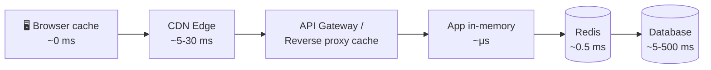
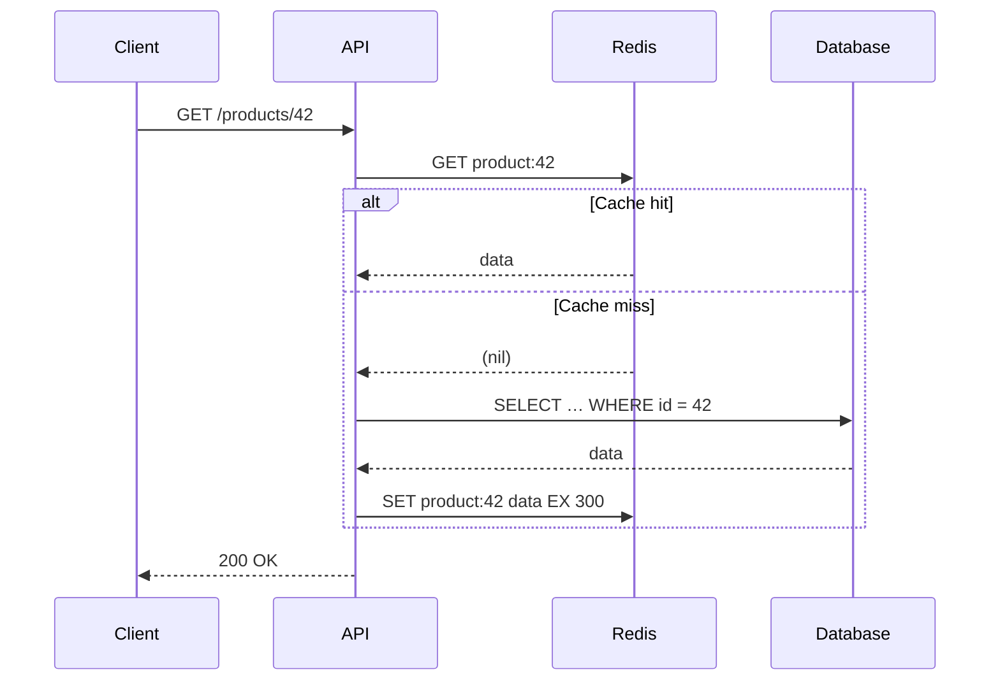
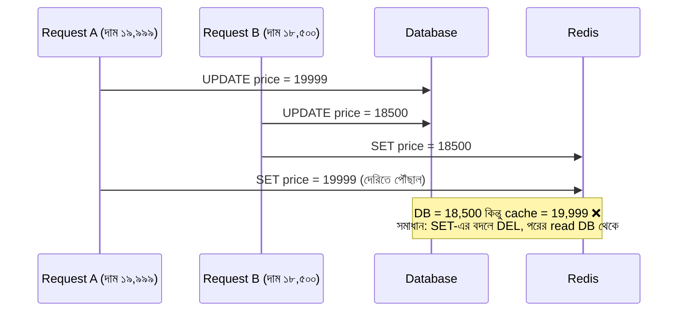
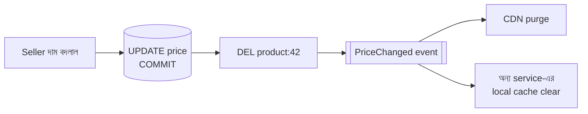
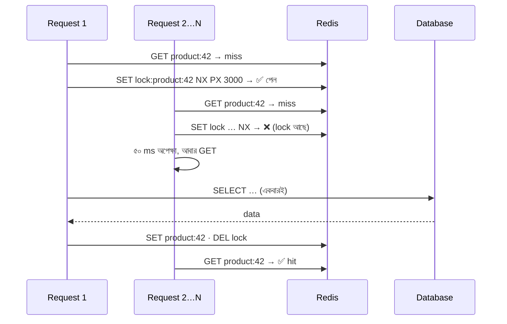
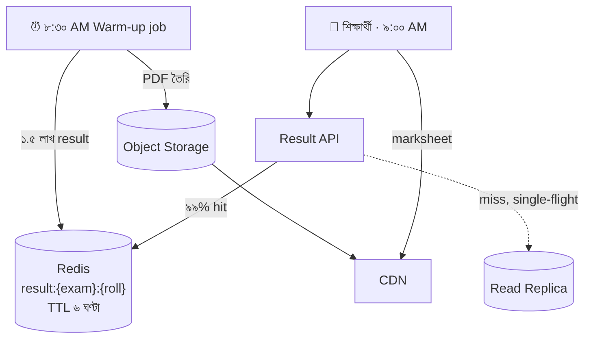

> [!GOALS]
> - Cache কোথায় কোথায় থাকে: browser থেকে database পর্যন্ত
> - কী cache করবেন, কী কখনো করবেন না
> - Cache-aside, write-through, write-behind ও refresh-ahead pattern
> - Invalidation, stampede, penetration, avalanche ও hot key সমস্যা
> - CDN ও HTTP cache header
> - LLM-এর জন্য semantic cache এবং তার ঝুঁকি

> [!STORY] যখন cache মিথ্যা বলে
> চাঁদরাতের আগের সন্ধ্যা। নদী বাজারে flash sale চলছে। মিতু দৌড়ে এলেন, হাতে phone। "একটা ১৯,৯৯৯ টাকার phone ১,৯৯৯ টাকায় অর্ডার হচ্ছে! চল্লিশটা অর্ডার হয়ে গেছে!"
>
> Seller দুপুরে ভুল করে দাম ১,৯৯৯ লিখেছিলেন, দশ মিনিট পরে ঠিক করেছিলেন। Database-এ দাম ঠিক আছে। কিন্তু product page আর cart দাম নিচ্ছিল Redis থেকে, যেখানে TTL ছিল **২৪ ঘণ্টা**, আর দাম বদলালে cache মোছার কোনো code ছিল না।
>
> তানভীর এক লাইনে cache মুছে দিলেন। কিন্তু চল্লিশটা অর্ডার রয়ে গেল। সেই রাতে করিম সাহেব seller-এর সাথে বসে সিদ্ধান্ত নিলেন, ক্রেতাদের অর্ডার সম্মান করা হবে, ক্ষতি নদী বাজার বহন করবে।
>
> পরদিন সকালে নুসরাত whiteboard-এ লিখলেন: **"Cache গতি দেয়, কিন্তু সত্য নয়। সত্য থাকে database-এ।"** তারপর নিচে লিখলেন: "দাম, stock আর টাকা: checkout-এর মুহূর্তে সবসময় source of truth থেকে।"

## 6.1 Introduction (ভূমিকা)

একটি সিস্টেম স্লো হওয়ার সবচেয়ে সাধারণ কারণ: **"প্রতিটি রিকোয়েস্ট সরাসরি ডাটাবেজে হিট করছে।"** ছোট সিস্টেমে এটি কোনো সমস্যা নয়। কিন্তু ট্রাফিক বাড়লে একই ডেটার জন্য বারবার query আসতে থাকে। ফলে ডাটাবেজ overload হয়, CPU ১০০%-এ ওঠে, API response timeout হয়।

এর সবচেয়ে কার্যকর সমাধান **Caching**। ঠিকভাবে ব্যবহার করলে caching সিস্টেমকে দশ থেকে একশো গুণ দ্রুত করতে পারে, database-এর খরচ কমায়, আর peak traffic সামলায়। ভুলভাবে ব্যবহার করলে, গল্পের মতো, ভুল দামে জিনিস বিক্রি হয়।

## 6.2 Caching কী?

Caching হলো বারবার প্রয়োজন হয় এমন ডেটাকে অত্যন্ত দ্রুত একটি অস্থায়ী storage-এ রাখা।

- **ডাটাবেজ:** স্থায়ী ও নির্ভরযোগ্য, কিন্তু query করতে তুলনামূলক সময় লাগে (milliseconds থেকে seconds)।
- **ক্যাশ:** অস্থায়ী, সাধারণত RAM-এ, তাই অত্যন্ত দ্রুত (microseconds থেকে ১ millisecond)।

Cache-এর কার্যকারিতা মাপা হয় **hit ratio** দিয়ে: মোট request-এর কত শতাংশ cache থেকেই উত্তর পেল। ৯০% hit ratio মানে database-এর কাছে যাচ্ছে মাত্র ১০%; database-এর load দশ ভাগের এক ভাগ।

## 6.3 Real Production Story: ক্যাশ ছাড়া dashboard

একটি ERP সিস্টেমে প্রতিদিন ৫০০০ concurrent user লগইন করতো। Dashboard-এ বেশ কিছু ভারী SQL query ছিল, যেগুলো সারা মাসের আয়-ব্যয় এবং স্টক রিপোর্ট দেখাতো।

**সমস্যা:** প্রতিবার কেউ dashboard-এ গেলেই একই রিপোর্ট নতুন করে database থেকে হিসাব হতো। Database CPU ৯৫%+, একটি পেজ লোড হতে ৮-১২ সেকেন্ড।

**সমাধান:** Dashboard-এর ডেটা একবার হিসাব করে Redis-এ ৫ মিনিটের TTL দিয়ে রাখা হলো। পরের ৫ মিনিটে যত user আসে, সবাই Redis থেকে পায়।

**ফলাফল:** ১২ সেকেন্ডের response time নেমে আসে ২০০ millisecond-এ, database CPU ৯৫% থেকে ২০%-এ। আর business-এর জন্য ৫ মিনিট পুরনো dashboard সম্পূর্ণ গ্রহণযোগ্য ছিল। এই শেষ বাক্যটাই caching-এর আসল প্রশ্ন: **কতটা পুরনো data চলবে?**

## 6.4 Cache-এর স্তর: request-এর পথে প্রতিটি থামার জায়গা



| স্তর | উদাহরণ | কী রাখা হয় | সতর্কতা |
| --- | --- | --- | --- |
| Browser | `Cache-Control` header | CSS, JS, ছবি | Version ছাড়া নাম দিলে পুরনো file আটকে থাকে |
| CDN | Cloudflare, CloudFront, Akamai | Static file, public page, PDF | Personalized page CDN-এ নয় |
| Reverse proxy | NGINX, Varnish | পুরো API response | Auth header বিবেচনা |
| In-memory (local) | .NET `IMemoryCache` | ছোট lookup data, config | প্রতিটি server-এ আলাদা copy; restart-এ মুছে যায় |
| Distributed | Redis, Memcached | Session, query result, computed data | Network hop, নিজেরও availability দরকার |
| Database buffer | Buffer pool | Data page | Database নিজেই সামলায় |

### কী cache করবেন, কী করবেন না

| ভালো candidate | সাবধান / করবেন না |
| --- | --- |
| বারবার পড়া হয়, কম বদলায় (product details, category tree) | টাকা, balance, checkout-এর দাম (চূড়ান্ত হিসাব source থেকে) |
| হিসাব করতে ব্যয়বহুল (dashboard, report summary) | Stock reservation (গণনা DB-তে, cache শুধু দেখানোর জন্য) |
| সবার জন্য একই (result, notice, menu) | Permission ও role, যদি revoke সাথে সাথে কার্যকর হতে হয় |
| Session, rate limit counter | ব্যক্তিগত data, যদি key-তে user ID না থাকে |

## 6.5 Cache Pattern (ক্যাশিং প্যাটার্ন)

### ১. Cache-Aside (Lazy Loading): সবচেয়ে বেশি ব্যবহৃত

Application নিজেই cache ও database দুটো সামলায়।



```csharp
public async Task<ProductDto?> GetProductAsync(int id)
{
    var key = $"product:v2:{id}";
    var cached = await _cache.GetStringAsync(key);
    if (cached is not null) return JsonSerializer.Deserialize<ProductDto>(cached);

    var product = await _db.Products.AsNoTracking()
        .Where(p => p.Id == id)
        .Select(p => new ProductDto(p.Id, p.Name, p.Price))
        .FirstOrDefaultAsync();
    if (product is null) return null;

    // TTL-এ সামান্য random jitter, যাতে সব key একসাথে expire না হয়
    var ttl = TimeSpan.FromMinutes(5) + TimeSpan.FromSeconds(Random.Shared.Next(0, 60));
    await _cache.SetStringAsync(key, JsonSerializer.Serialize(product),
        new DistributedCacheEntryOptions { AbsoluteExpirationRelativeToNow = ttl });
    return product;
}
```

### অন্যান্য Pattern

| Pattern | কীভাবে কাজ করে | সুবিধা | অসুবিধা |
| --- | --- | --- | --- |
| **Cache-aside** | App আগে cache দেখে, miss হলে DB, তারপর cache-এ রাখে | সহজ, শুধু দরকারি data cache-এ | প্রথম request ধীর, invalidation app-এর দায়িত্ব |
| **Read-through** | Cache library নিজেই miss হলে DB থেকে আনে | App code পরিষ্কার | Library/provider-এর উপর নির্ভরতা |
| **Write-through** | Write একসাথে cache ও DB-তে | Cache সবসময় নতুন | Write ধীর, কখনো না পড়া data-ও cache-এ |
| **Write-behind (write-back)** | Write আগে cache-এ, পরে batch করে DB-তে | খুব দ্রুত write | Cache নষ্ট হলে data হারানোর ঝুঁকি |
| **Refresh-ahead** | Expire হওয়ার আগেই background-এ নতুন করে আনা | User কখনো miss দেখে না | কম ব্যবহৃত data অকারণে refresh |

> [!WARNING]
> Write-behind টাকা বা order-এর মতো গুরুত্বপূর্ণ data-র জন্য প্রায় কখনো নয়। View count, like count, analytics counter-এর মতো জায়গায় এটি চমৎকার।

## 6.6 Eviction: Cache ভরে গেলে কী মুছবে?

RAM সীমিত। Cache ভরে গেলে কোন key সরানো হবে, তা ঠিক করে **eviction policy**।

- **LRU (Least Recently Used):** সবচেয়ে দীর্ঘ সময় ব্যবহার হয়নি এমন key আগে যাবে। সবচেয়ে প্রচলিত।
- **LFU (Least Frequently Used):** সবচেয়ে কম বার ব্যবহৃত key আগে যাবে। জনপ্রিয় data দীর্ঘদিন থাকে।
- **TTL-ভিত্তিক:** যেগুলোর মেয়াদ শেষের কাছে, সেগুলো আগে।

Redis-এ `maxmemory` ও `maxmemory-policy` (যেমন `allkeys-lru`) অবশ্যই set করুন। না করলে memory ভরে গেলে write fail করতে পারে।

## 6.7 Cache Invalidation: কম্পিউটার বিজ্ঞানের কঠিনতম সমস্যার একটি

> [!QUOTE]
> There are only two hard things in Computer Science: cache invalidation and naming things. (Phil Karlton)

ইউজার নিজের নাম বদলালো, database-এ update হলো, কিন্তু cache-এ পুরনো নাম রয়ে গেল। সঠিক সময়ে cache মুছে ফেলা বা আপডেট করাকেই **Cache Invalidation** বলে।

**কৌশলগুলো:**
1. **TTL (Time To Live):** প্রতিটি key-এর মেয়াদ। সহজতম নিরাপত্তা জাল: invalidation ভুলে গেলেও একসময় ঠিক হয়ে যাবে। গল্পের ২৪ ঘণ্টার TTL ছিল দামের জন্য অনেক বেশি।
2. **Write-এর পর delete:** Database commit সফল হলে সংশ্লিষ্ট key মুছে দেওয়া; পরের read নতুন data আনবে।
3. **Versioned key:** `product:v2:42`; data-র structure বদলালে version বাড়ান, পুরনো key নিজে থেকে expire হবে।
4. **Event-ভিত্তিক invalidation:** Price বদলালে `PriceChanged` event, যা শুনে সব cache (এমনকি CDN) purge হয়।

### Invalidation-এর race condition

"Update DB, তারপর cache-এ নতুন মান **set** করো" পদ্ধতিতে একটি সূক্ষ্ম race আছে: দুটি update একসাথে হলে পুরনো মান শেষে cache-এ বসে যেতে পারে। তাই সাধারণ পরামর্শ: **DB update → commit → cache key delete** (set নয়), সাথে ছোট TTL। পরের read DB থেকে সর্বশেষ মান আনবে।





## 6.8 Cache-এর চারটি বিপদ

### ১. Cache Stampede (Thundering Herd)

একটি জনপ্রিয় product page-এর cache ৫ মিনিট পর expire হলো, আর ঠিক সেই মুহূর্তে ২০ হাজার user পেজটিতে এলো। Cache খালি, তাই ২০ হাজার request একসাথে database-এ, database crash।

**সমাধান:**
- **Locking / single-flight:** প্রথম request DB-তে যায়, বাকিরা কয়েক millisecond অপেক্ষা করে একই ফলাফল নেয়।
- **Stale-while-revalidate:** মেয়াদ শেষ হলেও কিছুক্ষণ পুরনো মান দেখানো, background-এ একটি request নতুন মান আনে।
- **Pre-warming / refresh-ahead:** মেয়াদ শেষের আগেই background worker নতুন মান রেখে দেয়।
- **Probabilistic early expiration:** প্রতিটি request সামান্য সম্ভাবনায় মেয়াদের আগেই refresh করে, যাতে সবাই একসাথে না যায়।



### ২. Cache Penetration

কেউ এমন key চাইছে যা database-এও নেই (যেমন `product:99999999`)। প্রতিবার cache miss, প্রতিবার DB। আক্রমণকারী ইচ্ছা করে এটা করতে পারে।
**সমাধান:** "নেই" ফলাফলও অল্প সময়ের জন্য cache করা (**negative caching**), অথবা **Bloom filter** দিয়ে আগেই বলে দেওয়া যে key-টি অস্তিত্বহীন।

### ৩. Cache Avalanche

অনেক key একসাথে expire হলো (যেমন সব key-এর TTL ঠিক ৫ মিনিট, আর সবই সকাল ৯টায় load করা)। একসাথে বিপুল miss।
**সমাধান:** TTL-এ random **jitter** (উপরের C# code-এর মতো), এবং Redis-এর নিজের high availability (replica, Sentinel বা Cluster), কারণ Redis নিজে বন্ধ হলেও একই avalanche।

### ৪. Hot Key

একটি key এত জনপ্রিয় যে একটি Redis node-এর CPU বা network একাই ভরে যায় (যেমন result day-তে "notice" key, বা ক্রিকেট ম্যাচের live score)।
**সমাধান:** App-এর local in-memory cache-এ কয়েক সেকেন্ডের জন্য রাখা (দুই স্তরের cache), অথবা key-এর কয়েকটি copy (`score:1`…`score:5`) বানিয়ে load ভাগ করা।

> [!CASE] Facebook-এর Memcache: বিশ্বের সবচেয়ে বড় cache-এর শিক্ষা
> ২০১৩ সালে Facebook-এর engineer-রা "Scaling Memcache at Facebook" নামে একটি গবেষণাপত্র প্রকাশ করেন (NSDI)। সেখানে বর্ণনা আছে কীভাবে হাজার হাজার memcached server প্রতি সেকেন্ডে কোটি কোটি request সামলায়। তারা ঠিক এই অধ্যায়ের দুটি সমস্যার মুখোমুখি হয়েছিল: **stale set** (পুরনো মান cache-এ বসে যাওয়ার race) এবং **thundering herd** (একটি জনপ্রিয় key মুছে গেলে সবার একসাথে database-এ যাওয়া)।
>
> তাদের সমাধানের নাম **lease**: cache miss হলে memcached client-কে একটি token দেয়। শুধু সেই token-ধারীই নতুন মান set করতে পারে, আর ওই key-এর জন্য অল্প সময়ের মধ্যে আরেকটি token দেওয়া হয় না। বাকিরা একটু অপেক্ষা করে আবার চেষ্টা করে, ততক্ষণে মান চলে আসে। মাঝে key মুছে গেলে পুরনো token অকার্যকর, তাই stale set-ও আটকায়।
>
> **শিক্ষা:** বিশাল scale-এও সমস্যাগুলো একই; সমাধান হলো "কে database-এ যাবে" তা নিয়ন্ত্রণ করা। আপনার Redis-এ এর সহজ রূপ হলো `SET key token NX PX 3000` দিয়ে একটি ছোট lock।

## 6.9 CDN (Content Delivery Network)

CDN হলো পৃথিবী জুড়ে ছড়ানো **edge server**-এর একটি network। আপনার মূল server সিঙ্গাপুরে থাকলে ঢাকা থেকে প্রতিটি ছবি আনতে ৪০-৬০ ms round trip, আর মূল server-এর bandwidth খরচ। CDN থাকলে ছবিটি ঢাকার কাছের কোনো edge-এ থাকবে, user প্রায় সাথে সাথে পাবে, আর মূল server ছুঁতেই হবে না।

**HTTP Cache Header-এর মূল কথা:**

```text
# Fingerprinted static file (নামের মধ্যে hash, যেমন app.3f9a1c.js): এক বছর রাখো
Cache-Control: public, max-age=31536000, immutable

# Public কিন্তু মাঝে মাঝে বদলায় (result notice): CDN ৬০ সেকেন্ড, তারপর background-এ নতুন আনো
Cache-Control: public, s-maxage=60, stale-while-revalidate=300

# ব্যক্তিগত data (নিজের marksheet): কোনো shared cache-এ নয়
Cache-Control: private, no-store
```

> [!TIP]
> Admission Portal-এর result day-তে সবচেয়ে বড় জয় এসেছিল CDN থেকে: প্রতিটি শিক্ষার্থীর marksheet PDF আগের রাতেই তৈরি করে object storage-এ রাখা হয়েছিল, আর অনুমান করা যায় না এমন একটি signed URL দিয়ে CDN থেকে দেওয়া হয়েছিল। মূল server-এর কাছে শুধু "কোন PDF" জিজ্ঞেস করা হয়, PDF পাঠানোর ভার CDN-এর।

## 6.10 Admission Portal-এর Cache Plan



## 6.11 AI কোণ: LLM-এর জন্য Cache

> [!AI] Semantic Cache: একই প্রশ্ন, ভিন্ন শব্দ
> AI সহায়কে "ভর্তি ফি কত?" আর "admission fee কত টাকা?" আসলে একই প্রশ্ন। সাধারণ cache (exact key match) এদের আলাদা ভাবে, তাই দুবারই দামি LLM call হয়। **Semantic cache** প্রশ্নের embedding তৈরি করে, আগের প্রশ্নগুলোর সাথে অর্থের মিল (similarity) মেপে দেখে; মিল একটি সীমার বেশি হলে আগের উত্তরই ফেরত দেয়।
>
> আয়েশার পরীক্ষায় FAQ ধরনের প্রশ্নে প্রায় অর্ধেক request cache থেকেই উত্তর পেয়েছিল, latency কয়েক সেকেন্ড থেকে কয়েক millisecond, আর token খরচ উল্লেখযোগ্যভাবে কম।
>
> **কিন্তু সাবধান:**
> - **ব্যক্তিগত উত্তর share করবেন না।** "আমার result কী?" প্রশ্নের উত্তর cache-এ রাখলে অন্য কেউ একই রকম প্রশ্ন করলে অন্যের result পেতে পারে। Personalized প্রশ্নে cache key-তে user ID রাখুন, অথবা cache-ই করবেন না।
> - **Similarity threshold ঝুঁকিপূর্ণ।** "ভর্তি ফি কত?" আর "ভর্তি ফি ফেরত পাওয়া যায় কি?" শব্দে কাছাকাছি, অর্থে সম্পূর্ণ আলাদা। Threshold খুব নিচু রাখলে ভুল উত্তর।
> - **উৎস বদলালে invalidate:** নতুন ফি নির্ধারিত হলে পুরনো AI উত্তরও cache থেকে মুছতে হবে, দামের গল্পের মতোই।
>
> **Provider-এর prompt caching:** অনেক LLM provider এখন একই লম্বা system prompt বা document বারবার পাঠালে সেই অংশ cache করে কম দামে ও দ্রুত process করে। Prompt-এর স্থির অংশ শুরুতে আর পরিবর্তনশীল অংশ শেষে রাখলে এর সুবিধা বেশি পাওয়া যায়।

## 6.12 সাধারণ ভুল

- সব data-তে একই লম্বা TTL।
- Write-এর পর cache invalidate করতে ভুলে যাওয়া।
- দাম, balance বা stock-এর চূড়ান্ত সিদ্ধান্ত cache থেকে নেওয়া।
- Personalized data এমন key-তে রাখা যেখানে user ID নেই।
- Redis-এর `maxmemory` set না করা; Redis-কে নিজেই SPOF বানিয়ে রাখা।
- Cache hit ratio ও Redis latency monitor না করা।
- প্রতিটি সমস্যায় cache দিয়ে ঢেকে দেওয়া, অথচ আসল সমস্যা ধীর query।

## 6.13 Interview প্রশ্ন

> [!INTERVIEW]
> 1. Cache-aside ও write-through-এর পার্থক্য কী? কোনটা কখন?
> 2. Cache stampede কী? অন্তত তিনটি সমাধান বলুন।
> 3. Cache penetration ও cache avalanche-এর পার্থক্য কী?
> 4. Database update-এর পর cache "update" না করে "delete" করা কেন নিরাপদ?
> 5. LRU ও LFU-এর পার্থক্য কী? কোন workload-এ কোনটা ভালো?
> 6. একটি news site-এর homepage কীভাবে cache করবেন, যাতে breaking news ৩০ সেকেন্ডের মধ্যে দেখা যায়?
> 7. LLM-এর উত্তর cache করার ঝুঁকি কী?

## 6.14 নিজে করে দেখুন

> [!EXERCISE] বিপিএল ফাইনালের live score
> একটি sports app-এ বিপিএল ফাইনালের সময় ২০ লাখ user প্রতি ৫ সেকেন্ডে score refresh করে। Score বদলায় প্রতি বলে (গড়ে ৪০ সেকেন্ডে একবার)।
> 1. প্রতি সেকেন্ডে কতগুলো request আসবে?
> 2. কোন স্তরে (CDN, Redis, local) cache করবেন, TTL কত?
> 3. Hot key সমস্যা কীভাবে সামলাবেন?
> 4. "Score বদলানোর ১০ সেকেন্ডের মধ্যে সবাই দেখবে": এই requirement কীভাবে নিশ্চিত করবেন?

## 6.15 Chapter Summary (সারসংক্ষেপ)

- **Caching-এর গুরুত্ব:** দশ থেকে একশো গুণ গতি, database-এর load কমানো; মূল প্রশ্ন "কতটা পুরনো data চলবে?"
- **স্তর:** Browser, CDN, proxy, local memory, Redis, database buffer।
- **Pattern:** Cache-aside সবচেয়ে প্রচলিত; write-through, write-behind ও refresh-ahead নির্দিষ্ট প্রয়োজনে।
- **Invalidation:** TTL নিরাপত্তা জাল; commit-এর পর delete; event দিয়ে সব স্তর পরিষ্কার।
- **চার বিপদ:** Stampede, penetration, avalanche, hot key; প্রত্যেকটির পরিচিত সমাধান আছে।
- **CDN:** Static ও public content-এর জন্য; সঠিক Cache-Control header।
- **AI cache:** Semantic cache খরচ ও latency কমায়, কিন্তু ব্যক্তিগত উত্তর ও ভুল মিলের ঝুঁকি আছে।

> [!ARCHITECT] নুসরাতের নোটবুক · চাঁদরাতের ভুল দাম
> মূল কারণ: Price cache-এর TTL ২৪ ঘণ্টা, update-এ invalidation নেই, আর checkout cache-এর দাম ব্যবহার করছিল। সিদ্ধান্ত: (১) checkout সবসময় database থেকে দাম ও stock নেবে; (২) price TTL ৫ মিনিট + `PriceChanged` event-এ delete ও CDN purge; (৩) seller-এর দাম ৫০%-এর বেশি কমালে নিশ্চিতকরণ চাওয়া হবে। খরচ: চল্লিশটি অর্ডারের ক্ষতি। শিক্ষা: অমূল্য। পরের আলোচনা: API design, কারণ mobile team বলছে আমাদের API "ভারী আর অগোছালো"।
