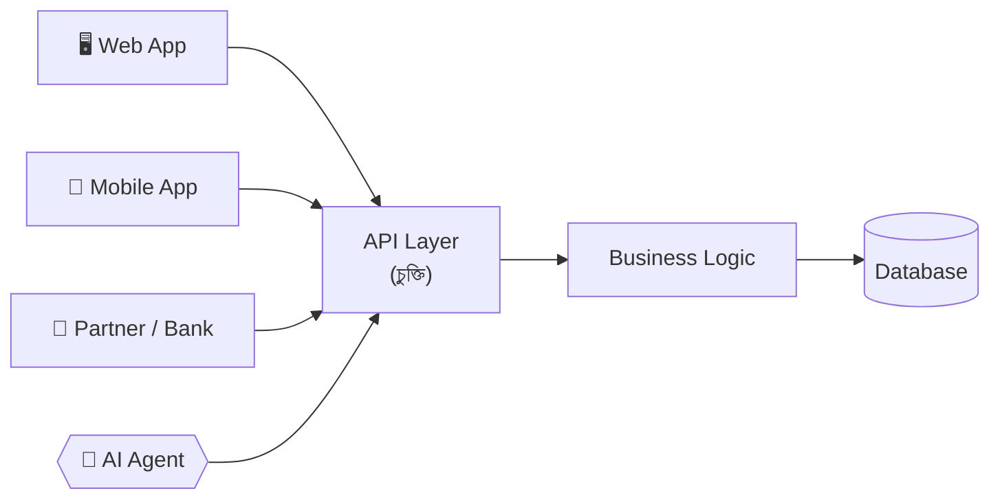
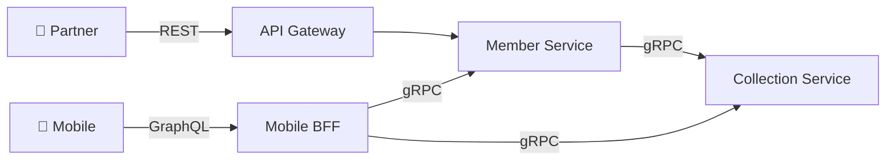
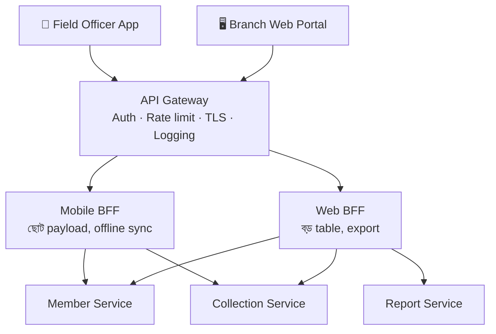
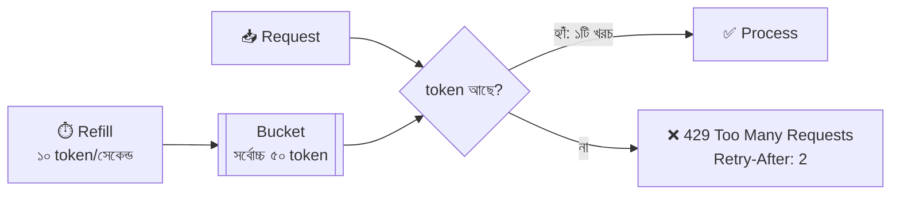
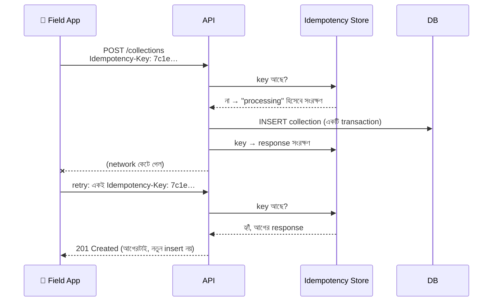
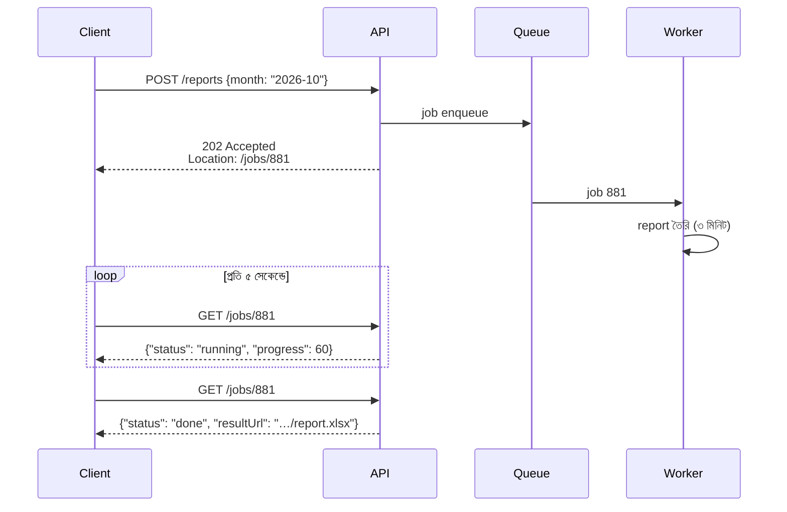

> [!GOALS]
> - API-কে team-এর মধ্যে একটি চুক্তি হিসেবে দেখা
> - REST-এর resource, method, status code ও error format
> - Versioning ও deprecation, যাতে পুরনো mobile app না ভাঙে
> - Offset বনাম cursor pagination
> - REST, GraphQL ও gRPC: কোনটা কোথায়
> - API Gateway, BFF, rate limiting ও token bucket
> - Idempotency key, async API, timeout, retry ও webhook
> - AI agent ও LLM যুগের API design

> [!STORY] সুনামগঞ্জের field officer
> নদীপে-র microfinance app ব্যবহার করেন সুনামগঞ্জের একজন field officer, নাম ধরা যাক জসিম। প্রতিদিন হাওরের গ্রামে গ্রামে ঘুরে কিস্তি আদায় করেন। ফোনে নেটওয়ার্ক কখনো 4G, বেশিরভাগ সময় দুর্বল 2G।
>
> একদিন মিতু একটি support ticket নিয়ে এলেন: "জসিম ভাই বলছেন collection list খুলতে দুই মিনিট লাগে, আর মাঝপথে বন্ধ হয়ে যায়। তারপর আবার submit চাপলে একই কিস্তি দুইবার জমা হয়।"
>
> রাফি API খুলে দেখল। `GET /api/GetCollectionData` একবারে branch-এর **সব** সদস্যের সব তথ্য পাঠায়: ছবি (base64), পুরো লেনদেনের ইতিহাস, এমনকি অপ্রয়োজনীয় audit field। Response size: **৪.২ MB**। আর `POST /api/SaveCollection`-এ duplicate ঠেকানোর কোনো ব্যবস্থা নেই।
>
> নুসরাত বললেন, "আমরা API বানিয়েছি অফিসের WiFi-তে বসে, অফিসের ল্যাপটপের জন্য। কিন্তু আমাদের আসল user হাওরের মাঝখানে, নৌকায় বসে। API design শুরু হয় user-এর বাস্তবতা থেকে।"

## 7.1 Introduction

একটি system যত বড় হয়, সবকিছুর কেন্দ্র হয়ে দাঁড়ায় API। কারণ frontend API call করে, mobile app API call করে, third-party integration API ব্যবহার করে, microservices একে অপরের সাথে API দিয়ে কথা বলে, আর এখন AI agent-ও API call করে। তাই বলা যায়:

> [!QUOTE]
> API হলো পুরো system-এর স্নায়ুতন্ত্র (nervous system)। আর একটি public API হলো একটি প্রতিশ্রুতি, যা একবার দিলে সহজে ফেরত নেওয়া যায় না।

একটি দুর্বল API design পুরো system-কে slow, unstable এবং unscalable করে দিতে পারে। আর একবার কোনো mobile app বা partner আপনার API ব্যবহার শুরু করলে, ভুল design বছরের পর বছর বহন করতে হয়।

## 7.2 Real Production Story: Bad API Design

একটি ERP system-এ শুরুতে API ছিল একটিমাত্র বিশাল endpoint: heavy response, কোনো pagination নেই, কোনো caching নেই, কোনো versioning নেই।

**সমস্যা:** Report API ১০-১৫ সেকেন্ড নিচ্ছিল, mobile app crash করছিল (memory শেষ), network payload বিশাল, database overload।

**Root cause:** API design করা হয়েছিল "database-এ যা আছে সব পাঠিয়ে দাও" চিন্তা থেকে, consumer-এর প্রয়োজন থেকে নয়।

**Solution:** RESTful redesign, pagination, caching, DTO optimization (শুধু দরকারি field), এবং versioning।

**Result:** Response time **১২ সেকেন্ড → ২৫০ ms**, bandwidth **৭০% কম**।

## 7.3 API কী? একটি চুক্তি

API (Application Programming Interface) হলো দুই system-এর মধ্যে যোগাযোগের সেতু। কিন্তু এর চেয়েও গুরুত্বপূর্ণ: API হলো **দুই team-এর মধ্যে একটি চুক্তি (contract)**। Mobile team জানে কী পাঠাতে হবে আর কী ফেরত আসবে; backend team কথা দেয় সেটা বদলাবে না (অন্তত না জানিয়ে)।



**Contract-first design:** Code লেখার আগে OpenAPI (Swagger) spec লিখে সব consumer-এর সাথে review করুন। এতে mobile ও backend team একসাথে কাজ শুরু করতে পারে (mock server দিয়ে), আর ভুল ধরা পড়ে সবচেয়ে সস্তা পর্যায়ে।

## 7.4 REST API

REST (Representational State Transfer) হলো সবচেয়ে প্রচলিত API architecture style।

**REST-এর মূলনীতি:**
- **Resource-based:** URL হলো "জিনিস" (noun), কাজ নয়: `/members/42/collections`।
- **HTTP method দিয়ে কাজ:** GET, POST, PUT, PATCH, DELETE।
- **Stateless:** প্রতিটি request নিজেই সম্পূর্ণ; server আগের request মনে রাখে না।
- **Standard status code ও format।**

### REST Methods

| Method | ব্যবহার | Idempotent? | উদাহরণ |
| --- | --- | --- | --- |
| GET | Data পড়া | হ্যাঁ | `GET /members/42` |
| POST | নতুন তৈরি | না (idempotency key দিয়ে করা যায়) | `POST /collections` |
| PUT | পুরো resource replace | হ্যাঁ | `PUT /members/42` |
| PATCH | আংশিক update | সাধারণত না | `PATCH /members/42` |
| DELETE | মুছে ফেলা | হ্যাঁ | `DELETE /members/42/photo` |

### Status Code: সঠিক সংকেত দিন

| Code | অর্থ | কখন |
| --- | --- | --- |
| 200 OK | সফল | GET, PUT, PATCH |
| 201 Created | নতুন তৈরি হয়েছে | POST, সাথে `Location` header |
| 202 Accepted | গ্রহণ করা হয়েছে, পরে process হবে | Async কাজ (report, import) |
| 204 No Content | সফল, ফেরত দেওয়ার কিছু নেই | DELETE |
| 400 Bad Request | Input ভুল | Validation error |
| 401 Unauthorized | Login নেই বা token অবৈধ | Authentication fail |
| 403 Forbidden | Login আছে, কিন্তু অনুমতি নেই | Authorization fail |
| 404 Not Found | Resource নেই | |
| 409 Conflict | অবস্থার সংঘর্ষ | Duplicate, version mismatch |
| 422 Unprocessable Entity | Format ঠিক, business rule ভাঙা | "কিস্তির পরিমাণ বকেয়ার বেশি" |
| 429 Too Many Requests | Rate limit পার | সাথে `Retry-After` |
| 500 / 502 / 503 / 504 | Server বা upstream সমস্যা | Client retry করতে পারে (503, 504) |

> [!WARNING]
> সব error-এ `200 OK` দিয়ে body-তে `"success": false` পাঠানো একটি প্রচলিত কিন্তু ক্ষতিকর অভ্যাস। Load balancer, monitoring, retry logic, CDN সবাই status code দেখে সিদ্ধান্ত নেয়। ভুল status code মানে আপনার error dashboard-এ কোনো error-ই দেখা যাবে না।

### Naming: খারাপ বনাম ভালো

| ❌ খারাপ | ✅ ভালো |
| --- | --- |
| `GET /getUserDataByIdAndType?id=1&type=2` | `GET /users/1?type=staff` |
| `POST /createNewOrder` | `POST /orders` |
| `GET /api/GetCollectionData` | `GET /branches/12/collections?date=2026-11-10` |
| `POST /deleteUser/5` | `DELETE /users/5` |
| `GET /orders/getAll` | `GET /orders?status=pending&page_size=50` |

## 7.5 API Versioning ও Deprecation

System evolve করলে API বদলায়। কিন্তু জসিমের ফোনে যে app আছে, সেটা হয়তো ছয় মাস update হয়নি। Mobile app-কে জোর করে update করানো যায় না, তাই পুরনো client-কে কিছুদিন সাপোর্ট দিতেই হয়।

| কৌশল | উদাহরণ | সুবিধা | অসুবিধা |
| --- | --- | --- | --- |
| URL path | `/api/v1/members` | সহজ, স্পষ্ট, cache-বান্ধব | URL বদলায় |
| Header | `Api-Version: 2` | URL পরিষ্কার | দেখা ও test করা কঠিন |
| Media type | `Accept: application/vnd.nodipay.v2+json` | HTTP-র নিয়মে শুদ্ধ | জটিল |

**Breaking বনাম non-breaking change:**
- ✅ Non-breaking: নতুন optional field যোগ, নতুন endpoint, নতুন optional query parameter।
- ❌ Breaking: field মুছে ফেলা বা নাম বদলানো, type বদলানো (`amount` string থেকে number), required field যোগ, অর্থ বদলানো।

**Deprecation-এর মানবিক প্রক্রিয়া:** নতুন version চালু → পুরনো version-এ `Deprecation` ও `Sunset: Wed, 31 Mar 2027 00:00:00 GMT` header → কারা এখনো পুরনোটা ব্যবহার করছে log থেকে খুঁজে সরাসরি জানানো → নির্ধারিত দিনে বন্ধ। Client-কে চমকে দেওয়া চলবে না।

## 7.6 Response ও Error Design

একটি consistent response structure সব consumer-এর জীবন সহজ করে।

```json
{
  "data": {
    "memberId": 42,
    "name": "রহিমা বেগম",
    "dueAmount": 1250.00,
    "nextInstallmentDate": "2026-11-17"
  },
  "meta": { "requestId": "req_7f3a9c" }
}
```

**Error-এর জন্য RFC 9457 (Problem Details) format** একটি ভালো standard:

```json
{
  "type": "https://api.nodipay.com/errors/amount-exceeds-due",
  "title": "কিস্তির পরিমাণ বকেয়ার বেশি",
  "status": 422,
  "detail": "Member 42-এর বকেয়া ১২৫০ টাকা, কিন্তু ২০০০ টাকা জমা দেওয়ার চেষ্টা করা হয়েছে।",
  "instance": "/collections",
  "requestId": "req_7f3a9c",
  "errors": [{ "field": "amount", "code": "MAX_EXCEEDED" }]
}
```

`requestId` সবচেয়ে কাজের field। জসিম support-এ ফোন করে এই ID বললে তানভীর এক সেকেন্ডে log খুঁজে পান (অধ্যায় ১২)।

> [!TIP]
> Error message-এ কখনো stack trace, SQL query, server-এর path বা internal ID ফাঁস করবেন না। আক্রমণকারীর জন্য এগুলো মানচিত্র। বিস্তারিত log-এ রাখুন, user-কে দিন শুধু `requestId`।

## 7.7 Pagination, Filtering ও Sorting

বড় dataset একসাথে load করা বিপজ্জনক: memory, bandwidth, database, সবকিছুর জন্য।

### Offset Pagination

```text
GET /orders?page=3&page_size=50   →   SQL: ... ORDER BY id OFFSET 100 ROWS FETCH NEXT 50 ROWS ONLY
```

সহজ, "পৃষ্ঠা ৩-এ যাও" সম্ভব। কিন্তু **পৃষ্ঠা ১০,০০০-এ গেলে database-কে আগের ৫ লাখ row পড়ে ফেলে দিতে হয়**, আর মাঝে নতুন row যোগ হলে item বাদ পড়ে বা দুবার আসে।

### Cursor (Keyset) Pagination

```text
GET /orders?limit=50&after=eyJpZCI6OTk4NzF9
SQL: SELECT ... FROM Orders WHERE id < 99871 ORDER BY id DESC FETCH FIRST 50 ROWS ONLY
```

Index ধরে সরাসরি পরের অংশে যায়; যত গভীরেই যান, গতি একই। Infinite scroll, feed, mobile list ও sync-এর জন্য আদর্শ।

| | Offset | Cursor |
| --- | --- | --- |
| গভীর পৃষ্ঠায় গতি | ধীর হতে থাকে | স্থির |
| নির্দিষ্ট পৃষ্ঠায় লাফ | পারে | পারে না |
| চলমান data-তে নির্ভুলতা | item বাদ বা duplicate | স্থিতিশীল |
| উপযুক্ত | Admin table, ছোট dataset | Feed, mobile, বড় dataset |

**Filtering ও Sorting:** `GET /products?category=mobile&price_max=30000&sort=-price`। সব field-এ filter খুলে দেবেন না; শুধু সেগুলো, যেগুলোর জন্য index আছে।

## 7.8 REST, GraphQL ও gRPC

### GraphQL

GraphQL-এ **client ঠিক করে** কী data লাগবে, একটি request-এ।

```graphql
query {
  member(id: 42) {
    name
    dueAmount
    lastCollections(limit: 3) { date amount }
  }
}
```

**সুবিধা:** Over-fetching ও under-fetching কম, একাধিক resource এক request-এ, শক্তিশালী type system, mobile-এর জন্য দারুণ।
**সমস্যা:** HTTP caching কঠিন (সাধারণত সব POST), জটিল query দিয়ে server-এ অতিরিক্ত চাপ (query depth ও cost limit লাগে), N+1 সমস্যা (DataLoader লাগে), শেখার সময়।

### gRPC

gRPC হলো Google-এর তৈরি high-performance RPC framework: HTTP/2-এর উপর, Protocol Buffers-এ binary data, strongly typed contract (`.proto` file), এবং streaming সাপোর্ট।

```protobuf
service MemberService {
  rpc GetMember (GetMemberRequest) returns (Member);
  rpc StreamCollections (BranchRequest) returns (stream Collection);
}
```

**ব্যবহার:** Microservice-এর ভেতরের যোগাযোগ, যেখানে গতি ও type safety জরুরি। Browser থেকে সরাসরি ব্যবহার কঠিন (gRPC-Web বা gateway লাগে)।

### কোনটা কোথায়

| | REST | GraphQL | gRPC |
| --- | --- | --- | --- |
| সেরা ব্যবহার | Public API, partner | Frontend/mobile-এর নমনীয় data চাহিদা | Internal service-to-service |
| Payload | JSON (text) | JSON | Protobuf (binary, ছোট) |
| HTTP caching | চমৎকার | কঠিন | প্রযোজ্য নয় |
| Contract | OpenAPI | Schema (SDL) | `.proto` |
| শেখার সহজতা | সবচেয়ে সহজ | মাঝারি | মাঝারি থেকে কঠিন |



## 7.9 API Gateway ও Backend for Frontend (BFF)

**API Gateway** হলো সব API-এর একক প্রবেশদ্বার। এর দায়িত্ব: routing, authentication (token যাচাই), rate limiting, request/response logging, TLS termination, এবং কখনো কখনো response caching ও aggregation।

**BFF (Backend for Frontend):** প্রতিটি ধরনের client-এর জন্য আলাদা একটি পাতলা backend layer। জসিমের mobile app-এর BFF ছোট, compress করা, offline-বান্ধব response দেয়; web admin-এর BFF বড় table-এর জন্য data দেয়।



> [!WARNING]
> Gateway-তে business logic ঢোকাবেন না। Gateway যত "স্মার্ট" হয়, তত বেশি team সেখানে পরিবর্তন চায়, আর সেটা হয়ে ওঠে নতুন bottleneck ও SPOF।

## 7.10 Rate Limiting

Rate limiting দিয়ে API-কে অপব্যবহার, ভুল client code-এর অসীম loop, brute-force login আক্রমণ এবং অনিচ্ছাকৃত overload থেকে রক্ষা করা হয়। উদাহরণ: প্রতি user প্রতি মিনিটে ১০০টি request।

| Algorithm | কীভাবে | সুবিধা | অসুবিধা |
| --- | --- | --- | --- |
| **Fixed window** | প্রতি মিনিটে counter শূন্য থেকে | সহজতম | Window-এর সীমানায় দ্বিগুণ burst |
| **Sliding window log** | প্রতিটি request-এর সময় রাখা | নিখুঁত | Memory বেশি |
| **Sliding window counter** | দুই window-এর ওজনভিত্তিক গড় | নির্ভুলতা ও memory-র ভারসাম্য | সামান্য অনুমান |
| **Token bucket** | নির্দিষ্ট হারে token জমে, প্রতি request-এ একটি খরচ | ছোট burst অনুমোদন, গড় নিয়ন্ত্রিত | Parameter tune করতে হয় |
| **Leaky bucket** | Request queue থেকে স্থির হারে বের হয় | মসৃণ output | Burst-এ অপেক্ষা |



**Rate limit-এর key:** User ID বা API key (logged-in), IP (login page, anonymous), endpoint অনুযায়ী আলাদা (login-এ কঠোর, product list-এ উদার), আর একটি global সীমা।

**Distributed rate limiting:** একাধিক gateway instance থাকলে counter রাখতে হয় shared store-এ, সাধারণত Redis (`INCR` + `EXPIRE`, অথবা Lua script দিয়ে atomic token bucket)। Client-কে জানাতে response header দিন: `RateLimit-Limit`, `RateLimit-Remaining`, `Retry-After`।

## 7.11 Idempotency: একই request দুইবার, ফলাফল একবার

জসিম "জমা দিন" চাপলেন, network কেটে গেল, response এলো না। তিনি জানেন না জমা হয়েছে কি না, তাই আবার চাপলেন। Idempotency না থাকলে একই কিস্তি দুইবার জমা হয়, সদস্যের হিসাবে গরমিল।

**Idempotency** মানে একই request একাধিকবার পাঠালেও ফলাফল একবার পাঠানোর মতোই। সমাধান: client প্রতিটি নতুন কাজের জন্য একটি unique **Idempotency-Key** তৈরি করে, retry-তে একই key পাঠায়।



**বাস্তবায়নের খুঁটিনাটি:**
- Key ও response database-এ রাখুন, সাথে request body-র hash। একই key-তে ভিন্ন body এলে `422` বা `409`।
- Key-এর উপর **unique constraint**: একই সময়ে দুটি retry এলেও একটিই জিতবে।
- Key কিছুদিন (যেমন ২৪-৭২ ঘণ্টা) রেখে তারপর মুছুন।
- Business-level unique key-ও রাখুন (যেমন `gateway_txn_id`, অধ্যায় ৪)।

> [!CASE] Stripe-এর Idempotency Key
> Online payment platform Stripe তাদের public API-তে বহু বছর ধরে `Idempotency-Key` header সাপোর্ট করে, এবং তাদের engineering blog-এ এর design বিস্তারিত ব্যাখ্যা করেছে। তাদের documentation অনুযায়ী একই key দিয়ে পুনরায় পাঠানো request-এ প্রথম request-এর ফলাফলই ফেরত আসে, এমনকি প্রথমটি error হলেও। Payment-এর দুনিয়ায় এটি এখন প্রায় standard অনুশীলন।
>
> **শিক্ষা:** Network অবিশ্বস্ত, তাই retry অনিবার্য। Retry নিরাপদ করার দায়িত্ব API-র, user-এর নয়।

## 7.12 Async API Design

ভারী কাজ (report তৈরি, বড় file import, email, AI দিয়ে document বিশ্লেষণ) request-এর ভেতরে করলে timeout, ব্যস্ত thread আর খারাপ অভিজ্ঞতা। এর বদলে: **গ্রহণ করো, পরে করো, জানিয়ে দাও।**



Polling-এর বদলে **webhook** (কাজ শেষে আপনার server আমার URL-এ জানাবে) বা **WebSocket/SSE** (খোলা connection-এ push) ব্যবহার করা যায়।

## 7.13 Timeout, Retry ও Backoff

প্রতিটি network call-এর একটি timeout থাকতেই হবে: database, internal service, external API। Timeout না থাকলে একটি ধীর dependency আপনার সব thread আটকে রাখে (অধ্যায় ২-এর Little's Law)।

**Timeout budget:** User-এর দিক থেকে মোট সীমা ২ সেকেন্ড হলে, ভেতরের call-গুলোর সময় তার ভেতরেই ভাগ করতে হবে। Gateway 2s → BFF 1.8s → service 800ms → database 300ms।

**Retry-এর নিয়ম:**
- শুধু **নিরাপদ** (idempotent) কাজ বা idempotency key-যুক্ত কাজ retry করুন।
- শুধু অস্থায়ী error-এ (timeout, 503, 504, connection reset); 400 বা 422-এ নয়।
- **Exponential backoff + jitter:** 200ms, 400ms, 800ms… সাথে random জিটার, যাতে হাজার client একসাথে ফিরে এসে আবার আঘাত না করে।
- সর্বোচ্চ ২-৩ বার, তারপর ব্যর্থতা স্বীকার করা। অসীম retry হলো নিজের তৈরি DDoS।

```csharp
// .NET 8: Microsoft.Extensions.Http.Resilience দিয়ে retry + timeout + circuit breaker
builder.Services.AddHttpClient<PaymentGatewayClient>()
    .AddStandardResilienceHandler(o =>
    {
        o.AttemptTimeout.Timeout = TimeSpan.FromSeconds(2);
        o.Retry.MaxRetryAttempts = 2;
        o.Retry.UseJitter = true;
        o.TotalRequestTimeout.Timeout = TimeSpan.FromSeconds(6);
    });
```

Circuit breaker নিয়ে অধ্যায় ১০-এ বিস্তারিত আলোচনা আছে।

## 7.14 Webhook: অন্যের API যখন আপনাকে ডাকে

Payment gateway-র callback (অধ্যায় ১-এর সমস্যা) আসলে একটি webhook। Webhook গ্রহণের নিয়ম:

1. **Signature যাচাই করুন:** Gateway-র shared secret দিয়ে HMAC signature মিলিয়ে দেখুন; নাহলে যে কেউ "payment success" পাঠাতে পারবে।
2. **দ্রুত 200 দিন, পরে process করুন:** Request পেয়েই queue-তে রেখে উত্তর দিন; ভারী কাজ worker-এ।
3. **Idempotent হোন:** Gateway retry করবেই; `gateway_txn_id` unique।
4. **শুধু webhook-এর উপর ভরসা নয়:** নির্দিষ্ট সময় পরপর gateway-র API-তে status query করে মিলিয়ে নিন (**reconciliation**, অধ্যায় ১৯)।

## 7.15 Performance Optimization

**Real Production Story: API Bottleneck।** ৫০০০ concurrent user, একটি API ৮ সেকেন্ড। কারণ: ভারী join, কোনো cache নেই, কোনো pagination নেই, এক API-তে তিনটি screen-এর data। সমাধান: DTO optimize, Redis cache, API ভাগ করা। ফলাফল: **৮ সেকেন্ড → ১৮০ ms**।

**কৌশলের তালিকা:**
- **DTO / projection:** শুধু দরকারি field; database থেকেও শুধু সেগুলো।
- **N+1 এড়ানো:** ORM-এ eager loading বা batch query।
- **Compression:** gzip বা Brotli; JSON সাধারণত ৭০-৯০% ছোট হয়।
- **HTTP caching:** `ETag` দিয়ে conditional request; data না বদলালে `304 Not Modified`, body ছাড়াই।
- **Pagination ও field selection** (`?fields=id,name,dueAmount`)।
- **Connection pooling** ও async I/O।
- **ছবি আলাদা:** Base64 দিয়ে JSON-এ ছবি নয়; CDN URL দিন।

জসিমের API-তে ঠিক এগুলোই করা হলো: সদস্য-তালিকা cursor pagination-এ, শুধু ছয়টি field, ছবি CDN থেকে আলাদা ও lazy, gzip চালু, আর `ETag`। **৪.২ MB → ৩৮ KB।** দুর্বল 2G-তেও list খুলল পাঁচ সেকেন্ডে।

## 7.16 Logging ও Observability

API স্তরে অন্তত **RED metric** রাখুন: **R**ate (প্রতি সেকেন্ডে request), **E**rrors (error-এর হার), **D**uration (latency, p50/p95/p99)। প্রতিটি endpoint আলাদাভাবে। আর প্রতিটি request-এ একটি `requestId`/trace ID, যা সব log-এ যাবে। অধ্যায় ১২-এ বিস্তারিত।

## 7.17 AI কোণ: LLM API ও AI Agent-এর জন্য API

> [!AI] AI যুগে API-র নতুন দুই দিক
> **১. LLM-কে ঘিরে API:** LLM-এর উত্তর আসতে কয়েক সেকেন্ড লাগে। User-কে পুরো সময় খালি screen দেখানোর বদলে **streaming** ব্যবহার করুন: Server-Sent Events (SSE) দিয়ে token আসার সাথে সাথে পাঠানো, যাতে প্রথম শব্দ এক সেকেন্ডের মধ্যে দেখা যায়। Rate limiting-ও শুধু request সংখ্যায় নয়, **token সংখ্যায়** করতে হয়, কারণ একটি request ১০০ token-এর হতে পারে, আরেকটি ১ লাখ token-এর। আর লম্বা কাজ (৫০ পৃষ্ঠার document বিশ্লেষণ) async API (৭.১২) দিয়ে।
>
> **২. AI Agent যখন আপনার API-র consumer:** এখন AI agent-রা tool হিসেবে API call করে (অধ্যায় ১৬)। এদের জন্য ভালো API মানে মানুষের জন্য ভালো API-রই আরো কঠোর রূপ: প্রতিটি endpoint ও field-এর পরিষ্কার description (OpenAPI-তে), অর্থবহ error message (agent সেটা পড়ে নিজেকে শোধরায়), স্পষ্ট idempotency (agent প্রায়ই retry করে), এবং **কঠোর authorization** (agent-কে শুধু ততটুকু অনুমতি, যতটুকু কাজের জন্য দরকার)। Model Context Protocol (MCP)-এর মতো standard এখন API-কে agent-এর জন্য tool হিসেবে প্রকাশ করার একটি প্রচলিত উপায়।

## 7.18 সাধারণ ভুল

- **Chatty API:** একটি screen-এর জন্য ২০টি ছোট call; mobile-এ প্রতিটি round trip দামি।
- **Over-fetching:** অপ্রয়োজনীয় data, ছবি base64-এ।
- **Versioning নেই:** একটি field-এর নাম বদলে production app ভেঙে দেওয়া।
- **Rate limiting নেই:** একটি ভুল client loop পুরো system বসিয়ে দেয়।
- **Timeout নেই:** একটি ধীর dependency সব thread আটকায়।
- **POST-এ idempotency নেই:** Duplicate payment ও duplicate entry।
- **সব error-এ 200:** Monitoring অন্ধ।

## 7.19 Interview প্রশ্ন

> [!INTERVIEW]
> 1. PUT ও PATCH-এর পার্থক্য কী? কোনটা idempotent?
> 2. 401 ও 403-এর পার্থক্য কী?
> 3. Offset ও cursor pagination-এর পার্থক্য কী? Infinite scroll-এ কোনটা নেবেন?
> 4. REST, GraphQL ও gRPC কোথায় কোনটা ব্যবহার করবেন?
> 5. Token bucket algorithm ব্যাখ্যা করুন। Distributed system-এ কীভাবে implement করবেন?
> 6. Payment API-তে duplicate charge কীভাবে ঠেকাবেন?
> 7. Retry-তে jitter কেন দরকার?
> 8. Webhook গ্রহণের সময় কী কী নিরাপত্তা নেবেন?

## 7.20 নিজে করে দেখুন

> [!EXERCISE] Food Delivery API
> একটি food delivery app-এর API design করুন: restaurant ও menu দেখা, cart, order দেওয়া, payment, rider-এর live location।
> 1. প্রধান resource ও endpoint-এর তালিকা (method সহ) লিখুন।
> 2. কোন endpoint-এ idempotency key লাগবে?
> 3. Menu list-এর জন্য কোন pagination ও caching?
> 4. Rider location কীভাবে পাঠাবেন: polling, SSE না WebSocket? কেন?
> 5. Rate limit কোথায় কতটা কঠোর হবে?

## 7.21 Chapter Summary

- **API একটি চুক্তি:** Consumer-এর বাস্তবতা থেকে design, contract-first।
- **REST:** Resource, সঠিক method ও status code, consistent response ও Problem Details error।
- **Versioning:** Breaking change নতুন version-এ; deprecation মানবিকভাবে, Sunset header দিয়ে।
- **Pagination:** বড় ও চলমান data-তে cursor।
- **REST/GraphQL/gRPC:** বাইরে REST বা GraphQL, ভেতরে gRPC; সবাই একসাথে থাকতে পারে।
- **Gateway ও BFF:** প্রবেশদ্বার ও client-ভিত্তিক সাজানো; business logic নয়।
- **Rate limiting, idempotency, timeout, retry, webhook:** অবিশ্বস্ত network-এ নির্ভরযোগ্য API-র পাঁচ স্তম্ভ।
- **AI যুগ:** Streaming, token-ভিত্তিক limit, আর agent-বান্ধব কিন্তু কঠোরভাবে সুরক্ষিত API।

> [!ARCHITECT] নুসরাতের নোটবুক · Field App API v2
> পরিবর্তন: cursor pagination, ছয়টি field, ছবি CDN-এ, gzip, ETag, এবং `POST /collections`-এ Idempotency-Key। ফলাফল: payload ৪.২ MB → ৩৮ KB; duplicate কিস্তি এক মাসে ২১৭টি থেকে শূন্য। v1 বন্ধ হবে ৯০ দিন পর; যে ৪১ জন field officer এখনো পুরনো app-এ, তাদের branch manager-কে আলাদা করে জানানো হয়েছে। পরের চিন্তা: token-টা যদি কেউ চুরি করে?
