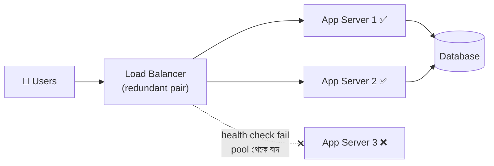
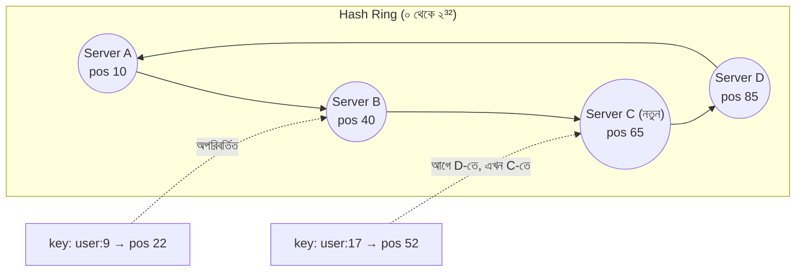
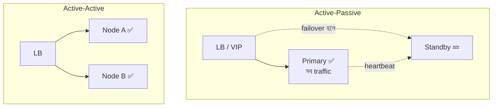
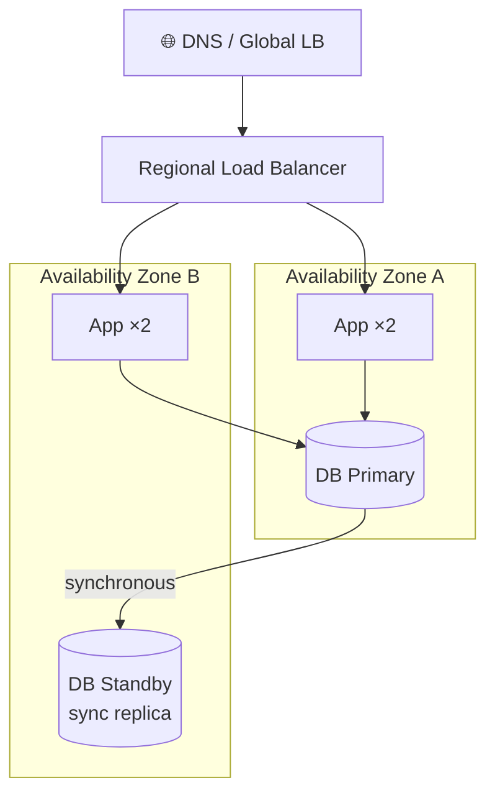
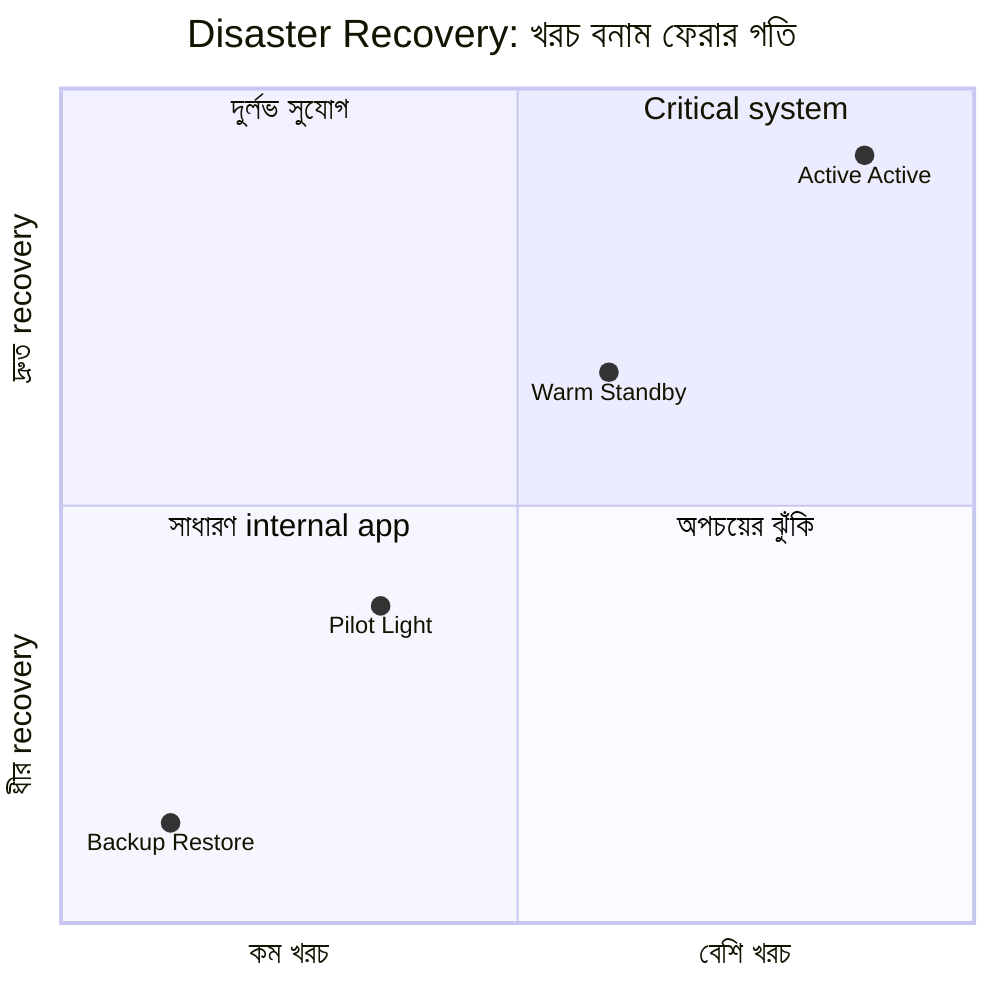
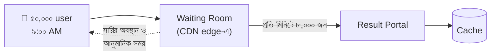

> [!GOALS]
> - Load balancer কীভাবে কাজ করে: L4 বনাম L7, algorithm, health check
> - Liveness ও readiness check, connection draining
> - Active-active বনাম active-passive, database failover ও split brain
> - Multi-AZ, multi-region ও disaster recovery strategy (RPO/RTO অনুযায়ী)
> - Autoscaling, load shedding ও virtual waiting room
> - AWS S3 (২০১৭) ও Facebook (২০২১) outage থেকে শিক্ষা

> [!STORY] জীবন্ত মৃত server
> চাঁদরাতের sale-এর জন্য নদী বাজারে এখন তিনটি app server, সামনে একটি load balancer। রাত ১১টায় error rate হঠাৎ ৩৩%-এ উঠল। ঠিক তিন ভাগের এক ভাগ।
>
> রাফি load balancer dashboard দেখে অবাক: "তিনটা server-ই তো healthy দেখাচ্ছে! সবুজ!"
>
> তানভীর server-২-তে ঢুকে দেখলেন, application-এর সব worker thread একটি ধীর payment API-র উত্তরের জন্য আটকে আছে। কোনো নতুন order process হচ্ছে না। কিন্তু `/health` endpoint তখনো সুন্দরভাবে `200 OK` দিচ্ছে, কারণ সেটা শুধু বলে "process চালু আছে।"
>
> নুসরাত পরে বললেন, "Server মারা গেলে load balancer বোঝে। কিন্তু server যখন বেঁচে থেকেও কাজ করে না, তখন সেটা সবচেয়ে বিপজ্জনক। আমাদের health check জিজ্ঞেস করছিল 'তুমি কি জীবিত?', অথচ জিজ্ঞেস করা উচিত ছিল 'তুমি কি কাজ নিতে প্রস্তুত?'"

## 9.1 Introduction

System বড় হলে সবচেয়ে বড় সমস্যা হয়: **"একটা server-এর উপর সব traffic চলে আসে।"** ফলাফল: server overload, API slow, crash, downtime, ব্যবসায়িক ক্ষতি। এর সমাধান তিনটি ধারণার সমন্বয়ে:

- **Load Balancing:** Traffic একাধিক server-এ ভাগ করা।
- **High Availability (HA):** কোনো component নষ্ট হলেও system চালু থাকা।
- **Fault Tolerance:** আংশিক ব্যর্থতার মধ্যেও মূল কাজ চালিয়ে যাওয়া।

অধ্যায় ৩-এ আমরা availability-র গণিত, stateless design ও SPOF দেখেছি। এই অধ্যায়ে দেখব সেগুলো বাস্তবে কীভাবে বসানো হয়।

## 9.2 Real Production Story: Single Server Disaster

একটি ERP system শুরু হয়েছিল একটি application server আর একটি database server দিয়ে: মসৃণ, দ্রুত, স্থিতিশীল। ব্যবসা বাড়ল: ১০,০০০ concurrent user, ভারী report, API traffic বৃদ্ধি।

**সমস্যা:** CPU ১০০%, IIS crash, **৩ ঘণ্টা system বন্ধ**, কেউ login করতে পারেনি।
**Root cause:** Single server architecture; load balancing বা redundancy নেই।

আরেকটি ঘটনায় একটি ERP-র একমাত্র SQL Server-এর disk নষ্ট হয়। Replication ছিল না। **৬ ঘণ্টা system বন্ধ**, আর শেষ backup-এর পরের কয়েক ঘণ্টার data হাতে পুনরায় entry করতে হয়। শিক্ষা: **redundancy ঐচ্ছিক নয়।**

## 9.3 Load Balancer কীভাবে কাজ করে

Load balancer হলো একটি "ট্রাফিক পুলিশ", যে incoming request একাধিক server-এ ভাগ করে দেয়, আর অসুস্থ server-কে বাদ দেয়।



**কেন জরুরি:** Performance (load ভাগ), high availability (একটি server গেলেও চলে), নমনীয় scaling (server যোগ-বিয়োগ), zero-downtime deployment (একটি একটি করে server update)।

### L4 বনাম L7 Load Balancer

| | Layer 4 (Transport) | Layer 7 (Application) |
| --- | --- | --- |
| কী দেখে | IP ও port (TCP/UDP) | HTTP path, header, cookie, host |
| গতি | খুব দ্রুত, কম resource | তুলনামূলক বেশি কাজ |
| ক্ষমতা | সাধারণ বণ্টন | `/api/*` এক জায়গায়, `/images/*` অন্য জায়গায়; TLS termination; header যোগ |
| উদাহরণ | AWS NLB, HAProxy (TCP mode), LVS | NGINX, HAProxy (HTTP), AWS ALB, Azure App Gateway, Envoy |

**ধরন:** Hardware (F5-এর মতো; ব্যয়বহুল, পুরনো enterprise-এ), Software (NGINX, HAProxy, Envoy; নমনীয়, সস্তা), Cloud managed (AWS ELB, Azure Load Balancer, GCP LB; নিজে HA, কম রক্ষণাবেক্ষণ)।

## 9.4 Load Balancing Algorithm

| Algorithm | কীভাবে | কখন ভালো |
| --- | --- | --- |
| **Round Robin** | পালাক্রমে: 1 → 2 → 3 → 1 | সব server সমান, request সমান ভারী |
| **Weighted Round Robin** | শক্তিশালী server বেশি পায় | ভিন্ন আকারের server; canary release |
| **Least Connections** | যার active connection সবচেয়ে কম | Request-এর সময় অসমান (report বনাম list) |
| **Least Response Time** | সবচেয়ে দ্রুত সাড়া দিচ্ছে যে | ধীর server এড়াতে |
| **IP Hash** | একই client IP সবসময় একই server | পুরনো stateful app (এড়ানো ভালো) |
| **Consistent Hashing** | Key-এর hash অনুযায়ী ring-এ জায়গা | Cache server, shard; server যোগ/বাদে কম data সরে |
| **Power of Two Choices** | দুটি random server বেছে কম ব্যস্তটিকে | বড় cluster-এ সহজ ও কার্যকর |

**Real Production Example:** একটি e-commerce system-এ round robin চলছিল। কিন্তু কিছু request (order processing) অন্যদের (product browsing) চেয়ে দশগুণ ভারী। ফলে server ১ overloaded, server ২ প্রায় অলস। **Least connections**-এ বদলানোর পর load সমান হলো, p95 latency ৪০% কমল।

### Consistent Hashing: এক নজরে

সাধারণ `hash(key) % N`-এ server সংখ্যা N বদলালে প্রায় সব key-এর জায়গা বদলে যায়, cache-এ হঠাৎ সব miss। Consistent hashing-এ server ও key দুটোই একটি বৃত্তের (ring) উপর বসে; প্রতিটি key ঘড়ির কাঁটার দিকে প্রথম যে server পায়, সেখানে যায়। একটি server যোগ বা বাদ দিলে শুধু তার পাশের অংশের key সরে, বাকি সব জায়গায় থাকে।



বাস্তবে প্রতিটি server-কে ring-এ অনেকগুলো "virtual node" হিসেবে বসানো হয়, যাতে বণ্টন সমান হয়। Cassandra, DynamoDB-র মতো database ও অনেক cache client এই কৌশল ব্যবহার করে।

## 9.5 Health Check: Liveness বনাম Readiness

গল্পের ঘটনাটি health check-এর সবচেয়ে প্রচলিত ভুল।

| ধরন | প্রশ্ন | ব্যর্থ হলে | কী পরীক্ষা করবে |
| --- | --- | --- | --- |
| **Liveness** | Process কি জীবিত, নাকি আটকে গেছে? | Restart | Process সাড়া দেয় কি না (হালকা) |
| **Readiness** | এখন কি traffic নিতে প্রস্তুত? | LB pool থেকে সাময়িক বাদ | Thread pool, DB connection, critical dependency, warm-up শেষ কি না |

```csharp
// ASP.NET Core: আলাদা liveness ও readiness
builder.Services.AddHealthChecks()
    .AddCheck("self", () => HealthCheckResult.Healthy(), tags: new[] { "live" })
    .AddSqlServer(connStr, name: "db", tags: new[] { "ready" })
    .AddCheck<ThreadPoolStarvationCheck>("threadpool", tags: new[] { "ready" });

app.MapHealthChecks("/health/live",  new() { Predicate = c => c.Tags.Contains("live") });
app.MapHealthChecks("/health/ready", new() { Predicate = c => c.Tags.Contains("ready") });
```

> [!WARNING]
> Readiness check-এ **প্রতিটি** dependency যোগ করবেন না। Payment gateway ধীর হলে যদি সব server "not ready" হয়ে যায়, load balancer সবাইকে বাদ দেবে, পুরো site বন্ধ। Readiness-এ রাখুন শুধু সেগুলো, যেগুলো ছাড়া server কোনো কাজই করতে পারে না (নিজের database)। বাইরের dependency সামলান timeout ও circuit breaker দিয়ে (অধ্যায় ১০)।

**Passive health check / outlier detection:** নির্দিষ্ট সময় পরপর ping-এর পাশাপাশি আসল traffic-এর error দেখেও (যেমন পরপর ৫টি 5xx) server-কে সাময়িকভাবে বাদ দেওয়া। গল্পের zombie server এভাবে ধরা পড়ত।

**Connection draining:** Deploy বা scale-in-এর সময় server সরানোর আগে নতুন request পাঠানো বন্ধ, কিন্তু চলমান request শেষ করার সময় (যেমন ৩০ সেকেন্ড) দেওয়া।

## 9.6 NGINX দিয়ে একটি বাস্তব configuration

```nginx
upstream nodi_app {
    least_conn;
    server 10.0.1.11:8080 max_fails=3 fail_timeout=15s;
    server 10.0.1.12:8080 max_fails=3 fail_timeout=15s;
    server 10.0.1.13:8080 max_fails=3 fail_timeout=15s;
    keepalive 64;
}

limit_req_zone $binary_remote_addr zone=perip:10m rate=20r/s;

server {
    listen 443 ssl http2;
    server_name shop.nodibazar.example;

    location /api/ {
        limit_req zone=perip burst=40 nodelay;
        proxy_pass http://nodi_app;
        proxy_connect_timeout 2s;
        proxy_read_timeout 10s;
        proxy_next_upstream error timeout http_502 http_503;
        proxy_set_header X-Request-Id $request_id;
        proxy_set_header X-Forwarded-For $proxy_add_x_forwarded_for;
    }
}
```

এখানে least connections, ব্যর্থ server সাময়িক বাদ (passive check), প্রতি IP rate limit, timeout, idempotent request-এ পরের server-এ চেষ্টা, আর প্রতিটি request-এ একটি trace ID।

## 9.7 High Availability Pattern

### Active-Passive বনাম Active-Active



| | Active-Passive | Active-Active |
| --- | --- | --- |
| Resource ব্যবহার | Standby অলস বসে থাকে | সবাই কাজ করে |
| Failover সময় | সেকেন্ড থেকে মিনিট | প্রায় তাৎক্ষণিক (বাকিরা চালিয়ে যায়) |
| জটিলতা | কম | বেশি, বিশেষত data-র ক্ষেত্রে |
| সতর্কতা | Standby কি সত্যিই কাজ করবে? নিয়মিত পরীক্ষা | প্রতিটি node একা পুরো load নিতে পারবে তো? |

> [!TIP]
> Active-active-এ দুটি node প্রত্যেকে ৭০% load-এ চললে একটি নষ্ট হলে অন্যটির উপর ১৪০% চাপ পড়বে, অর্থাৎ সেটাও পড়ে যাবে। N টি node থাকলে প্রতিটির load রাখুন এমনভাবে যাতে একটি গেলেও বাকিরা সামলাতে পারে (**N+1 capacity**)।

### Database Failover ও Split Brain

Application server-এর failover সহজ (stateless)। Database-এর failover কঠিন, কারণ data আছে।

**Split brain:** Network সমস্যায় primary আর replica একে অপরকে দেখতে না পেয়ে **দুজনেই** নিজেকে primary ভাবে, দুজনেই write নেয়। Network ফিরলে দুই ভিন্ন সত্য, মেলানো প্রায় অসম্ভব। অধ্যায় ৩-এর GitHub ঘটনা এরই একটি রূপ।

**প্রতিরোধ:**
- **Quorum:** সিদ্ধান্তের জন্য সংখ্যাগরিষ্ঠতা লাগে; তাই তিনটি node (বা দুটি + একটি witness), যাতে বিচ্ছিন্ন অংশটি একা primary হতে না পারে।
- **Fencing:** নতুন primary হওয়ার আগে পুরনো primary-কে নিশ্চিতভাবে বন্ধ বা write-অক্ষম করা।
- **Managed service:** Azure SQL, AWS RDS Multi-AZ, Cloud SQL HA এগুলো নিজেরাই সামলায়; ছোট team-এর জন্য প্রায়ই সেরা পছন্দ।
- **Application-এর প্রস্তুতি:** Connection string-এ সরাসরি server IP নয়, listener বা DNS name; failover-এর পর connection retry।

## 9.8 Redundancy-র স্তর: Server থেকে Region



- **Server redundancy:** একাধিক app instance।
- **Database redundancy:** Replica ও automatic failover।
- **Zone redundancy (Multi-AZ):** একই region-এর আলাদা data center; বিদ্যুৎ, বন্যা বা network-এর আলাদা ঝুঁকি।
- **Region redundancy (Multi-region):** ভিন্ন শহর বা দেশ; বড় দুর্যোগ বা পুরো region-এর outage-এর জন্য।
- **Network redundancy:** একাধিক ISP, আলাদা পথ, আর জরুরি অবস্থায় ভেতরে ঢোকার একটি **out-of-band** উপায়।

## 9.9 Disaster Recovery: RPO ও RTO অনুযায়ী কৌশল

অধ্যায় ২-এ আমরা RPO (কতটুকু data হারানো চলবে) আর RTO (কত দ্রুত ফিরতে হবে) দেখেছি। এগুলোই ঠিক করে DR কৌশল, আর খরচ।

| কৌশল | কীভাবে | RPO | RTO | খরচ |
| --- | --- | --- | --- | --- |
| **Backup & Restore** | শুধু অন্য region-এ backup | ঘণ্টা | ঘণ্টা থেকে দিন | সবচেয়ে কম |
| **Pilot Light** | Data replicate হয়; app চালু হয় দুর্যোগে | মিনিট | দশ মিনিট থেকে ঘণ্টা | কম |
| **Warm Standby** | ছোট আকারে পুরো system চালু, দুর্যোগে বড় করা | সেকেন্ড থেকে মিনিট | মিনিট | মাঝারি |
| **Multi-site Active-Active** | দুই region-ই পুরো traffic নেয় | প্রায় শূন্য | প্রায় শূন্য | সবচেয়ে বেশি |



> [!ARCHITECT] "DR plan" আর "DR অভ্যাস" এক জিনিস নয়
> তানভীর প্রতি তিন মাসে একটি **game day** চালান: অফিস সময়ে, সবাইকে জানিয়ে, ইচ্ছা করে primary database বন্ধ করে দেখা হয় কী হয়। প্রথম game day-তে failover নিজে হয়েছিল ৪০ সেকেন্ডে, কিন্তু application নতুন primary-তে connect করতে পারেনি সাত মিনিট, কারণ একটি পুরনো service-এর config-এ সরাসরি IP লেখা ছিল। কাগজের plan-এ এটা কখনো ধরা পড়ত না। রাত তিনটার আসল দুর্যোগে ধরা পড়লে কী হতো, ভাবুন।

> [!CASE] AWS S3, ফেব্রুয়ারি ২০১৭: একটি টাইপো
> ২০১৭ সালের ২৮ ফেব্রুয়ারি AWS-এর US-EAST-1 region-এ S3 (object storage) প্রায় চার ঘণ্টা অচল ছিল, আর এর উপর নির্ভরশীল হাজার হাজার website ও service ভুগেছিল। AWS-এর প্রকাশিত ব্যাখ্যা অনুযায়ী একজন engineer একটি debugging কাজের অংশ হিসেবে প্রতিষ্ঠিত playbook মেনে অল্প কিছু server সরানোর command চালান, কিন্তু command-এর একটি input ভুল লেখা হয়, ফলে প্রত্যাশার চেয়ে অনেক বড় সংখ্যক server সরে যায়। সেগুলোর মধ্যে ছিল দুটি গুরুত্বপূর্ণ subsystem। এত বড় আকারে এই subsystem বহু বছর পুনরায় চালু করা হয়নি, তাই restart ও consistency check-এ প্রত্যাশার চেয়ে অনেক বেশি সময় লাগে। আরো একটি পরিহাস: AWS-এর নিজের service health dashboard-ও প্রথমদিকে S3-এর উপর নির্ভরশীল থাকায় ঠিকমতো update হচ্ছিল না।
>
> **AWS-এর পরিবর্তন:** Tool বদলানো হয়, যাতে একবারে বেশি capacity সরানো না যায় এবং ন্যূনতম সীমার নিচে নামানো না যায়; বড় subsystem-কে ছোট ছোট অংশে (cell) ভাগ করার কাজ দ্রুত করা হয়।
>
> **শিক্ষা:** (১) মানুষের ভুল অনিবার্য; tool-এ guardrail রাখুন। (২) যা কখনো restart করা হয়নি, তার restart time-ও অজানা: নিয়মিত পরীক্ষা করুন। (৩) Status page ও monitoring-কে যে system monitor করছে, তার উপর নির্ভরশীল রাখবেন না। (৪) ছোট blast radius: একটি ভুল যেন সবকিছু না ছোঁয়।

> [!CASE] Facebook, অক্টোবর ২০২১: যখন ভেতরে ঢোকার দরজাও বন্ধ
> ২০২১ সালের ৪ অক্টোবর Facebook, Instagram ও WhatsApp প্রায় ছয় ঘণ্টা বিশ্বজুড়ে অচল ছিল। Facebook-এর engineering blog অনুযায়ী backbone network-এর রুটিন maintenance-এর একটি command ভুলবশত data center-গুলোর মধ্যকার সব সংযোগ বিচ্ছিন্ন করে দেয়; একটি audit tool-এর bug সেটা আটকাতে পারেনি। এর ফলে তাদের DNS server-গুলো BGP route প্রত্যাহার করে নেয়, আর পুরো ইন্টারনেট থেকে Facebook "অদৃশ্য" হয়ে যায়। সমস্যা আরো জটিল হয় কারণ engineer-দের দূর থেকে ঢোকার tool-গুলোও একই network-এর উপর নির্ভরশীল ছিল; শেষ পর্যন্ত মানুষকে সশরীরে data center-এ গিয়ে কাজ করতে হয়, যেখানে নিরাপত্তা ব্যবস্থার কারণে ঢোকাও ছিল সময়সাপেক্ষ।
>
> **শিক্ষা:** Recovery-র পথ যেন যে system ভেঙেছে তার উপর নির্ভর না করে (out-of-band access)। আর ব্যাপক প্রভাবের configuration change ধাপে ধাপে, যাচাই করে।

## 9.10 Autoscaling

Traffic অনুযায়ী server সংখ্যা স্বয়ংক্রিয়ভাবে বাড়ানো-কমানো।

- **Reactive:** CPU > ৬৫% বা request queue বড় হলে নতুন instance। নতুন instance চালু হতে মিনিট লাগে, তাই হঠাৎ spike-এ দেরি হয়।
- **Scheduled:** জানা peak-এর আগে (৯টার result-এর জন্য ৮:৩০-এ) আগেভাগে বাড়ানো। **নদী টেকের সবচেয়ে কার্যকর কৌশল।**
- **Predictive:** অতীতের pattern দেখে ML দিয়ে আগাম বাড়ানো (অনেক cloud-এ আছে)।

**মনে রাখুন:** Autoscaling শুধু stateless অংশে সহজ। Database, cache, বাইরের API-র limit autoscale হয় না; app server দশগুণ হলে database-এর connection-ও দশগুণ চাপ নেবে (অধ্যায় ৫-এর connection pooling)।

## 9.11 Load Shedding ও Virtual Waiting Room

সব capacity শেষ হলে system-এর সামনে দুটি পথ: সবার জন্য ধীর হয়ে শেষ পর্যন্ত সবার জন্য ভেঙে পড়া, অথবা কিছু request-কে ভদ্রভাবে "এখন না" বলে বাকিদের ভালো সেবা দেওয়া। দ্বিতীয়টিকে বলে **load shedding**।

- **Priority-ভিত্তিক:** Checkout ও payment সবসময় অগ্রাধিকার; recommendation, review, search suggestion আগে বন্ধ।
- **Queue-এর দৈর্ঘ্য দেখে:** অপেক্ষা একটি সীমা পেরোলে নতুন request-কে তাৎক্ষণিক `503` + `Retry-After`।
- **Virtual waiting room:** Result day বা concert ticket-এর মতো ঘটনায় user-কে একটি সারিতে রাখা ("আপনার সামনে ২,৩৪০ জন, আনুমানিক অপেক্ষা ৩ মিনিট"), আর নির্দিষ্ট হারে ভেতরে ঢোকানো। User অন্তত জানে কী হচ্ছে; বারবার refresh করে চাপ বাড়ায় না।



## 9.12 DDoS ও Edge Protection

ইচ্ছাকৃত বন্যা (DDoS) সামলানো আপনার নিজের server-এ প্রায় অসম্ভব। Cloudflare, AWS Shield, Azure Front Door-এর মতো edge service বিশাল network capacity দিয়ে আক্রমণ শুষে নেয়, আর WAF সন্দেহজনক request আটকায়। Origin server-এর আসল IP গোপন রাখুন এবং শুধু edge থেকে traffic গ্রহণ করুন।

## 9.13 Monitoring Load Balancer ও HA

Track করুন: request rate, প্রতিটি backend-এর latency ও error rate, healthy host-এর সংখ্যা (এক নামলেই alert), active connection, 5xx-এর উৎস (LB নিজে, না backend), TLS certificate-এর মেয়াদ, replication lag ও failover event।

**Real Production Story: Traffic Spike।** Flash sale-এ traffic ২০ গুণ বাড়ল। আগের বছর load balancer ছাড়া system crash করেছিল। এবার scheduled autoscaling, load balancer, cache ও waiting room মিলে system স্থিতিশীল ছিল। পার্থক্য technology-র চেয়ে বেশি ছিল **প্রস্তুতির**।

## 9.14 AI কোণ: AI service-এর HA

> [!AI] LLM ও GPU-র জন্য high availability
> **একাধিক provider-এ routing:** LLM API-র জন্য load balancer-এর মতো একটি **AI gateway** (অধ্যায় ১৫) অনুরোধগুলোকে প্রধান provider-এ পাঠায়, error বা rate limit (429) হলে দ্বিতীয় provider বা ছোট self-hosted model-এ। এটা এক ধরনের active-passive failover, তবে মনে রাখতে হয় দুটি model-এর উত্তরের মান ও ধরন আলাদা।
>
> **Self-hosted model-এর load balancing:** GPU server-এ inference-এর সময় request-ভেদে অনেক আলাদা (ছোট প্রশ্ন বনাম বড় document)। তাই round robin খারাপ; queue-এর দৈর্ঘ্য বা GPU memory-র ব্যবহার দেখে বণ্টন করতে হয়। GPU server চালু হতে ও model load হতে মিনিট লাগে, তাই reactive autoscaling দেরিতে আসে; warm pool রাখা জরুরি।
>
> **AIOps:** কিছু platform এখন incident-এর সময় log ও metric বিশ্লেষণ করে সম্ভাব্য কারণ প্রস্তাব করে, বা predictive autoscaling করে। এগুলো সহায়ক, কিন্তু failover-এর মতো ঝুঁকিপূর্ণ সিদ্ধান্তে মানুষের অনুমোদন রাখাই নিরাপদ।

## 9.15 সাধারণ ভুল

- **একটিমাত্র load balancer:** LB নিজেই SPOF।
- **Health check নেই, অথবা শুধু liveness:** মৃত বা zombie server traffic পায়।
- **Readiness-এ বাইরের dependency:** একটি ধীর API সব server-কে "অসুস্থ" বানায়।
- **Failover-এর পরিকল্পনা আছে, পরীক্ষা নেই।**
- **Sticky session-এর অপব্যবহার:** অসম load, server গেলে session হারায়।
- **N+1 capacity না রাখা:** একটি node গেলে বাকিরাও পড়ে যায়।
- **Autoscaling-এ database-এর কথা ভুলে যাওয়া।**

## 9.16 Enterprise Best Practices

- Redundant (বা managed) load balancer, multi-AZ।
- Stateless service, session ও file বাইরে।
- Liveness + readiness + passive health check, connection draining।
- Database replication ও পরীক্ষিত automatic failover, quorum।
- Scheduled + reactive autoscaling, N+1 capacity।
- Load shedding ও waiting room-এর পরিকল্পনা।
- নিয়মিত game day ও লিখিত runbook।

## 9.17 Interview প্রশ্ন

> [!INTERVIEW]
> 1. L4 ও L7 load balancer-এর পার্থক্য কী?
> 2. Round robin ও least connections কখন কোনটা?
> 3. Consistent hashing কী সমস্যা সমাধান করে?
> 4. Liveness ও readiness probe-এর পার্থক্য কী? Readiness-এ কী রাখবেন না?
> 5. Active-active ও active-passive-এর trade-off কী?
> 6. Split brain কী? কীভাবে ঠেকাবেন?
> 7. RPO ১ মিনিট, RTO ১৫ মিনিট হলে কোন DR কৌশল নেবেন?
> 8. Load shedding কী? একটি উদাহরণ দিন।

## 9.18 নিজে করে দেখুন

> [!EXERCISE] বাংলাদেশ থেকে চালানো একটি Global E-Commerce
> একটি e-commerce platform বাংলাদেশ, ভারত ও মধ্যপ্রাচ্যের ক্রেতাদের সেবা দেয়। প্রধান অফিস ঢাকায়।
> 1. কোন region-এ server রাখবেন? CDN কীভাবে সাহায্য করবে?
> 2. Load balancer-এর স্তর ও algorithm বেছে নিন।
> 3. RPO ৫ মিনিট, RTO ৩০ মিনিট রাখতে DR কৌশল কী?
> 4. ১১.১১ sale-এ checkout রক্ষা করতে load shedding-এর অগ্রাধিকার তালিকা লিখুন।
> 5. একটি game day-র scenario ও সাফল্যের মাপকাঠি লিখুন।

## 9.19 Chapter Summary

- **Load balancer:** L4 দ্রুত, L7 বুদ্ধিমান; algorithm নির্ভর করে request-এর ধরনের উপর।
- **Consistent hashing:** Server বদলালেও বেশিরভাগ key জায়গায় থাকে।
- **Health check:** Liveness ও readiness আলাদা; zombie server ধরতে passive check।
- **HA pattern:** Active-passive বনাম active-active; N+1 capacity; split brain এড়াতে quorum ও fencing।
- **Redundancy-র স্তর:** Server থেকে zone থেকে region; out-of-band access।
- **DR:** RPO/RTO অনুযায়ী কৌশল; plan নয়, নিয়মিত অনুশীলনই আসল।
- **Autoscaling ও load shedding:** জানা peak-এ আগাম scale; capacity-র বাইরে ভদ্রভাবে "না"।

> [!ARCHITECT] নুসরাতের নোটবুক · Zombie Server
> কারণ: health check শুধু process জীবিত কি না দেখত; payment API-র timeout ছিল ১০০ সেকেন্ড (default), ফলে thread pool নিঃশেষ। সমাধান: liveness ও readiness আলাদা; readiness-এ thread pool ও নিজের DB; passive outlier detection (পরপর ৫টি 5xx); payment call-এ ২ সেকেন্ড timeout ও circuit breaker। আর game day-তে পাওয়া hard-coded IP সরানো হয়েছে। তানভীরের মন্তব্য: "এখন অন্তত আমরা জানি আমরা কী জানি না।" পরের সমস্যা: monolith-টা এত বড় যে একটি ছোট পরিবর্তনের জন্যও পুরোটা deploy করতে হয়।
