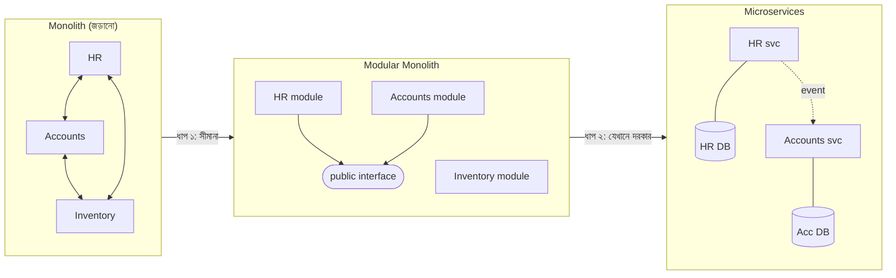
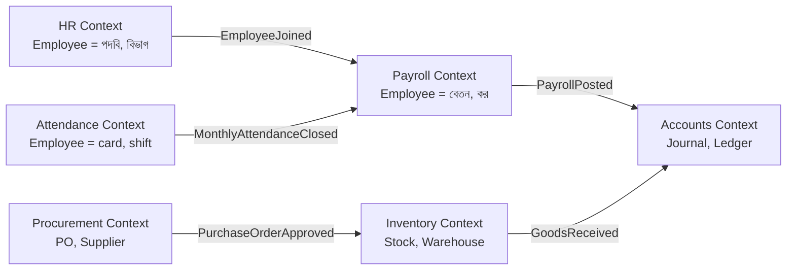
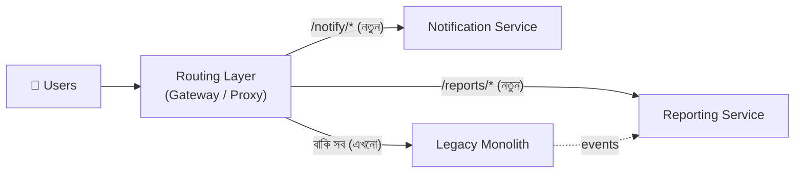
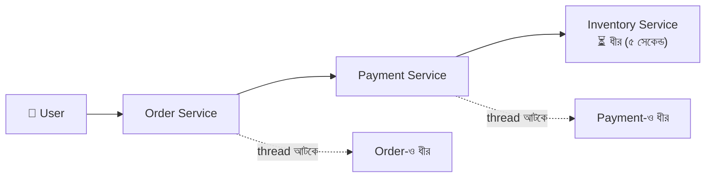
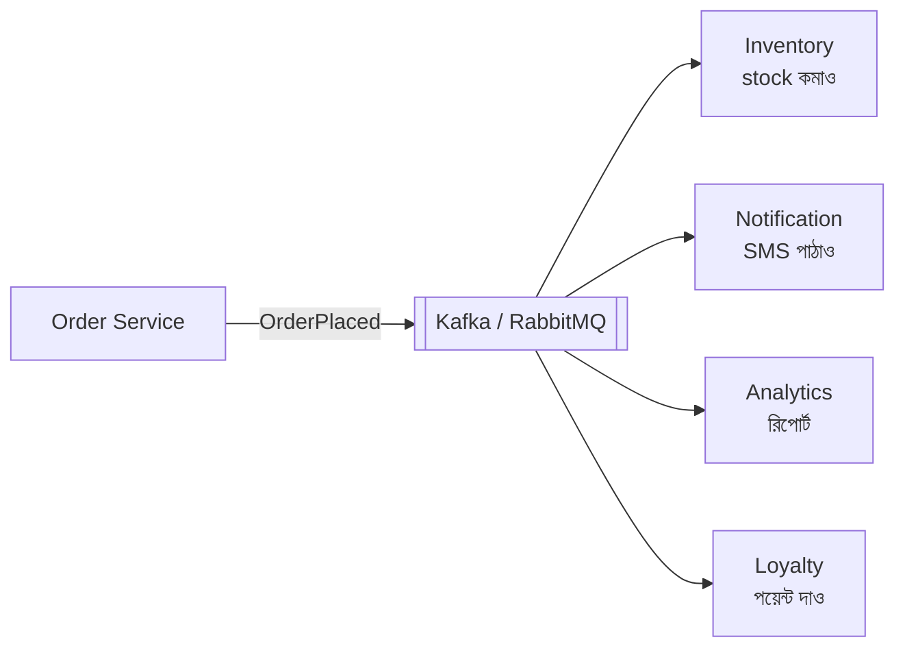
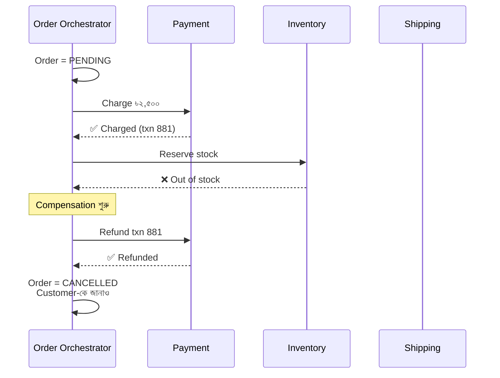
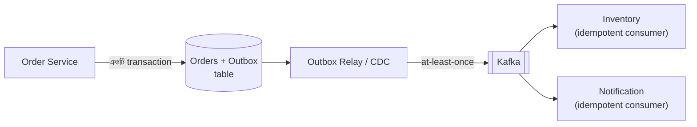
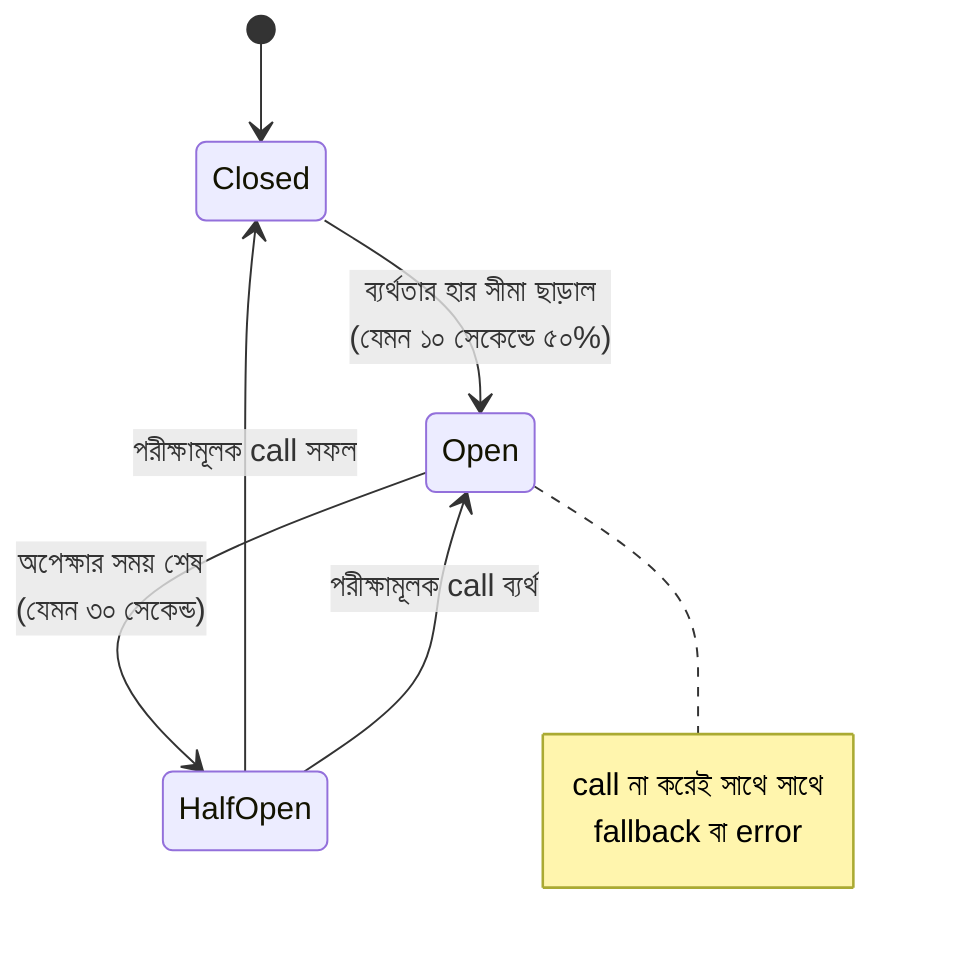
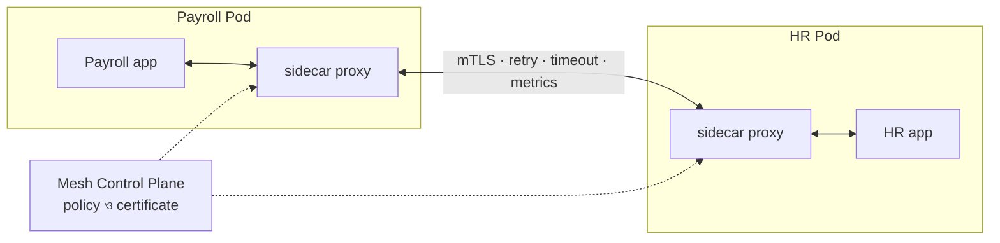

> [!GOALS]
> - Microservice কী, এবং কখন এটি সঠিক আর কখন ভুল পছন্দ
> - Modular monolith: অনেক team-এর জন্য সেরা মাঝামাঝি পথ
> - Domain-Driven Design, bounded context ও Conway's Law দিয়ে service ভাগ করা
> - Strangler Fig pattern দিয়ে monolith থেকে ধীরে ধীরে সরে আসা
> - Synchronous বনাম event-driven যোগাযোগ, database per service
> - Saga, Transactional Outbox ও idempotent consumer
> - Circuit breaker, bulkhead, service discovery ও service mesh

> [!STORY] "চলো microservices করি"
> নদী ERP-র build এখন ৪২ মিনিট নেয়। গত সপ্তাহে HR module-এ একটি ছোট পরিবর্তন করতে গিয়ে Accounts-এর একটি report ভেঙে গিয়েছিল, কারণ দুটোই একই `Employee` class ব্যবহার করত। Release-এর দিন চারটি team একে অপরের code-এর জন্য অপেক্ষা করে।
>
> Sprint retrospective-এ রাফি উত্তেজিত হয়ে বলল, "Netflix, Amazon সবাই microservices। আমরাও ভেঙে ফেলি! বিশটা service, প্রতিটার আলাদা database, Kubernetes-এ!"
>
> ঘরে কিছুক্ষণ নীরবতা। তারপর তানভীর হেসে বললেন, "বিশটা service মানে বিশটা pipeline, বিশটা dashboard, আর রাত তিনটায় বিশটা জায়গায় খোঁজা। আমরা এখন একটা system-এর log-ই ঠিকমতো দেখতে পারি না।"
>
> নুসরাত whiteboard-এ গেলেন। কোনো service আঁকলেন না। আঁকলেন কয়েকটি বৃত্ত: "বেতন", "হাজিরা", "হিসাব", "মজুদ", "ক্রয়"। তারপর বললেন, "আগে বলো, এই বৃত্তগুলোর সীমানা কোথায়? 'Employee' শব্দটা HR-এর কাছে যা বোঝায়, Accounts-এর কাছে কি তাই বোঝায়? সীমানা না বুঝে ভাঙলে আমরা একটা বড় জট থেকে বিশটা ছোট জট বানাব, যেগুলো network দিয়ে বাঁধা।"

## 10.1 Introduction

একটি system যখন ছোট থাকে, একটি single application (monolith) যথেষ্ট, এবং প্রায়ই সবচেয়ে ভালো। কিন্তু system বড় হলে আসে একাধিক team, একাধিক business domain, উচ্চ traffic, জটিল business logic আর আলাদা আলাদা সময়ে deploy করার প্রয়োজন। তখন অনেক প্রতিষ্ঠান **Microservices Architecture**-এর দিকে যায়।

তবে এই অধ্যায়ের মূল বার্তা একটু অপ্রত্যাশিত: **microservices মূলত একটি organizational সমাধান, technical সমাধান নয়।** এটি অনেকগুলো team-কে একে অপরের পায়ে পা না দিয়ে কাজ করতে দেয়। বিনিময়ে দিতে হয় distributed system-এর পুরো জটিলতা।

## 10.2 Real Production Story: Monolith Breakdown Problem

একটি ERP system শুরু হয়েছিল একটি single .NET application, একটি database আর সব module এক project-এ রেখে। শুরুতে development দ্রুত, deployment সহজ।

**২-৩ বছর পর:** HR module বদলালে Accounting ভাঙে, deployment ঝুঁকিপূর্ণ, team-এর মধ্যে সংঘর্ষ, **build time ৪০+ মিনিট**, একটি bug-এর প্রভাব বিশাল।

**আসল সমস্যা:** "Monolith" নয়, **"সবকিছু জড়ানো (tightly coupled)"।** Module-এর মধ্যে কোনো সীমানা ছিল না; যে কেউ যেকোনো table বা class সরাসরি ব্যবহার করত।

**সমাধান:** System ধাপে ধাপে স্বাধীন অংশে ভাগ করা হয়: প্রথমে ভেতরে module-এর সীমানা, তারপর যেখানে সত্যিই দরকার সেখানে আলাদা service।

## 10.3 Microservices কী?

Microservices হলো একটি বড় system-কে ছোট, স্বাধীন service-এ ভাগ করা, যেখানে প্রতিটি service:
- **একটি business capability-র মালিক** (যেমন Payroll, Inventory)।
- **স্বাধীনভাবে deploy করা যায়,** অন্যদের অপেক্ষা না করে।
- **নিজের data-র মালিক;** অন্যরা সরাসরি তার database ছোঁয় না, শুধু API বা event দিয়ে।
- **Loosely coupled:** একটির ভেতরের পরিবর্তন অন্যদের ভাঙে না।
- **একটি team-এর মালিকানায়:** "You build it, you run it."

## 10.4 Monolith, Modular Monolith ও Microservices

| বৈশিষ্ট্য | Monolith (জড়ানো) | Modular Monolith | Microservices |
| --- | --- | --- | --- |
| Deployment | একসাথে | একসাথে | প্রতিটি আলাদা |
| Module-এর সীমানা | নেই বা দুর্বল | ভেতরে কঠোর | Network দিয়ে বাধ্যতামূলক |
| Database | একটি, সবাই সব ছোঁয় | একটি, কিন্তু module-ভিত্তিক schema | প্রতিটির নিজস্ব |
| Transaction | সহজ | সহজ | Saga, eventual consistency |
| Scaling | পুরোটা একসাথে | পুরোটা একসাথে | প্রতিটি আলাদা |
| Operational জটিলতা | কম | কম | অনেক বেশি |
| উপযুক্ত team | ছোট | ছোট থেকে মাঝারি (২-৫ team) | বড়, অনেক স্বাধীন team |

> [!ARCHITECT] Modular Monolith প্রায়ই সঠিক উত্তর
> নদী ERP-র জন্য নুসরাতের সিদ্ধান্ত: প্রথমে **modular monolith**। প্রতিটি module (HR, Payroll, Accounts, Inventory) নিজের namespace, নিজের database schema, এবং শুধু একটি public interface দিয়ে অন্যদের সাথে কথা বলবে; অন্যের table সরাসরি query করা build-এ নিষিদ্ধ (architecture test দিয়ে যাচাই)। শুধু দুটি অংশ আলাদা service হলো: **Reporting** (load আর আচরণ সম্পূর্ণ আলাদা) এবং **Notification** (বাইরের SMS/email provider, ব্যর্থতা আলাদা রাখা দরকার)। Build time ৪২ মিনিট থেকে ৯ মিনিট, কারণ এখন শুধু পরিবর্তিত module-এর test চলে।

## 10.5 কখন Microservices নয়: বাস্তবের দুই দিক

> [!CASE] Amazon-এর API mandate: microservices-এর পক্ষে
> ২০১১ সালে Google-এর engineer Steve Yegge-এর একটি অভ্যন্তরীণ লেখা ভুলবশত public হয়ে যায়, যেখানে তিনি Amazon-এ কাজের অভিজ্ঞতা থেকে লেখেন যে প্রায় ২০০২ সালের দিকে Jeff Bezos নির্দেশ দিয়েছিলেন: সব team তাদের data ও কার্যক্রম শুধু service interface-এর মাধ্যমে প্রকাশ করবে, অন্য কোনো উপায়ে team-গুলোর মধ্যে যোগাযোগ চলবে না, এবং প্রতিটি interface এমনভাবে বানাতে হবে যেন বাইরের developer-রাও ব্যবহার করতে পারে। এই সংস্কৃতিই পরে AWS-এর জন্মে ভূমিকা রাখে বলে ব্যাপকভাবে মনে করা হয়।
>
> **শিক্ষা:** Amazon-এর microservices এসেছিল হাজার হাজার engineer-কে স্বাধীনভাবে কাজ করতে দেওয়ার প্রয়োজন থেকে। Technology নয়, **organization**-এর সমস্যা।

> [!CASE] Segment (২০১৮) ও Prime Video (২০২৩): microservices থেকে ফেরা
> Customer data platform Segment ২০১৮ সালে "Goodbye Microservices" শিরোনামে লিখেছিল কীভাবে তাদের শতাধিক ছোট service (প্রতিটি বাইরের একটি destination-এর জন্য) সামলানো এত কঠিন হয়ে গিয়েছিল যে নতুন feature-এর গতি কমে যায়। তারা সেগুলোকে একটি service-এ ফিরিয়ে আনে এবং উৎপাদনশীলতা বাড়ে।
>
> ২০২৩ সালে Amazon Prime Video-র একটি team (video stream-এর মান পর্যবেক্ষণ করার tool) লিখেছিল, তাদের distributed, serverless microservice design-এ component-গুলোর মধ্যে বিপুল পরিমাণ data আদান-প্রদান হচ্ছিল এবং scale-এ সমস্যা ও খরচ বাড়ছিল। সবকিছু একটি process-এ (monolith) এনে তারা infrastructure খরচ **৯০%-এর বেশি** কমিয়েছিল।
>
> **শিক্ষা:** Microservices কোনো "উন্নত ধাপ" নয় যেখানে একবার পৌঁছালে ফিরতে নেই। যেখানে component-গুলো একসাথে প্রচুর data নিয়ে কাজ করে, বা team ছোট, সেখানে network সীমানা খরচ ও জটিলতাই বাড়ায়।

**Microservices-এর সংকেত (signals):**
- অনেকগুলো team একই codebase-এ একে অপরকে আটকাচ্ছে।
- একটি অংশের scaling চাহিদা বাকিদের থেকে সম্পূর্ণ আলাদা।
- একটি অংশের ব্যর্থতা বাকিদের থেকে আলাদা রাখা জরুরি।
- Release cycle আলাদা হওয়া দরকার (যেমন payment-এর কঠোর audit)।
- Team-এর DevOps, monitoring ও distributed system-এর দক্ষতা আছে।

## 10.6 Service কীভাবে ভাগ করবেন: Domain-Driven Design

সবচেয়ে কঠিন প্রশ্ন: **কোথায় কাটবেন?**

**১. Business domain-ভিত্তিক (ভালো):** HR, Payroll, Inventory, Payment, Procurement।
**২. Technical function-ভিত্তিক (বড় system-এ খারাপ):** "User Service", "Email Service", "Report Service", "Database Service"। এতে প্রায় প্রতিটি feature-এর জন্য সব service বদলাতে হয়।

### Bounded Context

**Domain-Driven Design (DDD)**-এর মূল ধারণা: একটি শব্দের অর্থ context ভেদে বদলায়। নদী ERP-তে "Employee":
- **HR context-এ:** নাম, যোগদানের তারিখ, পদবি, বিভাগ, ছুটি।
- **Payroll context-এ:** মূল বেতন, ভাতা, কর, ব্যাংক account।
- **Attendance context-এ:** card ID, shift, হাজিরার রেকর্ড।

সব কিছু একটি বিশাল `Employee` class-এ রাখাই গল্পের সমস্যার মূল। প্রতিটি context-এর নিজস্ব model, নিজস্ব ভাষা (**ubiquitous language**), আর সীমানা পার হলে অনুবাদ।

### Conway's Law

> [!QUOTE]
> যেকোনো প্রতিষ্ঠান যে system design করে, তার গঠন সেই প্রতিষ্ঠানের যোগাযোগ কাঠামোর প্রতিলিপি হয়। (Melvin Conway, ১৯৬৮)

চারটি team একটি service-এ কাজ করলে সেই service ভেতরে চার ভাগে জট পাকাবে। তাই service-এর সীমানা আর team-এর সীমানা মিলিয়ে নিন। কখনো কখনো উল্টোটাও করা হয় ("Inverse Conway Maneuver"): কাঙ্ক্ষিত architecture অনুযায়ী team সাজানো।

### Strangler Fig: Monolith থেকে ধীরে ধীরে সরে আসা

পুরো system একবারে নতুন করে লেখা (big bang rewrite) সবচেয়ে ঝুঁকিপূর্ণ প্রকল্পগুলোর একটি। এর বদলে **Strangler Fig pattern**: পুরনো system চালু রেখে সামনে একটি routing layer বসানো, তারপর একটি একটি feature নতুন service-এ সরানো, যতক্ষণ না পুরনোটি ছোট হতে হতে বন্ধ করা যায়।

## 10.7 Service-এর মধ্যে যোগাযোগ

### Synchronous (REST/gRPC)

সরাসরি call, তাৎক্ষণিক উত্তর। সহজ, বোঝা সহজ। কিন্তু সমস্যা:

একটি chain-এর availability প্রতিটির গুণফল (অধ্যায় ৩), আর latency প্রতিটির যোগফল। Chain যত লম্বা, system তত ভঙ্গুর।

### Asynchronous ও Event-Driven

সরাসরি call-এর বদলে service একটি **event** প্রকাশ করে ("এটা ঘটেছে"), আর যারা আগ্রহী তারা নিজেদের মতো সাড়া দেয়।

**Real Production Example:** একটি e-commerce system-এ order দেওয়ার সময় inventory update, email, push notification সব synchronous ছিল; order API-র সময় ৪ সেকেন্ড, আর email server ধীর হলে order-ও ব্যর্থ। Event-ভিত্তিক করার পর order API ৩০০ ms, আর email সমস্যা order-কে আর ছোঁয় না।

| | Synchronous | Asynchronous / Event |
| --- | --- | --- |
| Coupling | সময়ে আবদ্ধ: দুজনকেই একসাথে চালু থাকতে হবে | বিচ্ছিন্ন |
| User-এর অভিজ্ঞতা | তাৎক্ষণিক ফলাফল | "আপনার অনুরোধ গৃহীত হয়েছে" |
| Consistency | তাৎক্ষণিক | Eventual |
| Debugging | সহজ | কঠিন (trace লাগে) |
| উপযুক্ত | Query, যেখানে উত্তর এখনই লাগবে | Side effect, notification, integration |

## 10.8 Database per Service

প্রতিটি service নিজের database-এর মালিক; অন্যরা শুধু API বা event দিয়ে data পায়।

**Shared database-এর সমস্যা:** এক team একটি column-এর নাম বদলালে অন্য team-এর service ভেঙে যায়; কে কোন table ব্যবহার করছে কেউ জানে না; একটি service-এর ভারী query সবাইকে ধীর করে; স্বাধীন deploy অসম্ভব। Shared database মানে নামে microservice, কাজে **distributed monolith**: monolith-এর সব দুর্বলতা আর microservice-এর সব জটিলতা একসাথে।

**অন্য service-এর data লাগলে কী করবেন?** (১) প্রয়োজনের সময় API call, অথবা (২) event শুনে নিজের কাছে প্রয়োজনীয় অংশের একটি copy রাখা (যেমন Payroll নিজের কাছে employee-র নাম ও ব্যাংক account রাখে, HR-এর `EmployeeUpdated` event থেকে)।

## 10.9 Distributed Transaction ও Saga Pattern

Monolith-এ "order তৈরি + payment + stock কমানো" একটি database transaction। Microservice-এ তিনটি আলাদা database; একটি transaction দিয়ে বাঁধা যায় না। Two-Phase Commit (2PC) তাত্ত্বিকভাবে আছে, কিন্তু ধীর, lock ধরে রাখে, এবং একটি অংশগ্রহণকারী বন্ধ হলে সবাই আটকে থাকে; তাই আধুনিক system-এ সাধারণত এড়ানো হয়।

**Saga** হলো ছোট ছোট local transaction-এর একটি ধারা। প্রতিটি ধাপ সফল হলে পরের ধাপ; কোনো ধাপ ব্যর্থ হলে আগের সফল ধাপগুলোকে উল্টানোর জন্য **compensating action** (refund, stock ফেরত)।

| ধরন | কীভাবে | সুবিধা | অসুবিধা |
| --- | --- | --- | --- |
| **Choreography** | প্রতিটি service event শুনে নিজের কাজ করে, পরের event দেয় | কেন্দ্রীয় নিয়ন্ত্রক নেই, সহজ শুরু | Flow বোঝা কঠিন, অনেক ধাপে জট |
| **Orchestration** | একটি orchestrator প্রতিটি ধাপকে নির্দেশ দেয় | Flow এক জায়গায় দৃশ্যমান, timeout ও retry সহজ | Orchestrator-এর উপর নির্ভরতা |

**Real Production Story: Payment Failure।** একটি system-এ order দেওয়ার মাঝপথে payment ব্যর্থ হতো, কিন্তু stock আগেই কমে যেত। ফলে stock-এ জিনিস থাকলেও "শেষ" দেখাত, আর অর্ডার অসম্পূর্ণ অবস্থায় আটকে থাকত। Saga compensation যোগ করার পর ব্যর্থ order-এর stock স্বয়ংক্রিয়ভাবে ফেরত আসে, data consistency ফিরে আসে।

> [!TIP]
> Saga ডিজাইনের সময় ধাপগুলো এমন ক্রমে সাজান যাতে সবচেয়ে বেশি ব্যর্থ হওয়ার সম্ভাবনা যে ধাপের (যেমন stock reserve) সেটা আগে হয়, আর যে ধাপ উল্টানো সবচেয়ে কঠিন (যেমন টাকা কাটা, SMS পাঠানো) সেটা পরে। Compensation-ও idempotent হতে হবে।

## 10.10 Transactional Outbox: Dual Write সমস্যার সমাধান

একটি সূক্ষ্ম কিন্তু অত্যন্ত প্রচলিত bug: service নিজের database-এ order save করল, তারপর Kafka-তে `OrderPlaced` event পাঠাতে গেল, ঠিক তখন process crash করল। Database-এ order আছে, কিন্তু কেউ জানল না: stock কমল না, SMS গেল না। উল্টো ক্রমেও সমস্যা: event গেল, database save ব্যর্থ। একে বলে **dual write problem**।

**সমাধান: Transactional Outbox।** Event-কে **একই database transaction-এ** একটি `Outbox` table-এ লিখুন। তারপর একটি আলাদা relay process (বা CDC tool যেমন Debezium) outbox পড়ে message broker-এ প্রকাশ করে, এবং সফল হলে চিহ্নিত করে।

Outbox "অন্তত একবার" (at-least-once) পৌঁছানো নিশ্চিত করে, তাই consumer-কে **idempotent** হতে হবে: একই event দুবার এলে দ্বিতীয়বার কিছু করবে না (event ID মনে রেখে)। অধ্যায় ১১-এ বিস্তারিত।

## 10.11 Resilience: ব্যর্থতাকে আটকে রাখা

### Circuit Breaker

বিদ্যুতের circuit breaker-এর মতো: একটি dependency বারবার ব্যর্থ হলে কিছুক্ষণের জন্য তাকে call করাই বন্ধ, যাতে নিজের resource নষ্ট না হয় এবং অসুস্থ service সেরে ওঠার সময় পায়।

- **Closed:** স্বাভাবিক, সব call যায়; ব্যর্থতা গোনা হয়।
- **Open:** Call না করেই তাৎক্ষণিক fallback (cached data, ডিফল্ট উত্তর, "পরে চেষ্টা করুন")।
- **Half-Open:** কয়েকটি পরীক্ষামূলক call; সফল হলে আবার Closed।

### Bulkhead

জাহাজের খোলে আলাদা কক্ষ থাকে, যাতে একটি ফুটো হলে পুরো জাহাজ না ডোবে। Software-এ: প্রতিটি dependency-র জন্য আলাদা connection pool বা thread সীমা। Payment API ধীর হলে সে নিজের ২০টি connection-ই আটকাবে, পুরো server-এর সব thread নয়। অধ্যায় ৯-এর zombie server এভাবেই ঠেকানো যেত।

### Timeout ও Retry

অধ্যায় ৭-এর নিয়মগুলো এখানে আরো জরুরি: প্রতিটি call-এ timeout, শুধু idempotent কাজে retry, exponential backoff ও jitter, আর retry-র মোট সীমা। মনে রাখুন: পাঁচ স্তরের chain-এ প্রতিটি স্তর ৩ বার retry করলে নিচের service পায় ৩⁵ = ২৪৩ গুণ request (**retry storm**)। Retry শুধু একটি স্তরে রাখুন।

## 10.12 Service Discovery ও Service Mesh

Container-ভিত্তিক পরিবেশে service-এর IP প্রতিনিয়ত বদলায়। **Service discovery** একটি registry রাখে কোন service কোথায় চলছে: Kubernetes-এ built-in DNS (`payroll.hr.svc.cluster.local`), বা Consul, Eureka।

**Service Mesh** (Istio, Linkerd): প্রতিটি service-এর পাশে একটি ছোট proxy (sidecar) বসে, যা retry, timeout, circuit breaking, mTLS (অধ্যায় ৮), traffic splitting ও tracing সামলায়, application code না বদলে। শক্তিশালী, কিন্তু নিজেও একটি জটিল system; অল্প কয়েকটি service-এর জন্য সাধারণত প্রয়োজন নেই।

## 10.13 Observability: Microservice-এ debugging

**Real Production Story: Microservice Debugging।** Payment দেরিতে হচ্ছিল, order আটকে থাকছিল। কিন্তু log ছড়িয়ে ছিল দশটি service-এ, কোনো সাধারণ ID ছাড়া। একটি সমস্যার কারণ খুঁজতে লেগেছিল দুই দিন। Centralized logging আর প্রতিটি request-এ **trace ID** যোগ করার পর একই ধরনের সমস্যা খুঁজতে লাগে কয়েক মিনিট। Microservice-এ distributed tracing বিলাসিতা নয়, পূর্বশর্ত। অধ্যায় ১২-এ বিস্তারিত।

## 10.14 AI কোণ: AI-ও একটি service, এবং architecture-এর সহকারী

> [!AI] AI inference আলাদা service কেন
> AI model (বিশেষত self-hosted) সাধারণ service থেকে আলাদা: GPU লাগে, চালু হতে মিনিট লাগে, memory বিশাল, আর latency কয়েক সেকেন্ড। তাই AI inference প্রায় সবসময় **আলাদা service** হিসেবে রাখা হয়, নিজস্ব scaling ও queue সহ, যাতে সাধারণ API-র CPU server আর দামি GPU server আলাদাভাবে বাড়ানো-কমানো যায়। এটি microservice-এ ভাগ করার একটি সঠিক signal: **resource-এর চাহিদা সম্পূর্ণ আলাদা।**
>
> **AI দিয়ে monolith বোঝা:** পুরনো বিশাল codebase-এ কোন class কোন table ছোঁয়, কোন module কার উপর নির্ভরশীল, তা বের করতে AI coding assistant সত্যিই সহায়ক: dependency-র তালিকা, call graph-এর খসড়া, "এই module ভাঙলে কী কী বদলাতে হবে" ধরনের বিশ্লেষণ। কিন্তু **bounded context-এর সীমানা একটি business সিদ্ধান্ত।** "Employee" শব্দ HR ও Payroll-এ কী অর্থ বহন করে, তা জানেন HR ও Payroll-এর মানুষেরা; সেই আলোচনা কোনো tool করে দিতে পারে না।

## 10.15 সাধারণ ভুল

- **অকালে microservices:** ছোট team, ছোট system, অপ্রয়োজনীয় জটিলতা।
- **অতিরিক্ত ছোট service (nano-services):** প্রতিটি function একটি service; network call-এর বন্যা।
- **Shared database:** Distributed monolith।
- **Synchronous call-এর লম্বা chain:** Cascading failure।
- **Dual write:** Outbox ছাড়া database + broker-এ লেখা।
- **Observability ছাড়া শুরু:** Debugging অসম্ভব।
- **Big bang rewrite:** Strangler fig-এর বদলে সব একসাথে নতুন করে লেখা।

## 10.16 Enterprise Best Practices

- DDD দিয়ে bounded context; team ও service-এর সীমানা মেলানো।
- প্রথমে modular monolith, প্রমাণিত প্রয়োজনে service।
- Database per service; data দরকার হলে API বা event।
- Side effect-এর জন্য event-driven; outbox ও idempotent consumer।
- Saga দিয়ে ব্যবসায়িক transaction; compensation পরিকল্পিত।
- প্রতিটি call-এ timeout, circuit breaker, bulkhead।
- শুরু থেকেই centralized logging, metrics ও distributed tracing।

## 10.17 Interview প্রশ্ন

> [!INTERVIEW]
> 1. Monolith, modular monolith ও microservices-এর পার্থক্য কী? কখন কোনটা?
> 2. Bounded context কী? একটি উদাহরণ দিন।
> 3. Conway's Law কী এবং architecture-এ এর প্রভাব কী?
> 4. Saga pattern কী? Choreography ও orchestration-এর পার্থক্য কী?
> 5. Dual write problem কী? Transactional outbox কীভাবে সমাধান করে?
> 6. Circuit breaker-এর তিনটি অবস্থা ব্যাখ্যা করুন।
> 7. "Distributed monolith" কী এবং কীভাবে তৈরি হয়?
> 8. একটি legacy monolith থেকে ধাপে ধাপে microservices-এ যাওয়ার পরিকল্পনা বলুন।

## 10.18 নিজে করে দেখুন

> [!EXERCISE] Food Delivery Microservices
> একটি food delivery system-এর জন্য:
> 1. Bounded context চিহ্নিত করুন (ইঙ্গিত: Ordering, Restaurant, Delivery, Payment, …)। প্রতিটিতে "Order" শব্দের অর্থ কী?
> 2. Order দেওয়া থেকে খাবার পৌঁছানো পর্যন্ত একটি saga আঁকুন; প্রতিটি ধাপের compensation লিখুন।
> 3. কোন যোগাযোগ synchronous, কোনটা event?
> 4. আপনার team যদি মাত্র ছয়জনের হয়, তাহলে প্রথম version কেমন হবে?

## 10.19 Chapter Summary

- **Microservices একটি organizational সমাধান:** অনেক team-কে স্বাধীন করে, বিনিময়ে distributed জটিলতা।
- **Modular monolith:** কঠোর ভেতরের সীমানা, এক deploy; প্রায়ই সেরা প্রথম ধাপ।
- **DDD ও Conway's Law:** Business-এর সীমানা ও team-এর সীমানা দিয়ে service ভাগ।
- **Strangler fig:** ধীরে ধীরে, চালু system রেখে migration।
- **যোগাযোগ:** Query-তে sync, side effect-এ event; লম্বা sync chain এড়ান।
- **Data:** Database per service; saga দিয়ে consistency; outbox দিয়ে নির্ভরযোগ্য event।
- **Resilience:** Timeout, circuit breaker, bulkhead, সীমিত retry।
- **AI:** Inference আলাদা service; AI কোড বোঝায় সাহায্য করে, সীমানা ঠিক করে মানুষ।

> [!ARCHITECT] নুসরাতের নোটবুক · Microservices বিতর্ক
> সিদ্ধান্ত: বিশটি service নয়। Modular monolith (৫টি module, architecture test দিয়ে সীমানা রক্ষা) + দুটি আলাদা service (Reporting, Notification)। Event-এর জন্য outbox। এক বছর পর আবার মূল্যায়ন: কোন module-এর জন্য team আলাদা হয়েছে, কোনটার scaling চাহিদা আলাদা। রাফি একটু হতাশ, কিন্তু Notification service-এর মালিকানা তাকেই দেওয়া হয়েছে। প্রথম কাজ: queue বুঝে নেওয়া।
