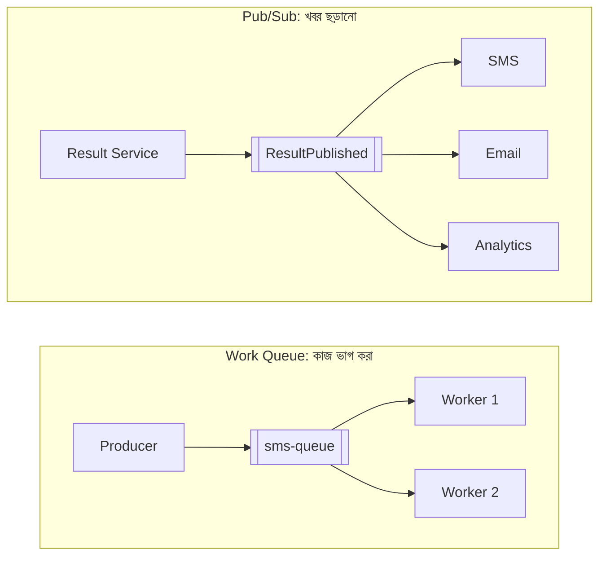
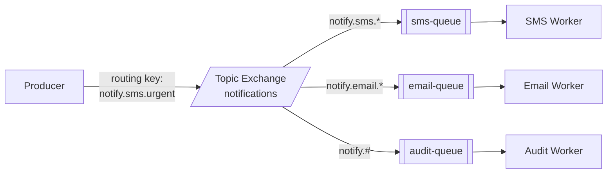
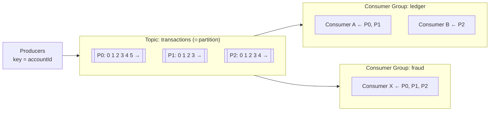
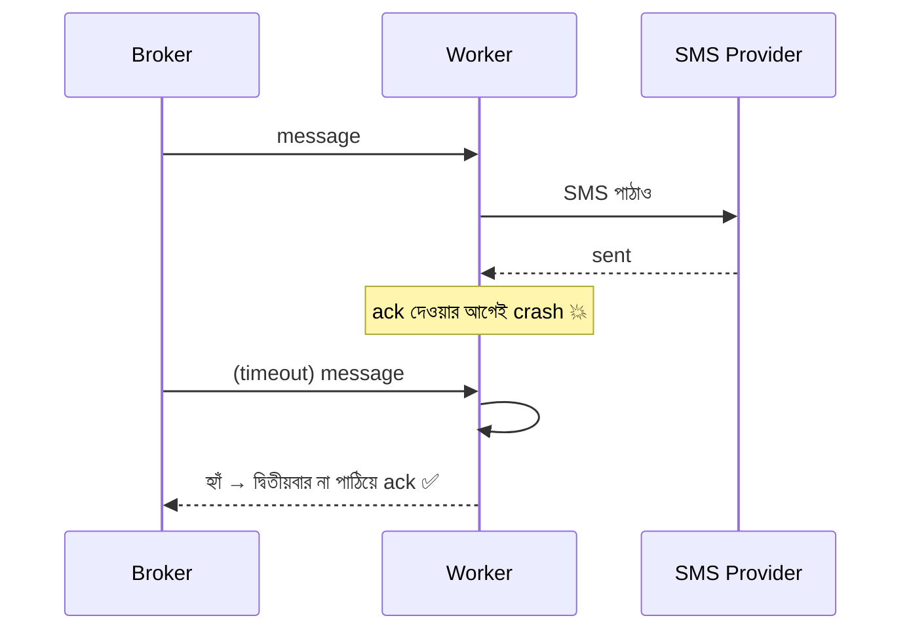
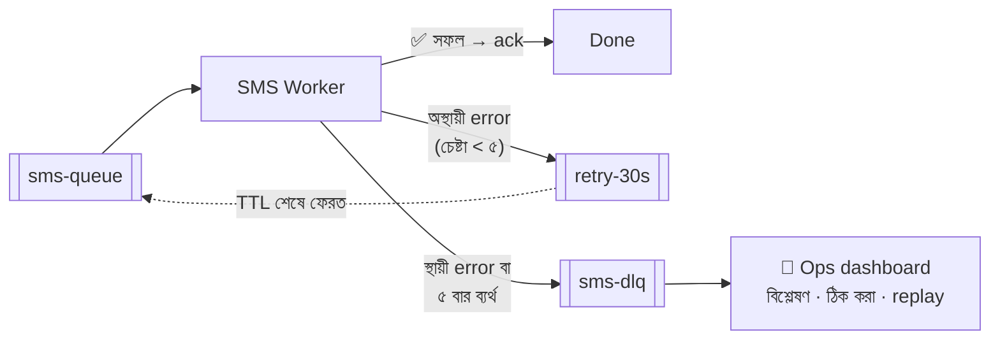
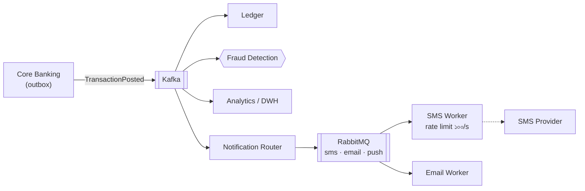

> [!GOALS]
> - Message queue কেন দরকার, আর queue বনাম pub/sub
> - RabbitMQ-র exchange ও queue, Kafka-র topic, partition ও consumer group
> - At-most-once, at-least-once ও "exactly-once"-এর বাস্তবতা
> - Acknowledgement, retry, backoff, Dead Letter Queue ও poison message
> - Idempotent consumer, message ordering ও backpressure
> - Event design, schema evolution এবং event sourcing-এর ধারণা
> - AI workload-এর জন্য queue

> [!STORY] দেড় লাখ SMS আর একটি ভাঙা নম্বর
> Result day-র আগের সপ্তাহ। রাফি এখন Notification service-এর মালিক। পরিকল্পনা সহজ: result প্রকাশের সাথে সাথে প্রতিটি অভিভাবককে SMS যাবে।
>
> Test-এর দিন রাফি একসাথে ১.৫ লাখ message queue-তে দিল। Worker চালু হলো, SMS provider-এর API-তে বন্যা বয়ে গেল। পাঁচ মিনিটের মধ্যে provider থেকে `429 Too Many Requests`। খোঁজ নিয়ে জানা গেল, চুক্তি অনুযায়ী তাদের সীমা **প্রতি সেকেন্ডে ১০০টি**।
>
> তারপর আরেক বিপদ। একটি message-এ ফোন নম্বর ছিল `"01৭১২-ABC"`, কারো ভুল data entry। Worker সেটা পাঠাতে ব্যর্থ হয়, message আবার queue-র সামনে ফেরত যায়, আবার ব্যর্থ হয়… পুরো রাত। পেছনের হাজার হাজার message আটকে রইল একটি ভাঙা নম্বরের পেছনে।
>
> সকালে তানভীর queue-র graph দেখিয়ে বললেন, "Queue তোমাকে সময় কিনে দেয়, রাফি। কিন্তু queue জাদু নয়। পেছনের দরজা কত বড় (consumer), আর ভাঙা জিনিস কোথায় সরিয়ে রাখবে (DLQ), সেটা তোমাকেই ঠিক করতে হবে।"

## 11.1 Introduction

বড় system-এ সবচেয়ে প্রচলিত সমস্যাগুলোর একটি: **"সব কাজ একসাথে synchronous-ভাবে করা।"** User register করলেন, আর সেই একই request-এর ভেতরে email পাঠানো, welcome SMS, analytics, CRM-এ data পাঠানো। ফলাফল: API ধীর, timeout, খারাপ user experience, আর একটি বাইরের service ধীর হলে পুরো system আটকে যায়।

সমাধান: **Message Queue ও Event Streaming।** "এখনই যা দরকার তা এখনই করো; বাকিটা একটি নির্ভরযোগ্য খাতায় লিখে রাখো, পরে করা হবে।"

## 11.2 Real Production Story: Email System Failure

একটি ERP system-এ user registration-এর সাথে সাথে synchronous-ভাবে email পাঠানো হচ্ছিল।

**সমস্যা:** Email server ধীর হলে API response ৬-১০ সেকেন্ড, মাঝে মাঝে timeout, আর email server বন্ধ থাকলে registration-ই ব্যর্থ।
**Root cause:** Email পাঠানো একটি side effect, কিন্তু সেটাকে মূল কাজের অংশ বানানো হয়েছিল।
**Solution:** Message queue ও background worker।
**Result:** API response **২০০ ms**, email async, আর email server বন্ধ থাকলেও registration চলে; email পরে চলে যায়।

## 11.3 Message Queue কী?

Message queue হলো system-এর অংশগুলোর মধ্যে **asynchronous যোগাযোগের** একটি নির্ভরযোগ্য মাধ্যম। মূল ধারণা: **Producer → Broker (Queue) → Consumer**।

- **Producer:** Message তৈরি করে পাঠায় (যেমন Result Service: "এই শিক্ষার্থীর অভিভাবককে SMS পাঠাও")।
- **Broker:** Message নিরাপদে রাখে, যতক্ষণ না কেউ process করে।
- **Consumer:** Message নিয়ে কাজ করে, তারপর জানায় "হয়েছে" (acknowledge)।

**কেন দরকার:** Async processing (দ্রুত API), decoupling (producer জানে না consumer কে), peak load শোষণ (spike-এ queue বড় হয়, system ভাঙে না), নির্ভরযোগ্যতা (consumer বন্ধ থাকলেও message হারায় না), আর retry।

| বৈশিষ্ট্য | Direct API Call | Message Queue |
| --- | --- | --- |
| Caller-এর অপেক্ষা | পুরো কাজ শেষ পর্যন্ত | শুধু message রাখা পর্যন্ত |
| Dependency | দুজনকেই একসাথে চালু থাকতে হবে | Consumer পরে চালু হলেও চলবে |
| ব্যর্থতার প্রভাব | সরাসরি caller-এ | Queue-তে জমা থাকে, পরে retry |
| Peak load | Downstream-কে সরাসরি আঘাত | Queue শোষণ করে, নির্দিষ্ট হারে process |
| তাৎক্ষণিক ফলাফল | পাওয়া যায় | পাওয়া যায় না (eventual) |

### Queue (Point-to-Point) বনাম Pub/Sub



## 11.4 RabbitMQ

RabbitMQ একটি প্রচলিত **message broker**: queue-ভিত্তিক, নমনীয় routing, acknowledgement, priority ও delayed delivery সাপোর্ট।

**Architecture:** Producer সরাসরি queue-তে নয়, পাঠায় একটি **exchange**-এ। Exchange নিয়ম (binding) অনুযায়ী ঠিক করে message কোন queue-তে যাবে।



| Exchange ধরন | কীভাবে route করে |
| --- | --- |
| Direct | Routing key হুবহু মিললে |
| Topic | Pattern দিয়ে (`notify.sms.*`, `notify.#`) |
| Fanout | সব bound queue-তে (broadcast) |
| Headers | Message header-এর মান দেখে |

**কখন RabbitMQ:** Task queue ও background job, email/SMS/notification, জটিল routing, priority queue, delayed retry, যেখানে message process হয়ে গেলে আর দরকার নেই।

## 11.5 Kafka

Kafka একটি **distributed event streaming platform**। এর মূল ধারণা queue নয়, **log**: একটি append-only খাতা, যেখানে event ক্রমানুসারে লেখা হয় এবং নির্দিষ্ট সময় (দিন, সপ্তাহ, বা চিরকাল) সংরক্ষিত থাকে। Consumer পড়লেও event মুছে যায় না।



**মূল ধারণা:**
- **Topic:** একটি event প্রবাহ (যেমন `transactions`)।
- **Partition:** Topic-কে কয়েকটি ভাগে ভাগ করা; প্রতিটি partition আলাদা server-এ থাকতে পারে, তাই parallel throughput।
- **Offset:** Partition-এর ভেতরে প্রতিটি event-এর ক্রমিক নম্বর। Consumer মনে রাখে কোথা পর্যন্ত পড়েছে।
- **Consumer Group:** একটি group-এর মধ্যে প্রতিটি partition একজন consumer পায় (কাজ ভাগ)। আলাদা group প্রত্যেকে পুরো stream স্বাধীনভাবে পড়ে (pub/sub)।
- **Retention ও Replay:** Event থেকে যায়, তাই নতুন consumer শুরু থেকে পড়তে পারে, বা bug ঠিক করে offset পিছিয়ে আবার process করা যায়।

**কখন Kafka:** খুব বেশি throughput (প্রতি সেকেন্ডে লাখো event), event-কে সত্যের উৎস হিসেবে রাখা, একই event অনেক team ব্যবহার করে, replay দরকার, real-time analytics, log ও clickstream, CDC (অধ্যায় ৫)।

> [!CASE] LinkedIn ও Kafka-র জন্ম
> Kafka তৈরি হয়েছিল LinkedIn-এ, প্রায় ২০১০-১১ সালে। তাদের সমস্যা ছিল: page view, search, connection-এর মতো activity data আর system metric প্রচুর পরিমাণে তৈরি হচ্ছিল, আর সেগুলো অনেকগুলো system-এ (search index, recommendation, Hadoop, monitoring) পৌঁছাতে হতো। প্রতিটি জোড়ার জন্য আলাদা pipeline বানাতে গিয়ে জট তৈরি হচ্ছিল। Kafka-র অন্যতম স্রষ্টা Jay Kreps পরে "The Log" নামে একটি বিখ্যাত প্রবন্ধে ব্যাখ্যা করেন: সব data একটি কেন্দ্রীয়, ক্রমানুসারী log-এ লিখে রাখলে প্রতিটি system শুধু সেই log পড়লেই হয়, N×M জোড়ার বদলে N+M সংযোগ।
>
> **শিক্ষা:** Kafka-র শক্তি গতিতে যতটা, তার চেয়ে বেশি **একটি সাধারণ সত্যের উৎস** হিসেবে, যেখান থেকে অনেক team স্বাধীনভাবে data নেয়।

### RabbitMQ বনাম Kafka

| বৈশিষ্ট্য | RabbitMQ | Kafka |
| --- | --- | --- |
| মূল model | Queue (smart broker) | Distributed log (simple broker, smart consumer) |
| Message পড়ার পর | সাধারণত মুছে যায় | Retention পর্যন্ত থাকে |
| Replay | সীমিত | স্বাভাবিক বৈশিষ্ট্য |
| Throughput | ভালো (হাজার থেকে লাখ/সেকেন্ড) | অত্যন্ত বেশি |
| Routing | নমনীয় (exchange) | Topic ও partition key |
| Ordering | Queue-তে, একজন consumer হলে | Partition-এর ভেতরে নিশ্চিত |
| Delayed / priority message | আছে | স্বাভাবিকভাবে নেই |
| Operational জটিলতা | কম | বেশি (managed service সহজ করে) |
| সেরা ব্যবহার | Task, job, notification | Event stream, analytics, integration hub |

Cloud-এ managed বিকল্প: AWS SQS/SNS, Azure Service Bus, Google Pub/Sub, আর managed Kafka (Confluent, AWS MSK, Azure Event Hubs)। ছোট team-এর জন্য managed service প্রায়ই সবচেয়ে বুদ্ধিমানের কাজ।

## 11.6 Background Processing

ভারী কাজ API থেকে আলাদা করে worker process-এ করা। User report চাইলে: API job queue-তে রাখে, `202 Accepted` ফেরত দেয় (অধ্যায় ৭), worker report তৈরি করে, শেষে user-কে জানানো হয়।

**Real Production Example: Report System।** Report তৈরিতে ১৫ সেকেন্ড লাগত, API timeout হচ্ছিল। Queue-ভিত্তিক processing-এ API এখন সাথে সাথে উত্তর দেয়, worker report তৈরি করে object storage-এ রাখে, user notification পেয়ে download করে। API দ্রুত, system স্থিতিশীল, আর একসাথে অনেক report এলেও worker সংখ্যা অনুযায়ী নিয়ন্ত্রিত হারে চলে।

## 11.7 Delivery Guarantee: Message কতবার পৌঁছাবে?

| Guarantee | অর্থ | কীভাবে | ঝুঁকি |
| --- | --- | --- | --- |
| **At-most-once** | সর্বোচ্চ একবার, হারাতে পারে | Process-এর আগেই ack | Message হারানো |
| **At-least-once** | অন্তত একবার, duplicate হতে পারে | Process শেষে ack; ব্যর্থ হলে আবার পাঠানো | Duplicate |
| **Exactly-once** | ঠিক একবার | Broker-এর transaction + idempotent consumer | জটিল, সীমিত পরিসরে |

> [!ARCHITECT] "Exactly-once" আসলে "effectively-once"
> বাস্তবে, বিশেষত বাইরের system (SMS provider, payment gateway, অন্য database) জড়িত থাকলে, নিশ্চিত exactly-once delivery প্রায় অসম্ভব। Kafka-র exactly-once semantics Kafka-র ভেতরের read-process-write চক্রে কাজ করে, কিন্তু আপনার worker যদি SMS পাঠিয়ে ack দেওয়ার আগে crash করে, SMS দ্বিতীয়বার যাবেই। তাই পরিপক্ক system-এর নিয়ম: **at-least-once delivery + idempotent consumer = effectively-once।**

## 11.8 Acknowledgement, Retry ও Dead Letter Queue

**Acknowledgement:** Consumer কাজ সফলভাবে শেষ করার **পরে** broker-কে জানায়। Ack না এলে (consumer crash বা timeout) message আবার deliver হয়।



**Retry:** অস্থায়ী ব্যর্থতায় (network, provider-এর 503) আবার চেষ্টা। কিন্তু সাথে সাথে বারবার নয়; **backoff** দিয়ে, অর্থাৎ ক্রমবর্ধমান বিরতিতে।

**Poison message:** যে message কখনোই সফল হবে না (গল্পের ভাঙা ফোন নম্বর, ভুল format)। অসীম retry করলে এটি queue আটকে রাখে আর resource নষ্ট করে।

**Dead Letter Queue (DLQ):** নির্দিষ্ট সংখ্যক চেষ্টার পর ব্যর্থ message একটি আলাদা queue-তে সরিয়ে রাখা, যাতে বাকিরা এগোতে পারে, আর মানুষ পরে বিশ্লেষণ করে ঠিক করতে বা আবার পাঠাতে পারে।



> [!TIP]
> Error-কে দুই ভাগ করুন: **retryable** (timeout, 429, 503) আর **non-retryable** (invalid phone number, validation error)। Non-retryable হলে একবারও retry না করে সরাসরি DLQ-তে। আর DLQ-তে message জমলে alert দিন; কেউ না দেখলে DLQ শুধু একটি কবরস্থান।

**Real Production Story: Payment Retry Issue।** একটি payment processing queue-তে gateway timeout হলে message হারানোর ঝুঁকি ছিল, কারণ ack দেওয়া হতো process শুরুর আগেই। Ack সরানো হলো process শেষে, retry-তে backoff আর DLQ যোগ হলো। ফলাফল: **শূন্য message loss** এবং ধারাবাহিক processing।

## 11.9 Idempotent Consumer

At-least-once মানে duplicate আসবেই। Consumer-কে এমনভাবে লিখতে হবে যাতে একই message দুবার process করলেও ফলাফল একবারের মতো।

```sql
-- প্রতিটি message-এর একটি unique ID থাকে (producer বা outbox দেয়)
CREATE TABLE ProcessedMessages (
    MessageId   UNIQUEIDENTIFIER PRIMARY KEY,
    ProcessedAt DATETIME2 NOT NULL DEFAULT SYSUTCDATETIME()
);

BEGIN TRANSACTION;
  INSERT INTO ProcessedMessages (MessageId) VALUES (@MessageId);  -- duplicate হলে PK violation
  UPDATE Accounts SET Balance = Balance + @Amount WHERE AccountId = @AccountId;
COMMIT;
-- PK violation হলে: আগেই process হয়েছে → কিছু না করে ack দাও
```

বাইরের API (SMS provider) call-এর ক্ষেত্রে: provider যদি idempotency key সাপোর্ট করে, message ID সেটা হিসেবে পাঠান; না করলে আগে "পাঠানো হচ্ছে" অবস্থা লিখে, provider-এর message ID সংরক্ষণ করে duplicate ঝুঁকি কমান।

## 11.10 Message Ordering

Kafka শুধু **একটি partition-এর ভেতরে** ক্রম নিশ্চিত করে। একই account-এর "জমা ৫০০" আর "উত্তোলন ৫০০" ভিন্ন partition-এ গেলে উল্টো ক্রমে process হতে পারে, আর উত্তোলন "অপর্যাপ্ত balance" বলে ব্যর্থ হবে।

**সমাধান:** যেসব event-এর ক্রম গুরুত্বপূর্ণ, তাদের একই **partition key** দিন (যেমন `accountId`)। তাহলে একই account-এর সব event একই partition-এ, ক্রমানুসারে। ভিন্ন account-এর event সমান্তরালে চলবে।

**সতর্কতা:** Retry-র জন্য message আলাদা retry queue-তে পাঠালে ক্রম ভাঙে। যেখানে ক্রম জরুরি, সেখানে partition-এর ভেতরে থেমে retry করতে হয় (বা event-এ version নম্বর দিয়ে consumer-এ পুরনো event উপেক্ষা)। আর সত্যিই কি **সব** event-এ বৈশ্বিক ক্রম দরকার? প্রায়ই নয়; শুধু একই entity-র ভেতরে।

## 11.11 Backpressure: Producer যখন consumer-এর চেয়ে দ্রুত

Producer যদি consumer-এর চেয়ে দ্রুত message দেয়, queue বড় হতে থাকে, latency বাড়ে, শেষে broker-এর storage বা memory শেষ। গল্পে আরেকটি সীমা ছিল: consumer-এর পরে **SMS provider-এর ১০০/সেকেন্ড**।

**কৌশল:**
- **Consumer scale করা:** Queue-র দৈর্ঘ্য বা Kafka consumer lag দেখে worker বাড়ানো (Kubernetes-এ KEDA দিয়ে)। কিন্তু Kafka-তে consumer সংখ্যা partition সংখ্যার বেশি হলে লাভ নেই।
- **Downstream-এর সীমা মানা:** Worker-এ rate limiter (token bucket, অধ্যায় ৭), যাতে provider-এর সীমা না ভাঙে।
- **Priority:** OTP ও payment confirmation-এর জন্য আলাদা high-priority queue; promotional SMS আলাদা, নিম্ন অগ্রাধিকারে।
- **Producer-কে ধীর করা:** চরম অবস্থায় নতুন কাজ নেওয়া সীমিত করা বা `503` দেওয়া।

> [!TIP]
> Result day-র হিসাব: ১.৫ লাখ SMS ÷ ১০০/সেকেন্ড = ১,৫০০ সেকেন্ড = **২৫ মিনিট**। কেউ কেউ সাড়ে নয়টায় SMS পাবে, এটা মেনে নিতে হবে, অথবা provider-এর সাথে সাময়িকভাবে সীমা বাড়ানোর চুক্তি করতে হবে, অথবা দুটি provider ব্যবহার করতে হবে। Architecture-এর সীমা কখনো কখনো business negotiation দিয়ে মেটে। মিতু সেদিন provider-এর সাথে কথা বলে result day-র জন্য সীমা ৩০০/সেকেন্ড করিয়েছিলেন।

**Real Production Story: Traffic Spike।** E-commerce flash sale-এ প্রতি মিনিটে ১ লাখ order। Queue ছাড়া order processing system ভেঙে পড়ত। Queue থাকায় order গ্রহণ দ্রুত হলো, আর processing চলল নিয়ন্ত্রিত হারে; peak শেষে কয়েক মিনিটের মধ্যে backlog শূন্য।

## 11.12 Event Design

**ভালো event-এর বৈশিষ্ট্য:**
- **অতীত কালে নাম:** `OrderPlaced`, `PaymentCompleted`, `ResultPublished`। Event একটি ঘটে যাওয়া সত্য, নির্দেশ নয়।
- **Unique ID, সময়, উৎস, version।**
- **যথেষ্ট তথ্য, কিন্তু অতিরিক্ত নয়।**

```json
{
  "eventId": "6b1f2c0e-4a7d-4b4e-9d1a-2e6f8b0c9a11",
  "type": "ResultPublished",
  "version": 2,
  "occurredAt": "2026-12-15T03:00:00Z",
  "source": "result-service",
  "data": { "examId": 77, "studentId": 612345, "guardianPhone": "+8801712xxxxxx" }
}
```

**Event Notification বনাম Event-Carried State Transfer:** প্রথমটিতে event শুধু জানায় "কিছু ঘটেছে" (consumer প্রয়োজনে API call করে বিস্তারিত আনে); দ্বিতীয়টিতে event-এর ভেতরেই দরকারি data থাকে (consumer-কে আর call করতে হয় না, কিন্তু event বড় হয় এবং data-র copy ছড়ায়)।

**Schema evolution:** Event-এর format সময়ের সাথে বদলায়। নিয়ম API versioning-এর মতোই (অধ্যায় ৭): শুধু optional field যোগ করুন, field মুছবেন না, অর্থ বদলাবেন না। Kafka-তে **Schema Registry** (Avro বা Protobuf) দিয়ে compatibility স্বয়ংক্রিয়ভাবে যাচাই করা যায়।

**Event Sourcing (এক নজরে):** বর্তমান অবস্থা (`balance = 5000`) রাখার বদলে সব পরিবর্তনের event (`Deposited 3000`, `Withdrawn 1000`…) সংরক্ষণ করা, আর সেগুলো যোগ করে বর্তমান অবস্থা বের করা। পূর্ণ audit trail ও "যেকোনো সময়ের অবস্থা" দেখার ক্ষমতা দেয়, কিন্তু জটিল; ledger বা audit-কেন্দ্রিক domain ছাড়া সাধারণত প্রয়োজন নেই (অধ্যায় ১৯)।

## 11.13 Monitoring Queue System

| Metric | কী বলে | Alert কখন |
| --- | --- | --- |
| Queue depth / consumer lag | কতগুলো message অপেক্ষায় | ক্রমাগত বাড়ছে |
| Oldest message age | সবচেয়ে পুরনো message কত সময় অপেক্ষায় | SLA ছাড়িয়েছে (যেমন OTP > ৩০ সেকেন্ড) |
| Processing rate ও time | Consumer কত দ্রুত কাজ করছে | হঠাৎ কমে গেছে |
| Failure / retry rate | কতগুলো ব্যর্থ হচ্ছে | Spike |
| DLQ size | স্থায়ী ব্যর্থতা | শূন্যের বেশি হলেই |

> [!TIP]
> শুধু queue depth দেখে বিভ্রান্ত হবেন না। ১০,০০০ message জমে থাকা ঠিক আছে যদি সেগুলো promotional email হয় আর ৫ মিনিটে শেষ হয়। কিন্তু ৫০টি OTP দুই মিনিট আটকে থাকা জরুরি অবস্থা। **"সবচেয়ে পুরনো message-এর বয়স"** প্রায়ই সবচেয়ে কাজের metric।

## 11.14 Enterprise Architecture Example

একটি banking system-এ একসাথে দুটিই চলে:
- **Kafka:** Transaction event-এর প্রধান stream; ledger, fraud detection, analytics, regulatory reporting প্রত্যেকে আলাদা consumer group।
- **RabbitMQ (বা SQS/Service Bus):** Email, SMS, push notification-এর task queue, priority ও delayed retry সহ।
- **Worker service:** Statement ও report তৈরি।



## 11.15 AI কোণ: AI workload-এর জন্য queue

> [!AI] AI কাজ প্রায়ই queue-এর জন্যই তৈরি
> **ধীর ও দামি কাজ:** একটি ৫০ পৃষ্ঠার ভর্তি নির্দেশিকা AI দিয়ে সারসংক্ষেপ করা, হাজার document-এর embedding তৈরি করা, বা call recording থেকে transcript: এসব কয়েক সেকেন্ড থেকে কয়েক মিনিটের কাজ। Synchronous API-তে এগুলো রাখলে timeout অবধারিত। Queue + worker + `202 Accepted` এখানে স্বাভাবিক নকশা।
>
> **Provider-এর rate limit:** LLM provider-এর সীমা থাকে প্রতি মিনিটে request ও token-এ। গল্পের SMS provider-এর মতোই, worker-এ token-ভিত্তিক rate limiter রেখে queue থেকে নিয়ন্ত্রিত হারে পাঠাতে হয়।
>
> **অগ্রাধিকার:** User অপেক্ষা করছে এমন প্রশ্ন (interactive) আর রাতের batch কাজ (পুরো knowledge base-এর embedding নবায়ন) আলাদা queue-তে রাখুন, যাতে batch কাজ interactive অভিজ্ঞতা নষ্ট না করে। অনেক provider batch API-তে কম দামে কাজ করে দেয়।
>
> **Event stream থেকে real-time ML:** Fraud detection model-কে transaction-এর Kafka stream থেকে feature (গত ১০ মিনিটে এই কার্ডে কতবার লেনদেন) দেওয়া হয়। Event streaming আর ML এখানে হাতে হাত ধরে চলে (অধ্যায় ১৯)।

## 11.16 সাধারণ ভুল

- **Retry strategy নেই:** Message হারায়।
- **অসীম retry ও DLQ নেই:** Poison message queue আটকায়।
- **Process-এর আগে ack:** Crash হলে message হারায়।
- **Consumer idempotent নয়:** Duplicate data।
- **Downstream-এর সীমা উপেক্ষা:** SMS বা LLM provider-এর rate limit ভাঙা।
- **ভুল tool:** Simple task queue-র জন্য Kafka cluster, বা event replay দরকার এমন জায়গায় RabbitMQ।
- **Ordering-এর ভুল ধারণা:** Partition key ছাড়া ক্রম আশা করা।
- **Dual write:** Database ও broker-এ আলাদাভাবে লেখা (অধ্যায় ১০-এর outbox ব্যবহার করুন)।

## 11.17 Interview প্রশ্ন

> [!INTERVIEW]
> 1. Message queue কী সমস্যা সমাধান করে? Queue ও pub/sub-এর পার্থক্য কী?
> 2. RabbitMQ ও Kafka-র মূল পার্থক্য কী? কোনটা কখন?
> 3. Kafka-তে partition ও consumer group কীভাবে কাজ করে?
> 4. At-least-once delivery-তে duplicate কীভাবে সামলাবেন?
> 5. Dead Letter Queue কী? Poison message কী?
> 6. Kafka-তে message ordering কীভাবে নিশ্চিত করবেন?
> 7. Consumer lag বাড়ছে। কী কী কারণ হতে পারে এবং কী করবেন?
> 8. "Exactly-once delivery" কি বাস্তবে সম্ভব?

## 11.18 নিজে করে দেখুন

> [!EXERCISE] বড় আকারের Notification System
> একটি platform দিনে ২ কোটি notification পাঠায়: OTP, লেনদেনের সতর্কবার্তা, promotional message; channel: SMS, email, push।
> 1. Queue-র গঠন আঁকুন (কয়টি queue বা topic, কেন)।
> 2. OTP যেন ১০ সেকেন্ডের মধ্যে যায়, promotional message-এর ভিড়েও: কীভাবে নিশ্চিত করবেন?
> 3. Retry, backoff ও DLQ-র নিয়ম লিখুন।
> 4. একই notification দুবার না যাওয়ার কৌশল কী?
> 5. User "promotional SMS বন্ধ" করলে সেটা কোথায় যাচাই হবে?

## 11.19 Chapter Summary

- **Message queue:** Async processing, decoupling, peak শোষণ, নির্ভরযোগ্যতা।
- **RabbitMQ:** Exchange ও queue দিয়ে নমনীয় task routing।
- **Kafka:** Partitioned log, consumer group, retention ও replay; অনেক consumer-এর সাধারণ সত্যের উৎস।
- **Delivery:** At-least-once + idempotent consumer = effectively-once।
- **Retry ও DLQ:** Backoff, retryable বনাম non-retryable, poison message আলাদা করা।
- **Ordering:** শুধু partition-এর ভেতরে; partition key দিয়ে entity-ভিত্তিক ক্রম।
- **Backpressure:** Consumer scale, downstream-এর সীমা মানা, অগ্রাধিকার।
- **Event design:** অতীত কালে নাম, ID ও version, schema evolution-এর নিয়ম।

> [!ARCHITECT] নুসরাতের নোটবুক · Result Day Notification
> নতুন নকশা: `ResultPublished` event (outbox থেকে) → Notification Router → priority queue (OTP/জরুরি) ও bulk queue (result SMS)। Worker-এ token bucket (৩০০/সেকেন্ড, provider-এর নতুন চুক্তি অনুযায়ী)। Invalid নম্বর validation-এই ধরা পড়ে সরাসরি DLQ-তে; DLQ-তে message এলে ops channel-এ alert। ফলাফল: ১.৫ লাখ SMS ৯ মিনিটে, ২১৪টি invalid নম্বর DLQ-তে, যার তালিকা রেজিস্ট্রার অফিসে পাঠানো হয়েছে সংশোধনের জন্য। রাফির প্রথম on-call সপ্তাহ সফল। কিন্তু তানভীর বললেন, "Queue কাজ করছে কি না জানলাম কারণ আমরা graph দেখছিলাম। সব কিছুর graph কি আমাদের আছে?"
