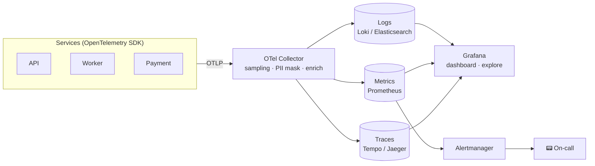
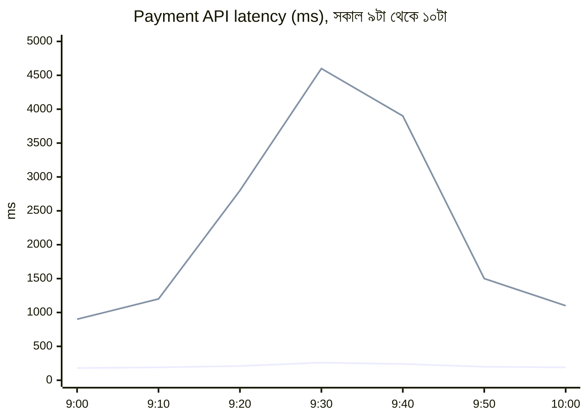
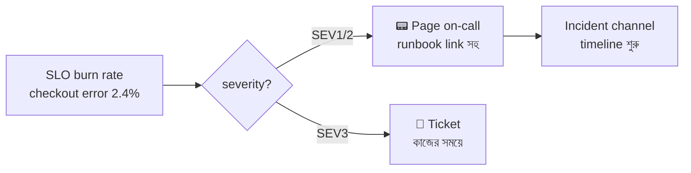
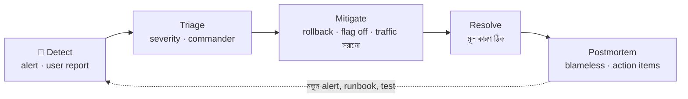
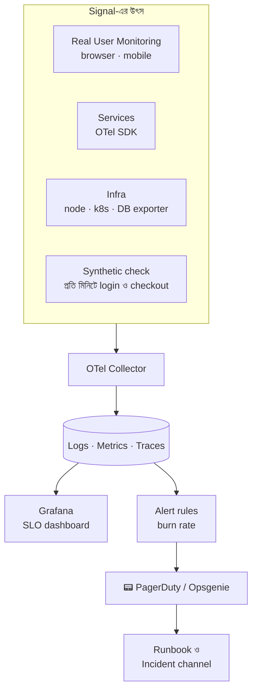

> [!GOALS]
> - Monitoring ও observability-র পার্থক্য
> - Structured logging, correlation ID ও কী log করবেন না
> - Metric-এর ধরন, RED, USE ও Golden Signals; গড় কেন মিথ্যা বলে
> - Distributed tracing, span ও OpenTelemetry
> - SLI, SLO, SLA, error budget ও burn-rate alert
> - Alert fatigue এড়ানো, on-call-এর মানবিক দিক, blameless postmortem
> - LLM application-এর observability ও AIOps

> [!STORY] রাত ২টা ১৭ মিনিট
> তানভীরের phone গত এক মাসে প্রতি রাতে গড়ে দুইশোবার বেজেছে। CPU ৮০% ছাড়িয়েছে। একটি health check একবার ব্যর্থ হয়ে আবার ঠিক হয়েছে। Disk ৭০%। Queue-তে ৫০০ message। প্রায় সবগুলোই নিজে থেকে ঠিক হয়ে যায়। তানভীর শিখে গিয়েছিলেন, ঘুমের মধ্যেই phone উল্টে রেখে দিতে।
>
> এক রাতে, রাত ২টা ১৭ মিনিটে, আসলেই একটি গুরুত্বপূর্ণ alert এসেছিল: payment database-এর log disk ৯৫%। সেটাও আর দশটার মতো উল্টে রাখা হলো। ভোর ৪টায় disk পুরো ভরে গেল, database নতুন write নেওয়া বন্ধ করল, আর সকাল পর্যন্ত কোনো payment হয়নি।
>
> সকালের meeting-এ কেউ তানভীরকে দোষ দিল না। নুসরাত বললেন, "দুইশো alert-এর মধ্যে একটি সত্যিকারের alert খুঁজে বের করা মানুষের কাজ নয়। এটা আমাদের system-এর design-এর ব্যর্থতা। আমরা মানুষকে ক্লান্ত করে তারপর অবাক হচ্ছি কেন সে ভুল করল।"
>
> করিম সাহেব যোগ করলেন, "আর তানভীর এক মাস ধরে প্রতি রাতে ঘুম থেকে উঠছেন, এটা আমরা কেউ জানতামও না। এটাও ঠিক করতে হবে।"

## 12.1 Introduction

System production-এ গেলে সবচেয়ে বড় প্রশ্ন: **"System-এর ভেতরে এখন কী হচ্ছে, আমরা কীভাবে বুঝব?"** Production-এ সমস্যা সবসময় চোখে পড়ে না: API ধীর কিন্তু error নেই, কিছু user সমস্যায় কিন্তু সবাই নয়, প্রতি মঙ্গলবার রাতে memory বাড়ে। এগুলো বুঝতে লাগে **observability**।

**Monitoring বনাম Observability:**
- **Monitoring:** জানা প্রশ্নের উত্তর: "CPU কত? Error rate কি ১%-এর বেশি?" (known unknowns)
- **Observability:** অজানা প্রশ্নের উত্তর খুঁজে বের করার ক্ষমতা: "শুধু চট্টগ্রামের Android user-রা কেন বিকেল ৪টার পর ধীর পাচ্ছেন?" (unknown unknowns)

Monitoring হলো dashboard; observability হলো এমন data, যা দিয়ে নতুন প্রশ্ন করা যায়।

## 12.2 Real Production Story: Unknown Production Issue

একটি ERP-তে dashboard ধীর হচ্ছিল, কিন্তু log-এ কোনো error ছিল না। কারণ ছিল একটি ধীর database query, কিন্তু সেটা চিহ্নিত করার কোনো উপায় ছিল না: কোন query, কত সময়, কোন request থেকে, কেউ জানত না। সমস্যা খুঁজতে প্রতিবার **দুই ঘণ্টা** লাগত, আর প্রায়ই অনুমানে।

Logging, metrics ও tracing যোগ করার পর একই ধরনের সমস্যা চিহ্নিত করতে লাগে **কয়েক মিনিট**। Root cause আর অনুমান নয়, প্রমাণ।

## 12.3 Observability-র তিন স্তম্ভ

| | Logs | Metrics | Traces |
| --- | --- | --- | --- |
| কী | আলাদা আলাদা ঘটনার বিস্তারিত রেকর্ড | সময়ের সাথে সংখ্যা | একটি request-এর পুরো যাত্রা |
| প্রশ্ন | "ঠিক কী ঘটেছিল?" | "কতটা, কত দ্রুত, কত ঘন ঘন?" | "কোথায় সময় গেল?" |
| উদাহরণ | `payment failed: card declined` | `http_requests_total`, p95 latency | Gateway → Order → Payment → DB |
| খরচ | বেশি (volume) | কম | মাঝারি (sampling করা হয়) |
| Tool | ELK, Loki, Seq | Prometheus, Grafana | Jaeger, Tempo, Zipkin |



## 12.4 Logging

Logging হলো system-এর ঘটনাগুলো রেকর্ড করা। Log level: **Debug** (development-এ বিস্তারিত), **Info** (স্বাভাবিক গুরুত্বপূর্ণ ঘটনা), **Warning** (অস্বাভাবিক কিন্তু চলছে), **Error** (একটি কাজ ব্যর্থ), **Critical/Fatal** (system-এর বড় অংশ অচল)।

### Structured Logging

```text
❌ User error happened
❌ Login failed for user 101 at 10:05 PM because invalid password
```

```json
✅ {
  "timestamp": "2026-11-10T16:05:12.381Z",
  "level": "Warning",
  "event": "login_failed",
  "userId": 101,
  "reason": "invalid_password",
  "ip": "103.x.x.x",
  "traceId": "4bf92f3577b34da6a3ce929d0e0e4736",
  "service": "auth-api",
  "version": "2.14.0"
}
```

Structured (JSON) log-এ খোঁজা যায় `event = login_failed AND userId = 101`, গণনা করা যায়, graph বানানো যায়। Free text-এ শুধু অনুমান।

```csharp
// Serilog দিয়ে structured logging (message template, string interpolation নয়)
_logger.LogWarning("Login failed for {UserId} from {Ip}: {Reason}", userId, ip, "invalid_password");
```

**Correlation ID / Trace ID:** প্রতিটি request-এ একটি ID, যা সেই request-এর সব log-এ থাকে, সব service-এ। অধ্যায় ৭-এ জসিমের ফোনে দেখানো `requestId` ঠিক এটাই।

> [!WARNING] কী log করবেন না
> Password, OTP, access token, পুরো card নম্বর, CVV, NID নম্বর, ব্যক্তিগত স্বাস্থ্য তথ্য। Log সাধারণত database-এর চেয়ে অনেক বেশি মানুষ দেখে, এবং অনেক বেশি জায়গায় copy হয়। প্রয়োজনে mask করুন (`+8801712****78`)। আর LLM-এর prompt log করলে মনে রাখুন, user সেখানে ব্যক্তিগত তথ্য লিখতে পারেন।

**Centralized logging:** Microservice-এ log দশটি server-এ ছড়ানো থাকলে কোনো লাভ নেই। সব log এক জায়গায়: ELK (Elasticsearch, Logstash, Kibana), Grafana Loki, Seq, বা cloud-এর managed service।

**Retention ও খরচ:** Log চিরকাল রাখা যায় না। একটি সাধারণ কৌশল: ৭ দিন hot (দ্রুত খোঁজা), ৩০ দিন warm/cold, তারপর সস্তা archive (audit ও আইনগত প্রয়োজনে দীর্ঘ)। Debug log production-এ বন্ধ, অথবা sampling।

## 12.5 Metrics

Metric হলো সময়ের সাথে মাপা সংখ্যা: CPU, memory, request rate, response time, error rate, queue depth।

**Metric-এর ধরন:**
- **Counter:** শুধু বাড়ে (মোট request, মোট error); rate বের করতে ব্যবহার।
- **Gauge:** বাড়ে-কমে (বর্তমান memory, queue-র দৈর্ঘ্য, active connection)।
- **Histogram:** মানের বণ্টন (latency কোন bucket-এ কতগুলো); percentile বের করতে।

### কী মাপবেন: তিনটি পদ্ধতি

| পদ্ধতি | কার জন্য | কী মাপে |
| --- | --- | --- |
| **RED** | Service / API | **R**ate, **E**rrors, **D**uration |
| **USE** | Resource (CPU, disk, DB) | **U**tilization, **S**aturation, **E**rrors |
| **Golden Signals** (Google SRE) | User-facing system | Latency, Traffic, Errors, Saturation |

### গড় মিথ্যা বলে

১০০টি request-এর ৯৫টি ১০০ ms, ৫টি ৫ সেকেন্ড। গড়: ৩৪৫ ms, "ঠিকঠাক দেখায়"। কিন্তু প্রতি ২০ জনে একজন user পাঁচ সেকেন্ড অপেক্ষা করছেন। আর সেই একজন সম্ভবত আপনার সবচেয়ে বড় customer, যার data সবচেয়ে বেশি। তাই latency সবসময় **percentile**-এ দেখুন: p50 (সাধারণ অভিজ্ঞতা), p95, p99 (খারাপ দিনের অভিজ্ঞতা)।



*(নিচের রেখা গড়, উপরের রেখা p99)*

**Prometheus ও Grafana:** Prometheus প্রতিটি service-এর `/metrics` endpoint থেকে নির্দিষ্ট সময় পরপর metric সংগ্রহ করে (pull), time-series হিসেবে রাখে, আর PromQL দিয়ে query করা যায়। Grafana সেগুলোকে dashboard-এ দেখায়।

```promql
# গত ৫ মিনিটে payment API-র p95 latency
histogram_quantile(0.95, sum by (le) (rate(http_request_duration_seconds_bucket{service="payment"}[5m])))

# Error rate (%)
100 * sum(rate(http_requests_total{service="payment", status=~"5.."}[5m]))
    / sum(rate(http_requests_total{service="payment"}[5m]))
```

> [!WARNING] Cardinality বিস্ফোরণ
> Metric-এর label-এ `userId`, `orderId` বা পুরো URL (ID সহ) রাখবেন না। প্রতিটি আলাদা মান একটি নতুন time-series তৈরি করে; লাখো user মানে লাখো series, Prometheus-এর memory শেষ। Label রাখুন সীমিত মানের: service, endpoint template (`/members/{id}`), status code, region।

**Real Production Example: CPU Spike।** API ধীর হচ্ছিল। Metric-এ দেখা গেল database CPU ৯৫%, আর একটি নির্দিষ্ট query-র সময় হঠাৎ বেড়েছে, ঠিক একটি deploy-এর পর। Index যোগ আর cache দিয়ে সমাধান। Metric ছাড়া প্রথম সন্দেহ যেত app server-এর দিকে।

## 12.6 Distributed Tracing

Tracing দেখায় একটি request পুরো system-এর ভেতর দিয়ে কোথায় কোথায় গেল, প্রতিটি ধাপে কত সময় নিল। একটি **trace** অনেকগুলো **span** দিয়ে তৈরি; প্রতিটি span একটি কাজ (একটি HTTP call, একটি DB query)।

```mermaid
%% caption: একটি checkout request-এর trace: সময়ের বেশিরভাগ গেছে inventory-র একটি DB query-তে
gantt
    title Trace 4bf92f…: POST /checkout (মোট ১,৮৪০ ms)
    dateFormat x
    axisFormat %S.%L s
    section Gateway
    gateway auth           :0, 40
    section Order Service
    validate cart          :40, 120
    section Inventory
    reserve stock          :120, 1450
    SELECT … FOR UPDATE    :crit, 150, 1420
    section Payment
    charge card            :1450, 1780
    section Order Service
    save order             :1780, 1840
```



Trace দেখে পাঁচ সেকেন্ডে বোঝা যায়: সমস্যা payment নয়, inventory-র একটি locking query।

**Context propagation:** Trace ID এক service থেকে আরেক service-এ HTTP header-এ যায় (W3C standard `traceparent`), message queue-তে message header-এ। Chain-এর কোনো একটি service propagation না করলে trace ভেঙে যায়।

**Sampling:** সব request-এর trace রাখা ব্যয়বহুল। সাধারণ কৌশল: সব error ও ধীর request রাখা (tail-based sampling), বাকিদের একটি ছোট অংশ।

**Real Production Story: Microservice Debugging।** Payment দেরিতে হচ্ছিল। Tracing ছাড়া team তিন ঘণ্টা অনুমান করে এক service থেকে আরেক service-এ খুঁজছিল। Tracing যোগ করার পর একই ধরনের সমস্যায় ১০ মিনিটে দেখা গেল: Order service-এর একটি DB query bottleneck। **Debugging time ৩ ঘণ্টা → ১০ মিনিট।**

## 12.7 OpenTelemetry

OpenTelemetry (OTel) হলো logs, metrics ও traces সংগ্রহের একটি vendor-নিরপেক্ষ open standard ও SDK। একবার OTel দিয়ে instrument করলে পরে backend বদলানো যায় (Jaeger থেকে Tempo, বা কোনো commercial tool) code না বদলে। .NET, Java, Node, Python, Go সব ভাষায় automatic instrumentation আছে: HTTP, database, queue call নিজে থেকেই span হয়ে যায়।

```csharp
builder.Services.AddOpenTelemetry()
    .ConfigureResource(r => r.AddService("payment-api", serviceVersion: "2.14.0"))
    .WithTracing(t => t.AddAspNetCoreInstrumentation().AddHttpClientInstrumentation()
                       .AddSqlClientInstrumentation().AddOtlpExporter())
    .WithMetrics(m => m.AddAspNetCoreInstrumentation().AddRuntimeInstrumentation().AddOtlpExporter());
```

## 12.8 SLI, SLO, SLA ও Error Budget

| শব্দ | অর্থ | উদাহরণ |
| --- | --- | --- |
| **SLI** (Indicator) | যা মাপা হচ্ছে | সফল checkout request-এর শতাংশ; ৫০০ ms-এর কম latency-র শতাংশ |
| **SLO** (Objective) | Team-এর অভ্যন্তরীণ লক্ষ্য | ২৮ দিনে ৯৯.৯% checkout সফল |
| **SLA** (Agreement) | Customer-এর সাথে চুক্তি, ভাঙলে জরিমানা | মাসিক ৯৯.৫% availability, নাহলে ১০% ফেরত |

SLO সবসময় SLA-র চেয়ে কঠোর রাখুন, যাতে চুক্তি ভাঙার আগেই team সতর্ক হয়।

### Error Budget

৯৯.৯% SLO মানে ০.১% ব্যর্থতা **অনুমোদিত**। ২৮ দিনে ১০ লাখ checkout হলে, ১,০০০টি ব্যর্থ হতে পারে। এটাই **error budget**।

```text
২৮ দিনের মোট request : 1,000,000
SLO                  : 99.9%
Error budget         : 1,000,000 × 0.1% = 1,000 ব্যর্থ request
এ পর্যন্ত খরচ        : 640  →  বাকি 360 (36%)
```

Error budget একটি **সিদ্ধান্তের হাতিয়ার**: budget বাকি থাকলে team ঝুঁকি নিয়ে নতুন feature release করতে পারে; budget শেষ হলে নতুন feature থামিয়ে reliability-র কাজ। এতে product আর engineering-এর চিরকালীন তর্ক ("দ্রুত feature" বনাম "স্থিতিশীলতা") একটি সংখ্যার ভিত্তিতে মীমাংসা হয়।

> [!CASE] Google SRE: error budget ও blameless postmortem
> Google-এর Site Reliability Engineering অনুশীলন, যা তাদের প্রকাশিত "Site Reliability Engineering" (২০১৬) বইয়ে বিস্তারিত বর্ণিত, SLO ও error budget-কে কেন্দ্রীয় ধারণা বানিয়েছে: ১০০% reliability ভুল লক্ষ্য, কারণ user নিজেই তার network ও device-এর কারণে কখনো ১০০% পায় না, আর ১০০% চাইলে নতুন কিছু release করাই বন্ধ হয়ে যায়। একই বইয়ে **blameless postmortem**-এর সংস্কৃতি বর্ণিত: incident-এর পর লক্ষ্য দোষী খোঁজা নয়, system-এর কোন দুর্বলতা মানুষকে ভুল করতে দিয়েছে তা খোঁজা। Etsy-র John Allspaw-ও ২০১২ সালে "Blameless PostMortems and a Just Culture" লেখায় একই কথা বলেছিলেন: ভুলের জন্য শাস্তি পেলে মানুষ ভুল লুকায়, আর লুকানো ভুল থেকে কেউ শেখে না।

## 12.9 Alerting: কম, কিন্তু সঠিক

গল্পের দুইশো alert-এর সমস্যাকে বলে **alert fatigue**। প্রতিটি অপ্রয়োজনীয় alert পরের প্রকৃত alert-এর বিশ্বাসযোগ্যতা কমায়।

**ভালো alert-এর নিয়ম:**
1. **Symptom-এ alert, cause-এ নয়।** "CPU ৮০%" নয় (হয়তো স্বাভাবিক); "checkout error rate ২% ছাড়িয়েছে" বা "p99 latency SLO ভাঙছে", কারণ এটাই user-এর কষ্ট।
2. **প্রতিটি page actionable।** রাতে ঘুম ভাঙানোর মতো alert-এ মানুষকে এখনই কিছু করতে হবে। না হলে সেটা সকালের ticket।
3. **প্রতিটি alert-এর runbook।** "এই alert এলে প্রথম তিনটি কাজ" লেখা থাকবে।
4. **Burn-rate alert:** Error budget কত দ্রুত খরচ হচ্ছে দেখে। দ্রুত খরচ হলে (যেমন এক ঘণ্টায় মাসিক budget-এর ২%) এখনই page; ধীরে খরচ হলে ticket।
5. **Severity স্পষ্ট:** SEV1 (পুরো service বন্ধ, এখনই), SEV2 (গুরুত্বপূর্ণ অংশ ক্ষতিগ্রস্ত), SEV3 (কাজের সময়ে দেখলেই হবে)।
6. **নিয়মিত পরিষ্কার:** গত মাসে যে alert-এ কেউ কিছু করেনি, সেটা বাদ বা নিচের severity-তে।



## 12.10 Incident Response ও On-call-এর মানবিক দিক

**Incident-এর ধাপ:** Detect → Triage (severity) → Mitigate (আগে রক্তক্ষরণ বন্ধ: rollback, feature flag বন্ধ, traffic সরানো) → Resolve (মূল কারণ ঠিক) → Postmortem।



> [!TIP]
> Incident-এর সময় সবচেয়ে বড় ভুল: মূল কারণ খুঁজতে গিয়ে mitigation দেরি করা। আগে user-এর কষ্ট বন্ধ করুন (সাম্প্রতিক deploy rollback করুন), তারপর শান্ত মাথায় কারণ খুঁজুন।

**বড় incident-এ ভূমিকা ভাগ:** **Incident Commander** (সিদ্ধান্ত ও সমন্বয়, নিজে debug করেন না), **Ops lead** (technical কাজ), **Communications** (customer ও management-কে নিয়মিত update), **Scribe** (timeline লেখা)।

**On-call-কে মানবিক রাখা:**
- Rotation-এ অন্তত চার-পাঁচজন, যাতে কেউ প্রতি সপ্তাহে না পড়েন।
- রাতে page হলে পরদিন দেরিতে আসার অনুমতি বা ক্ষতিপূরণ।
- প্রতি shift-এ কতবার page হলো, তা মাপা; বেশি হলে সেটা engineering-এর অগ্রাধিকার।
- নতুনদের প্রথমে shadow on-call, তারপর একা।

### Blameless Postmortem Template

```text
শিরোনাম : Payment DB log disk full (SEV1)
প্রভাব  : ০৪:০২–০৮:৪৫, কোনো payment সম্পন্ন হয়নি; আনুমানিক ১,৯০০ user প্রভাবিত
Timeline: ০২:১৭ disk 95% alert (অন্য ১৮৬টি alert-এর সাথে) … ০৪:০২ disk full … ০৮:৩০ শনাক্ত …
মূল কারণ: log backup job তিন দিন ধরে ব্যর্থ; ফলে transaction log বড় হচ্ছিল
সহায়ক কারণ: alert fatigue; backup job-এর ব্যর্থতার alert ছিল না
কী ভালো হয়েছে: শনাক্তের পর ১৫ মিনিটে recovery
Action items: (১) backup job ব্যর্থ হলে SEV2 alert — তানভীর, ১৫ নভেম্বর
              (২) রাতের alert ২০০ → ১০-এর নিচে, SLO-ভিত্তিক — নুসরাত, ৩০ নভেম্বর
              (৩) disk-এর জন্য 'কতক্ষণে ভরবে' (predictive) alert — রাফি, ২০ নভেম্বর
```

লক্ষ্য করুন, কোথাও "তানভীর alert উপেক্ষা করেছেন" লেখা নেই। লেখা আছে, system একজন মানুষকে ১৮৬টি অর্থহীন alert দিয়েছিল।

## 12.11 Performance Monitoring ও Memory Leak

**Real Production Story: Memory Leak।** একটি server সময়ের সাথে ধীর হচ্ছিল, প্রতি কয়েক দিনে restart লাগত। Metric-এ memory-র graph ছিল সিঁড়ির মতো ক্রমাগত ঊর্ধ্বমুখী। Root cause: একটি static dictionary-তে object জমা হচ্ছিল, কখনো মুছছিল না, আর কিছু database context dispose হচ্ছিল না। Memory dump বিশ্লেষণ করে ঠিক করা হয়। শিক্ষা: memory ও GC-র metric দীর্ঘ সময়ের graph-এ দেখুন; ধীর leak এক ঘণ্টার graph-এ চোখে পড়ে না।

**আরো যা track করবেন:** Slow query log, connection pool-এর ব্যবহার, thread pool starvation, GC pause, external API-র latency (আলাদাভাবে), queue lag (অধ্যায় ১১), certificate-এর মেয়াদ, disk "কত দিনে ভরবে"।

## 12.12 Enterprise Observability Architecture



**Synthetic monitoring:** প্রতি মিনিটে একটি robot সত্যিকারের user-এর মতো login করে checkout পর্যন্ত যায়। আসল user-এর অভিযোগ আসার আগেই সমস্যা ধরা পড়ে, এমনকি রাত তিনটায়, যখন কোনো user নেই।

## 12.13 AI কোণ: LLM-এর observability ও AIOps

> [!AI] AI feature-এ কী মাপবেন
> সাধারণ API-তে আমরা দেখি latency আর error। LLM-ভিত্তিক feature-এ এর সাথে যোগ হয়:
> - **Token ও খরচ:** প্রতি request-এ input/output token, প্রতি feature ও প্রতি tenant-এর দৈনিক খরচ। একটি ভুল prompt বা loop রাতারাতি budget শেষ করতে পারে।
> - **Time to first token:** User-এর কাছে প্রথম শব্দ কত দ্রুত পৌঁছায় (streaming-এ এটাই অনুভূত গতি)।
> - **গুণমান:** User-এর 👍/👎, "উত্তর কপি করা হয়েছে কি না", evaluation score (অধ্যায় ১৫), retrieval-এ সঠিক document এসেছে কি না।
> - **নিরাপত্তা:** Guardrail কতবার আটকেছে, prompt injection সন্দেহ, PII শনাক্ত।
> - **পুরো trace:** User-এর প্রশ্ন → retrieval → কোন document → prompt → model → উত্তর। কোনো ভুল উত্তরের অভিযোগ এলে এই trace ছাড়া কারণ বের করা অসম্ভব। তবে prompt-এ ব্যক্তিগত তথ্য থাকে, তাই masking ও কঠোর access।
>
> **AIOps:** অনেক observability tool এখন ML দিয়ে anomaly শনাক্ত করে, একই কারণের শত alert-কে একটি incident-এ জোড়া দেয়, আর LLM দিয়ে incident-এর সারসংক্ষেপ বা সম্ভাব্য কারণ প্রস্তাব করে। গল্পের alert fatigue কমাতে এগুলো সত্যিই সাহায্য করতে পারে। কিন্তু মনে রাখুন: AI-এর প্রস্তাব একটি hypothesis, প্রমাণ নয়। Rollback বা failover-এর মতো সিদ্ধান্ত নেওয়ার আগে trace ও metric দিয়ে যাচাই করুন।

## 12.14 সাধারণ ভুল

- **Logging strategy নেই:** Debug অসম্ভব।
- **Unstructured log ও trace ID নেই।**
- **Metric নেই, বা শুধু গড়:** p99-এর যন্ত্রণা অদৃশ্য।
- **Tracing নেই:** Microservice-এ root cause অজানা।
- **অতিরিক্ত logging:** Storage ও খরচের অপচয়, আসল তথ্য হারিয়ে যায়।
- **Alert নেই, অথবা অনেক বেশি alert।**
- **High-cardinality label।**
- **Postmortem-এ দোষারোপ:** মানুষ ভুল লুকাতে শেখে।

## 12.15 Interview প্রশ্ন

> [!INTERVIEW]
> 1. Monitoring ও observability-র পার্থক্য কী?
> 2. Logs, metrics ও traces কোনটা কখন ব্যবহার করবেন?
> 3. Latency-তে গড়ের বদলে percentile কেন?
> 4. RED ও USE method কী?
> 5. Distributed tracing কীভাবে কাজ করে? Trace context কীভাবে propagate হয়?
> 6. SLI, SLO, SLA-র পার্থক্য কী? Error budget কী এবং কীভাবে ব্যবহার করবেন?
> 7. Alert fatigue কী? কীভাবে কমাবেন?
> 8. Blameless postmortem কেন জরুরি?

## 12.16 নিজে করে দেখুন

> [!EXERCISE] Mobile Banking-এর Monitoring Design
> একটি mobile banking platform-এর জন্য:
> 1. তিনটি গুরুত্বপূর্ণ user journey বেছে নিন এবং প্রতিটির SLI ও SLO লিখুন।
> 2. কোন পাঁচটি alert রাতে page করবে? কোনগুলো শুধু ticket?
> 3. একটি fund transfer-এর trace-এ কোন কোন span থাকবে?
> 4. কোন তথ্য কখনো log হবে না?
> 5. Fraud detection model-এর জন্য কোন অতিরিক্ত metric রাখবেন?

## 12.17 Chapter Summary

- **Observability:** অজানা প্রশ্নের উত্তর খোঁজার ক্ষমতা; তিন স্তম্ভ logs, metrics, traces।
- **Logging:** Structured, trace ID সহ, গোপন তথ্য ছাড়া, centralized, retention পরিকল্পিত।
- **Metrics:** Counter, gauge, histogram; RED, USE, Golden Signals; percentile; cardinality সাবধান।
- **Tracing:** Span-এর waterfall দেখায় কোথায় সময় গেল; OpenTelemetry standard।
- **SLO ও error budget:** Reliability-কে মাপা লক্ষ্য বানায় এবং feature বনাম স্থিতিশীলতার সিদ্ধান্ত দেয়।
- **Alerting:** Symptom-এ, actionable, runbook সহ, burn-rate ভিত্তিক; কম কিন্তু সঠিক।
- **মানুষ:** মানবিক on-call, blameless postmortem; ক্লান্ত মানুষ ভুল করে, system design সেটা বিবেচনা করবে।
- **AI:** Token, খরচ, গুণমান ও নিরাপত্তার metric; AIOps সহায়ক, কিন্তু প্রস্তাব যাচাই করুন।

> [!ARCHITECT] নুসরাতের নোটবুক · ২টা ১৭-র alert
> পরিবর্তন: রাতের alert ২১৩টি নিয়ম থেকে ৯টি SLO-ভিত্তিক burn-rate alert-এ; বাকিগুলো dashboard বা ticket। প্রতিটি alert-এ runbook link। Disk-এর জন্য "৬ ঘণ্টায় ভরবে" ধরনের predictive alert। On-call rotation ২ জন থেকে ৫ জন; রাতে page হলে পরদিন অর্ধদিবস ছুটি। প্রথম মাসে তানভীরের রাতের page: ৬,০০০+ থেকে ৪টি। তানভীর এখন রাতে ঘুমান। পরের ধাপ: deploy-এর পরেই সবচেয়ে বেশি incident হয়; deploy প্রক্রিয়া নিরাপদ করতে হবে।
