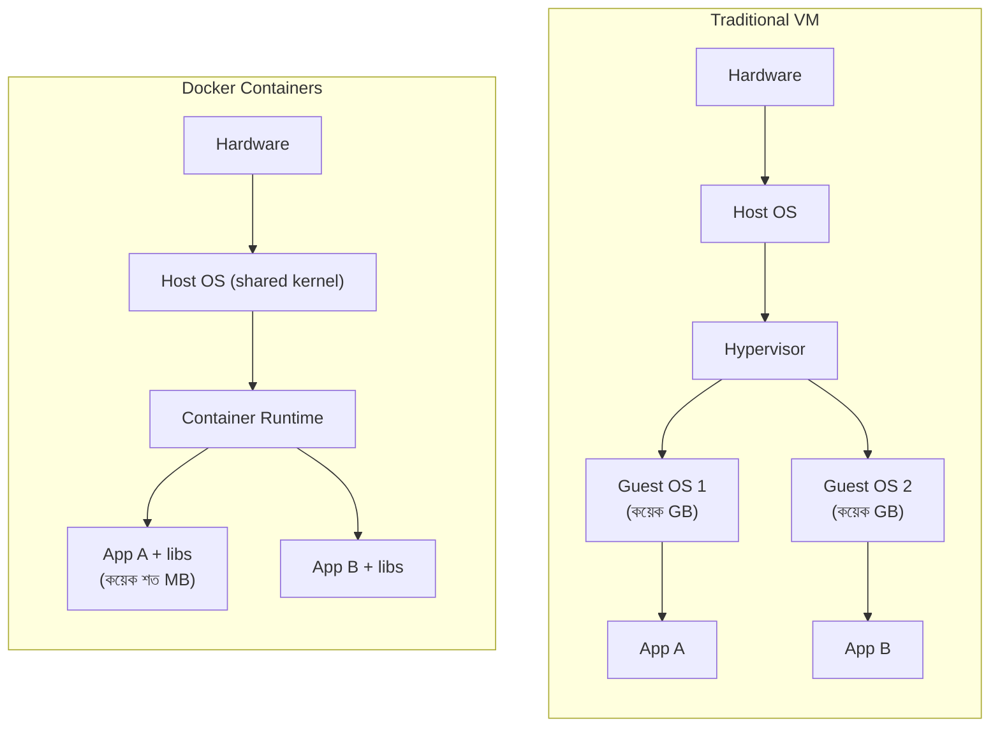
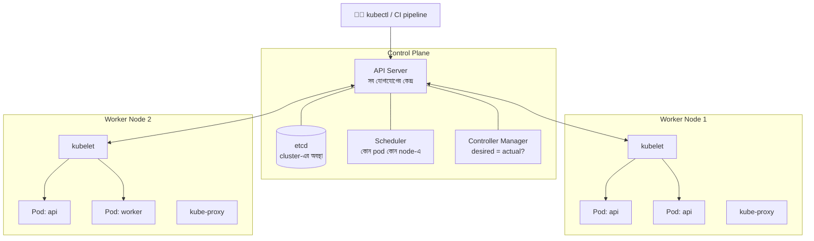
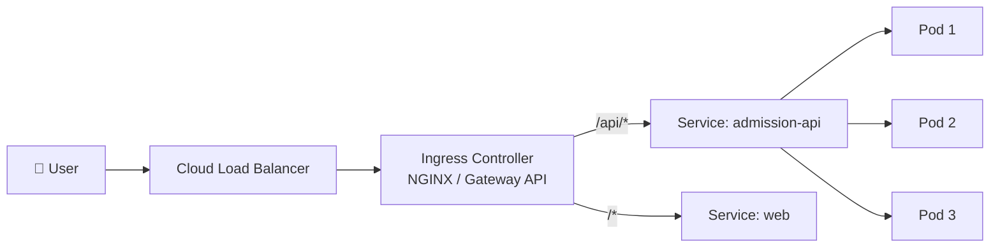
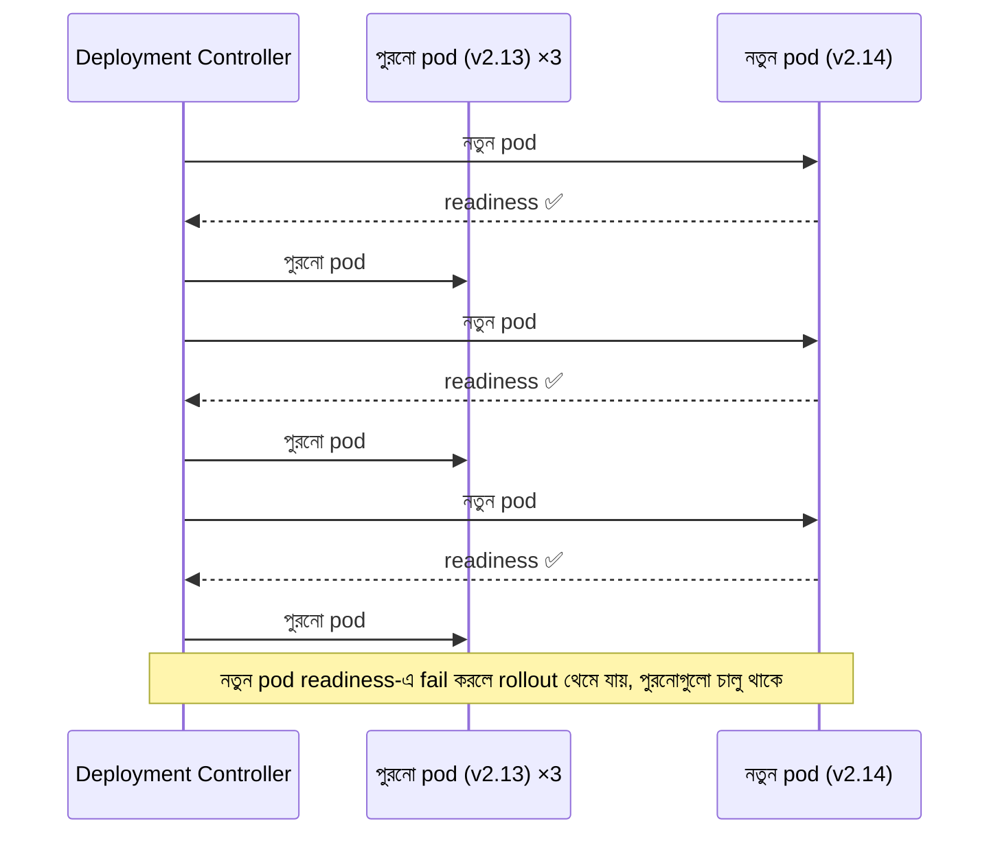
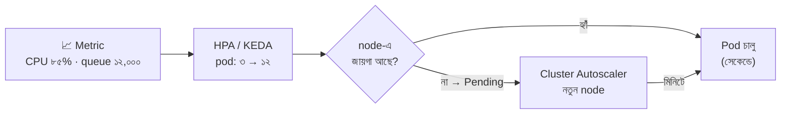

> [!GOALS]
> - Container কী সমস্যা সমাধান করে, এবং VM-এর সাথে পার্থক্য
> - একটি production-মানের Dockerfile লেখা (multi-stage, non-root, ছোট image)
> - Kubernetes-এর architecture ও মূল object
> - Probe, resource request/limit, rolling update ও PodDisruptionBudget
> - HPA, cluster autoscaler ও queue-ভিত্তিক scaling
> - কখন Kubernetes নয়, এবং AI/GPU workload-এর বিশেষ চাহিদা

> [!STORY] "আমার machine-এ তো চলে!"
> রাফির নতুন feature: ভর্তির শেষ তারিখের countdown। নিজের laptop-এ নিখুঁত। Staging server-এ deploy করার পর countdown ছয় ঘণ্টা ভুল দেখাচ্ছে, আর একটি report-এ টাকার অঙ্কে কমার জায়গায় ডট।
>
> দুই ঘণ্টা খোঁজার পর কারণ বের হলো: রাফির laptop-এর timezone ঢাকা আর culture `bn-BD`; staging server-এর timezone UTC আর culture invariant। তার উপর server-এ .NET runtime-এর একটি পুরনো patch version।
>
> রাফি হতাশ হয়ে বলল, "আমার machine-এ তো চলে!"
>
> তানভীর হেসে বললেন, "তাহলে তোমার machine-টাই production-এ পাঠিয়ে দাও।" তারপর গম্ভীর হয়ে যোগ করলেন, "আসলে ঠিক এটাই container করে। তোমার application আর তার পুরো পরিবেশ একটি বাক্সে ভরে পাঠায়, যাতে laptop, staging আর production-এ একই বাক্স চলে।"

## 13.1 Introduction

Traditional deployment-এর সবচেয়ে পুরনো সমস্যা: **"It works on my machine, but not in production!"** Development PC-তে code ঠিকভাবে চলে, কিন্তু server-এ environment mismatch, missing library, ভিন্ন OS version বা configuration-এর কারণে ভেঙে পড়ে।

এর সমাধান দুই ধাপে: **Containerization** (Docker), যা application ও তার পরিবেশ একসাথে প্যাক করে; আর **Orchestration** (Kubernetes), যা হাজারো container-কে অনেকগুলো server-এ চালায়, নষ্ট হলে আবার চালু করে, আর traffic অনুযায়ী বাড়ায়-কমায়।

## 13.2 Docker ও Container

Docker হলো একটি platform, যা application এবং তার সব dependency (runtime, library, OS-এর প্রয়োজনীয় অংশ, configuration) একটি standard unit-এ প্যাক করে: **container image**। Image থেকে চালু হওয়া চলমান instance-কে বলে **container**।



| | Virtual Machine | Container |
| --- | --- | --- |
| Isolation | শক্তিশালী (আলাদা kernel) | Process-স্তরে (একই kernel) |
| আকার | কয়েক GB | কয়েক দশ থেকে শত MB |
| চালু হতে সময় | মিনিট | সেকেন্ড |
| একটি server-এ কয়টি | কয়েকটি থেকে দশটি | দশ থেকে শত |
| উপযুক্ত | ভিন্ন OS, কঠোর isolation | Microservice, দ্রুত deploy, scaling |

**কেন Docker:**
- **Consistency:** Laptop, CI, staging, production সব জায়গায় হুবহু একই image।
- **Lightweight ও দ্রুত:** পুরো OS চালাতে হয় না; সেকেন্ডে চালু।
- **Immutable deployment:** Server-এ গিয়ে কিছু বদলানো নয়; নতুন image, নতুন container।
- **Dependency isolation:** একটি app-এর .NET 8 আর আরেকটির .NET 6 একই server-এ পাশাপাশি।

## 13.3 একটি Production-মানের Dockerfile

```dockerfile
# ---------- Build stage: SDK সহ বড় image, শুধু build-এর জন্য ----------
FROM mcr.microsoft.com/dotnet/sdk:8.0 AS build
WORKDIR /src
COPY ["Nodi.Admission.Api/Nodi.Admission.Api.csproj", "Nodi.Admission.Api/"]
# শুধু csproj আগে copy: dependency restore-এর layer cache থাকবে
RUN dotnet restore "Nodi.Admission.Api/Nodi.Admission.Api.csproj"
COPY . .
RUN dotnet publish "Nodi.Admission.Api/Nodi.Admission.Api.csproj" -c Release -o /app/publish --no-restore

# ---------- Runtime stage: শুধু runtime, ছোট ও নিরাপদ ----------
FROM mcr.microsoft.com/dotnet/aspnet:8.0 AS runtime
ENV TZ=Asia/Dhaka \
    ASPNETCORE_URLS=http://+:8080 \
    DOTNET_SYSTEM_GLOBALIZATION_INVARIANT=false
WORKDIR /app
COPY --from=build /app/publish .
# root হিসেবে নয়: .NET 8 image-এ তৈরি থাকা non-root user
USER app
EXPOSE 8080
ENTRYPOINT ["dotnet", "Nodi.Admission.Api.dll"]
```

**Image-এর ভালো অভ্যাস:**
- **Multi-stage build:** Build tool final image-এ যায় না; image ছোট, আক্রমণের পৃষ্ঠতল কম।
- **Layer ক্রম:** কম বদলায় এমন জিনিস (dependency restore) আগে, প্রায়ই বদলায় এমন (source code) পরে; build cache কাজে লাগে।
- **Non-root user।**
- **নির্দিষ্ট version tag:** `latest` নয়; `8.0` বা আরো নির্দিষ্ট digest।
- **Secret কখনো image-এ নয়:** Connection string বা API key image-এ বসালে registry-তে যার access আছে সবাই পায়। Runtime-এ environment বা secret store থেকে।
- **Image scan:** CI-তে vulnerability scan (Trivy, Docker Scout)।
- **একটি container, একটি process।**

রাফির সমস্যার সমাধান হয়েছিল ঠিক এই Dockerfile-এর `TZ` আর culture setting দিয়ে, এবং সবচেয়ে বড় কথা: এখন laptop আর server-এ একই image চলে।

### Local development: Docker Compose

```yaml
services:
  api:
    build: .
    ports: ["8080:8080"]
    environment:
      ConnectionStrings__Default: "Server=sql;Database=Admission;User Id=sa;Password=${SA_PASSWORD};TrustServerCertificate=true"
      Redis__Host: "redis:6379"
    depends_on: [sql, redis]
  sql:
    image: mcr.microsoft.com/mssql/server:2022-latest
    environment: { ACCEPT_EULA: "Y", MSSQL_SA_PASSWORD: "${SA_PASSWORD}" }
  redis:
    image: redis:7-alpine
```

নতুন developer যোগ দিলে `docker compose up`, আর পুরো system তার laptop-এ চালু। আগে যে কাজে দুই দিন লাগত (SQL Server install, Redis setup), এখন দশ মিনিট।

## 13.4 Kubernetes কেন?

Production-এ যখন অনেক service আর শত শত container, তখন প্রশ্ন আসে: কোন container কোন server-এ চলবে? একটি নষ্ট হলে কে আবার চালু করবে? Traffic বাড়লে কে নতুন copy চালাবে? নতুন version কীভাবে downtime ছাড়া আসবে? Container-এর IP বদলালে অন্যরা কীভাবে খুঁজে পাবে?

**Kubernetes (K8s)** হলো একটি open-source container orchestration platform, যা এসব স্বয়ংক্রিয়ভাবে করে। এর মূল দর্শন **desired state**: আপনি YAML-এ লিখে দেন "Admission API-র ৩টি copy চলবে, প্রতিটি ৫১২ MB memory পাবে", আর Kubernetes ক্রমাগত চেষ্টা করে বাস্তবতাকে সেই অবস্থায় রাখতে। একটি container মরলে সে নতুনটা চালায়, কেউ না বললেও (**self-healing**)।

## 13.5 Kubernetes Architecture



- **API Server:** সবকিছু এর মধ্য দিয়ে যায়: kubectl, CI, এমনকি node-গুলোও।
- **etcd:** Cluster-এর সব অবস্থা রাখা একটি distributed key-value store। এটি হারালে cluster হারায়; backup জরুরি।
- **Scheduler:** নতুন pod-কে উপযুক্ত node-এ বসায় (resource, নিয়ম দেখে)।
- **Controller Manager:** অনেকগুলো control loop, যারা desired ও actual অবস্থা মেলায়।
- **kubelet:** প্রতিটি node-এ agent, যে pod চালায় ও অবস্থা জানায়।
- **kube-proxy:** Service-এর network routing।

Managed Kubernetes (AKS, EKS, GKE) ব্যবহার করলে control plane cloud provider চালায়; আপনি শুধু worker node আর workload নিয়ে ভাবেন। বেশিরভাগ team-এর জন্য এটাই বুদ্ধিমানের কাজ।

## 13.6 মূল Kubernetes Object

| Object | কী করে | উদাহরণ |
| --- | --- | --- |
| **Pod** | সবচেয়ে ছোট unit; এক বা একাধিক container একসাথে | `admission-api` container |
| **Deployment** | Pod-এর replica সংখ্যা ও rolling update | ৩টি api pod |
| **Service** | Pod-গুলোর জন্য স্থির নাম ও IP, load balancing | `admission-api.default.svc` |
| **Ingress / Gateway** | বাইরের HTTP traffic-কে ভেতরের Service-এ route | `admission.example.com/api` |
| **ConfigMap / Secret** | Configuration ও গোপন তথ্য | Connection string (Secret) |
| **HPA** | Load অনুযায়ী pod সংখ্যা বাড়ানো-কমানো | CPU > ৬৫% হলে বাড়াও |
| **StatefulSet** | স্থির পরিচয় ও storage দরকার এমন workload | Kafka, Elasticsearch |
| **Job / CronJob** | একবারের বা নির্দিষ্ট সময়ের কাজ | রাত ২টায় archive |
| **Namespace** | Cluster-কে যৌক্তিক ভাগে ভাগ | `staging`, `production`, `team-hr` |
| **PodDisruptionBudget** | Maintenance-এ একসাথে কতগুলো pod বন্ধ হতে পারবে | কমপক্ষে ২টি চালু থাকবে |

### Request কীভাবে pod-এ পৌঁছায়



## 13.7 একটি Production Deployment-এর YAML

```yaml
apiVersion: apps/v1
kind: Deployment
metadata:
  name: admission-api
  labels: { app: admission-api }
spec:
  replicas: 3
  strategy:
    type: RollingUpdate
    rollingUpdate: { maxUnavailable: 0, maxSurge: 1 }   # একটি নতুন চালু, তারপর একটি পুরনো বন্ধ
  selector:
    matchLabels: { app: admission-api }
  template:
    metadata:
      labels: { app: admission-api }
    spec:
      containers:
        - name: api
          image: registry.example.com/nodi/admission-api:2.14.0
          ports: [{ containerPort: 8080 }]
          envFrom: [{ secretRef: { name: admission-secrets } }]
          resources:
            requests: { cpu: "250m", memory: "384Mi" }    # scheduling-এর জন্য নিশ্চিত বরাদ্দ
            limits:   { memory: "768Mi" }                 # এর বেশি নিলে OOMKilled
          readinessProbe:
            httpGet: { path: /health/ready, port: 8080 }
            periodSeconds: 5
          livenessProbe:
            httpGet: { path: /health/live, port: 8080 }
            initialDelaySeconds: 20
            periodSeconds: 10
          lifecycle:
            preStop: { exec: { command: ["sleep", "10"] } } # LB থেকে সরার সময় দেওয়া
---
apiVersion: autoscaling/v2
kind: HorizontalPodAutoscaler
metadata: { name: admission-api }
spec:
  scaleTargetRef: { apiVersion: apps/v1, kind: Deployment, name: admission-api }
  minReplicas: 3
  maxReplicas: 30
  metrics:
    - type: Resource
      resource: { name: cpu, target: { type: Utilization, averageUtilization: 65 } }
---
apiVersion: policy/v1
kind: PodDisruptionBudget
metadata: { name: admission-api }
spec:
  minAvailable: 2
  selector: { matchLabels: { app: admission-api } }
```

অধ্যায় ৯-এর liveness ও readiness এখানে probe হিসেবে, connection draining এখানে `preStop`, আর N+1 capacity এখানে `minReplicas` ও PDB।



## 13.8 Resource Request ও Limit

- **Request:** Scheduler এই পরিমাণ resource নিশ্চিত আছে এমন node খোঁজে। খুব কম দিলে একটি node-এ অতিরিক্ত pod গাদাগাদি হয়।
- **Memory limit:** এর বেশি memory নিলে container **OOMKilled** (Out Of Memory) হয়ে restart।
- **CPU limit:** এর বেশি CPU চাইলে container মারা যায় না, কিন্তু **throttle** হয়: ধীর হয়ে যায়, প্রায়ই রহস্যজনক latency spike-এর কারণ। অনেক team CPU limit না দিয়ে শুধু request দেয়।

> [!CASE] নদী টেকের OOMKilled রহস্য
> Kubernetes-এ যাওয়ার পর প্রথম সপ্তাহে report worker প্রতি কয়েক ঘণ্টায় restart হচ্ছিল। Log-এ কোনো error নেই। `kubectl describe pod` দেখাল: **`Last State: Terminated, Reason: OOMKilled`**। বড় Excel report তৈরির সময় worker পুরো data memory-তে তুলছিল, আর memory limit ছিল ৫১২ MB। সমাধান দুই দিক থেকে: (১) report streaming-এ লেখা (পুরো data একসাথে memory-তে নয়), (২) worker-এর limit ১.৫ GB, আর বড় report-এর জন্য আলাদা queue ও আলাদা worker pool। শিক্ষা: container-এর ভেতরে application জানে না তার কতটুকু memory বরাদ্দ; runtime-কে container-সচেতন করে configure করুন, আর restart-এর কারণ সবসময় `describe` দিয়ে দেখুন।

## 13.9 Autoscaling-এর স্তর

| স্তর | কী বাড়ায় | কিসের ভিত্তিতে |
| --- | --- | --- |
| **HPA** | Pod-এর সংখ্যা | CPU, memory, custom metric (RPS) |
| **KEDA** | Pod-এর সংখ্যা (শূন্য থেকেও) | Queue-র দৈর্ঘ্য, Kafka lag, cron |
| **VPA** | প্রতিটি pod-এর request/limit | ঐতিহাসিক ব্যবহার |
| **Cluster Autoscaler / Karpenter** | Node-এর সংখ্যা | Pod বসানোর জায়গা না থাকলে |



**Real Production Story: Scaling with K8s।** একটি e-commerce site-এ campaign-এর সময় হঠাৎ ১০ গুণ traffic আসত, server CPU ১০০% হয়ে crash করত। Kubernetes-এর HPA দিয়ে CPU ৭০%-এর বেশি হলে স্বয়ংক্রিয়ভাবে নতুন pod তৈরির ব্যবস্থা করা হয়, আর cluster autoscaler প্রয়োজনে নতুন node আনে। Campaign শেষে traffic কমলে pod ও node নিজে থেকেই কমে যায়, খরচও।

> [!WARNING]
> নতুন node আসতে কয়েক মিনিট, নতুন pod ready হতে আরো কিছু সময়। হঠাৎ spike-এ (৯টার result) reactive autoscaling দেরিতে পৌঁছায়। জানা peak-এর জন্য scheduled scaling বা আগে থেকে `minReplicas` বাড়িয়ে রাখুন। আর মনে রাখবেন: pod ৩০টি হলে database-এর connection-ও ৩০ গুণ (অধ্যায় ৫)।

## 13.10 Stateful workload: Database কি Kubernetes-এ?

Kubernetes stateless application-এর জন্য চমৎকার। Database-ও StatefulSet দিয়ে চালানো যায়, এবং অভিজ্ঞ team তা করে। কিন্তু backup, failover, upgrade, storage performance সব নিজের দায়িত্ব। ছোট ও মাঝারি team-এর জন্য সাধারণ পরামর্শ: **application Kubernetes-এ, database managed service-এ** (Azure SQL, RDS, Cloud SQL)।

> [!CASE] OpenAI, ডিসেম্বর ২০২৪: control plane যখন বোঝা বহন করতে পারে না
> ২০২৪ সালের ১১ ডিসেম্বর OpenAI-এর ChatGPT, API ও অন্যান্য service কয়েক ঘণ্টা ব্যাপকভাবে বিঘ্নিত হয়। তাদের প্রকাশিত postmortem অনুযায়ী একটি নতুন telemetry service deploy করা হয়েছিল, যার configuration-এর কারণে বড় বড় Kubernetes cluster-এর প্রতিটি node একসাথে Kubernetes API server-এ ভারী অনুরোধ পাঠাতে শুরু করে। API server-গুলো অতিরিক্ত চাপে বসে পড়ে, আর তার সাথে DNS-ভিত্তিক service discovery-ও ভেঙে যায়, ফলে service-গুলো একে অপরকে খুঁজে পাচ্ছিল না। Recovery কঠিন হয়েছিল কারণ সমস্যাযুক্ত deployment সরাতে যে Kubernetes API দরকার, সেটাই অচল ছিল।
>
> **শিক্ষা:** (১) Control plane-ও একটি shared resource, যার ক্ষমতা সীমিত; cluster-এর সব node-এ চলা জিনিস (DaemonSet, agent) সবচেয়ে ঝুঁকিপূর্ণ। (২) Staging-এ ছোট cluster-এ যা নিরীহ, বড় production cluster-এ তা বিপর্যয় হতে পারে; ধাপে ধাপে, ছোট অংশে rollout। (৩) "ভাঙা system সারাতে ভাঙা system লাগে" ধরনের circular dependency খুঁজে বের করুন, অধ্যায় ৯-এর Facebook ঘটনার মতোই।

## 13.11 কখন Kubernetes নয়

Kubernetes শক্তিশালী, কিন্তু নিজেই একটি জটিল distributed system। Upgrade, networking, security policy, storage, monitoring: সবকিছুর জন্য দক্ষতা লাগে।

| পরিস্থিতি | বিকল্প |
| --- | --- |
| ২-৫টি service, ছোট team | Azure App Service, AWS App Runner / ECS Fargate, Google Cloud Run |
| শুধু background job ও API | Serverless function বা container app platform |
| এক-দুটি server-এ চলা internal app | Docker Compose + ভালো backup ও monitoring |
| অনেক team, অনেক service, নিজস্ব platform team আছে | Managed Kubernetes |

> [!ARCHITECT] নদী টেকের সিদ্ধান্ত
> নুসরাত Admission Portal-এর জন্য managed Kubernetes (AKS) বেছে নিলেন, কারণ result day-র ১,০০০ গুণ spike, অনেকগুলো worker, আর নদী টেকের অন্য product-গুলোও একই platform-এ আসবে; তানভীরের team সেটা চালাবে। কিন্তু একটি ছোট client project-এর জন্য, যেখানে মাত্র একটি API আর ২০০ user, তিনি পরামর্শ দিলেন App Service। "Tool বাছাই করো সমস্যার আকার দেখে, CV-র আকার দেখে নয়।"

## 13.12 Production Readiness Checklist

- [ ] Image ছোট, non-root, নির্দিষ্ট tag, vulnerability scan পাস
- [ ] Readiness ও liveness probe আলাদা; `preStop` দিয়ে draining
- [ ] Resource request সব container-এ; memory limit যুক্তিসঙ্গত
- [ ] `replicas ≥ 2`, PDB, pod anti-affinity (একই node-এ সব নয়)
- [ ] HPA ও cluster autoscaler; জানা peak-এর জন্য scheduled scaling
- [ ] Secret, ConfigMap; image-এ কোনো secret নেই
- [ ] Namespace, RBAC, network policy (কে কার সাথে কথা বলতে পারবে)
- [ ] Logs, metrics, traces cluster থেকে বাইরে যাচ্ছে (অধ্যায় ১২)
- [ ] etcd বা cluster config-এর backup; disaster recovery পরীক্ষিত

## 13.13 AI কোণ: GPU, model serving ও AI-লেখা YAML

> [!AI] Kubernetes-এ AI workload
> **GPU scheduling:** GPU node আলাদা node pool-এ রাখা হয়, taint দিয়ে চিহ্নিত, যাতে সাধারণ pod সেখানে বসে দামি GPU নষ্ট না করে। Pod `nvidia.com/gpu: 1` চেয়ে নেয়। GPU node সাধারণ node-এর চেয়ে বহুগুণ দামি, তাই autoscaling ও "শূন্যে নামানো" খুব গুরুত্বপূর্ণ।
>
> **Model serving:** vLLM, Text Generation Inference বা KServe-এর মতো tool দিয়ে model serve করা হয়। Model-এর আকার কয়েক থেকে কয়েকশো GB হতে পারে; image-এ না রেখে আলাদা storage থেকে load করা হয়, তাই নতুন pod চালু হতে মিনিট লাগে (cold start)। ফলে warm replica রাখতে হয়, আর scaling হয় GPU-র ব্যবহার বা request queue দেখে, CPU দেখে নয়।
>
> **AI-লেখা YAML:** AI assistant দিয়ে Kubernetes manifest বা Dockerfile লেখানো খুব দ্রুত। কিন্তু সাধারণ ভুলগুলো দেখে নিন: resource request নেই, probe নেই, `latest` tag, root user, secret সরাসরি YAML-এ। Policy-as-code tool (যেমন Kyverno, OPA Gatekeeper) দিয়ে cluster-এ এই নিয়মগুলো বাধ্যতামূলক করলে মানুষ বা AI, কেউই ভুল manifest ঢোকাতে পারবে না।

## 13.14 সাধারণ ভুল

- Image-এ secret, root user, `latest` tag।
- Probe নেই বা ভুল probe (অধ্যায় ৯)।
- Resource request নেই, ফলে node গাদাগাদি; অথবা কঠোর CPU limit, ফলে throttling।
- একটি replica, PDB নেই; node maintenance-এ downtime।
- Database-কে না বুঝে StatefulSet-এ চালানো, backup ছাড়া।
- ছোট সমস্যার জন্য Kubernetes।
- Cluster-এর সব node-এ চলা agent ও DaemonSet-এর প্রভাব না ভেবে deploy।

## 13.15 Interview প্রশ্ন

> [!INTERVIEW]
> 1. Container ও VM-এর পার্থক্য কী?
> 2. Multi-stage Docker build কেন ব্যবহার করবেন?
> 3. Kubernetes-এর control plane-এর component-গুলো কী কী, কে কী করে?
> 4. Pod, Deployment ও Service-এর সম্পর্ক কী?
> 5. Liveness ও readiness probe-এর পার্থক্য কী?
> 6. Resource request ও limit কী? OOMKilled ও CPU throttling কেন হয়?
> 7. HPA কীভাবে কাজ করে? Queue-ভিত্তিক worker কীভাবে scale করবেন?
> 8. কোন পরিস্থিতিতে আপনি Kubernetes ব্যবহার না করার পরামর্শ দেবেন?

## 13.16 নিজে করে দেখুন

> [!EXERCISE] Admission Portal-কে container-এ
> 1. Admission API, Notification worker ও Report worker-এর জন্য Dockerfile-এর রূপরেখা লিখুন।
> 2. প্রতিটির জন্য Deployment-এর replica, resource ও probe ঠিক করুন।
> 3. Report worker-এর scaling কিসের ভিত্তিতে হবে (CPU না queue)?
> 4. ৯টার result-এর জন্য scaling পরিকল্পনা লিখুন (কখন কতগুলো pod)।
> 5. Database কোথায় চলবে এবং কেন?

## 13.17 Chapter Summary

- **Container:** Application ও পরিবেশ একসাথে; "আমার machine-এ চলে" সমস্যার সমাধান।
- **Dockerfile:** Multi-stage, non-root, নির্দিষ্ট tag, কোনো secret নয়।
- **Kubernetes:** Desired state ও self-healing; control plane সিদ্ধান্ত নেয়, kubelet চালায়।
- **মূল object:** Pod, Deployment, Service, Ingress, ConfigMap/Secret, HPA, PDB।
- **Resource:** Request scheduling-এর জন্য; memory limit পেরোলে OOMKilled, CPU limit-এ throttling।
- **Autoscaling:** HPA, KEDA, cluster autoscaler; জানা peak-এ আগাম scaling।
- **বিবেচনা:** Database সাধারণত managed service-এ; ছোট সমস্যায় Kubernetes নয়।
- **AI:** GPU node pool, ধীর cold start, model serving tool, আর policy দিয়ে নিরাপদ manifest।

> [!ARCHITECT] নুসরাতের নোটবুক · Container যাত্রা
> সব service এখন একই image দিয়ে laptop থেকে production পর্যন্ত। "আমার machine-এ চলে" ধরনের bug এক মাসে শূন্য। OOMKilled থেকে শেখা: report streaming। Result day-র জন্য ৮:৩০-এ scheduled scale-up (api ৩ → ২০ pod), ১১টায় নামানো। পরের প্রশ্ন: আমরা দিনে একবার deploy করতেও ভয় পাই। Kubernetes deploy সহজ করেছে, কিন্তু ভুল জিনিস deploy হওয়া কে আটকাবে?
