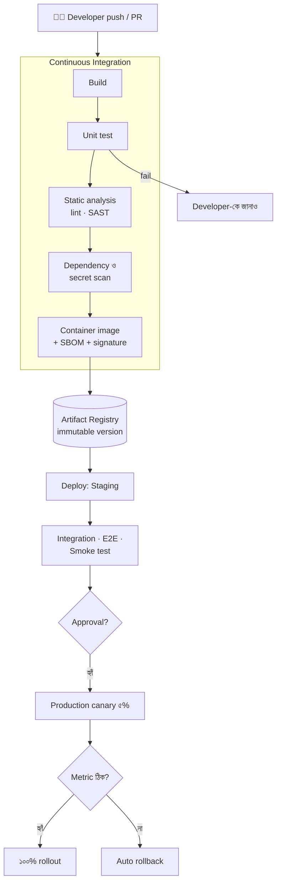
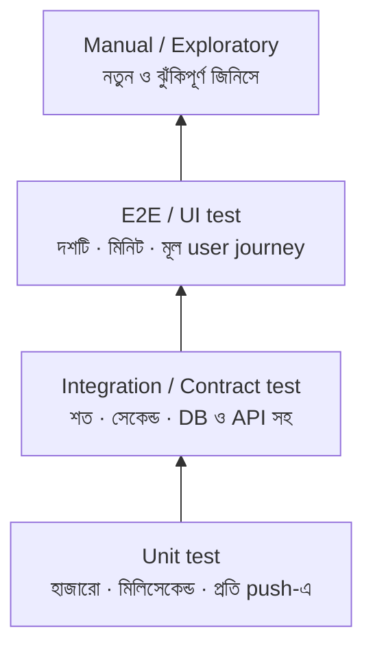
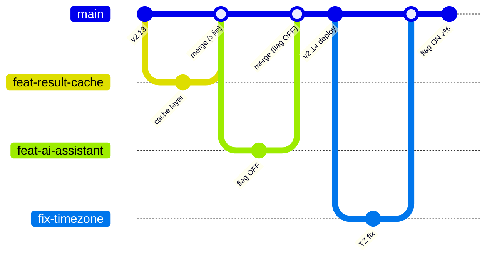
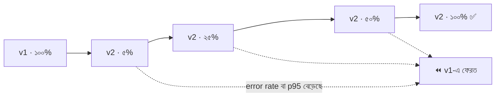
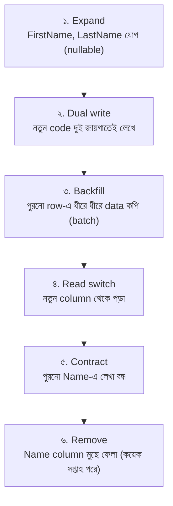

> [!GOALS]
> - CI, Continuous Delivery ও Continuous Deployment-এর পার্থক্য
> - একটি পূর্ণাঙ্গ pipeline-এর ধাপ ও একটি বাস্তব workflow
> - Testing pyramid ও trunk-based development
> - Rolling, blue-green, canary: কখন কোনটা, আর metric দেখে স্বয়ংক্রিয় rollback
> - Feature flag দিয়ে deploy ও release আলাদা করা
> - Zero-downtime database migration (expand-contract)
> - GitOps, Infrastructure as Code, DORA metric ও supply chain security
> - Knight Capital ও CrowdStrike থেকে শিক্ষা

> [!STORY] শুক্রবার সন্ধ্যার deploy
> নদী টেকে deploy মানে ছিল একটি ritual। শুক্রবার সন্ধ্যা সাতটা, যখন user কম। একজন developer Remote Desktop দিয়ে production server-এ ঢোকেন, IIS বন্ধ করেন, zip file থেকে নতুন file copy করেন, `web.config` হাতে মিলিয়ে দেখেন, তারপর প্রার্থনা করে IIS চালু করেন।
>
> এক শুক্রবার তিনটি server-এর মধ্যে দুটিতে নতুন file গেল, তৃতীয়টিতে ভুলে বাকি রইল। আর একটি নতুন config key কেউ production-এর `web.config`-এ যোগ করতে ভুলে গেল। শনিবার সকালে এক তৃতীয়াংশ user পুরনো version পাচ্ছিলেন, বাকিরা একটি error page।
>
> সোমবার করিম সাহেব ঘোষণা দিলেন: "এখন থেকে শুক্রবারে deploy নিষিদ্ধ। আর deploy করার আগে আমার অনুমতি লাগবে।"
>
> সেদিন বিকেলে নুসরাত করিম সাহেবের ঘরে গেলেন। "ভাই, deploy করতে ভয় পাওয়া একটা সংকেত। সংকেতটা বলছে আমাদের deploy প্রক্রিয়া বিপজ্জনক। নিয়ম দিয়ে ভয় কমবে না, deploy কম হবে, প্রতিটি deploy আরো বড় হবে, আরো বিপজ্জনক হবে। আমাদের লক্ষ্য হওয়া উচিত deploy এত সাধারণ আর নিরাপদ করা যে সেটা নিয়ে কেউ আর ভাবেই না।"

## 14.1 Introduction

একসময় software deploy মানে ছিল ভয়ের ব্যাপার: server বন্ধ, file হাতে copy, ভুল হলে হাতে rollback। আধুনিক system-এ এই পুরো প্রক্রিয়া স্বয়ংক্রিয় করা হয় **CI/CD** দিয়ে, আর লক্ষ্য হলো deploy-কে **একঘেয়ে রকমের সাধারণ (boring)** করা।

## 14.2 CI, CD ও CD

| | কী | শেষ ধাপ |
| --- | --- | --- |
| **Continuous Integration (CI)** | প্রতিটি push-এ স্বয়ংক্রিয় build ও test; সবার code দিনে একাধিকবার মূল branch-এ মেলানো | পরীক্ষিত artifact |
| **Continuous Delivery** | প্রতিটি সফল build যেকোনো সময় production-এ পাঠানোর জন্য প্রস্তুত; শেষ ধাপে মানুষের একটি click | মানুষের অনুমোদনে production |
| **Continuous Deployment** | সব test ও check পাস করলে মানুষের হস্তক্ষেপ ছাড়াই production-এ | স্বয়ংক্রিয় production |

## 14.3 Pipeline Architecture



**মূল নীতি:**
- **একবার build, সব জায়গায় deploy:** Staging আর production-এ হুবহু একই image (অধ্যায় ১৩); environment-এর পার্থক্য শুধু configuration-এ।
- **দ্রুত feedback:** Push-এর ১০ মিনিটের মধ্যে developer জানবে কিছু ভেঙেছে কি না।
- **Pipeline-ই একমাত্র পথ:** Production-এ হাতে কোনো পরিবর্তন নয়। কেউ server-এ RDP করে file বদলাবে না।

## 14.4 একটি বাস্তব Workflow (GitHub Actions)

```yaml
name: admission-api
on:
  push: { branches: [main] }
  pull_request:
jobs:
  build-test:
    runs-on: ubuntu-latest
    steps:
      - uses: actions/checkout@v4
      - uses: actions/setup-dotnet@v4
        with: { dotnet-version: "8.0.x" }
      - run: dotnet restore
      - run: dotnet build --no-restore -c Release
      - run: dotnet test --no-build -c Release --collect:"XPlat Code Coverage"
      - name: Vulnerable package check
        run: dotnet list package --vulnerable --include-transitive
  image:
    needs: build-test
    if: github.ref == 'refs/heads/main'
    runs-on: ubuntu-latest
    steps:
      - uses: actions/checkout@v4
      - name: Build & push image
        run: |
          docker build -t $REGISTRY/admission-api:${{ github.sha }} .
          docker push $REGISTRY/admission-api:${{ github.sha }}
      - name: Update staging manifest (GitOps)
        run: ./scripts/bump-image.sh staging admission-api ${{ github.sha }}
```

Image tag হিসেবে git commit SHA: প্রতিটি deploy ঠিক কোন code থেকে এসেছে, তা সবসময় জানা যায়।

## 14.5 Testing Pyramid



- **Unit test:** একটি function বা class; দ্রুত ও নির্ভরযোগ্য।
- **Integration test:** আসল database (container-এ, Testcontainers দিয়ে) ও আসল HTTP পথ।
- **Contract test:** Service A যা পাঠায় আর Service B যা আশা করে, মিলছে কি না (microservice-এ জরুরি)।
- **E2E test:** "ভর্তি ফর্ম জমা → payment → রসিদ"-এর মতো কয়েকটি গুরুত্বপূর্ণ journey।
- **Performance / Load test:** Release-এর আগে নিয়মিত (অধ্যায় ২-এর ১,০০০ RPS লক্ষ্য)।

## 14.6 Branching: Trunk-Based Development

দীর্ঘদিনের feature branch (দুই সপ্তাহ, এক মাস) মানে merge-এর দিন বিশাল সংঘর্ষ ও বড় ঝুঁকি। আধুনিক পরামর্শ **trunk-based development**: ছোট, স্বল্পস্থায়ী branch (এক-দুই দিন), দ্রুত code review, ঘন ঘন `main`-এ merge। অসম্পূর্ণ feature লুকিয়ে রাখা হয় **feature flag** দিয়ে (১৪.৮)। গবেষণায় (DORA) উচ্চ-কার্যকর team-গুলোর একটি সাধারণ বৈশিষ্ট্য এটি।



## 14.7 Deployment Strategy

| Strategy | কীভাবে | সুবিধা | অসুবিধা |
| --- | --- | --- | --- |
| **Recreate** | পুরনো সব বন্ধ, নতুন চালু | সহজ | Downtime |
| **Rolling** | একটি একটি করে instance বদলানো | Downtime নেই, অতিরিক্ত infra কম | কিছু সময় দুই version একসাথে; rollback ধীর |
| **Blue-Green** | দুটি পূর্ণ environment; traffic একবারে switch | তাৎক্ষণিক rollback | দ্বিগুণ infra; database-এর পরিবর্তন জটিল |
| **Canary** | নতুন version প্রথমে অল্প user (১-৫%), metric দেখে ধাপে ধাপে বাড়ানো | ঝুঁকি সবচেয়ে কম, বাস্তব traffic-এ যাচাই | Tooling ও ভালো metric লাগে |
| **Shadow** | আসল traffic-এর copy নতুন version-এ, কিন্তু উত্তর ব্যবহার হয় না | User-এর কোনো ঝুঁকি নেই | Side effect (payment, SMS) সাবধানে বন্ধ রাখতে হয় |



**Metric-ভিত্তিক স্বয়ংক্রিয় যাচাই:** প্রতিটি ধাপে কয়েক মিনিট অপেক্ষা করে নতুন version-এর error rate, p95 latency, এবং business metric (যেমন সফল checkout-এর হার) পুরনোটার সাথে তুলনা। খারাপ হলে মানুষের অপেক্ষা না করে rollback (Argo Rollouts, Flagger)।

**Real Production Insight: Zero Downtime।** একটি banking application-এ প্রতিটি update-এ ১০ মিনিট downtime থাকত, তাই update হতো মাসে একবার, রাত দুইটায়। CI/CD pipeline আর Kubernetes-এর rolling update (অধ্যায় ১৩-এর `maxUnavailable: 0` ও readiness probe) চালুর পর পুরনো pod এক এক করে বন্ধ হয়, নতুন pod চালু হয়, user কোনো downtime অনুভব করেন না। Deploy এখন সপ্তাহে কয়েকবার, অফিস সময়ে, যখন team জেগে আছে।

## 14.8 Feature Flag: Deploy ও Release আলাদা

**Deploy** মানে code production-এ পৌঁছানো। **Release** মানে user-রা feature দেখতে পাওয়া। Feature flag এই দুটিকে আলাদা করে।

```csharp
if (await _flags.IsEnabledAsync("ai-admission-assistant", user))
    return await _assistant.AnswerAsync(question);
return await _faq.SearchAsync(question);
```

**ব্যবহার:**
- **ধাপে ধাপে release:** প্রথমে শুধু নদী টেকের কর্মীদের, তারপর একটি ক্যাম্পাস, তারপর সবাই।
- **Kill switch:** নতুন AI সহায়ক অদ্ভুত উত্তর দিচ্ছে? Deploy ছাড়াই এক click-এ বন্ধ।
- **Trunk-based development:** অসম্পূর্ণ code `main`-এ থাকে, flag বন্ধ।
- **A/B test।**

> [!WARNING]
> Feature flag-এর ঋণ (flag debt) জমে। পুরনো flag code-এ পড়ে থাকলে if-else-এর জঙ্গল তৈরি হয়, আর ভুলে কেউ পুরনো flag চালু করলে বিপদ (নিচের Knight Capital দেখুন)। প্রতিটি flag-এর একজন মালিক ও মেয়াদ রাখুন; feature স্থায়ী হলে flag সরিয়ে ফেলুন।

> [!CASE] Knight Capital, ১ আগস্ট ২০১২: ৪৫ মিনিটে ৪৪ কোটি ডলার
> Knight Capital ছিল আমেরিকার অন্যতম বড় শেয়ার ট্রেডিং প্রতিষ্ঠান। একটি নতুন feature-এর জন্য তারা তাদের trading system-এ নতুন code deploy করে, এবং একটি পুরনো, বহু বছর অব্যবহৃত feature-এর flag-কে নতুন কাজে পুনর্ব্যবহার করে। মার্কিন SEC-এর তদন্ত অনুযায়ী deploy হাতে করা হয়েছিল, আর **আটটি server-এর একটিতে নতুন code পৌঁছায়নি**। বাজার খোলার পর flag চালু হলে সাতটি server নতুন আচরণ করল, কিন্তু অষ্টমটিতে পুরনো, মৃত code জেগে উঠে নিয়ন্ত্রণহীনভাবে লাখ লাখ অর্ডার পাঠাতে লাগল। প্রায় ৪৫ মিনিটে প্রতিষ্ঠানটির ক্ষতি দাঁড়ায় প্রায় ৪৪ কোটি ডলার; কয়েক দিনের মধ্যে প্রতিষ্ঠানটিকে উদ্ধার করতে বাইরের বিনিয়োগ লাগে এবং পরে অন্য প্রতিষ্ঠানের সাথে একীভূত হয়।
>
> **শিক্ষা:** (১) হাতে deploy মানে মানুষের ভুলের সুযোগ; গল্পের "তিনটির মধ্যে দুটি server" ঠিক এই ভুল। (২) মৃত code মুছে ফেলুন; flag পুনর্ব্যবহার করবেন না। (৩) Deploy-এর পর সব instance একই version চালাচ্ছে কি না, স্বয়ংক্রিয়ভাবে যাচাই করুন। (৪) অস্বাভাবিক আচরণে দ্রুত থামানোর একটি kill switch রাখুন।

## 14.9 Database Migration: Zero-Downtime Schema Change

Application rolling update-এ কিছু সময় পুরনো ও নতুন version একসাথে চলে, দুজনেই একই database ব্যবহার করে। তাই schema পরিবর্তন এমন হতে হবে যাতে **দুই version-ই কাজ করে**। এর কৌশল **Expand-Contract** (Parallel Change)।

উদাহরণ: `Students.Name` column-কে `FirstName` ও `LastName`-এ ভাগ করা।



**অন্যান্য নিয়ম:**
- বড় table-এ index তৈরি online মোডে (`ONLINE = ON`, PostgreSQL-এ `CONCURRENTLY`)।
- কোটি row-এর update এক transaction-এ নয়, ছোট batch-এ।
- Migration script version-controlled ও pipeline দিয়ে চলে (EF Core migrations, Flyway, Liquibase)।
- Column মুছে ফেলা বা নাম বদলানো সবসময় শেষ ধাপে, আলাদা release-এ।

## 14.10 Rollback, Roll-forward ও GitOps

- **Rollback:** আগের image-এ ফেরা। Immutable artifact থাকলে এটা এক command। কিন্তু database migration-এর পরে rollback জটিল, এজন্যই expand-contract।
- **Roll-forward:** ছোট সমস্যায় দ্রুত একটি fix deploy করা। দ্রুত pipeline থাকলে প্রায়ই সহজ।
- **GitOps:** Production-এর desired state (কোন service-এর কোন version, কতগুলো replica) একটি git repository-তে থাকে। Argo CD বা Flux সেটা cluster-এর সাথে মিলিয়ে রাখে। ফলে প্রতিটি পরিবর্তন একটি pull request, review করা, ইতিহাস থাকা, আর rollback মানে একটি git revert।
- **Infrastructure as Code (IaC):** Server, network, database, DNS সবকিছু Terraform, Bicep বা Pulumi দিয়ে code হিসেবে। নতুন environment বানানো এক command; হাতে click করে তৈরি "রহস্যময় server" আর নয়।

## 14.11 Supply Chain Security

আপনার application-এর ৯০% code সম্ভবত আপনার লেখা নয়: open-source library, base image, build tool। Pipeline-এ:
- **Dependency scanning** ও automated update (Dependabot, Renovate)।
- **Secret scanning:** ভুল করে push হওয়া key ধরা।
- **SBOM (Software Bill of Materials):** প্রতিটি image-এ কোন কোন library-র কোন version আছে; পরের Equifax-ধরনের দুর্বলতায় (অধ্যায় ৮) মিনিটে খুঁজে পাওয়া যাবে কোথায় কোথায় ঝুঁকি।
- **Signed artifact:** Image-এ signature (Sigstore/cosign), cluster শুধু signed image চালাবে।
- **Least privilege pipeline:** CI-র credential যেন পুরো cloud account-এর চাবি না হয়।

> [!CASE] CrowdStrike, ১৯ জুলাই ২০২৪: একটি update, লাখ লাখ নীল screen
> ২০২৪ সালের ১৯ জুলাই cybersecurity প্রতিষ্ঠান CrowdStrike তাদের Falcon sensor-এর জন্য একটি "content update" (নতুন আক্রমণ শনাক্তের configuration) প্রকাশ করে। Microsoft-এর হিসাব অনুযায়ী প্রায় **৮৫ লাখ Windows computer** crash করে নীল screen-এ আটকে যায়: বিমানবন্দর, হাসপাতাল, ব্যাংক, টিভি চ্যানেল বিশ্বজুড়ে অচল হয়ে পড়ে। CrowdStrike-এর প্রকাশিত পর্যালোচনা অনুযায়ী এই ধরনের content update-এর ক্ষেত্রে যাচাই প্রক্রিয়ায় একটি ত্রুটি সমস্যাটি ধরতে পারেনি, আর update একসাথে সব গ্রাহকের কাছে পাঠানো হয়েছিল। অনেক computer-এ সমাধানের জন্য মানুষকে সশরীরে গিয়ে হাতে ঠিক করতে হয়েছিল। এরপর প্রতিষ্ঠানটি content update-এর জন্যও staged rollout ও গ্রাহকের নিয়ন্ত্রণ যোগ করার কথা জানায়।
>
> একই ধরনের শিক্ষা পাওয়া যায় **Cloudflare-এর জুলাই ২০১৯-এর** ঘটনা থেকে: একটি নতুন WAF rule-এর regular expression সারা বিশ্বের server-এ একসাথে deploy হয়ে CPU ১০০%-এ নিয়ে যায়, প্রায় আধঘণ্টা তাদের network-এর বড় অংশ অচল থাকে।
>
> **শিক্ষা:** "এটা তো শুধু configuration, code নয়" ভাবনা বিপজ্জনক। Configuration, rule, prompt, model: যা কিছু production-এর আচরণ বদলায়, সবকিছুর জন্য একই নিয়ম: test, ধাপে ধাপে rollout (canary), দ্রুত rollback।

## 14.12 DORA Metric: আমরা কতটা ভালো করছি?

Google-এর DORA (DevOps Research and Assessment) গবেষণা software delivery-র কার্যকারিতা মাপতে চারটি metric প্রতিষ্ঠিত করেছে:

| Metric | প্রশ্ন | উচ্চ-কার্যকর team (মোটামুটি) |
| --- | --- | --- |
| **Deployment Frequency** | কত ঘন ঘন production-এ deploy? | দিনে একাধিকবার, প্রয়োজনমতো |
| **Lead Time for Changes** | Commit থেকে production পর্যন্ত কত সময়? | এক দিনের কম |
| **Change Failure Rate** | কত শতাংশ deploy সমস্যা তৈরি করে? | কম (সাধারণত ১৫%-এর নিচে) |
| **Time to Restore Service** | সমস্যা হলে কত দ্রুত ঠিক? | এক ঘণ্টার কম |

গবেষণার একটি গুরুত্বপূর্ণ ফলাফল: **গতি আর স্থিতিশীলতা পরস্পরবিরোধী নয়।** যারা ঘন ঘন ছোট deploy করে, তাদের failure rate-ও কম, কারণ প্রতিটি পরিবর্তন ছোট, বোঝা সহজ, আর ফেরানো সহজ। করিম সাহেবের "শুক্রবার নিষিদ্ধ" নিয়মের ঠিক উল্টো দিক।

## 14.13 AI কোণ: Pipeline-এ AI, এবং AI-এর জন্য pipeline

> [!AI] Prompt ও model-ও deploy হয়
> **AI দিয়ে pipeline:** AI code review (PR-এ সম্ভাব্য bug, security সমস্যা, test-এর অভাব চিহ্নিত করা), test case-এর খসড়া তৈরি, ব্যর্থ build-এর log পড়ে সম্ভাব্য কারণ বলা: এগুলো এখন প্রচলিত ও সত্যিই কাজের। কিন্তু AI দিয়ে code লেখার গতি বাড়লে review-এর বোঝাও বাড়ে। "AI লিখেছে" মানে "কেউ বুঝেছে" নয়; merge-এর দায় মানুষের (অধ্যায় ১৭)।
>
> **AI feature-এর জন্য pipeline:** LLM-ভিত্তিক feature-এ আচরণ বদলায় শুধু code-এ নয়: **prompt, model version, retrieval-এর document, temperature**: সবকিছুতে। CrowdStrike-এর শিক্ষা এখানেও প্রযোজ্য: "শুধু prompt-এ একটা লাইন বদলেছি" production-এ অপ্রত্যাশিত আচরণ আনতে পারে। তাই:
> - Prompt ও model configuration version-controlled, code-এর মতো review।
> - CI-তে **evaluation suite**: শত শত প্রশ্ন-উত্তরের একটি সংগ্রহ, যেখানে নতুন prompt বা model-এর উত্তরের মান মাপা হয় (সঠিকতা, নিয়ম মানা, নিষিদ্ধ বিষয় এড়ানো)। মান কমলে pipeline থামবে (অধ্যায় ১৫)।
> - Model provider নতুন version দিলে সেটাও canary-র মতো: অল্প traffic, তুলনা, তারপর সবাই।
> - Feature flag দিয়ে AI সহায়কের kill switch।

## 14.14 সাধারণ ভুল

- হাতে deploy, server-এ সরাসরি পরিবর্তন।
- প্রতিটি environment-এর জন্য আলাদা build।
- ধীর pipeline (৪০ মিনিট), ফলে developer অপেক্ষা করে না, ঘুরে যায়।
- অস্থির (flaky) test উপেক্ষা করা, ফলে সবাই "আবার চালাও" অভ্যাসে।
- Database migration-কে rollback-যোগ্য না ভাবা।
- Configuration ও rule-কে "code নয়" ভেবে পরীক্ষা ছাড়া ছড়িয়ে দেওয়া।
- Feature flag জমতে দেওয়া।
- Deploy-এর পর verification নেই।

## 14.15 Interview প্রশ্ন

> [!INTERVIEW]
> 1. Continuous Delivery ও Continuous Deployment-এর পার্থক্য কী?
> 2. Blue-green ও canary deployment-এর পার্থক্য ও trade-off কী?
> 3. Feature flag কেন ব্যবহার করবেন? এর ঝুঁকি কী?
> 4. একটি column-এর নাম zero downtime-এ কীভাবে বদলাবেন?
> 5. "Build once, deploy everywhere" কেন গুরুত্বপূর্ণ?
> 6. DORA-র চারটি metric কী?
> 7. GitOps কী এবং এর সুবিধা কী?
> 8. Canary-তে স্বয়ংক্রিয় rollback-এর জন্য কোন metric দেখবেন?

## 14.16 নিজে করে দেখুন

> [!EXERCISE] Admission Portal-এর Release Plan
> Result day-র দুই সপ্তাহ আগে আপনাকে নতুন "AI ভর্তি সহায়ক" এবং result page-এর নতুন design release করতে হবে।
> 1. Pipeline-এর ধাপগুলো লিখুন, AI evaluation সহ।
> 2. কোন deployment strategy কোন component-এর জন্য?
> 3. Feature flag দিয়ে ধাপে ধাপে release-এর পরিকল্পনা।
> 4. Result day-র আগের ও দিনের "deploy freeze" নীতি কী হবে, এবং কেন সেটা "শুক্রবার নিষিদ্ধ" নিয়মের থেকে আলাদা?
> 5. `Results` table-এ একটি নতুন column যোগ করতে হবে; migration কীভাবে করবেন?

## 14.17 Chapter Summary

- **CI/CD-এর লক্ষ্য:** Deploy-কে সাধারণ, ঘন ঘন ও নিরাপদ করা।
- **Pipeline:** Build, test, scan, একবার artifact, staging, যাচাই, ধাপে ধাপে production।
- **Testing pyramid ও trunk-based development:** দ্রুত feedback, ছোট পরিবর্তন।
- **Deployment strategy:** Rolling, blue-green, canary; metric দেখে স্বয়ংক্রিয় rollback।
- **Feature flag:** Deploy ও release আলাদা; kill switch; flag debt সামলানো।
- **Database:** Expand-contract দিয়ে zero-downtime migration।
- **GitOps, IaC, supply chain:** সবকিছু code, সবকিছু review, সবকিছু signed।
- **DORA:** গতি ও স্থিতিশীলতা একসাথে আসে।
- **AI:** Prompt ও model-ও deploy হয়; evaluation দিয়ে pipeline-এ যাচাই।

> [!ARCHITECT] নুসরাতের নোটবুক · শুক্রবারের ভয় থেকে মুক্তি
> তিন মাসের ফলাফল: deploy মাসে ২ বার থেকে সপ্তাহে ১২ বার; lead time ১২ দিন থেকে ১ দিন; change failure rate ৩০% থেকে ৮%; rollback এক click-এ, গড়ে ৪ মিনিট। Production server-এ RDP access এখন শুধু জরুরি অবস্থার জন্য, audit সহ। করিম সাহেব "শুক্রবার নিষিদ্ধ" নিয়ম নিজেই তুলে নিয়েছেন; শুধু result day-র আগের ৪৮ ঘণ্টা freeze। Platform এখন প্রস্তুত। আয়েশা জিজ্ঞেস করছেন: "এবার কি AI নিয়ে কাজ শুরু করতে পারি?"
