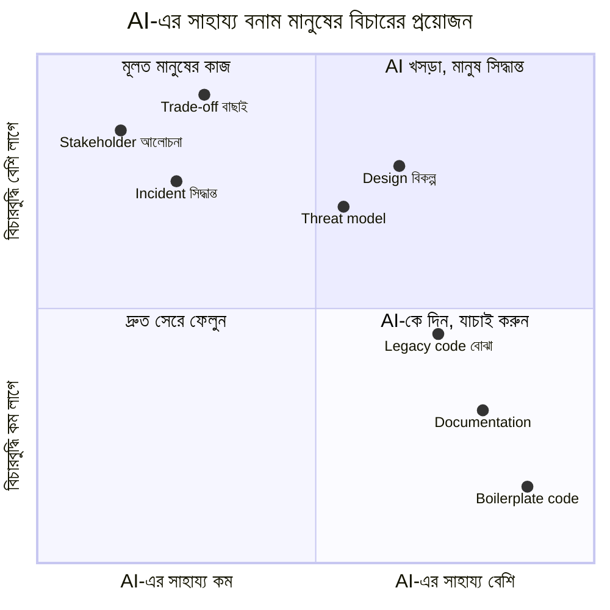
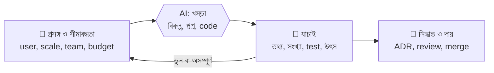
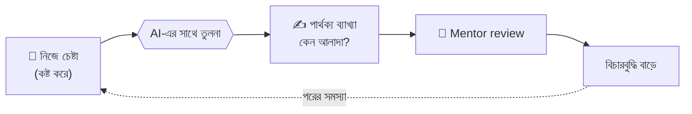
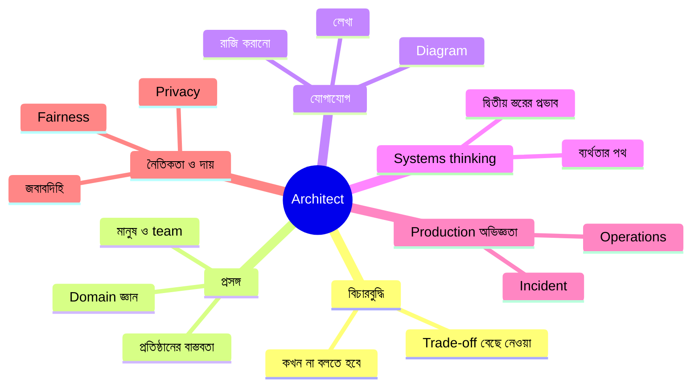

> [!GOALS]
> - Architect-এর কাজের কোন অংশে AI সত্যিই সাহায্য করে, আর কোথায় করে না
> - AI-সহায়িত কাজের ধারা: requirement থেকে incident review পর্যন্ত, প্রতিটিতে যাচাইয়ের ধাপসহ
> - AI-এর ব্যর্থতার ধরন: বানানো তথ্য, অস্তিত্বহীন package, প্রসঙ্গহীন "best practice"
> - উৎপাদনশীলতার গবেষণা: কেন একই tool কারো জন্য দ্রুত, কারো জন্য ধীর
> - Team-এর AI নীতি, code review-এর দায় এবং নতুনদের শেখা রক্ষা করা
> - যে দক্ষতাগুলো AI যুগে আরো মূল্যবান
> - Architect-দের জন্য কার্যকর prompt pattern ও career-এর পথ

> [!STORY] "ভাই, AI কি আমাদের চাকরি খেয়ে ফেলবে?"
> চায়ের বিরতিতে রাফি প্রশ্নটা করেই ফেলল। আগের রাতে সে একটি AI tool দিয়ে আধঘণ্টায় এমন একটি feature বানিয়েছে, যেটা আগে তার দুই দিন লাগত। খুশির চেয়ে ভয়ই বেশি পেয়েছিল।
>
> নুসরাত উত্তর না দিয়ে ল্যাপটপ খুললেন। একটি AI assistant-কে লিখলেন: "একটি internal leave management system-এর architecture design করো।" কয়েক সেকেন্ডে সুন্দর উত্তর: microservices, Kafka, Kubernetes, Redis, Elasticsearch, আলাদা auth service, CQRS।
>
> "এই client-এর কর্মী কতজন, জানো?" নুসরাত জিজ্ঞেস করলেন। "দুইশো। IT team-এ একজন মানুষ, যিনি শুধু Windows server চালাতে জানেন। Budget মাসে পনেরো হাজার টাকা।"
>
> তারপর এই তথ্যগুলো যোগ করে আবার জিজ্ঞেস করলেন। এবার উত্তর: একটি সাধারণ web app, একটি database, managed hosting, রাতের backup। "দেখলে? প্রথম উত্তরটা ভুল ছিল না, শুধু অন্য কারো জন্য ছিল। কোন প্রশ্ন করতে হবে আর কোন তথ্যগুলো আসলে গুরুত্বপূর্ণ, সেটা জানা আমাদের কাজ।"
>
> সেদিন বিকেলে রাফির AI-লেখা PR review করতে গিয়ে তানভীর একটি লাইনে আটকালেন: ভর্তির শেষ সময় যাচাইয়ে `DateTime.Now`। Server UTC-তে, তাই রাত বারোটার বদলে সকাল ছয়টায় আবেদন বন্ধ হতো। সব test পাস করেছিল, কারণ test-ও AI লিখেছিল, একই ভুল ধারণা নিয়ে। রাফি চুপ করে রইল। অধ্যায় ১৩-এর সেই একই timezone, এবার AI-এর হাত দিয়ে।

## 17.1 কী বদলাচ্ছে, কী বদলাচ্ছে না

AI system design-এর **সবচেয়ে সময়সাপেক্ষ কিন্তু কম বিচারবুদ্ধির** অংশগুলো দ্রুত করছে: খসড়া লেখা, boilerplate code, দ্রুত তুলনা, documentation, পুরনো code বোঝা। কিন্তু architect-এর মূল কাজ, অর্থাৎ **প্রসঙ্গ বোঝা, trade-off বেছে নেওয়া, মানুষকে রাজি করানো, আর ফলাফলের দায় নেওয়া**, এখনো মানুষের।

| Architect-এর কাজ | AI কতটা সাহায্য করে | মানুষের অপরিহার্য ভূমিকা |
| --- | --- | --- |
| Requirement বোঝা | প্রশ্নের তালিকা, transcript থেকে অস্পষ্টতা খোঁজা | Stakeholder-এর সাথে আস্থা, অব্যক্ত চাহিদা ধরা, সংখ্যা নিশ্চিত করা |
| Capacity হিসাব | সূত্র ও হিসাব যাচাই | অনুমানগুলো সঠিক কি না (peak কখন, কতজন) |
| Architecture বিকল্প | একাধিক বিকল্প ও তাদের trade-off-এর খসড়া | Team, budget, ঝুঁকি, রাজনীতি মিলিয়ে বেছে নেওয়া |
| Diagram | Text থেকে Mermaid/PlantUML-এর খসড়া | কোন বিস্তারিত দেখাবেন, কোনটা লুকাবেন |
| ADR ও document | খসড়া, ভাষা পরিমার্জন, অনুবাদ | সিদ্ধান্ত ও তার কারণ |
| Code review | প্রচলিত bug ও security pattern শনাক্ত | Business নিয়ম, প্রসঙ্গগত ভুল, merge-এর দায় |
| Threat modeling | STRIDE-এর প্রথম তালিকা | এই প্রতিষ্ঠানের আসল ঝুঁকি কোনটা |
| Incident | Log ও timeline-এর সারসংক্ষেপ, hypothesis | Rollback-এর সিদ্ধান্ত, customer-এর সাথে যোগাযোগ |
| Legacy code বোঝা | Dependency map, call graph, ব্যাখ্যা | কোনটা ইচ্ছাকৃত নকশা, কোনটা দুর্ঘটনা |
| Team গড়া ও mentoring | শেখার উপকরণ | বিশ্বাস, অনুপ্রেরণা, বিচারবুদ্ধি শেখানো |



## 17.2 AI-সহায়িত কাজের ধারা

প্রতিটি কাজে একটি সাধারণ নিয়ম: **AI খসড়া দেয়, মানুষ যাচাই করে, মানুষ সিদ্ধান্ত নেয়।**



### ১. Requirement workshop-এর প্রস্তুতি

```text
প্রসঙ্গ: একটি বিশ্ববিদ্যালয় গ্রুপের অনলাইন ভর্তি ও রেজাল্ট portal।
নিচে রেজিস্ট্রারের সাথে আলোচনার transcript দেওয়া হলো।
কাজ: (১) উল্লেখ করা হয়নি এমন non-functional requirement-এর তালিকা দাও,
(২) প্রতিটির জন্য রেজিস্ট্রারকে জিজ্ঞেস করার একটি প্রশ্ন লেখো,
(৩) কোনো সংখ্যা অনুমান করবে না; যা জানা নেই, "অজানা" লিখবে।
```

**যাচাই:** প্রশ্নগুলো নিজে পড়ে বাছাই করুন; উত্তর আসবে মানুষের কাছ থেকে।

### ২. Design critique ("red team")

AI-কে design বানাতে বলার চেয়ে প্রায়ই বেশি কাজের হলো **নিজের design-এর দুর্বলতা খুঁজতে বলা**:

```text
নিচে আমাদের result day architecture। ১,০০০ RPS peak, ১.৫ লাখ শিক্ষার্থী।
তুমি একজন সন্দেহপ্রবণ senior SRE। এই design-এর সবচেয়ে সম্ভাব্য পাঁচটি
ব্যর্থতার জায়গা বলো, প্রতিটির জন্য "কীভাবে বুঝব এটা ঘটছে" এবং "প্রতিরোধ"।
যেখানে আমার দেওয়া তথ্য অপর্যাপ্ত, সেখানে প্রশ্ন করো।
```

### ৩. Diagram-এর খসড়া

এই বইয়ের diagram-গুলো Mermaid-এ লেখা, অর্থাৎ text। AI text থেকে diagram-এর প্রথম খসড়া দ্রুত বানাতে পারে। যাচাই: প্রতিটি তীর কি সত্যিকারের call? কোনটা sync, কোনটা async? Diagram সবচেয়ে বিপজ্জনক তখন, যখন সুন্দর কিন্তু ভুল।

### ৪. ADR-এর খসড়া

সিদ্ধান্ত, বিকল্প ও কারণগুলো bullet-এ লিখে AI-কে পরিপাটি ADR বানাতে দিন (পরিশিষ্ট B-এর template)। সিদ্ধান্তটা নিজের; ভাষা AI-এর সাহায্যে।

### ৫. Code review ও legacy code বোঝা

"এই PR-এ concurrency, timezone, null, authorization ও idempotency-সংক্রান্ত সম্ভাব্য সমস্যা খোঁজো" ধরনের নির্দিষ্ট checklist দিয়ে AI review কার্যকর। বিশ বছরের পুরনো stored procedure-এর ব্যাখ্যা চাওয়া বা কোন module কোন table ছোঁয় তা বের করাও দারুণ কাজে আসে।

### ৬. Incident-এর পর

Timeline, chat log ও alert-এর ইতিহাস দিয়ে postmortem-এর খসড়া। কিন্তু **blameless** ভাষা আর action item-এর মালিক ঠিক করা মানুষের কাজ (অধ্যায় ১২)।

### ৭. বাংলায় document

অনেক client-এর ব্যবহারকারী ইংরেজিতে স্বচ্ছন্দ নন। User manual বা release note-এর বাংলা খসড়া AI দ্রুত দিতে পারে; শুধু technical শব্দের বানান ও অর্থ একজন বাংলাভাষী domain expert দিয়ে মিলিয়ে নিন।

## 17.3 AI-এর ব্যর্থতার ধরন এবং যাচাইয়ের অভ্যাস

| ব্যর্থতা | উদাহরণ | যাচাই |
| --- | --- | --- |
| বানানো তথ্য | অস্তিত্বহীন API, ভুল configuration option, বানানো উৎস | Official documentation-এ মিলিয়ে দেখা |
| অস্তিত্বহীন package | এমন library-র নাম যা নেই; আক্রমণকারী সেই নামে ক্ষতিকর package বানিয়ে রাখতে পারে ("slopsquatting") | Package-এর উৎস, download সংখ্যা, maintainer যাচাই; lock file ও approved registry |
| পুরনো জ্ঞান | Deprecated API, পুরনো version-এর নিয়ম | Version উল্লেখ করে জিজ্ঞেস ও documentation |
| আত্মবিশ্বাসী সংখ্যা | Latency, দাম, limit-এর ভুল মান | মাপুন বা provider-এর পৃষ্ঠা দেখুন |
| প্রসঙ্গহীন "best practice" | ২০০ user-এর জন্য Kubernetes | Constraint আগে দিন; ফলাফলকে constraint দিয়ে যাচাই |
| সূক্ষ্ম logic bug | Timezone, off-by-one, race condition | Review checklist, property-based test, মানুষের লেখা edge case test |
| নিরাপত্তা ফাঁক | Authorization বাদ পড়া, SQL string জোড়া | Security review ও automated scanner |
| নিজের ভুলের নিশ্চয়তা | ভুল code আর একই ভুল ধারণায় লেখা test | Test-এর প্রত্যাশা মানুষ লিখবে, বা অন্তত যাচাই করবে |

> [!CASE] Mata v. Avianca, ২০২৩: বানানো মামলার নজির
> ২০২৩ সালে নিউ ইয়র্কের একটি ফেডারেল আদালতে একটি মামলায় আইনজীবীরা যে লিখিত যুক্তি জমা দেন, তাতে উল্লেখ করা কয়েকটি পূর্ববর্তী মামলার নজির আসলে **অস্তিত্বহীন** ছিল; সেগুলো ChatGPT দিয়ে খুঁজতে গিয়ে বানানো তথ্য এসেছিল, আর আইনজীবীরা যাচাই করেননি। প্রতিপক্ষ ও আদালত নজিরগুলো খুঁজে না পেলে বিষয়টি প্রকাশ পায়। বিচারক সংশ্লিষ্ট আইনজীবীদের জরিমানা করেন।
>
> **শিক্ষা:** AI-এর বানানো তথ্য প্রায়ই **দেখতে নিখুঁত**: সঠিক format, বিশ্বাসযোগ্য নাম, আত্মবিশ্বাসী ভাষা। Software-এ এর সমতুল্য হলো এমন configuration flag বা library function, যা দেখতে সম্পূর্ণ বাস্তব কিন্তু নেই। নিয়ম: AI-এর দেওয়া প্রতিটি তথ্য যা কোনো সিদ্ধান্তে ব্যবহার হবে, তার মূল উৎস নিজে দেখুন।

### উৎপাদনশীলতা: কার জন্য দ্রুত, কার জন্য ধীর?

> [!CASE] দুটি গবেষণা, দুটি ভিন্ন ফলাফল
> ২০২২ সালে GitHub-এর একটি নিয়ন্ত্রিত পরীক্ষায় developer-রা একটি নির্দিষ্ট, নতুন করে শুরু করা কাজ (একটি ছোট HTTP server লেখা) AI coding assistant ব্যবহার করে উল্লেখযোগ্যভাবে দ্রুত (প্রায় ৫৫%) শেষ করেছিলেন।
>
> ২০২৫ সালে গবেষণা প্রতিষ্ঠান METR একটি randomized গবেষণায় ১৬ জন **অভিজ্ঞ** open-source developer-কে তাঁদের নিজেদের পরিচিত, বড় ও পরিপক্ক codebase-এ বাস্তব কাজ দেয়, কিছু কাজে AI ব্যবহারের অনুমতিসহ, কিছুতে ছাড়া। ফলাফল: AI ব্যবহার করে কাজ শেষ করতে গড়ে প্রায় **১৯% বেশি** সময় লেগেছিল। সবচেয়ে চমকপ্রদ বিষয়: developer-রা নিজেরা মনে করছিলেন AI তাঁদের প্রায় ২০% **দ্রুত** করেছে। গবেষকরা সতর্ক করেছেন যে এই ফলাফল সব পরিস্থিতিতে প্রযোজ্য নাও হতে পারে, এবং tool দ্রুত উন্নত হচ্ছে।
>
> **শিক্ষা:** (১) AI-এর সুবিধা নির্ভর করে কাজের ধরনের উপর: নতুন, সুনির্দিষ্ট কাজে বেশি; বড়, অলিখিত নিয়মে ভরা codebase-এ কম। (২) **অনুভূত গতি আর বাস্তব গতি আলাদা হতে পারে।** Prompt লেখা, অপেক্ষা, AI-এর code পড়া ও ঠিক করা: এই সময়গুলো চোখে পড়ে কম। তাই team-এর উৎপাদনশীলতা মাপুন ফলাফল দিয়ে (অধ্যায় ১৪-এর DORA metric, bug-এর হার), অনুভূতি বা লেখা code-এর লাইন দিয়ে নয়।

## 17.4 Team-এর অনুশীলন

### AI ব্যবহার নীতি

নদী টেক একটি এক পৃষ্ঠার নীতি তৈরি করল, যার মূল অংশ একটি টেবিল:

| Data-র শ্রেণী | উদাহরণ | কোন AI tool-এ দেওয়া যাবে |
| --- | --- | --- |
| Public | Open-source code, প্রকাশিত document | যেকোনো অনুমোদিত tool |
| Internal | নিজেদের code, architecture document | শুধু enterprise চুক্তির tool (training-এ ব্যবহার হয় না) |
| Confidential | Client-এর data, চুক্তি, বেতন | শুধু অনুমোদিত, data-সুরক্ষা চুক্তিসহ, বা self-hosted |
| Secret | Password, key, ব্যক্তিগত তথ্য (NID, স্বাস্থ্য) | কোনো AI tool-এ নয় |

### Review ও দায়

- **"যে merge করে, সে-ই মালিক।"** AI লিখুক বা মানুষ, production-এ যাওয়া code-এর দায় merge-কারীর ও reviewer-এর।
- AI-এর লেখা বড় পরিবর্তন ছোট ছোট PR-এ ভাগ করা; বিশাল PR কেউ সত্যিই review করে না।
- Test-এর **প্রত্যাশা** (কী হওয়া উচিত) মানুষ লিখবে বা অন্তত মনোযোগ দিয়ে যাচাই করবে; গল্পের `DateTime.Now` এখানেই ধরা পড়ত।
- Security-সংবেদনশীল অংশে (auth, payment, permission) AI-এর code-এ অতিরিক্ত review।

### নতুনদের শেখা রক্ষা করা

> [!ARCHITECT] রাফির শেখার চক্র
> নুসরাতের সবচেয়ে বড় দুশ্চিন্তা ছিল রাফির মতো নতুনদের নিয়ে। AI উত্তর দিয়ে দিলে কষ্ট করে শেখার অংশটা বাদ পড়ে যায়, অথচ সেই কষ্টই বিচারবুদ্ধি তৈরি করে। নুসরাতের নিয়ম: (১) নতুন ধারণা শেখার সময় আগে নিজে চেষ্টা, তারপর AI দিয়ে তুলনা; (২) AI-এর দেওয়া প্রতিটি code লাইন ব্যাখ্যা করতে না পারলে merge নয়; (৩) প্রতি সপ্তাহে একটি "AI-ছাড়া" design exercise; (৪) AI-কে শিক্ষক হিসেবে ব্যবহার: "উত্তর দিও না, আমাকে প্রশ্ন করে বুঝতে সাহায্য করো।" ছয় মাস পর রাফি AI দিয়ে আগের চেয়ে দ্রুত কাজ করে, কিন্তু আরো গুরুত্বপূর্ণ, AI ভুল করলে সেটা ধরতে পারে।



## 17.5 যে দক্ষতাগুলো আরো মূল্যবান হচ্ছে



- **বিচারবুদ্ধি (judgment):** AI দশটি বিকল্প দিতে পারে; কোনটা এই client, এই team, এই budget-এর জন্য সঠিক, তা বলা আপনার কাজ।
- **প্রসঙ্গ ও domain জ্ঞান:** Microfinance-এর কিস্তি আদায় কীভাবে হয়, গার্মেন্টসের ঈদ-বোনাস কবে, রেজাল্ট কখন বের হয়। এই জ্ঞান কোনো model-এর training data-তে নেই।
- **যোগাযোগ:** একটি ভালো diagram আর এক পৃষ্ঠার পরিষ্কার ADR প্রায়ই সবচেয়ে বড় architecture অবদান।
- **Systems thinking:** "এটা বদলালে আর কী বদলাবে?" "এটা ভাঙলে কী হবে?"
- **Production-এর অভিজ্ঞতা:** রাত তিনটার incident-এর স্মৃতি থেকে আসা সতর্কতা।
- **নৈতিকতা ও দায়:** কার উপর প্রভাব পড়ছে, ভুল হলে কে ক্ষতিগ্রস্ত হবে।

## 17.6 Architect-দের জন্য Prompt Pattern

| Pattern | উদাহরণ |
| --- | --- |
| **প্রসঙ্গ আগে** | "২০০ user, এক জনের IT team, মাসিক budget ১৫ হাজার টাকা, Windows-অভিজ্ঞতা। এই সীমার মধ্যে…" |
| **বিকল্প ও trade-off চাও** | "তিনটি বিকল্প দাও, প্রতিটির খরচ, ঝুঁকি, দক্ষতার প্রয়োজন ও কখন এটি ভুল পছন্দ।" |
| **ব্যর্থতা খোঁজাও** | "এই design কীভাবে ব্যর্থ হতে পারে? সবচেয়ে কম স্পষ্ট পাঁচটি উপায় বলো।" |
| **উত্তর নয়, প্রশ্ন চাও** | "সিদ্ধান্তের আগে আমার আর কী জানা দরকার? প্রশ্নের তালিকা দাও।" |
| **অনিশ্চয়তা স্বীকার করাও** | "যেখানে নিশ্চিত নও বা version-নির্ভর, স্পষ্ট করে বলো।" |
| **উৎস চাও এবং নিজে মেলাও** | "এই configuration-এর official documentation-এর কোন অংশ এটি সমর্থন করে?" |
| **ভূমিকা দাও** | "তুমি একজন সন্দেহপ্রবণ security reviewer।" |

## 17.7 Career-এর পথ: প্রতিটি স্তরে কী করবেন

- **Junior (রাফির মতো):** মৌলিক বিষয়গুলো গভীরভাবে শিখুন (database, network, concurrency); AI দিয়ে দ্রুত হোন, কিন্তু প্রতিটি লাইন বুঝে। Production-এর কাছাকাছি থাকুন: on-call shadow করুন, postmortem পড়ুন।
- **Senior engineer:** Review-এর মান ও team-এর AI অনুশীলনের নেতৃত্ব দিন। নিজের লেখা কমিয়ে, অন্যদের লেখা নিরাপদ করার দিকে সময় দিন।
- **Architect (নুসরাতের মতো):** AI-কে নিজের research assistant আর red team বানান; কিন্তু সময় বেশি দিন মানুষের সাথে: stakeholder, team, client। Architecture এখন আরো বেশি **অনুবাদের কাজ**: business-এর ভাষা থেকে system-এর ভাষায়, আর system-এর সীমাবদ্ধতা থেকে business-এর ভাষায়।

> [!QUOTE]
> AI আপনার চাকরি নেবে না। কিন্তু যে architect AI-কে ভালোভাবে ব্যবহার করতে জানে এবং তার ভুল ধরতে জানে, সে হয়তো সেই architect-এর জায়গা নেবে যে দুটোর কোনোটাই জানে না।

## 17.8 Interview প্রশ্ন

> [!INTERVIEW]
> 1. আপনার team-এ AI coding assistant ব্যবহারের নীতি কেমন হওয়া উচিত?
> 2. AI-লেখা code review করার সময় বিশেষভাবে কী কী দেখবেন?
> 3. "AI ব্যবহারে উৎপাদনশীলতা বেড়েছে কি না" কীভাবে মাপবেন?
> 4. Package hallucination বা slopsquatting কী? কীভাবে ঠেকাবেন?
> 5. একটি architecture সিদ্ধান্তে AI-এর পরামর্শ কখন মানবেন না?
>
> **টিপস:** এখন অনেক interview-তে জিজ্ঞেস করা হয় আপনি AI tool কীভাবে ব্যবহার করেন। সবচেয়ে ভালো উত্তর: নির্দিষ্ট উদাহরণ, যেখানে AI সাহায্য করেছে, আর যেখানে আপনি AI-এর ভুল ধরেছেন।

## 17.9 নিজে করে দেখুন

> [!EXERCISE] AI-এর সাথে একটি design session
> অধ্যায় ২-এর "বেতনের দিনের Mobile Banking" exercise নিন।
> 1. কোনো প্রসঙ্গ না দিয়ে AI-এর কাছে architecture চান। উত্তর সংরক্ষণ করুন।
> 2. এবার পূর্ণ প্রসঙ্গ দিন (scale, team, budget, নিয়ন্ত্রক শর্ত)। দুই উত্তরের পার্থক্য লিখুন।
> 3. AI-কে আপনার নিজের design-এর red team হতে বলুন। কতগুলো সমালোচনা সত্যিই প্রাসঙ্গিক?
> 4. AI-এর উত্তরে অন্তত তিনটি তথ্য বা সংখ্যা official উৎসে যাচাই করুন। কতগুলো সঠিক ছিল?
> 5. শেষে নিজে একটি ADR লিখুন এবং চিহ্নিত করুন কোন সিদ্ধান্তগুলো সম্পূর্ণ আপনার বিচারবুদ্ধি থেকে এসেছে।

## 17.10 Chapter Summary

- **কী বদলাচ্ছে:** খসড়া, boilerplate, তুলনা, document, পুরনো code বোঝা দ্রুত হচ্ছে।
- **কী বদলাচ্ছে না:** প্রসঙ্গ বোঝা, trade-off বেছে নেওয়া, মানুষকে রাজি করানো, দায় নেওয়া।
- **কাজের চক্র:** প্রসঙ্গ দাও → খসড়া নাও → যাচাই করো → সিদ্ধান্ত ও দায় নাও।
- **ব্যর্থতা:** বানানো তথ্য ও package, পুরনো জ্ঞান, প্রসঙ্গহীন পরামর্শ, সূক্ষ্ম bug; প্রতিটির যাচাইয়ের অভ্যাস।
- **উৎপাদনশীলতা:** কাজের ধরন অনুযায়ী আলাদা; অনুভূতি নয়, ফলাফল মাপুন।
- **Team:** Data-শ্রেণীভিত্তিক AI নীতি, merge-কারীর দায়, নতুনদের শেখার চক্র রক্ষা।
- **দক্ষতা:** বিচারবুদ্ধি, প্রসঙ্গ, যোগাযোগ, systems thinking, production অভিজ্ঞতা, নৈতিকতা।

> [!ARCHITECT] নুসরাতের নোটবুক · রাফির প্রশ্নের উত্তর
> রাফিকে যা বলেছিলাম, লিখে রাখি: "তুমি যখন প্রথম এসেছিলে, তোমার কাজ ছিল code লেখা। এখন AI-ও code লেখে। কিন্তু অধ্যায় ১-এর সেই রেজাল্টের সকালে code-এ কোনো ভুল ছিল না। ভুল ছিল এই প্রশ্নে: 'সবচেয়ে খারাপ দিনটা দেখতে কেমন?' সেই প্রশ্ন করার মানুষ, উত্তর যাচাই করার মানুষ, আর ভুল হলে দায় নেওয়ার মানুষ: এগুলোই আমাদের কাজ ছিল, আছে, থাকবে।" আজ থেকে team-এর AI নীতি চালু। পরের পর্বে আমরা ফিরছি বড় enterprise system-এ: ERP, যেখানে ভুল মানে একটি কারখানার বেতন আটকে যাওয়া।
