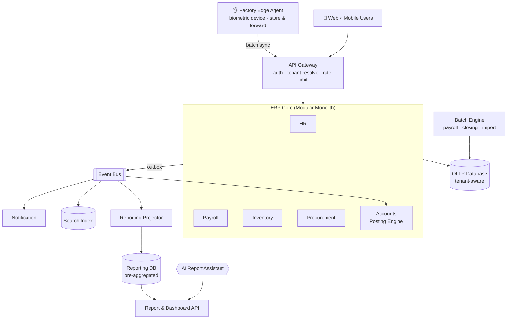
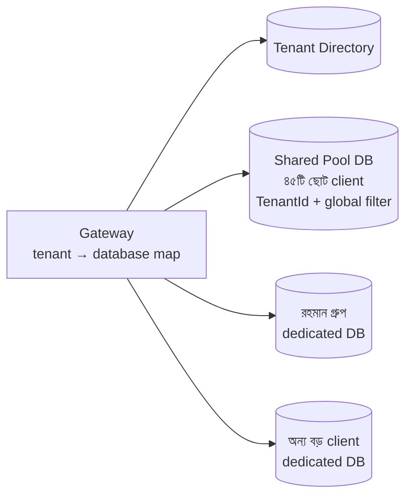
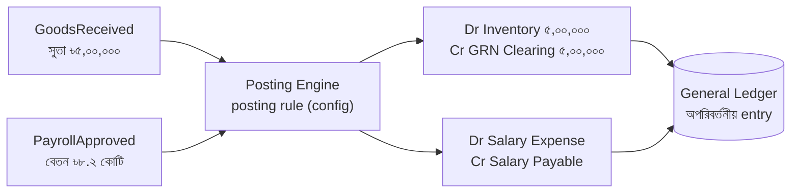
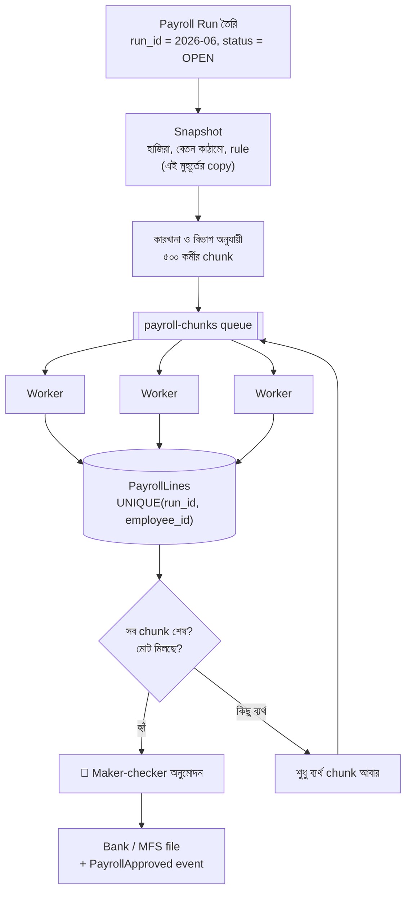
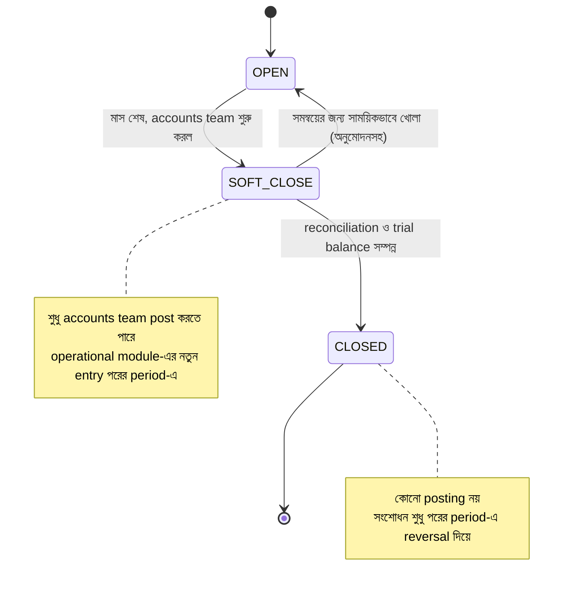

> [!GOALS]
> - একটি বড় ERP-র requirement ও চ্যালেঞ্জ (লেখকের Standard Chapter Template অনুসারে)
> - Multi-tenant architecture-এর তিনটি model ও hybrid কৌশল
> - Inventory-কে quantity column নয়, movement ledger হিসেবে design করা
> - Module-এর event থেকে double-entry accounting posting
> - ৬০,০০০ কর্মীর payroll batch: নির্ভরযোগ্য, পুনরায় চালানো যায় এমন
> - Month-end closing, reporting (CQRS) ও offline কারখানা
> - Maker-checker, segregation of duties ও audit
> - ERP-তে AI: semantic layer-ভিত্তিক report সহায়ক ও anomaly detection

> [!STORY] ঈদের আগের বৃহস্পতিবার
> রহমান গার্মেন্টস গ্রুপ (কাল্পনিক) নদী ERP-র সবচেয়ে বড় client: চল্লিশটি কারখানা, ষাট হাজার শ্রমিক। ঈদের ছুটি শুরু শনিবার। নিয়ম অনুযায়ী বেতন আর ঈদ-বোনাস পরিশোধ করতে হবে বৃহস্পতিবারের মধ্যে, যাতে শ্রমিকরা শুক্রবার বাড়ির পথে রওনা দিতে পারেন।
>
> বুধবার বিকেলে payroll চালু হলো। রাত দশটায় দেখা গেল, ২৭টি কারখানার payroll শেষ, ১৩টি আটকে আছে। একই সময়ে accounts team মাস শেষের closing করছে, আর ভারী report চলছে। Database CPU ১০০%। রাত দুইটায় payroll job একটি deadlock-এ পড়ে বন্ধ হলো। আবার চালাতে গেলে প্রশ্ন: **যে ২৭টি কারখানার হিসাব হয়ে গেছে, সেগুলো কি আবার হবে? কারো বেতন দুইবার হবে?**
>
> ভোর পাঁচটায় তানভীর, রাফি আর নুসরাত হাতে হাতে বের করলেন কোন কর্মীর হিসাব শেষ, কারটা অর্ধেক। বৃহস্পতিবার দুপুরে শেষ ব্যাংক file গেল। কয়েকটি কারখানায় শ্রমিকরা বেতন পেলেন সন্ধ্যায়।
>
> ঈদের পর করিম সাহেব শুধু একটি বাক্য বললেন: "ষাট হাজার পরিবারের ঈদ আমাদের একটি batch job-এর উপর নির্ভর করছিল। এটা যেন আর কখনো না হয়।"

## 18.1 Introduction

ERP (Enterprise Resource Planning) হলো এমন একটি software, যা একটি প্রতিষ্ঠানের Accounting, HR ও Payroll, Inventory, Procurement, Production, Sales ও CRM একটি সমন্বিত system-এ পরিচালনা করে। ERP design করা কঠিন, কারণ:
- **শত শত table ও জটিল business নিয়ম,** যার অনেকগুলো আইন ও প্রতিষ্ঠানের নীতি থেকে আসে।
- **Module-গুলো গভীরভাবে জড়িত:** একটি goods receipt একসাথে inventory, accounts payable ও general ledger-এ প্রভাব ফেলে।
- **ভারী reporting ও period closing।**
- **নির্ভুলতা অপরিহার্য:** হিসাবে এক টাকার গরমিলও audit-এ প্রশ্ন তোলে।
- **প্রতিটি client-এর আলাদা প্রক্রিয়া,** অথচ একটিই product।

## 18.2 Problem Statement

নদী ERP একটি multi-tenant SaaS, যা ছোট (৫০ কর্মী) থেকে বড় (৬০,০০০ কর্মী, ৪০ কারখানা) গার্মেন্টস ও manufacturing প্রতিষ্ঠানকে সেবা দেয়। বর্তমান সমস্যা:
- মাস শেষে report ও closing চলাকালীন সাধারণ লেনদেন ধীর বা অচল।
- Payroll batch মাঝপথে ব্যর্থ হলে নিরাপদে পুনরায় চালানো যায় না।
- একই product-এর stock বিভিন্ন report-এ ভিন্ন দেখায়।
- একটি বড় client-এর load অন্য ছোট client-দের ধীর করে দেয়।
- কিছু কারখানায় ইন্টারনেট অনির্ভরযোগ্য; biometric হাজিরার data দেরিতে বা হারিয়ে আসে।

## 18.3 Requirements

**Functional:**
- HR: কর্মী, পদবি, বিভাগ, ছুটি, হাজিরা (biometric device থেকে)।
- Payroll: মাসিক বেতন, ওভারটাইম, বোনাস, কর্তন, ব্যাংক ও mobile financial service-এ পরিশোধের file।
- Inventory: goods receipt, issue, transfer, stock count, costing।
- Procurement: requisition, quotation, purchase order, অনুমোদন।
- Accounts: double-entry ledger, accounts payable/receivable, period closing, আর্থিক বিবরণী।
- Report ও dashboard; প্রতিটি client-এর নিজস্ব অনুমোদন প্রবাহ।

**Non-functional:**
- ৬০,০০০ কর্মীর payroll ২ ঘণ্টার মধ্যে; ব্যর্থ হলে যেখানে থেমেছিল সেখান থেকে, কোনো duplicate ছাড়া।
- মাস শেষের closing চলাকালীনও লেনদেনের p95 latency < ১ সেকেন্ড।
- হিসাবের সঠিকতা: debit = credit সবসময়; stock কখনো অননুমোদিতভাবে ঋণাত্মক নয়।
- Tenant isolation: এক client-এর data অন্য client কখনো দেখবে না; এক client-এর load অন্যকে ক্ষতিগ্রস্ত করবে না।
- Audit: প্রতিটি আর্থিক পরিবর্তনের পূর্ণ ইতিহাস, কমপক্ষে আইনগতভাবে নির্ধারিত সময় পর্যন্ত।
- কারখানার network বিচ্ছিন্ন থাকলেও হাজিরা সংগ্রহ চলবে।

## 18.4 High-Level Design



মূল সিদ্ধান্তগুলো আগের অধ্যায়গুলো থেকে এসেছে: **modular monolith** (অধ্যায় ১০), **outbox ও event bus** (অধ্যায় ১০-১১), **আলাদা reporting store / CQRS** (অধ্যায় ৫), **batch engine queue-ভিত্তিক** (অধ্যায় ১১)।

## 18.5 Multi-Tenant Architecture

| Model | কীভাবে | সুবিধা | অসুবিধা | উপযুক্ত |
| --- | --- | --- | --- | --- |
| **Shared DB, shared schema** | সব client এক database, প্রতিটি row-এ `TenantId` | সবচেয়ে কম খরচ, সহজ upgrade | Isolation-এর পুরো দায় code-এর; noisy neighbor | অনেক ছোট client |
| **Shared DB, schema per tenant** | প্রতিটি client-এর আলাদা schema | মাঝারি isolation | হাজার schema-র migration জটিল | মাঝারি সংখ্যক client |
| **Database per tenant** | প্রতিটি client-এর নিজস্ব database | শক্তিশালী isolation, আলাদা backup ও restore, data residency | খরচ ও operation বেশি | বড় বা নিয়ন্ত্রিত client |



নদী ERP-র সিদ্ধান্ত **hybrid**: ছোট client shared pool-এ (অধ্যায় ৫-এর tenant-based sharding-এর সরল রূপ), বড় বা বিশেষ চাহিদার client নিজস্ব database-এ। Code একটাই; tenant directory বলে দেয় কার data কোথায়। Shared pool-এ প্রতিটি query-তে `TenantId` filter বাধ্যতামূলক, ORM-এর global filter দিয়ে (অধ্যায় ৮-এর IDOR প্রতিরোধ)।

> [!WARNING] Noisy neighbor
> Shared pool-এ একটি client যদি মাস শেষে বিশাল report চালায়, সবাই ধীর হয়। প্রতিরক্ষা: tenant-ভিত্তিক rate limit ও job queue-তে tenant-ভিত্তিক ন্যায্য বণ্টন (fair scheduling), ভারী report আলাদা reporting store-এ, আর বড় হয়ে ওঠা client-কে dedicated database-এ সরানোর একটি পরীক্ষিত প্রক্রিয়া।

## 18.6 Detailed Design

### Inventory: Quantity column নয়, Movement Ledger

অনেক ERP-তে `Products.StockQty` নামে একটি column থাকে, আর প্রতিটি লেনদেনে সেটা বাড়ানো-কমানো হয়। সমস্যা: কেন এই সংখ্যা, কেউ জানে না; একটি bug-এ সংখ্যা ভুল হলে ইতিহাস থেকে ঠিক করা যায় না; একসাথে অনেক update-এ lock ও সংঘর্ষ।

ভালো নকশা: **প্রতিটি stock-এর পরিবর্তন একটি অপরিবর্তনীয় movement row** (হিসাবের খাতার মতো), আর বর্তমান stock হলো movement-এর যোগফল (দ্রুততার জন্য একটি balance table, যা movement থেকেই update হয় এবং যেকোনো সময় পুনর্গণনা করা যায়)।

```sql
CREATE TABLE StockMovements (
    MovementId   BIGINT IDENTITY PRIMARY KEY,
    TenantId     INT NOT NULL,
    ItemId       INT NOT NULL,
    WarehouseId  INT NOT NULL,
    Qty          DECIMAL(18,3) NOT NULL,        -- + receipt, − issue
    UnitCost     DECIMAL(18,4) NOT NULL,
    SourceType   VARCHAR(20) NOT NULL,          -- GRN, ISSUE, TRANSFER, ADJUST
    SourceId     BIGINT NOT NULL,
    PostedAt     DATETIME2 NOT NULL,
    CONSTRAINT UQ_Movement_Source UNIQUE (TenantId, SourceType, SourceId, ItemId, WarehouseId)
);
-- Balance update একই transaction-এ, শর্তসহ (অধ্যায় ৪-এর atomic conditional update)
UPDATE StockBalances SET Qty = Qty - @IssueQty
WHERE TenantId = @T AND ItemId = @I AND WarehouseId = @W AND Qty >= @IssueQty;
```

`UQ_Movement_Source` নিশ্চিত করে একই goods receipt দুইবার stock বাড়াবে না (idempotency)। আর balance যেকোনো সময় movement থেকে মিলিয়ে দেখা যায় (reconciliation job)।

### Double-entry Posting Engine

প্রতিটি module-এর আর্থিক ঘটনা event হিসেবে আসে, আর Accounts module সেটাকে **double-entry journal**-এ রূপান্তর করে: প্রতিটি entry-তে মোট debit = মোট credit।



**নিয়ম:**
- Journal entry একবার post হলে **কখনো edit বা delete নয়**; ভুল হলে উল্টো entry (reversal) দিয়ে সংশোধন। Audit trail স্বয়ংক্রিয়।
- Posting rule (কোন event-এ কোন account) configuration-এ, যাতে প্রতিটি client-এর chart of accounts অনুযায়ী বদলানো যায়, code না বদলে।
- Database-এ constraint বা trigger দিয়ে প্রতিটি journal-এ debit = credit যাচাই।
- Posting idempotent: event ID দিয়ে (অধ্যায় ১১-এর idempotent consumer)।

### Payroll Batch: গল্পের সমস্যার সমাধান

ষাট হাজার কর্মীর payroll একটি বিশাল transaction হিসেবে চালানো যায় না: lock, timeout, আর ব্যর্থ হলে সব শুরু থেকে। নতুন নকশা:



**মূল নীতি:**
- **Snapshot:** Payroll চলাকালীন কেউ হাজিরা বা বেতন বদলালেও এই run-এর হিসাব বদলাবে না; পরিবর্তন পরের run-এ বা আলাদা adjustment-এ।
- **Chunk ও queue:** ৫০০ জনের ছোট অংশ, সমান্তরালে, প্রতিটির ছোট transaction।
- **Idempotent:** `UNIQUE(run_id, employee_id)`; একই chunk দুবার চললেও কারো বেতন দুবার হবে না।
- **Resumable:** ব্যর্থ হলে শুধু ব্যর্থ chunk আবার। কোনটা শেষ, কোনটা বাকি, dashboard-এ দেখা যায়।
- **নিয়ন্ত্রণ মোট:** কর্মী সংখ্যা, মোট gross, মোট net আগের মাসের সাথে তুলনা; অস্বাভাবিক পার্থক্যে সতর্কতা।
- **Resource আলাদা:** Payroll ও closing-এর মতো batch আলাদা worker pool-এ, নির্দিষ্ট concurrency সীমায়, যাতে দিনের লেনদেন ধীর না হয়।

### Month-end Closing

Closing মানে একটি period (মাস বা অর্থবছর) "বন্ধ" করা: সব posting শেষ, reconciliation, সমন্বয়, তারপর ওই period-এ আর নতুন entry নয়।
- **Period state:** `OPEN → SOFT_CLOSE (শুধু accounts team) → CLOSED`। Closed period-এ posting database স্তরেই আটকানো।


- **ভারী হিসাব background-এ:** Trial balance, depreciation, accrual queue-ভিত্তিক job।
- **Report আলাদা store থেকে:** Closing-এর report reporting database থেকে, OLTP থেকে নয়।
- **Pre-aggregation:** প্রতিদিন রাতে account ও cost center অনুযায়ী daily balance; মাস শেষের report তখন কোটি journal line নয়, ৩০টি দৈনিক সারাংশ যোগ করে।

### Offline কারখানা ও Edge Agent

কিছু কারখানায় ইন্টারনেট দিনে কয়েকবার বিচ্ছিন্ন হয়। প্রতিটি কারখানায় একটি ছোট **edge agent** (একটি ছোট PC) biometric device থেকে হাজিরা সংগ্রহ করে স্থানীয়ভাবে জমা রাখে (store and forward), আর network ফিরলে batch-এ পাঠায়। প্রতিটি record-এ device ID ও স্থানীয় sequence নম্বর, যাতে কেন্দ্রীয় system duplicate চিনতে পারে আর কোনো record হারালে gap ধরা পড়ে।

### Customization: Code নয়, Configuration

প্রতিটি client-এর অনুমোদন প্রবাহ, বেতনের নিয়ম, report আলাদা। প্রতিটি client-এর জন্য code-এর আলাদা copy (fork) করলে কয়েক বছরে চল্লিশটি আলাদা product, প্রতিটি upgrade একটি দুঃস্বপ্ন। নীতি: **workflow, rule, form field, report configuration-এ**; সত্যিই আলাদা logic দরকার হলে নির্দিষ্ট extension point (plugin বা script)। মূল code সবার জন্য একই।

> [!CASE] Lidl ও SAP: যখন software-এর অনুমান আর ব্যবসার বাস্তবতা মেলে না
> জার্মান supermarket chain Lidl কয়েক বছর ধরে একটি বড় SAP-ভিত্তিক inventory ও merchandise management প্রকল্প চালানোর পর ২০১৮ সালে তা বাতিল করে; জার্মান সংবাদমাধ্যমের প্রতিবেদন অনুযায়ী এতে প্রায় ৫০ কোটি ইউরো ব্যয় হয়েছিল। প্রকাশিত বিশ্লেষণে একটি কারণ বারবার এসেছে: Lidl ঐতিহাসিকভাবে inventory-র হিসাব রাখত **ক্রয়মূল্যে**, অথচ software-এর প্রচলিত পদ্ধতি ছিল **বিক্রয়মূল্য**-ভিত্তিক। প্রতিষ্ঠান নিজের প্রক্রিয়া বদলাতে চায়নি, ফলে software-কে ব্যাপকভাবে customize করতে হয়, যা প্রকল্পকে জটিল ও ব্যয়বহুল করে তোলে।
>
> **শিক্ষা:** ERP-র সবচেয়ে বড় ঝুঁকি প্রায়ই technology নয়, **ব্যবসার প্রক্রিয়া ও software-এর অনুমানের অমিল**। প্রকল্পের শুরুতেই চিহ্নিত করুন কোন প্রক্রিয়া প্রতিষ্ঠান বদলাবে আর কোনটা software-কে মানতে হবে, এবং customization-এর প্রকৃত খরচ স্পষ্ট করুন।

## 18.7 Scalability Consideration

- **Reporting আলাদা:** CQRS ও pre-aggregated reporting database (অধ্যায় ৫); OLTP-তে ভারী report নিষিদ্ধ।
- **Partitioning:** Journal, stock movement ও attendance table অর্থবছর বা মাস অনুযায়ী partitioned; পুরনো বছর archive।
- **Batch-এর জন্য আলাদা worker pool ও concurrency সীমা।**
- **Cache:** Permission tree, chart of accounts, dropdown-এর মতো কম বদলানো data Redis-এ, invalidation event সহ (অধ্যায় ৬)।
- **Search:** কর্মী, সরবরাহকারী ও invoice দ্রুত খোঁজার জন্য search index।
- **Tenant isolation ও noisy neighbor নিয়ন্ত্রণ।**

## 18.8 Security Consideration

- **RBAC + data scope:** "Payroll Officer, শুধু গাজীপুর কারখানা-২" (অধ্যায় ৮-এর permission model)।
- **Maker-checker:** যে payroll তৈরি করেন, তিনি অনুমোদন করতে পারবেন না। Vendor-এর ব্যাংক account বদলানোর মতো ঝুঁকিপূর্ণ পরিবর্তনে দ্বিতীয় ব্যক্তির অনুমোদন।
- **Segregation of Duties (SoD):** একই ব্যক্তি সরবরাহকারী তৈরি, purchase order অনুমোদন আর payment ছাড়, তিনটি একসাথে করতে পারবেন না; system-এ নিয়ম হিসেবে যাচাই।
- **Audit:** প্রতিটি আর্থিক ও master data পরিবর্তনের পুরনো ও নতুন মান, কে, কখন, কোথা থেকে; অপরিবর্তনীয় storage-এ।
- **সংবেদনশীল তথ্য:** বেতন, ব্যাংক account, NID field-level encryption ও mask।

## 18.9 Real Production Experience

**মাস শেষের hang:** সব branch থেকে একসাথে ledger report generate করায় পুরো ERP আটকে যেত। Report request এখন queue-তে যায়, background worker reporting database থেকে report তৈরি করে, শেষ হলে notification। API timeout বন্ধ, closing-এর দিনেও warehouse-এর entry স্বাভাবিক।

**ঈদের payroll (গল্পের পরের বছর):** নতুন chunked, idempotent payroll engine-এ ৬০,০০০ কর্মীর হিসাব ৪৮ মিনিটে শেষ। একটি worker মাঝপথে বন্ধ হয়েছিল; তার তিনটি chunk স্বয়ংক্রিয়ভাবে আবার চলে, কোনো duplicate ছাড়া। ব্যাংক file বুধবার সন্ধ্যায়ই প্রস্তুত।

**Stock-এর রহস্য:** দুটি report-এ একই সুতার stock আলাদা দেখাচ্ছিল। কারণ: একটি report `StockQty` column থেকে, আরেকটি movement থেকে হিসাব করছিল, আর একটি পুরনো bug-এ column কয়েক মাস ধরে ভুলভাবে update হচ্ছিল। Movement ledger-কে একমাত্র সত্যের উৎস বানিয়ে, balance রাতে movement থেকে মিলিয়ে দেখার job যোগ করা হয়।

## 18.10 AI কোণ: ERP-তে AI

> [!AI] "গত তিন মাসে কোন কারখানায় ওভারটাইম সবচেয়ে বেশি বেড়েছে?"
> ERP-র সবচেয়ে চাওয়া AI feature হলো নিজের ভাষায় report চাওয়া। কিন্তু অধ্যায় ৪-এ দেখেছি, AI-কে সরাসরি production database-এ SQL লিখতে দেওয়া বিপজ্জনক: ভুল join-এ ভুল সংখ্যা, ধীর query, আর permission ফাঁক। নদী ERP-র নকশা:
> - **Semantic layer:** "ওভারটাইম ঘণ্টা", "কারখানা", "মাস"-এর মতো business metric ও dimension আগে থেকে সংজ্ঞায়িত (কোন table, কোন হিসাব)। LLM শুধু প্রশ্নকে এই metric ও filter-এর একটি structured অনুরোধে রূপান্তর করে; আসল query বানায় semantic layer, পরীক্ষিত নিয়মে।
> - **শুধু reporting database,** user-এর permission ও data scope সহ।
> - **উত্তরের সাথে সংজ্ঞা দেখানো:** "ওভারটাইম = নির্ধারিত সময়ের অতিরিক্ত অনুমোদিত ঘণ্টা; উৎস: হাজিরা module; সময়কাল: মার্চ–মে ২০২৬"। User যাচাই করতে পারেন সংখ্যাটি কীসের।
> - **Anomaly detection:** কোনো কারখানায় হঠাৎ ওভারটাইম বা কোনো সরবরাহকারীর বিল অস্বাভাবিকভাবে বাড়লে সতর্কতা; সিদ্ধান্ত মানুষের।
> - **Invoice ও quotation থেকে তথ্য বের করা:** AI খসড়া, মানুষের যাচাই (অধ্যায় ১৬-এর procurement workflow)।

## 18.11 Common Mistakes

- `StockQty` column-কে একমাত্র সত্য ধরা, movement history ছাড়া।
- Posted journal edit বা delete করা।
- বিশাল একক transaction-এ payroll; resumable নয়, idempotent নয়।
- Report ও closing OLTP database-এ।
- প্রতিটি client-এর জন্য code fork।
- Shared database-এ tenant filter code-এর প্রতিটি query-তে হাতে লেখা (একটি ভুলে data leak)।
- Maker-checker ও SoD না থাকা।
- কারখানার network-কে নির্ভরযোগ্য ধরে নেওয়া।

## 18.12 Interview Questions

> [!INTERVIEW]
> 1. Multi-tenant SaaS-এর তিনটি data isolation model-এর trade-off কী?
> 2. Inventory-কে movement ledger হিসেবে design করার সুবিধা কী?
> 3. Double-entry accounting system-এ ভুল entry কীভাবে সংশোধন করবেন?
> 4. লক্ষাধিক কর্মীর payroll batch কীভাবে design করবেন যাতে মাঝপথে ব্যর্থ হলেও duplicate না হয়?
> 5. Month-end closing-এর সময় সাধারণ লেনদেন ধীর না হওয়ার জন্য কী করবেন?
> 6. Noisy neighbor সমস্যা কী? কীভাবে সামলাবেন?
> 7. Maker-checker ও segregation of duties system-এ কীভাবে প্রয়োগ করবেন?

## 18.13 নিজে করে দেখুন

> [!EXERCISE] একটি Hospital ERP
> ৩০০ শয্যার একটি হাসপাতালের জন্য ERP-র architecture আঁকুন: রোগী ভর্তি, ফার্মেসি inventory (মেয়াদসহ), বিলিং, কর্মীদের shift ও বেতন।
> 1. Multi-tenant হবে কি (একাধিক হাসপাতাল)? কোন model?
> 2. ওষুধের stock-এ মেয়াদ (expiry) ও batch কীভাবে model করবেন?
> 3. বিলিং থেকে accounting posting-এর event ও rule লিখুন।
> 4. কোন কাজে maker-checker লাগবে?
> 5. রোগীর তথ্যের নিরাপত্তায় কী কী রাখবেন?

## 18.14 Summary

- **ERP-র জটিলতা:** গভীরভাবে জড়িত module, আইন ও নীতিনির্ভর নিয়ম, ভারী reporting, শূন্য-ভুলের প্রত্যাশা।
- **Multi-tenancy:** Shared, schema-per-tenant, database-per-tenant; প্রায়ই hybrid।
- **Inventory:** অপরিবর্তনীয় movement ledger, idempotent posting, শর্তসাপেক্ষ balance update।
- **Accounting:** Event থেকে configuration-ভিত্তিক double-entry posting; reversal দিয়ে সংশোধন।
- **Payroll:** Snapshot, chunk, queue, idempotent, resumable, নিয়ন্ত্রণ মোট, maker-checker।
- **Closing ও reporting:** Period state, background job, pre-aggregation, আলাদা reporting store।
- **Security:** RBAC + data scope, maker-checker, SoD, audit, encryption।
- **AI:** Semantic layer-এর মাধ্যমে নিরাপদ প্রাকৃতিক-ভাষার report; anomaly detection; সিদ্ধান্ত মানুষের।

> [!ARCHITECT] নুসরাতের নোটবুক · ঈদের payroll
> করিম সাহেবের বাক্যটা notebook-এর প্রথম পাতায় লিখে রেখেছি: "ষাট হাজার পরিবারের ঈদ একটি batch job-এর উপর নির্ভর করছিল।" নতুন engine: snapshot, ৫০০-জনের chunk, `UNIQUE(run_id, employee_id)`, resume, নিয়ন্ত্রণ মোট, maker-checker, আর payroll চলাকালীন report বন্ধ নয়, আলাদা store-এ। পরের ঈদে payroll শেষ ৪৮ মিনিটে। কিন্তু ব্যাংক file পাঠানোর পরের অংশটা, অর্থাৎ টাকা আসলে কীভাবে শ্রমিকের mobile wallet-এ পৌঁছায়, সেটা fintech-এর জগৎ। সেখানে নিয়ম আরো কঠোর।
