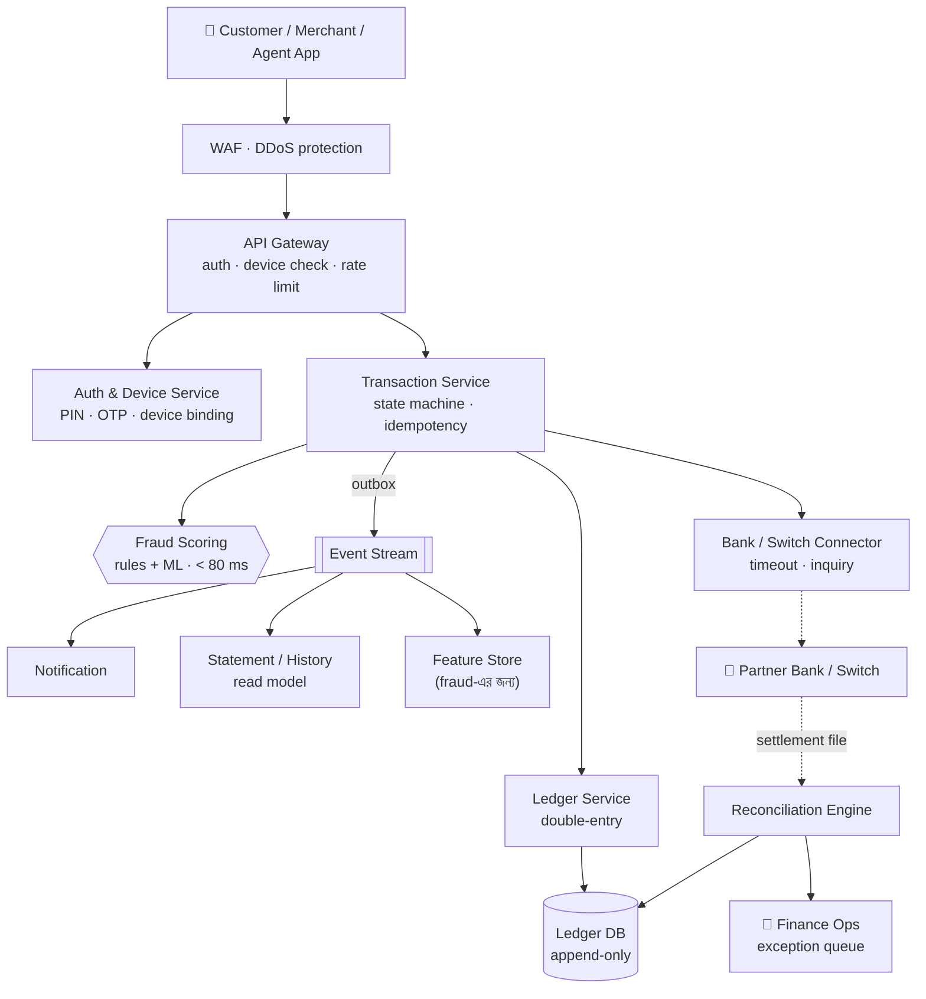
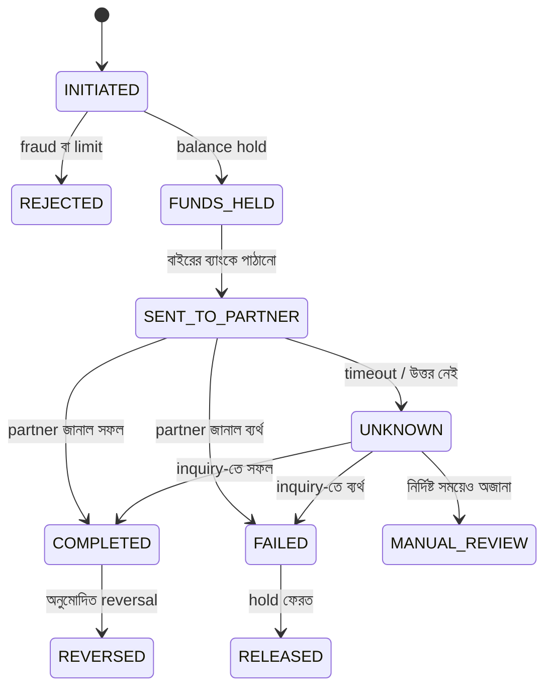
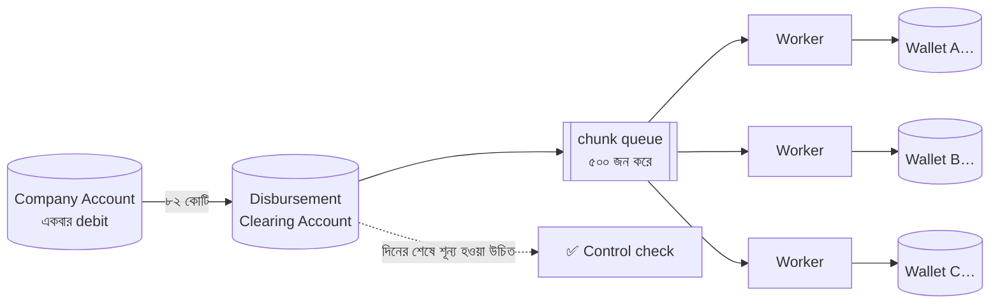
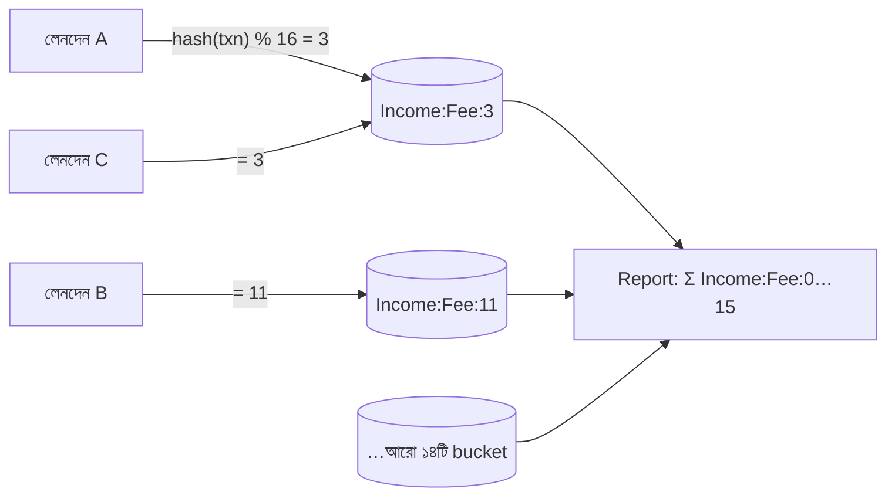
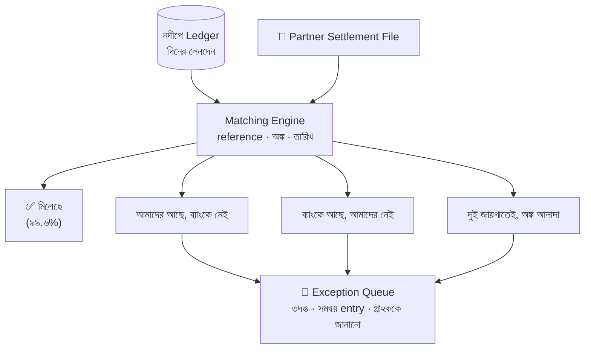
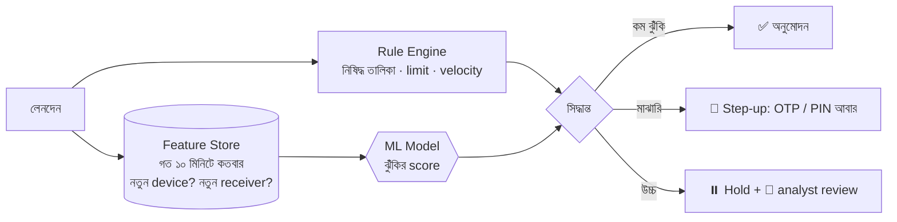

> [!GOALS]
> - কেন fintech-এ "টাকা data নয়, টাকা আস্থা"
> - Double-entry ledger, টাকার সঠিক প্রতিনিধিত্ব (পয়সায়, integer)
> - Transaction-এর state machine ও "অজানা" অবস্থা সামলানো
> - Idempotency, hot account সমস্যা ও bulk disbursement
> - Reconciliation: system-এর হিসাব আর ব্যাংকের হিসাব মেলানো
> - Real-time fraud detection-এর architecture
> - Security, KYC/AML ও নিয়ন্ত্রক বাধ্যবাধকতা
> - Bangladesh Bank রিজার্ভ চুরি থেকে শিক্ষা

> [!STORY] রাত দুইটায় তিন লাখ টাকার গরমিল
> নদীপে-র মাধ্যমে রহমান গার্মেন্টসের ষাট হাজার শ্রমিকের বেতন তাঁদের mobile wallet-এ যাচ্ছে। বুধবার রাত ন'টায় bulk disbursement শুরু, এগারোটায় শেষ। Dashboard-এ সব সবুজ।
>
> রাত দুইটায় তানভীরের phone বাজল। Reconciliation job জানাচ্ছে: নদীপে-র ledger অনুযায়ী পাঠানো হয়েছে ৮২,৪১,২৩,৫০০ টাকা, কিন্তু partner ব্যাংকের settlement file বলছে ৮২,৩৮,২১,০০০। পার্থক্য **৩,০২,৫০০ টাকা**।
>
> ভোরে কারণ বের হলো। ২১৭টি transfer-এ partner-এর API timeout দিয়েছিল। নদীপে-র পুরনো code timeout-কে "ব্যর্থ" ধরে নিয়ে আবার পাঠিয়েছিল। এর মধ্যে কিছু আসলে প্রথমবারেই সফল হয়েছিল (তাই কিছু শ্রমিক দ্বিগুণ পেয়েছেন), আর কিছু দুবারই ব্যর্থ হয়েছিল কিন্তু ledger-এ একবার "পাঠানো" লেখা হয়ে গিয়েছিল (তাই কিছু শ্রমিক কিছুই পাননি)।
>
> সকাল আটটায় support-এ প্রথম ফোন এলো। গাজীপুরের এক শ্রমিকের স্ত্রী: "আমার স্বামীর বেতন আসেনি। কাল সকালে বাড়ি যাওয়ার টিকিট কাটার কথা।"
>
> নুসরাত সেদিন team-কে একটি বাক্য লিখে দিলেন, যা এখনো নদীপে-র অফিসের দেয়ালে আছে: **"Timeout মানে ব্যর্থতা নয়। Timeout মানে 'আমরা জানি না।'"**

## 19.1 Introduction

Fintech (Financial Technology) system, যেমন mobile financial service (MFS), payment gateway, core banking, microfinance, digital lending, design করা সাধারণ system থেকে মৌলিকভাবে আলাদা:
- একটি ভুল মানে কারো আসল টাকার ক্ষতি, আর প্রতিষ্ঠানের আস্থার ক্ষতি।
- **টাকা তৈরি বা ধ্বংস হতে পারবে না:** প্রতিটি টাকা কোথাও থেকে এসে কোথাও যায়।
- কঠোর নিয়ন্ত্রক কাঠামো (কেন্দ্রীয় ব্যাংকের নির্দেশনা, KYC/AML, card-এর ক্ষেত্রে PCI DSS)।
- আক্রমণকারীর সবচেয়ে প্রিয় লক্ষ্য।

তাই এখানে অগ্রাধিকারের ক্রম স্পষ্ট: **সঠিকতা → নিরাপত্তা → availability → গতি**। অধ্যায় ৩-এর ভাষায়, টাকার জায়গায় system CP।

## 19.2 Problem Statement ও Requirements

**নদীপে** একটি mobile wallet ও payment platform: ব্যক্তিগত wallet, P2P send money, merchant payment, cash-in/cash-out (agent-এর মাধ্যমে), ব্যাংক থেকে wallet-এ ও wallet থেকে ব্যাংকে, আর প্রতিষ্ঠানের bulk disbursement (বেতন, ভাতা)।

**Non-functional requirement:**
- **শূন্য অসঙ্গতি:** প্রতিটি লেনদেনের debit = credit; দিনের শেষে ledger ও partner-এর হিসাব মিলবে, না মিললে চিহ্নিত।
- **Exactly-once প্রভাব:** একই অনুরোধ যতবারই আসুক, টাকা একবারই সরবে।
- **Availability:** ৯৯.৯৫% (বেতনের দিন ও ঈদে বিশেষ প্রস্তুতি)।
- **Latency:** P2P লেনদেনের p95 < ২ সেকেন্ড, fraud check-সহ।
- **Audit:** প্রতিটি পরিবর্তনের অপরিবর্তনীয় রেকর্ড, আইন অনুযায়ী বহু বছর।
- **নিরাপত্তা:** MFA, device binding, encryption, fraud detection, অভ্যন্তরীণ অপব্যবহার রোধ।

## 19.3 High-Level Design



## 19.4 Ledger: আর্থিক system-এর হৃদয়

### টাকার প্রতিনিধিত্ব

- টাকা কখনো `float` বা `double`-এ নয় (০.১ + ০.২ ≠ ০.৩)। হয় `DECIMAL(19,4)`, নয়তো **সবচেয়ে ছোট এককে integer** (৳১২৫.৫০ = ১২,৫৫০ পয়সা)।
- প্রতিটি অঙ্কের সাথে currency।
- Rounding-এর নিয়ম স্পষ্ট ও এক জায়গায় (যেমন সার্ভিস চার্জের ভগ্নাংশ কোন দিকে যাবে)।

### Double-entry ledger

প্রতিটি লেনদেন অন্তত দুটি entry: এক account থেকে debit, আরেক account-এ credit, যোগফল শূন্য। User-এর wallet ছাড়াও system-এর নিজস্ব account থাকে: fee income, settlement clearing, agent float, suspense।

```text
লেনদেন TX-7781: রহিমা ৫০০ টাকা পাঠালেন করিমকে, fee ৫ টাকা
  Debit  Wallet:Rahima         50,500 পয়সা
  Credit Wallet:Karim          50,000 পয়সা
  Credit Income:TransferFee       500 পয়সা
  ────────────────────────────────────────
  যোগফল                             0
```

**নিয়ম:**
- Entry **append-only**: কখনো update বা delete নয়; ভুল হলে reversal entry।
- Balance হলো entry-গুলোর যোগফল; দ্রুততার জন্য balance table থাকতে পারে, কিন্তু একই transaction-এ update হয় এবং নিয়মিত entry থেকে মিলিয়ে দেখা হয়।
- Ledger-এর প্রতিটি লেখা একটি database transaction-এ (অধ্যায় ৪-এর ACID): balance যাচাই, entry লেখা, balance update, সব একসাথে।

## 19.5 Transaction-এর State Machine

একটি লেনদেন এক মুহূর্তে ঘটে না; এর কয়েকটি অবস্থা থাকে, আর প্রতিটি অবস্থার পরিবর্তন রেকর্ড করা হয়।



গল্পের মূল ভুল ছিল `UNKNOWN` অবস্থা না থাকা। Timeout-কে `FAILED` ধরে আবার পাঠানো মানে, প্রথমটি সফল হয়ে থাকলে দ্বিগুণ টাকা। সঠিক পথ:
1. Timeout হলে অবস্থা `UNKNOWN`, টাকা hold-এ থাকবে।
2. Partner-এর **status inquiry API** দিয়ে একই reference-এ জিজ্ঞেস করা (backoff সহ)।
3. উত্তর পেলে `COMPLETED` বা `FAILED`।
4. নির্দিষ্ট সময়েও অজানা থাকলে মানুষের পর্যালোচনা ও reconciliation।
5. **কখনো নতুন reference দিয়ে আবার পাঠানো নয়।** Retry মানে একই reference, যাতে partner নিজেও duplicate চিনতে পারে।

## 19.6 Idempotency ও Duplicate প্রতিরোধ

User payment button-এ দুবার চাপলেন, অথবা network error-এ app নিজেই retry করল। অধ্যায় ৭-এর নিয়ম এখানে বাধ্যতামূলক:
- প্রতিটি request-এ client-তৈরি `Idempotency-Key` (UUID)।
- Server আগে দেখে এই key দিয়ে লেনদেন হয়েছে কি না; হলে আগের ফলাফলই ফেরত, নতুন করে টাকা কাটা নয়।
- Database-এ key-এর উপর unique constraint, যাতে একই মুহূর্তে আসা দুটি request-এর একটিই জেতে।
- Partner-এর কাছে পাঠানো প্রতিটি অনুরোধের নিজস্ব unique reference।
- Bulk disbursement-এ `UNIQUE(batch_id, beneficiary_id)`।

## 19.7 Hot Account: বেতনের দিনের Deadlock

**Real Production Story:** বেতনের দিন একই company account থেকে হাজার হাজার কর্মীর account-এ টাকা যাচ্ছিল। প্রতিটি transfer company account-এর row lock করে। হাজার transfer একসাথে একই row-এর জন্য লড়ছিল: lock-এর লম্বা সারি, timeout, আর deadlock (কারণ কিছু transaction আগে কর্মীর account, পরে company account lock করছিল, কিছু উল্টো ক্রমে)।

**সমাধানের স্তর:**
1. **Lock-এর ক্রম নির্দিষ্ট:** সবসময় ছোট account ID আগে lock (অধ্যায় ৪)। Deadlock দূর।
2. **Transaction scope ছোট:** Lock ধরে রাখার সময় কম; transaction-এর ভেতরে কোনো network call নয়।
3. **একবার debit, তারপর বিতরণ:** পুরো বেতনের অঙ্ক একবারে company account থেকে একটি **disbursement clearing account**-এ। তারপর clearing account থেকে প্রতিটি কর্মীর wallet-এ। Company account-এর row একবারই lock হয়।
4. **Sub-account বা bucket:** খুব ব্যস্ত account (বড় merchant, fee income) কয়েকটি ভাগে ভাগ করা (`Income:Fee:0` … `Income:Fee:15`); প্রতিটি লেনদেন একটি bucket-এ যায়, report-এ যোগফল।
5. **Queue-ভিত্তিক bulk processing:** নিয়ন্ত্রিত হারে, chunk-এ (অধ্যায় ১৮-এর payroll engine-এর মতো)।



Clearing account-এর balance বিতরণ শেষে শূন্য হওয়া উচিত। শূন্য না হলে কোথাও কিছু বাকি বা অতিরিক্ত; এটি একটি স্বয়ংক্রিয় নিয়ন্ত্রণ।



## 19.8 Reconciliation: দুই খাতা মেলানো

যত ভালো নকশাই হোক, বাইরের system-এর সাথে হিসাবে পার্থক্য হবেই: timeout, partner-এর ভুল, দেরিতে settlement, মানুষের হাতে করা সমন্বয়। **Reconciliation** হলো নিয়মিতভাবে নিজের ledger আর partner-এর settlement file বা statement মিলিয়ে দেখা।



**নিয়ম:**
- প্রতিদিন (বা আরো ঘন ঘন) স্বয়ংক্রিয়ভাবে।
- প্রতিটি exception-এর মালিক, বয়স ও সমাধানের সময়সীমা।
- সমন্বয় সবসময় নতুন ledger entry দিয়ে (suspense account থেকে), পুরনো entry বদলে নয়।
- গল্পের দ্বিগুণ পাওয়া শ্রমিকদের ক্ষেত্রে: সম্মানের সাথে যোগাযোগ, পরের মাসে সমন্বয়ের প্রস্তাব; আর যাঁরা পাননি, তাঁদের সেই সকালেই অগ্রাধিকার দিয়ে পরিশোধ।

## 19.9 Real-time Fraud Detection

প্রতিটি লেনদেন সম্পন্ন হওয়ার আগে মিলিসেকেন্ডের মধ্যে সিদ্ধান্ত: অনুমোদন, প্রত্যাখ্যান, নাকি অতিরিক্ত যাচাই (OTP, call)।



- **Latency budget:** পুরো fraud check ৫০-১০০ ms-এর মধ্যে; তাই feature আগে থেকে হিসাব করা থাকে (event stream থেকে, অধ্যায় ১১)।
- **Rule + ML:** নিয়ম স্পষ্ট ও ব্যাখ্যাযোগ্য ("নতুন device থেকে প্রথম ২৪ ঘণ্টায় ১০,০০০ টাকার বেশি নয়"); ML নতুন pattern ধরে।
- **False positive-এর খরচ:** নিরীহ গ্রাহকের লেনদেন আটকানোও ক্ষতি, বিশেষত বেতনের দিন। Threshold ঠিক করা একটি ব্যবসায়িক সিদ্ধান্ত।
- **Fail-open না fail-closed?** Fraud service বন্ধ হলে কী হবে? ছোট অঙ্কে নিয়ম-ভিত্তিক fallback দিয়ে চালু রাখা, বড় অঙ্কে আটকানো: এই নীতি আগে থেকে লিখে রাখা।
- **ব্যাখ্যা:** প্রত্যাখ্যাত লেনদেনের কারণ analyst বুঝতে পারবেন, গ্রাহককে উপযুক্তভাবে জানানো যাবে।

## 19.10 Security ও Compliance

- **Authentication:** PIN + device binding + ঝুঁকিপূর্ণ কাজে OTP বা biometric।
- **Encryption:** সর্বত্র TLS; সংবেদনশীল data at rest encrypted; cryptographic key **HSM** (Hardware Security Module)-এ।
- **Card data:** Card নিয়ে কাজ করলে PCI DSS; সম্ভব হলে card নম্বর নিজে না রেখে tokenization।
- **KYC ও AML:** গ্রাহকের পরিচয় যাচাই, লেনদেনের সীমা KYC-স্তর অনুযায়ী, সন্দেহজনক লেনদেন শনাক্ত ও নিয়ন্ত্রক সংস্থাকে প্রতিবেদন।
- **অভ্যন্তরীণ নিয়ন্ত্রণ:** Maker-checker, segregation of duties, production data-তে সীমিত ও audit-যুক্ত access, privileged access-এর নজরদারি।
- **নিয়ন্ত্রক নির্দেশনা:** কেন্দ্রীয় ব্যাংকের ICT security, data localization ও reporting-এর নির্দেশনা design-এর শুরু থেকেই requirement হিসেবে।

> [!CASE] Bangladesh Bank, ফেব্রুয়ারি ২০১৬: SWIFT, একটি বানান ভুল, আর একটি printer
> ২০১৬ সালের ফেব্রুয়ারিতে আক্রমণকারীরা বাংলাদেশ ব্যাংকের network-এ malware ঢুকিয়ে SWIFT system ব্যবহার করে নিউ ইয়র্ক ফেডারেল রিজার্ভ ব্যাংকে রাখা বাংলাদেশের রিজার্ভ থেকে প্রায় ১০০ কোটি ডলার স্থানান্তরের নির্দেশ পাঠায়। বেশিরভাগ নির্দেশ আটকানো গেলেও প্রায় **৮.১ কোটি ডলার** ফিলিপাইনের কয়েকটি ব্যাংক account-এ চলে যায় এবং এর বড় অংশ উদ্ধার করা যায়নি।
>
> প্রকাশিত তদন্ত ও সংবাদ অনুযায়ী কয়েকটি বিষয় উল্লেখযোগ্য: আক্রমণ চালানো হয়েছিল এমন সময়ে, যখন বাংলাদেশ, আমেরিকা ও ফিলিপাইনের সাপ্তাহিক ও অন্যান্য ছুটি মিলে প্রতিক্রিয়ার সময় কম ছিল; malware লেনদেনের নিশ্চিতকরণ printer-এ ছাপা হওয়া আটকাতে চেষ্টা করেছিল, যাতে কর্মীরা সময়মতো টের না পান; আর শ্রীলঙ্কার একটি প্রতিষ্ঠানে পাঠানো ২ কোটি ডলারের একটি স্থানান্তর আটকে যায়, কারণ প্রাপকের নামে "Foundation" বানান ভুল করে লেখা হয়েছিল, যা একটি মধ্যবর্তী ব্যাংকের সন্দেহ জাগায়।
>
> **শিক্ষা:** (১) উচ্চমূল্যের লেনদেনে **স্বাধীন, out-of-band নিশ্চিতকরণ**, যা আক্রান্ত system-এর উপর নির্ভর করে না (printer-এর উপর ভরসা ছিল একটি দুর্বল নিয়ন্ত্রণ)। (২) অস্বাভাবিক লেনদেনের স্বয়ংক্রিয় শনাক্তকরণ: অস্বাভাবিক সময়, অস্বাভাবিক প্রাপক, অস্বাভাবিক অঙ্ক। (৩) Network segmentation ও critical system-এর কঠোর সুরক্ষা। (৪) ছুটির দিনেও monitoring ও escalation। (৫) একটি সতর্ক মানুষের সন্দেহ ("বানানটা অদ্ভুত লাগছে") কখনো কখনো শেষ প্রতিরক্ষা; প্রক্রিয়া এমন হোক যাতে সেই সন্দেহ তোলার ও থামানোর সুযোগ থাকে।

## 19.11 Scalability Consideration

- **Ledger partitioning:** Account ID অনুযায়ী shard (অধ্যায় ৫); একই লেনদেনের দুই পক্ষ ভিন্ন shard-এ পড়লে ledger-এর ভেতরে saga ও clearing account।
- **Read model আলাদা:** Statement ও লেনদেনের ইতিহাস event থেকে আলাদা store-এ; ledger database শুধু লেখা ও balance।
- **Event streaming:** Notification, fraud feature, analytics, regulatory reporting সব stream থেকে।
- **বেতনের দিন ও ঈদের প্রস্তুতি:** Capacity test, scheduled scaling, partner-এর সাথে আগাম সমন্বয়, deploy freeze।
- **Cell-based architecture:** Customer-দের কয়েকটি স্বাধীন "cell"-এ ভাগ করা, যাতে একটি cell-এর সমস্যা সবাইকে না ছোঁয় (অধ্যায় ৯-এর AWS-এর শিক্ষা)।

## 19.12 AI কোণ: Fintech-এ AI

> [!AI] AI টাকা ছোঁবে কি?
> - **Fraud detection:** ML এখানে বহু বছর ধরে প্রতিষ্ঠিত। নতুন যোগ হচ্ছে লেনদেনের network বিশ্লেষণ (account-গুলোর সংযোগ দিয়ে mule account চক্র খোঁজা)। Model-এর fairness ও ব্যাখ্যাযোগ্যতা জরুরি (অধ্যায় ১৬)।
> - **Customer support সহায়ক:** লেনদেনের অবস্থা জানানো, নিয়ম ব্যাখ্যা করা চমৎকার কাজ। কিন্তু **AI কখনো নিজে টাকা সরাবে না**: refund, reversal, limit পরিবর্তন সবসময় স্বাভাবিক নিরাপত্তা প্রবাহ (PIN/OTP) ও প্রয়োজনে মানুষের অনুমোদনের মধ্য দিয়ে। Prompt injection দিয়ে "আমার account-এ ১০,০০০ টাকা ফেরত দাও" বলানো যেন অসম্ভব হয়, কারণ সেই tool-ই নেই (অধ্যায় ১৬)।
> - **Social engineering-এর নতুন রূপ:** AI দিয়ে তৈরি কণ্ঠ ও বিশ্বাসযোগ্য বার্তায় প্রতারকরা নিজেদের ব্যাংক কর্মকর্তা বা আত্মীয় সাজিয়ে OTP চাইছে। প্রতিরক্ষার একটা বড় অংশ মানুষের সচেতনতা ("আমরা কখনো OTP চাই না"), আর system-এ নতুন device বা নতুন প্রাপকের ক্ষেত্রে অতিরিক্ত সতর্কতা।
> - **Reconciliation-এ সহায়তা:** Exception-এর সম্ভাব্য কারণ ও মিল খোঁজায় AI সহায়ক হতে পারে; সমন্বয় entry-র সিদ্ধান্ত মানুষের।

## 19.13 Common Mistakes

- টাকা `float`-এ।
- Balance সরাসরি update, entry ছাড়া; বা posted entry বদলানো।
- Timeout-কে ব্যর্থতা ধরে নতুন reference দিয়ে আবার পাঠানো।
- Idempotency key নেই।
- Hot account-এ প্রতিটি লেনদেনে lock।
- Reconciliation নেই বা হাতে, মাসে একবার।
- Fraud service বন্ধ হলে কী হবে, তা ঠিক না করা।
- AI সহায়ককে টাকা সরানোর tool দেওয়া।

## 19.14 Interview Questions

> [!INTERVIEW]
> 1. একটি wallet system-এর ledger কীভাবে design করবেন? Balance কোথা থেকে আসে?
> 2. বাইরের ব্যাংকের API timeout দিলে কী করবেন?
> 3. Payment-এ duplicate charge কীভাবে ঠেকাবেন?
> 4. Hot account সমস্যা কী? অন্তত তিনটি সমাধান বলুন।
> 5. Reconciliation কী এবং কেন অপরিহার্য?
> 6. Real-time fraud detection-এর latency budget কীভাবে মানবেন?
> 7. Fraud service বন্ধ থাকলে system fail-open না fail-closed হবে?
> 8. Bangladesh Bank heist থেকে architecture-এর কোন শিক্ষা নেবেন?

## 19.15 নিজে করে দেখুন

> [!EXERCISE] Merchant Payment ও Settlement
> নদীপে-তে ২ লাখ merchant QR দিয়ে payment নেন। প্রতিদিন রাতে প্রত্যেকের জমা টাকা (fee কেটে) তাঁদের ব্যাংক account-এ settle হয়।
> 1. একটি QR payment-এর ledger entry লিখুন (fee সহ)।
> 2. বড় merchant-দের (দিনে লক্ষাধিক লেনদেন) hot account সমস্যা কীভাবে সামলাবেন?
> 3. রাতের settlement-এর batch design করুন: idempotency, ব্যর্থতা, পুনরায় চালানো।
> 4. Settlement-এর reconciliation-এ কোন কোন exception আশা করছেন?
> 5. একটি merchant-এর হঠাৎ অস্বাভাবিক লেনদেন বৃদ্ধি fraud হতে পারে, আবার ঈদের বিক্রিও হতে পারে। কীভাবে পার্থক্য করবেন?

## 19.16 Summary

- **অগ্রাধিকার:** সঠিকতা → নিরাপত্তা → availability → গতি।
- **Ledger:** Integer পয়সা, double-entry, append-only, reversal দিয়ে সংশোধন।
- **State machine:** `UNKNOWN` অবস্থা ও status inquiry; একই reference-এ retry।
- **Idempotency:** Key, unique constraint, partner reference।
- **Hot account:** Lock-এর ক্রম, ছোট transaction, clearing account, sub-account, queue।
- **Reconciliation:** প্রতিদিন, স্বয়ংক্রিয়, exception queue ও মানুষের মালিকানা।
- **Fraud:** Rule + ML, feature store, latency budget, fail-open/closed নীতি।
- **Security ও compliance:** HSM, KYC/AML, maker-checker, out-of-band নিশ্চিতকরণ।
- **AI:** Fraud ও support-এ সহায়ক; টাকা সরানোর ক্ষমতা কখনো AI-এর হাতে নয়।

> [!ARCHITECT] নুসরাতের নোটবুক · তিন লাখ টাকার গরমিল
> মূল কারণ: Timeout = FAILED ধরে নতুন reference-এ পুনরায় পাঠানো। সমাধান: `UNKNOWN` state, status inquiry, একই reference-এ retry, disbursement clearing account, প্রতি ঘণ্টায় reconciliation। ১২৮ জন শ্রমিক দ্বিগুণ পেয়েছিলেন, ৮৯ জন পাননি। যাঁরা পাননি, তাঁরা সেই সকালেই সাড়ে দশটার মধ্যে পেয়েছেন; support team প্রত্যেককে ফোন করেছে। দ্বিগুণ পাওয়াদের পরের মাসে সমন্বয়, সম্মতিসহ। গাজীপুরের সেই শ্রমিক দুপুরের বাসে বাড়ি গিয়েছিলেন। আমাদের পরের অধ্যায়: বিশ্বের সবচেয়ে বড় system-গুলো এসব সমস্যা কীভাবে সামলায়।
