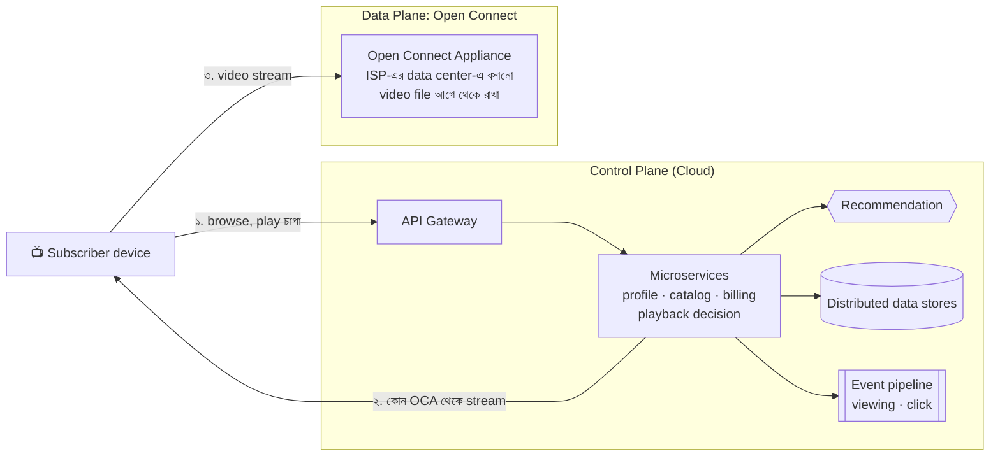
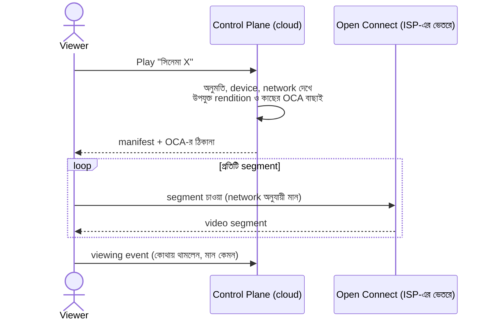
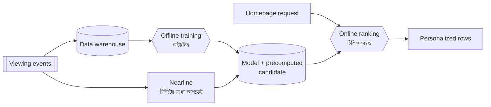
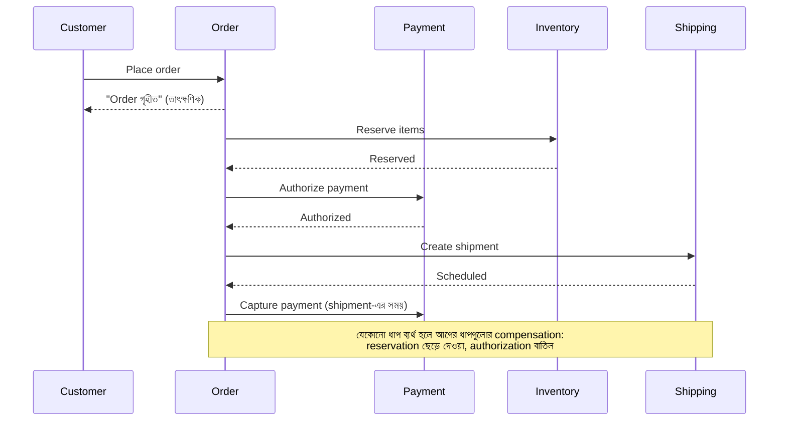
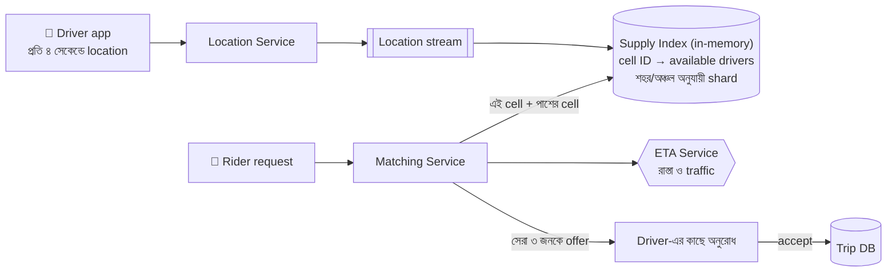
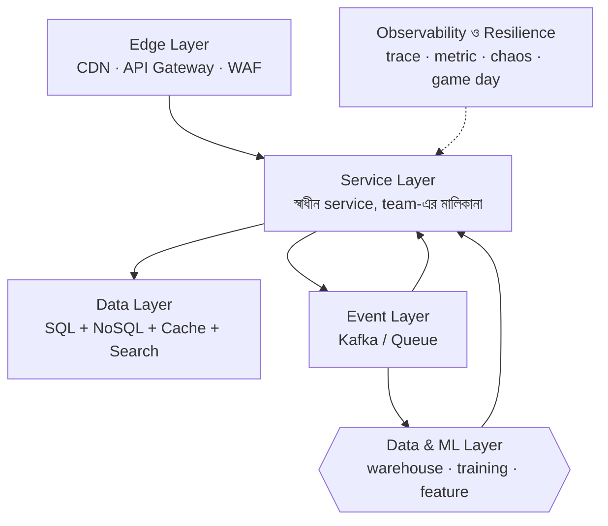

> [!GOALS]
> - Netflix: CDN-কে নিজের হাতে নেওয়া, chaos engineering ও recommendation
> - Amazon: service-oriented সংস্কৃতি, "সবসময় লেখা যায়" এমন cart, order-এর saga
> - Uber: real-time location, geospatial index ও matching
> - তিনটি system-এর সাধারণ pattern
> - বড় প্রতিষ্ঠানের গল্প থেকে নিজের প্রেক্ষাপটে কী নেবেন, কী নেবেন না

> [!STORY] Case Study Friday
> প্রতি শুক্রবার বিকেলে নদী টেকে একটি ছোট reading group বসে। এ সপ্তাহের বিষয়: Netflix, Amazon, Uber। রাফি Netflix নিয়ে উত্তেজিত হয়ে presentation দিল: হাজারখানেক microservice, chaos monkey, নিজেদের CDN। শেষে বলল, "আমাদেরও এমন করা উচিত!"
>
> নুসরাত হাসলেন। "Netflix-এর engineer সংখ্যা জানো? আর আমাদের? Netflix যখন শুরু করেছিল, তারা কি হাজার microservice দিয়ে শুরু করেছিল?" একটু থেমে বললেন, "বড় প্রতিষ্ঠানের architecture পড়ো তাদের **সমস্যা** বুঝতে। তাদের সমাধান কপি করো না; তাদের **নীতি** কপি করো। কারণ তারা যে সমস্যা থেকে ওই সমাধানে পৌঁছেছে, সেই সমস্যা হয়তো আমাদের নেই।"

## 20.1 Introduction

এ পর্যন্ত আমরা database scaling, caching, API, security, microservices, queue, observability, load balancing, platform আর AI শিখেছি। এই অধ্যায়ে দেখব বাস্তবের তিনটি বিশাল system কীভাবে এগুলো একসাথে ব্যবহার করে। তথ্যগুলো এসেছে প্রতিষ্ঠানগুলোর নিজস্ব প্রকাশিত engineering blog, গবেষণাপত্র ও conference talk থেকে; ভেতরের বিস্তারিত সময়ের সাথে বদলায়, কিন্তু নীতিগুলো স্থায়ী।

## 20.2 Netflix: বিশ্বজুড়ে video, প্রতিটি মুহূর্তে

### মূল চ্যালেঞ্জ

- বিশ্বের বিভিন্ন দেশে কোটি কোটি subscriber, সন্ধ্যার সময় বিশাল একযোগে viewing।
- Video বিপুল bandwidth নেয়; ইন্টারনেটের মোট traffic-এর উল্লেখযোগ্য অংশ।
- প্রতিটি device (TV, phone, browser) ও network-এর জন্য ভিন্ন মানের stream।
- কী দেখবেন, তা বেছে নিতে সাহায্য করা (personalization)।

### Control Plane ও Data Plane

Netflix-এর architecture বোঝার সবচেয়ে সহজ উপায় দুই ভাগে ভাবা:

**Control plane** (cloud-এ): login, catalog দেখা, recommendation, billing, আর "play" চাপলে কোন server থেকে কোন মানের stream আসবে সেই সিদ্ধান্ত। **Data plane:** আসল video bytes আসে **Open Connect** থেকে, Netflix-এর নিজস্ব CDN, যার appliance (server) Netflix বিভিন্ন ISP-এর ভেতরে বা কাছাকাছি বসায়। জনপ্রিয় video রাতে কম ব্যস্ত সময়ে আগেভাগে সেখানে পৌঁছে দেওয়া হয়।

**কেন নিজের CDN?** Netflix-এর মাত্রায় video traffic এত বিশাল যে নিজস্ব CDN খরচ কমায়, মান নিয়ন্ত্রণে রাখে, আর ISP-এর জন্যও লাভজনক (তাদের বাইরের bandwidth বাঁচে)। **শিক্ষা আপনার জন্য:** নিজের CDN নয়; বরং ভারী data-কে user-এর কাছে, আগেভাগে রাখা (অধ্যায় ৬)।

### Cloud migration ও resilience-এর সংস্কৃতি

Netflix-এর প্রকাশিত বিবরণ অনুযায়ী ২০০৮ সালে তাদের নিজস্ব data center-এ একটি বড় database corruption-এর কারণে কয়েক দিন DVD পাঠানো বিঘ্নিত হয়েছিল। এই ঘটনা তাদের একটি বড় সিদ্ধান্তের দিকে নিয়ে যায়: একটি বিশাল কেন্দ্রীয় system থেকে সরে cloud-এ, অনেকগুলো স্বাধীন ও horizontally scalable service-এ যাওয়া; বহু বছরের ধাপে ধাপে migration (অধ্যায় ১০-এর strangler fig-এর মতো)।

### Chaos Engineering

Netflix ২০১০-এর দশকের শুরুতে **Chaos Monkey** নামে একটি tool প্রকাশ্যে আনে, যা কাজের সময়ে production-এর server **ইচ্ছা করে, এলোমেলোভাবে বন্ধ করে দেয়**। উদ্দেশ্য: যদি server নষ্ট হওয়া অনিবার্যই হয়, তাহলে সেটা ঘটুক যখন engineer-রা জেগে আছেন ও প্রস্তুত, আর প্রতিটি team বাধ্য হোক তাদের service-কে এমনভাবে বানাতে যাতে একটি instance হারালেও কিছু না হয়। পরে এর সাথে যুক্ত হয় আরো বড় পরিসরের পরীক্ষা (পুরো zone বা region বন্ধের মহড়া)।

> [!ARCHITECT] Chaos engineering-এর মানবিক রূপ
> নদী টেক Chaos Monkey চালায় না, কিন্তু নীতিটা নিয়েছে: অধ্যায় ৯-এর **game day**। নিয়ন্ত্রিত পরিবেশে, সবাইকে জানিয়ে, অফিস সময়ে একটি component বন্ধ করে দেখা। Chaos engineering-এর সারকথা tool নয়: **"ব্যর্থতা ঘটবেই; তাকে আমরা বেছে নেওয়া সময়ে ঘটতে দেব, রাত তিনটায় নয়।"**

Netflix-এর আরেকটি বিখ্যাত অবদান **Hystrix**, circuit breaker-এর একটি library (অধ্যায় ১০), যা microservice-এর জগতে এই pattern জনপ্রিয় করে।

### Recommendation

Netflix-এর গবেষকদের প্রকাশিত একটি গবেষণাপত্র ("The Netflix Recommender System", ২০১৫) অনুযায়ী দেখার সময়ের বড় অংশ (তাদের হিসাবে প্রায় ৮০%) আসে recommendation-এর মাধ্যমে আবিষ্কৃত content থেকে। Homepage-এর প্রতিটি সারি, সারির ক্রম, এমনকি একই সিনেমার জন্য কোন ছবি (artwork) দেখানো হবে, সেটাও personalization।

**Architecture-এর দিক:** ভারী model training offline-এ (batch), কিছু অংশ nearline-এ (দেখার ঘটনার কয়েক মিনিটের মধ্যে event stream থেকে), আর request-এর সময় দ্রুত online ranking। প্রতিটি নতুন algorithm A/B test দিয়ে যাচাই।

## 20.3 Amazon: Service-এর জন্ম ও সবসময় খোলা cart

### মূল চ্যালেঞ্জ

বিশাল product catalog, উৎসবের মৌসুমে বিপুল order, payment, inventory-র সমন্বয়, delivery tracking, আর বিশ্বের নানা প্রান্তের seller।

### Service-oriented সংস্কৃতি

অধ্যায় ১০-এ দেখেছি, ২০০০-এর দশকের শুরুতে Amazon-এর team-গুলোকে শুধু service interface দিয়ে যোগাযোগ করতে বলা হয়েছিল। এর সাথে আসে "two-pizza team" ধারণা (এত ছোট team যাকে দুটি pizza দিয়ে খাওয়ানো যায়), প্রতিটি team নিজের service-এর পূর্ণ মালিক: "you build it, you run it"।

### Dynamo: "Add to Cart" কখনো ব্যর্থ হবে না

২০০৭ সালে Amazon-এর engineer-রা **Dynamo** নামে তাদের একটি অভ্যন্তরীণ key-value store নিয়ে একটি প্রভাবশালী গবেষণাপত্র প্রকাশ করেন। মূল উদ্দেশ্য ছিল shopping cart-এর মতো service: ব্যবসায়িকভাবে সবচেয়ে গুরুত্বপূর্ণ ছিল যে গ্রাহক **যেকোনো অবস্থায়** cart-এ জিনিস যোগ করতে পারবেন, এমনকি server বা network সমস্যা চললেও। তাই Dynamo সচেতনভাবে **availability**-কে consistency-র উপরে রাখে (অধ্যায় ৩-এর AP): consistent hashing দিয়ে data ভাগ (অধ্যায় ৯), একাধিক replica-তে লেখা, আর সংঘর্ষ হলে (দুই জায়গায় দুই রকম cart) পরে মিলিয়ে নেওয়া: যেমন দুটি cart-এর জিনিস একত্র করা। এর ফলে কখনো কখনো মুছে ফেলা জিনিস cart-এ ফিরে আসতে পারত, কিন্তু Amazon-এর হিসাবে সেটা "cart কাজ করছে না"-এর চেয়ে অনেক কম ক্ষতিকর।

এই গবেষণাপত্র পরে Cassandra-সহ অনেক NoSQL database-এর নকশাকে প্রভাবিত করে। **শিক্ষা:** CAP-এর সিদ্ধান্ত technical নয়, **ব্যবসায়িক**। "কোন ভুল আমাদের জন্য কম ক্ষতিকর?" প্রশ্নের উত্তর থেকে architecture আসে।

### Order Flow: একটি Saga

লক্ষ্য করুন, payment-কে দুই ধাপে ভাগ করা হয়েছে: **authorize** (টাকা আটকে রাখা) আর **capture** (আসলে কাটা)। এতে stock না থাকলে টাকা কাটা হয় না, শুধু আটকানো বাতিল হয়: compensation সহজ ও গ্রাহকবান্ধব।

### Inventory ও Event-driven system

Catalog আর product page বিপুল পরিমাণে পড়া হয় (cache ও eventual consistency চলে), কিন্তু শেষ জিনিসটি reserve করার মুহূর্তে কঠোর consistency (অধ্যায় ৪-এর race condition)। Order-এর প্রতিটি ধাপ event তৈরি করে, যা delivery tracking, notification, analytics, recommendation সবাই আলাদাভাবে শোনে।

## 20.4 Uber: পৃথিবীর মানচিত্রে real-time

### মূল চ্যালেঞ্জ

- লাখো driver প্রতি কয়েক সেকেন্ডে location পাঠায়: বিশাল write।
- Rider request করলে কাছের উপযুক্ত driver মুহূর্তে খুঁজে বের করা।
- ETA ও ভাড়ার হিসাব, traffic বিবেচনা করে।
- চাহিদা ও যোগানের ভারসাম্য (surge)।

### Geospatial Index

"আমার ১ কিলোমিটারের মধ্যে কোন কোন driver আছে?" প্রশ্নের উত্তর latitude-longitude-এর উপর সাধারণ index দিয়ে দ্রুত হয় না। সমাধান: পৃথিবীর মানচিত্রকে ছোট ছোট **cell**-এ ভাগ করা, প্রতিটি cell-এর একটি ID। Driver-এর অবস্থান মানে "তিনি কোন cell-এ"; কাছের driver খোঁজা মানে "এই cell আর পাশের cell-গুলোতে কে আছে"। Uber এর জন্য **H3** নামে একটি ষড়ভুজাকৃতির (hexagonal), স্তরভিত্তিক (hierarchical) grid system তৈরি করে ২০১৮ সালে open-source করে। ষড়ভুজের সুবিধা: প্রতিটি প্রতিবেশীর দূরত্ব প্রায় সমান। Geohash, S2 অন্যান্য প্রচলিত বিকল্প।

### Matching ও Surge

Matching শুধু "সবচেয়ে কাছের driver" নয়: ETA (নদী পার হতে হলে কাছের driver দূরের হয়ে যায়), driver-এর দিক, রেটিং, আর পুরো এলাকার সামগ্রিক দক্ষতা। Supply index পুরোপুরি memory-তে এবং ভৌগোলিকভাবে shard করা, কারণ ঢাকার driver-দের তথ্য সিলেটের অনুরোধে লাগে না।

**Surge pricing:** কোনো এলাকায় চাহিদা যোগানের চেয়ে অনেক বেশি হলে ভাড়ার গুণক বাড়ানো হয়, যাতে আরো driver সেখানে আসতে উৎসাহিত হন এবং কিছু চাহিদা পিছিয়ে যায়। Architecture-এর দিক থেকে এটি একটি real-time stream processing সমস্যা: প্রতিটি cell-এ সাম্প্রতিক চাহিদা ও যোগান হিসাব করে মিনিটে মিনিটে গুণক।

### Event-ভিত্তিক trip জীবনচক্র

`RideRequested → DriverAssigned → DriverArrived → TripStarted → TripCompleted → PaymentCaptured`: প্রতিটি event-এ notification, ভাড়া হিসাব, analytics, safety feature, আর fraud check আলাদাভাবে সাড়া দেয় (অধ্যায় ১১)।

## 20.5 তিনটির তুলনা

| | Netflix | Amazon | Uber |
| --- | --- | --- | --- |
| মূল কাজ | Streaming | E-commerce | Real-time matching |
| বড় চ্যালেঞ্জ | Bandwidth, বিশ্বজুড়ে latency | Order, inventory, availability | Location write, দ্রুত geo-query |
| মূল কৌশল | নিজস্ব CDN, chaos engineering | Service ownership, AP store, saga | Geospatial cell, in-memory index, stream processing |
| Consistency | Catalog ও recommendation eventual | Cart AP; payment ও শেষ stock কঠোর | Location eventual; trip ও payment কঠোর |
| AI/ML | Recommendation, artwork, encoding | Recommendation, পূর্বাভাস, fraud | ETA, surge, fraud, matching |

## 20.6 সাধারণ Pattern

**বড় প্রতিষ্ঠানগুলোর শিক্ষা:**
1. **ব্যর্থতা ধরে নিয়ে design করুন** এবং নিয়মিত পরীক্ষা করুন।
2. **ভারী data user-এর কাছে রাখুন** (CDN, edge, cache)।
3. **Consistency ব্যবসার প্রয়োজন অনুযায়ী বেছে নিন,** প্রতিটি অংশের জন্য আলাদাভাবে।
4. **Event দিয়ে decouple করুন।**
5. **Team ও service-এর মালিকানা মেলান।**
6. **সবকিছু মাপুন** এবং A/B test দিয়ে সিদ্ধান্ত নিন।
7. **ধাপে ধাপে বিকশিত হোন:** এই প্রতিষ্ঠানগুলোর কেউই আজকের architecture দিয়ে শুরু করেনি।

## 20.7 আপনার প্রেক্ষাপটে কী নেবেন

| বড় প্রতিষ্ঠানের অনুশীলন | নদী টেকের মতো প্রতিষ্ঠানে উপযুক্ত রূপ |
| --- | --- |
| নিজস্ব CDN (Open Connect) | Commercial CDN + আগাম PDF তৈরি |
| Chaos Monkey | ত্রৈমাসিক game day |
| হাজার microservice | Modular monolith + কয়েকটি আলাদা service |
| নিজস্ব distributed database (Dynamo) | Managed PostgreSQL/SQL Server + Redis; প্রয়োজনে managed NoSQL |
| H3 ও বিশাল in-memory index | PostGIS বা Redis GEO দিয়ে শুরু |
| বিশাল ML platform | একটি ভালো managed ML service ও কয়েকটি ভালোভাবে monitor করা model |

## 20.8 সাধারণ ভুল

- **বড় প্রতিষ্ঠানের সমাধান হুবহু কপি করা,** তাদের সমস্যা ছাড়াই (over-engineering)।
- **শুধু architecture diagram দেখা,** পেছনের সংস্কৃতি (ownership, postmortem, testing) না দেখা।
- **Consistency-র সিদ্ধান্ত পুরো system-এর জন্য একটাই।**
- **Caching ও event ছাড়াই scale-এর আশা।**
- **Observability ছাড়া distributed system।**

## 20.9 Interview প্রশ্ন

> [!INTERVIEW]
> 1. Netflix-এর মতো একটি video streaming platform-এর high-level design আঁকুন। Control plane ও data plane আলাদা কেন?
> 2. Amazon-এর shopping cart-এর জন্য availability কেন consistency-র চেয়ে গুরুত্বপূর্ণ?
> 3. E-commerce order-এ payment authorize ও capture আলাদা কেন?
> 4. Ride-sharing-এ "কাছের driver" দ্রুত খুঁজবেন কীভাবে?
> 5. Chaos engineering কী? একটি ছোট প্রতিষ্ঠানে এটি কীভাবে প্রয়োগ করবেন?
> 6. Surge pricing-এর জন্য data pipeline কেমন হবে?

## 20.10 নিজে করে দেখুন

> [!EXERCISE] বাংলাদেশের জন্য একটি Ride-sharing ও Delivery Platform
> ঢাকা, চট্টগ্রাম ও সিলেটে মোটরসাইকেল ride ও খাবার delivery-র একটি platform design করুন।
> 1. Driver-এর location কত ঘন ঘন নেবেন? দুর্বল network ও battery বিবেচনা করে।
> 2. Geospatial index কীভাবে করবেন? ঢাকার জ্যাম ও একমুখী রাস্তা ETA-তে কীভাবে আসবে?
> 3. ঈদের আগে চাহিদা হঠাৎ দশগুণ হলে কী করবেন?
> 4. Cash payment-এর জন্য কী বিশেষ ব্যবস্থা লাগবে (driver-এর কাছে জমা টাকার হিসাব)?
> 5. Netflix, Amazon ও Uber-এর কোন নীতি এখানে নেবেন, কোনটা নেবেন না?

## 20.11 Chapter Summary

- **Netflix:** Control plane cloud-এ, video নিজস্ব CDN-এ ISP-এর কাছে; chaos engineering; recommendation-এর তিন স্তর।
- **Amazon:** Service ownership; ব্যবসার প্রয়োজনে AP cart (Dynamo); authorize-capture সহ order saga।
- **Uber:** Geospatial cell (H3), in-memory supply index, ETA-ভিত্তিক matching, stream-ভিত্তিক surge।
- **সাধারণ নীতি:** ব্যর্থতার জন্য design, ভারী data user-এর কাছে, অংশভেদে consistency, event দিয়ে decouple, মালিকানা, পরিমাপ, ধাপে ধাপে বিকাশ।
- **শিক্ষা:** Architecture কপি নয়, নীতি কপি।

> [!ARCHITECT] নুসরাতের নোটবুক · Case Study Friday
> রাফির presentation-এর পর team-এর তালিকা: নিলাম, game day (chaos-এর ছোট রূপ), authorize-capture (নদী বাজারে), consistency-র সিদ্ধান্ত অংশভেদে লিখে রাখা। নিলাম না: নিজস্ব CDN, নিজস্ব database, হাজার service। রাফি পরের সপ্তাহে News Feed নিয়ে পড়বে, কারণ নদী বাজারের নতুন "seller feed" feature আসছে।
