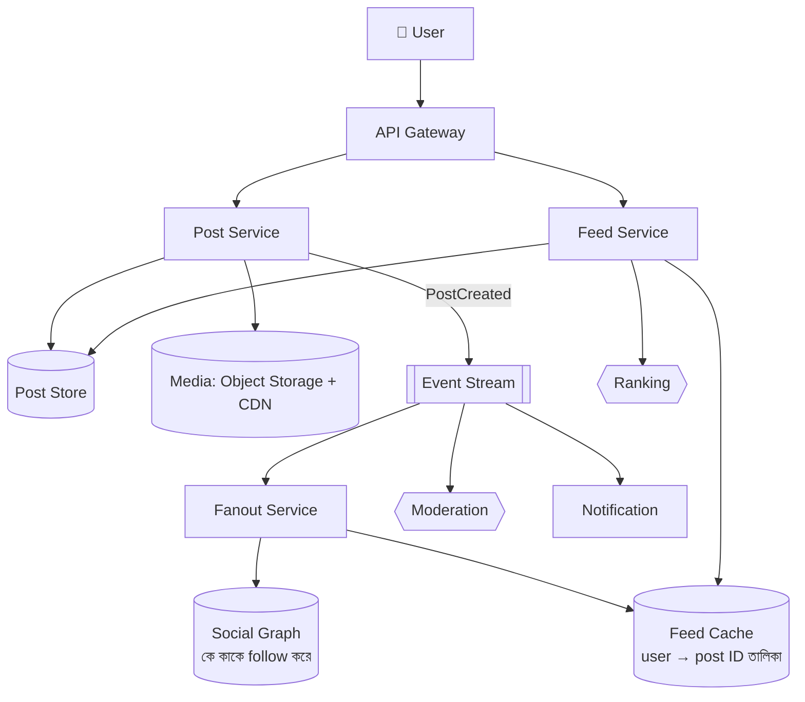
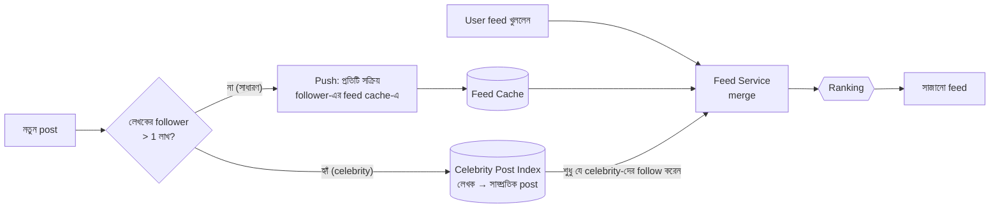
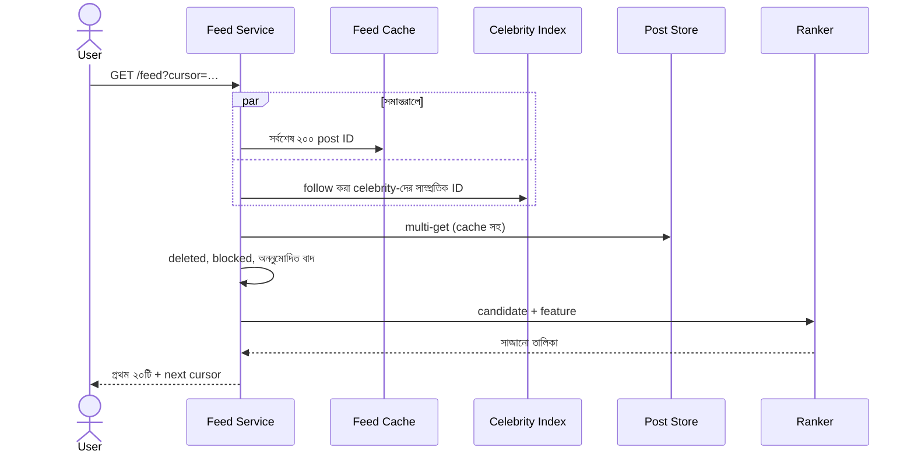
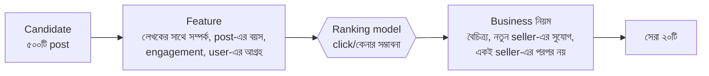

> [!GOALS]
> - একটি news feed system-এর requirement ও capacity estimation
> - Post লেখার পথ ও feed পড়ার পথ
> - Fanout-on-write বনাম fanout-on-read, এবং hybrid সমাধান
> - Celebrity (হাজারো follower) সমস্যা
> - Feed cache, ranking ও cursor pagination
> - Delete, edit, privacy ও content moderation

> [!STORY] একটি post, চল্লিশ লাখ follower
> নদী বাজারের নতুন feature "Seller Feed": ক্রেতারা পছন্দের seller-দের follow করবেন, আর seller-দের নতুন product ও offer তাঁদের feed-এ আসবে। রাফি প্রথম version বানাল সহজভাবে: seller post করলে প্রতিটি follower-এর feed-এ একটি row লেখা হয়।
>
> ঈদের আগে দেশের একটি বড় পোশাক brand, যার নদী বাজারে চল্লিশ লাখ follower, একটি flash sale-এর post দিল। Fanout queue-তে চল্লিশ লাখ লেখার কাজ জমল। সেই ৪০ মিনিট অন্য সব seller-এর post আটকে রইল সারির পেছনে। এক ছোট হস্তশিল্প seller, যিনি সেদিন প্রথম offer দিয়েছিলেন, অভিযোগ করলেন: "আমার post কেউ দেখছেই না।"
>
> নুসরাত বললেন, "সবার জন্য একই নিয়ম সবসময় ন্যায্য নয়, রাফি। একজনের চল্লিশ লাখ follower, আরেকজনের চল্লিশ জন। এদের post একই পথে যেতে পারে না।"

## 21.1 Introduction

Facebook, LinkedIn, X (Twitter), Instagram-এর মতো platform-এর news feed পৃথিবীর সবচেয়ে বেশি scale করা system-গুলোর একটি: কোটি কোটি user লগইন করলেই তাদের বন্ধু বা অনুসরণ করা মানুষের post, ছবি, video একটি সাজানো তালিকায়, কয়েকশো millisecond-এর মধ্যে। মূল চ্যালেঞ্জ হলো **read অসম্ভব রকম দ্রুত রাখা**, আর **write-এর বোঝা ন্যায্যভাবে ভাগ করা**।

## 21.2 Requirements

**Functional:**
- User post করতে পারবেন (text, ছবি, video, product link)।
- অন্য user বা seller-কে follow করতে পারবেন।
- Home feed-এ অনুসরণ করা সবার post দেখবেন, সাজানো (সময় বা প্রাসঙ্গিকতা অনুযায়ী)।
- Like, comment, share।
- Post edit ও delete করা যাবে।

**Non-functional:**
- Feed load p95 < ৩০০ ms।
- নতুন post সাধারণ follower-দের feed-এ কয়েক সেকেন্ডের মধ্যে (eventual consistency গ্রহণযোগ্য)।
- High availability: feed না আসার চেয়ে কিছুটা পুরনো feed দেখানো ভালো (AP)।
- ব্যবহারকারী বাড়ার সাথে horizontal scale।

## 21.3 Capacity Estimation (নদী বাজার)

```text
DAU                      : 40 লাখ
প্রতিজন দিনে feed খোলেন   : 8 বার → 3.2 কোটি feed read/day ≈ 370 read RPS (গড়), peak ×5 ≈ 1,850
নতুন post/day            : 2 লাখ (seller ও user মিলিয়ে) ≈ 2.3 write RPS (গড়)
গড় follower/লেখক          : 200 → fanout write: 2 লাখ × 200 = 4 কোটি feed entry/day ≈ 460/s
কিন্তু: কয়েকটি brand-এর follower 10-40 লাখ → একটি post-ই 40 লাখ write!
Feed cache               : প্রতিজনের সর্বশেষ 500টি post ID × 8 byte ≈ 4 KB × 40 লাখ ≈ 16 GB (memory-তে রাখা সম্ভব)
```

Read:write অনুপাত বিশাল, আর write-এর বণ্টন অত্যন্ত অসম (কয়েকজনের অসংখ্য follower)। এই দুটি তথ্যই design ঠিক করবে।

## 21.4 High-Level Design



## 21.5 Fanout: Post কীভাবে feed-এ পৌঁছায়

একজন লেখকের post তাঁর সব follower-এর feed-এ পৌঁছানোর প্রক্রিয়াকে বলে **fanout**।

### Fanout-on-Write (Push)

Post হওয়ার সাথে সাথে প্রত্যেক follower-এর feed cache-এ post ID লিখে দেওয়া।
- **সুবিধা:** Feed পড়া অত্যন্ত দ্রুত; feed আগে থেকেই তৈরি।
- **সমস্যা:** বেশি follower মানে বিপুল write (গল্পের ৪০ লাখ); অনেক follower হয়তো আজ লগইনই করবেন না, তাঁদের জন্য লেখা অপচয়।

### Fanout-on-Read (Pull)

User feed খুললে তখন তিনি যাঁদের follow করেন, তাঁদের সাম্প্রতিক post এনে মিলিয়ে feed তৈরি।
- **সুবিধা:** Write সস্তা; inactive user-এর জন্য কোনো কাজ নেই।
- **সমস্যা:** Read ধীর; ৫০০ জনকে follow করলে ৫০০ জায়গা থেকে আনতে হয়।

### Hybrid: বাস্তবের সমাধান



- **সাধারণ লেখক:** Push; আর শুধু **সক্রিয় follower** (গত ৩০ দিনে লগইন)-দের কাছে।
- **Celebrity বা বড় brand:** Push নয়; তাঁদের post একটি আলাদা index-এ, আর follower feed খুললে সেখান থেকে মিশিয়ে নেওয়া।
- **Fanout queue-তে অগ্রাধিকার ও ন্যায্যতা:** একজন লেখকের বিশাল কাজ যেন অন্যদের আটকে না রাখে; লেখকভিত্তিক partition বা আলাদা queue।

> [!CASE] Twitter-এর timeline
> Twitter-এর engineering team-এর ২০১২ সালের একটি প্রকাশিত talk ("Timelines at Scale") অনুযায়ী তারা home timeline প্রতিটি user-এর জন্য Redis-এর মতো in-memory store-এ আগে থেকে তৈরি করে রাখত (fanout-on-write), কারণ timeline পড়ার হার লেখার হারের চেয়ে বহুগুণ বেশি। কিন্তু কোটি follower-এর account-এর tweet প্রত্যেকের timeline-এ লিখতে অনেক সময় লাগত, তাই এমন account-গুলোর tweet read-এর সময় মিশিয়ে নেওয়ার কৌশল আলোচিত হয়েছিল। **শিক্ষা:** গল্পের ঠিক এই সমস্যা বিশ্বের সবচেয়ে বড় platform-গুলোতেও ছিল, এবং সমাধান একই: অসম বণ্টনের জন্য অসম কৌশল।

## 21.6 Feed Cache ও Storage

| Data | কোথায় | কেন |
| --- | --- | --- |
| Feed (post ID-র তালিকা) | Redis (sorted set বা list), user ID দিয়ে shard | দ্রুত read; শুধু ID, তাই ছোট |
| Post-এর বিষয়বস্তু | Wide-column বা document store (Cassandra, DynamoDB) বা sharded SQL | বিপুল write, ID দিয়ে খোঁজা |
| Social graph | Sharded SQL বা graph store | "কে কাকে follow করে" |
| ছবি ও video | Object storage + CDN | বড় file, user-এর কাছে |
| Like/comment count | Redis counter, batch করে স্থায়ী store-এ (write-behind, অধ্যায় ৬) | অত্যন্ত ঘন ঘন update |

**Feed পড়ার পথ:**
1. Feed cache থেকে সর্বশেষ post ID (ধরুন ২০০টি)।
2. যে celebrity-দের follow করেন, তাঁদের সাম্প্রতিক post ID মেশানো।
3. Post-এর বিস্তারিত batch-এ আনা (multi-get, cache সহ)।
4. মুছে ফেলা, block করা বা অনুমতি নেই এমন post বাদ।
5. Ranking।
6. প্রথম ২০টি ফেরত, পরের অংশের জন্য cursor।



**Cache-এ feed না থাকলে** (নতুন user, বহুদিন পর ফেরা user): fanout-on-read দিয়ে তৈরি করে cache-এ রাখা।

## 21.7 Ranking

শুরুতে feed সময় অনুযায়ী (reverse chronological)। পরে প্রাসঙ্গিকতা অনুযায়ী, কারণ user সব post দেখার সময় পান না।



**মানবিক ও ব্যবসায়িক নিয়ম:** শুধু engagement দিয়ে সাজালে বড় brand সবসময় জিতবে, ছোট seller হারিয়ে যাবেন (গল্পের অভিযোগ)। তাই ranking-এ সচেতনভাবে বৈচিত্র্য ও নতুনদের সুযোগ যোগ করা হয়। এটা technical সিদ্ধান্ত নয়, **platform-এর মূল্যবোধের সিদ্ধান্ত**।

## 21.8 Pagination, Edit, Delete ও Privacy

- **Cursor pagination** (অধ্যায় ৭): Feed চলমান; offset দিলে নতুন post এলে duplicate বা বাদ পড়ে। Cursor-এ শেষ post-এর score/সময় ও ID।
- **Delete:** Fanout-এর সব copy মুছতে যাওয়া ব্যয়বহুল। সহজ পথ: post-কে "deleted" চিহ্নিত করা, আর feed পড়ার সময় বাদ দেওয়া; পরে background-এ পরিষ্কার।
- **Edit:** Feed-এ শুধু ID থাকায় edit স্বয়ংক্রিয়ভাবে সবার কাছে নতুন রূপে পৌঁছায়।
- **Unfollow ও block:** পড়ার সময় filter (follow সম্পর্ক ও block তালিকা cache-এ)।
- **Privacy:** "শুধু বন্ধুরা" ধরনের post-এ পড়ার সময় অনুমতি যাচাই; cache-এ থাকলেই দেখানো নয়।

## 21.9 Scalability Consideration

- Feed cache user ID দিয়ে shard; প্রতিটি shard-এর replica।
- Fanout worker horizontally scale, লেখকভিত্তিক ন্যায্য scheduling।
- Post store write-optimized database-এ, ID সময়-ক্রমিক (অধ্যায় ৫-এর Snowflake)।
- Hot post (viral): তার বিস্তারিত ও counter local cache-এও (অধ্যায় ৬-এর hot key)।
- শুধু সক্রিয় user-এর feed precompute।

## 21.10 Security ও Content Moderation

- Rate limit: spam post ও follow-এর বন্যা ঠেকাতে।
- Privacy নিয়ম পড়ার পথে বাধ্যতামূলক।
- **Moderation pipeline:** Post-এর event থেকে স্বয়ংক্রিয় শ্রেণীবিভাগ (spam, প্রতারণা, ঘৃণাসূচক, নিষিদ্ধ পণ্য); নিশ্চিত হলে আটকানো, সন্দেহজনক হলে সীমিত বিতরণ ও মানুষের পর্যালোচনা।

## 21.11 Real Production Experience

গল্পের সমাধানের পর: ১ লাখের বেশি follower-ওয়ালা ৩১২টি seller celebrity হিসেবে চিহ্নিত; তাঁদের post read-time-এ মেশানো। সাধারণ seller-এর post শুধু গত ৩০ দিনের সক্রিয় follower-দের কাছে push। Fanout queue লেখকভিত্তিক partition-এ। পরের ঈদে সবচেয়ে বড় brand-এর post-ও follower-রা কয়েক সেকেন্ডে দেখলেন, আর ছোট seller-দের post-এর দেরি ৪০ মিনিট থেকে ৩ সেকেন্ডের নিচে।

## 21.12 AI কোণ

> [!AI] Ranking, moderation আর AI-তৈরি spam
> - **Ranking:** ML-ভিত্তিক ranking প্রায় সব বড় feed-এর কেন্দ্রে। কিন্তু model কী optimize করছে (click, কেনা, সময় কাটানো, নাকি user-এর দীর্ঘমেয়াদি সন্তুষ্টি) সেটাই platform-এর চরিত্র ঠিক করে। শুধু click optimize করলে চটকদার ও বিভ্রান্তিকর content জেতে।
> - **Moderation:** AI বিপুল পরিমাণ content দ্রুত ছাঁকতে পারে, কিন্তু বাংলা ভাষার প্রসঙ্গ, ব্যঙ্গ ও আঞ্চলিক শব্দে ভুল করে। তাই সন্দেহজনক অংশ মানুষের পর্যালোচনায়, আর user-এর আপিলের সুযোগ।
> - **AI-তৈরি spam ও ভুয়া review:** AI দিয়ে এখন বিশ্বাসযোগ্য ভুয়া product review ও post দ্রুত তৈরি করা যায়। প্রতিরক্ষা শুধু text বিশ্লেষণে নয়: account-এর আচরণ (নতুন account, একই সময়ে একই ধরনের অনেক post), network-এর সম্পর্ক, আর যাচাইকৃত ক্রেতার review-কে অগ্রাধিকার।

## 21.13 Common Mistakes

- সবার জন্য একই fanout কৌশল।
- Inactive user-দের feed-ও precompute।
- Feed cache-এ পুরো post-এর বিষয়বস্তু (ID-র বদলে), ফলে edit ও delete দুঃস্বপ্ন।
- Offset pagination।
- Ranking-এ শুধু engagement, ন্যায্যতা ও বৈচিত্র্য নেই।
- Privacy যাচাই শুধু লেখার সময়, পড়ার সময় নয়।

## 21.14 Interview Questions

> [!INTERVIEW]
> 1. Fanout-on-write ও fanout-on-read-এর trade-off কী?
> 2. Celebrity problem কী এবং কীভাবে সমাধান করবেন?
> 3. Feed cache-এ কী রাখবেন: পুরো post নাকি শুধু ID? কেন?
> 4. Feed-এ cursor pagination কীভাবে করবেন?
> 5. একটি post delete হলে সবার feed থেকে কীভাবে সরাবেন?
> 6. Ranking-এর জন্য কোন feature ব্যবহার করবেন?
> 7. ১০ কোটি DAU-এর জন্য feed cache-এর memory হিসাব করুন।

## 21.15 নিজে করে দেখুন

> [!EXERCISE] একটি বিশ্ববিদ্যালয়ের Notice ও Activity Feed
> একটি বিশ্ববিদ্যালয়ের ৫০,০০০ শিক্ষার্থীর app-এ feed: বিভাগের notice, শিক্ষকের post, ক্লাবের ঘোষণা, আর প্রশাসনের জরুরি বার্তা (সবার জন্য)।
> 1. "প্রশাসনের জরুরি বার্তা" সবার কাছে: push নাকি pull?
> 2. শিক্ষার্থী শুধু নিজের বিভাগ ও নির্বাচিত ক্লাব দেখবেন: graph কীভাবে model করবেন?
> 3. জরুরি বার্তা feed-এর সবার উপরে রাখার নিয়ম ranking-এ কীভাবে আসবে?
> 4. Capacity হিসাব করুন।

## 21.16 Summary

- **Read অনেক, write অসম:** এই দুই তথ্যই design-এর ভিত্তি।
- **Hybrid fanout:** সাধারণ লেখকের post push (শুধু সক্রিয় follower-কে), celebrity-র post read-এর সময় মেশানো।
- **Storage:** Feed-এ শুধু ID, বিষয়বস্তু আলাদা store-এ, media CDN-এ, counter Redis-এ।
- **Ranking:** Candidate → feature → model → মূল্যবোধ-ভিত্তিক নিয়ম।
- **Pagination ও পরিবর্তন:** Cursor; delete চিহ্নিত করে পড়ার সময় বাদ; privacy পড়ার পথে।
- **Moderation ও AI:** স্বয়ংক্রিয় ছাঁকনি + মানুষের পর্যালোচনা; AI-তৈরি spam-এর জন্য আচরণভিত্তিক শনাক্তকরণ।

> [!ARCHITECT] নুসরাতের নোটবুক · Seller Feed
> সিদ্ধান্ত: hybrid fanout (threshold ১ লাখ follower), সক্রিয় follower-দের কাছে push, লেখকভিত্তিক queue partition, ranking-এ "নতুন ও ছোট seller"-এর জন্য সচেতন জায়গা। হস্তশিল্পের সেই seller এখন নিয়মিত বিক্রি করেন। পরের সপ্তাহের বিষয়: seller ও ক্রেতার মধ্যে সরাসরি chat, যেটা মিতুর তালিকার সবচেয়ে বেশি চাওয়া feature।
