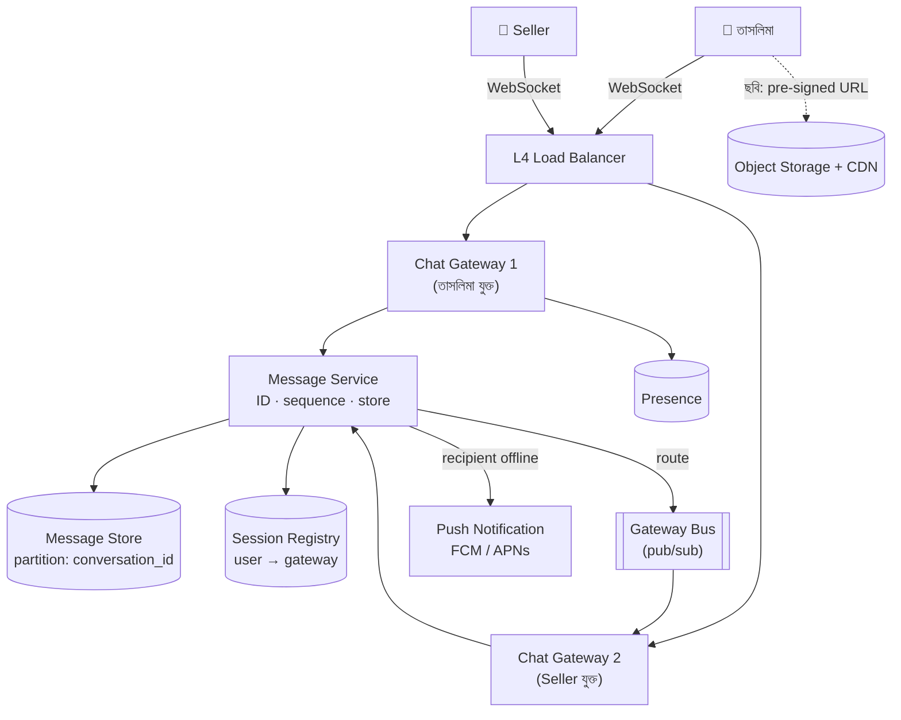
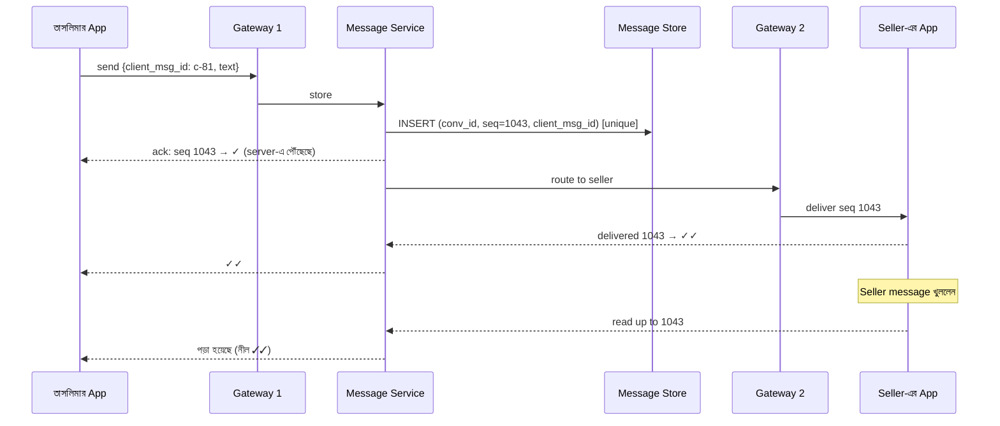
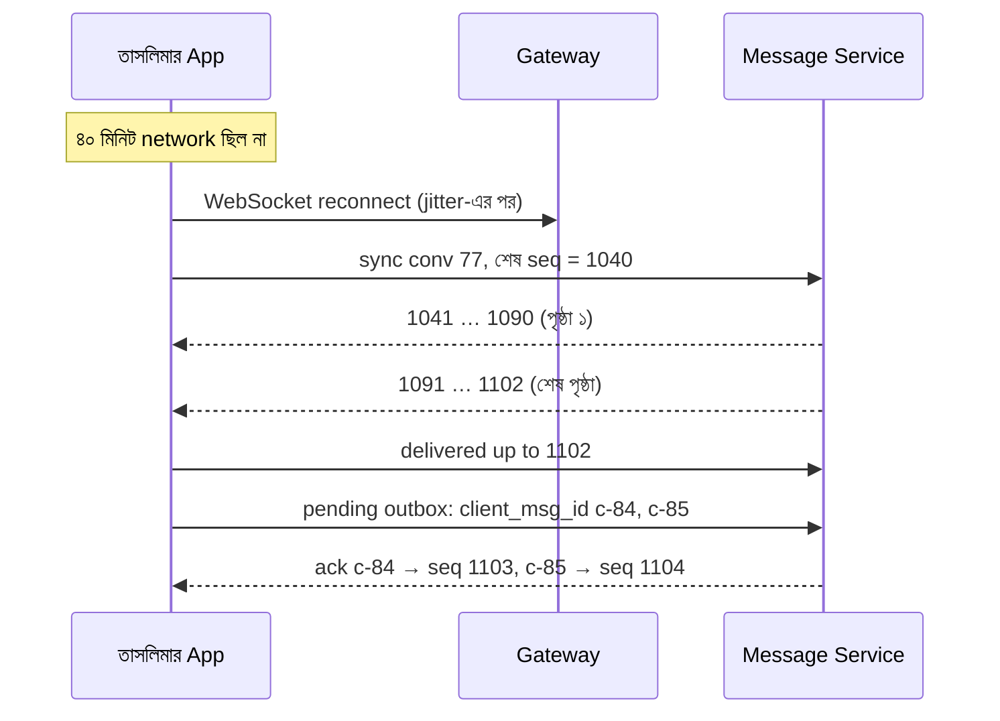
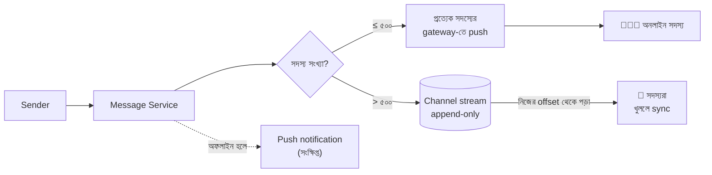

> [!GOALS]
> - Chat-এর requirement, capacity ও connection-এর হিসাব
> - Polling, long polling, SSE ও WebSocket-এর পার্থক্য
> - Gateway server ও session registry দিয়ে message routing
> - Sent, delivered, read: delivery guarantee ও deduplication
> - Message ordering, offline sync ও multi-device
> - Group chat, presence ও media
> - End-to-end encryption এবং নিরাপত্তা বনাম প্রতারণা শনাক্তের দ্বিধা

> [!STORY] হাওরের ক্রেতা আর হারানো message
> নদী বাজারে এখন ক্রেতা ও seller সরাসরি chat করতে পারেন। কিশোরগঞ্জের এক ক্রেতা, ধরা যাক তাসলিমা, একজন seller-কে লিখলেন: "শাড়িটা কি লাল রঙে আছে?" তারপর: "দাম কিছু কম হবে?" তারপর: "ঠিক আছে, নিলাম।"
>
> তাসলিমার phone-এ network আসছে-যাচ্ছে। Seller-এর কাছে message পৌঁছাল উল্টো ক্রমে: আগে "ঠিক আছে, নিলাম", তারপর "দাম কিছু কম হবে?" Seller বিভ্রান্ত। আর তাসলিমার phone দেখাল তিনটি message-ই "পাঠানো হয়েছে ✓", অথচ একটি আসলে server-এ পৌঁছায়ইনি। পরে app আবার পাঠাল, আর seller একই message দুবার পেলেন।
>
> রাফি বলল, "WebSocket তো real-time! তাহলে এমন হলো কেন?"
> তানভীর উত্তর দিলেন, "WebSocket একটা পাইপ। পাইপ কখন ভাঙবে, ভাঙার আগে কী পৌঁছেছিল, আবার জোড়া লাগলে কোথা থেকে শুরু হবে: এগুলো পাইপ বলে দেয় না। ওটা তোমার protocol-এর কাজ।"

## 22.1 Introduction

WhatsApp, Messenger, Telegram-এর মতো messaging application-এ প্রতিদিন শত কোটি message আদান-প্রদান হয়। মূল চ্যালেঞ্জ:
- **Real-time:** Message প্রায় সাথে সাথে পৌঁছাবে।
- **নির্ভরযোগ্যতা:** কোনো message হারাবে না, দুবার দেখাবে না, ক্রম ঠিক থাকবে।
- **অবিশ্বস্ত network:** Mobile network আসা-যাওয়া করে; app background-এ যায়।
- **লাখো একযোগে connection।**
- **গোপনীয়তা:** অনেক ক্ষেত্রে end-to-end encryption।

## 22.2 Requirements

**Functional:** ১:১ chat, group chat, text ও media, delivery ও read receipt, online/last seen, offline user-এর জন্য push notification, একাধিক device-এ history।

**Non-functional:** Online-এ message পৌঁছানো p95 < ৫০০ ms; message হারাবে না (durable); প্রতিটি conversation-এ ক্রম ঠিক; লাখো concurrent connection; উচ্চ availability।

## 22.3 Capacity Estimation

```text
DAU                         : 40 লাখ
প্রতিজন দিনে message পাঠান   : 20 → 8 কোটি message/day ≈ 925/s (গড়), peak ×4 ≈ 3,700/s
একসাথে online (peak)         : DAU-এর 25% ≈ 10 লাখ WebSocket connection
প্রতি gateway server-এ        : (সংরক্ষণশীলভাবে) 50,000 connection → অন্তত 20টি server + redundancy
Message storage              : 8 কোটি × 300 byte ≈ 24 GB/day → বছরে ≈ 8.8 TB (replica ও media বাদে)
```

## 22.4 Real-time যোগাযোগের পদ্ধতি

| পদ্ধতি | কীভাবে | সুবিধা | অসুবিধা |
| --- | --- | --- | --- |
| **Short polling** | প্রতি কয়েক সেকেন্ডে "নতুন কিছু আছে?" | সহজ | অপচয়, দেরি |
| **Long polling** | Request খোলা থাকে যতক্ষণ না নতুন কিছু আসে | Polling-এর চেয়ে দ্রুত | Connection বারবার খোলা-বন্ধ |
| **SSE** | Server থেকে client-এ একমুখী stream | সহজ, HTTP-বান্ধব | শুধু server → client |
| **WebSocket** | স্থায়ী, দ্বিমুখী connection | Chat-এর জন্য আদর্শ | Stateful server, load balancing জটিল |

Chat-এ সাধারণত **WebSocket** (অথবা mobile-এ MQTT-এর মতো হালকা protocol), সাথে app বন্ধ থাকলে **push notification** (Android-এ FCM, iOS-এ APNs)।

## 22.5 High-Level Design



- **Chat Gateway:** লাখো WebSocket connection ধরে রাখে। এরা stateful (কে কোন server-এ যুক্ত), তাই server বদলালে client আবার connect করে।
- **Session Registry:** কোন user এখন কোন gateway-তে যুক্ত (Redis, TTL ও heartbeat সহ)।
- **Message Service:** Message-কে ID ও ক্রম নম্বর দেয়, স্থায়ীভাবে সংরক্ষণ করে, তারপর প্রাপকের gateway-তে পাঠায়।
- **Message Store:** বিপুল write, conversation অনুযায়ী পড়া; wide-column store (Cassandra/ScyllaDB) বা conversation দিয়ে shard করা SQL।

## 22.6 Message-এর যাত্রা: Sent, Delivered, Read



**গল্পের সমস্যাগুলোর সমাধান:**
- **"✓" দেখাবে শুধু server-এর ack পেলে,** পাঠানোর চেষ্টাতেই নয়। Ack না এলে message "পাঠানো হচ্ছে" অবস্থায় থাকে, network ফিরলে আবার পাঠানো হয়।
- **Duplicate:** Client প্রতিটি message-এর জন্য একটি unique `client_msg_id` তৈরি করে; retry-তে একই ID। Server-এ `(conversation_id, client_msg_id)`-এর উপর unique constraint (অধ্যায় ৭-এর idempotency)। Seller একই message দুবার পাবেন না।
- **ক্রম:** প্রতিটি conversation-এর ভেতরে server একটি ক্রমবর্ধমান **sequence number** দেয়। প্রাপক sequence অনুযায়ী সাজায়; মাঝে ফাঁক থাকলে (১০৪৩-এর পর ১০৪৫ এল) অনুপস্থিতটা চেয়ে নেয়। Client-এর ঘড়ির সময় দিয়ে সাজানো যায় না, কারণ phone-এর ঘড়ি ভুল হতে পারে।

## 22.7 Offline ও Multi-device Sync

User offline থাকলে message store-এ জমা থাকে (চিরকাল বা নির্দিষ্ট সময় পর্যন্ত), আর push notification যায়। App আবার connect হলে:

```text
Client: "conversation 77-এ আমার শেষ দেখা seq = 1040"
Server: 1041 থেকে বাকি সব পাঠায় (পৃষ্ঠায় পৃষ্ঠায়, cursor দিয়ে)
```



প্রতিটি device নিজের "শেষ পাওয়া sequence" মনে রাখে, তাই phone ও computer আলাদাভাবে sync হয়। এটাই অধ্যায় ১১-এর consumer offset-এর মতো ধারণা।

## 22.8 Group Chat

- **ছোট group (≤ কয়েকশো):** Message একবার store, তারপর প্রত্যেক সদস্যের gateway-তে route (fanout-on-write)।
- **বড় group বা channel (হাজারো সদস্য):** প্রত্যেককে push নয়; সদস্যরা group-এর message stream থেকে নিজের offset দিয়ে পড়ে (fanout-on-read), অধ্যায় ২১-এর celebrity সমস্যার মতো।
- Read receipt বড় group-এ ব্যয়বহুল: সংক্ষিপ্ত রূপ ("২৩৪ জন দেখেছেন") বা সীমিত।



## 22.9 Presence: Online ও Last Seen

Client প্রতি ২০-৩০ সেকেন্ডে heartbeat পাঠায়; registry-তে TTL। Heartbeat বন্ধ হলে "offline" ও last seen।

> [!WARNING] Presence storm
> একজন user-এর ৫০০ contact থাকলে তিনি online হলেই ৫০০ জনকে জানাতে হবে? কোটি user-এর ক্ষেত্রে এটা বিশাল বার্তার ঝড়। সমাধান: শুধু যাঁরা এখন ওই user-এর chat খুলে রেখেছেন, তাঁদের জানানো (subscribe-on-view), পরিবর্তন throttle করা, আর "online" অবস্থা কয়েক সেকেন্ড দেরিতে হালনাগাদ গ্রহণযোগ্য ধরা।

## 22.10 Media

ছবি বা video WebSocket দিয়ে নয়। Client server থেকে একটি **pre-signed upload URL** নেয়, সরাসরি object storage-এ upload করে, তারপর message-এ শুধু file-এর reference পাঠায়। Thumbnail ও compression background-এ। প্রাপক CDN থেকে download করে।

## 22.11 Scalability Consideration

- Gateway horizontally scale; প্রতিটির connection সীমা monitor; deploy-এর সময় connection ধীরে ধীরে সরানো (অধ্যায় ৯-এর draining), নাহলে লাখো client একসাথে reconnect করে **reconnect storm** তৈরি করে। Client-এ reconnect-এর সময় random jitter।
- Message store conversation ID দিয়ে partition। খুব সক্রিয় conversation hot partition তৈরি করতে পারে।
- Session registry ও gateway bus-এর নিজের HA।

> [!CASE] WhatsApp ও Discord: অল্প মানুষ, বিশাল scale
> WhatsApp-এর engineering team ২০১২ সালে প্রকাশ করেছিল কীভাবে তারা একটি server-এ **২০ লাখের বেশি** একযোগে TCP connection চালাতে পেরেছিল, Erlang ও FreeBSD-ভিত্তিক system-কে সূক্ষ্মভাবে tune করে। ২০১৪ সালে Facebook যখন WhatsApp কিনে নেয়, তখন প্রতিষ্ঠানটি অল্প কয়েক ডজন engineer দিয়ে কয়েকশো মিলিয়ন user-কে সেবা দিচ্ছিল বলে ব্যাপকভাবে প্রকাশিত হয়েছিল। শিক্ষা: সঠিক প্রযুক্তি আর সরল নকশা অল্প মানুষকেও বিশাল scale সামলাতে দেয়।
>
> Discord ২০২৩ সালে লিখেছিল কীভাবে তারা **trillion-এর বেশি** message সংরক্ষণ করে। তাদের বড় সমস্যা ছিল **hot partition**: একটি জনপ্রিয় server-এর channel-এ হঠাৎ হাজারো মানুষ একই message পড়তে চাইলে database-এর একটি partition-এ চাপ পড়ে, আর তার প্রভাব অন্যদের উপরও। তারা database বদলায় (Cassandra থেকে ScyllaDB), আর database-এর সামনে একটি data service স্তর বসায় যা একই data-র জন্য একসাথে আসা অনেক request-কে **একটি query-তে মিলিয়ে দেয় (request coalescing)**, অধ্যায় ৬-এর single-flight-এর মতো। শিক্ষা: শুধু database বদলানো নয়, access pattern নিয়ন্ত্রণও সমান গুরুত্বপূর্ণ।

## 22.12 Security: End-to-End Encryption

**End-to-End Encryption (E2EE)**-এ message পাঠানোর device-এই encrypt হয়, আর শুধু প্রাপকের device decrypt করতে পারে; server শুধু encrypted data বহন করে, নিজে পড়তে পারে না। WhatsApp ২০১৬ সালে সব chat-এ Signal Protocol-ভিত্তিক E2EE চালু করে।

**মূল ধারণা (সরলভাবে):** প্রতিটি device-এর একটি public-private key জোড়া। পাঠানোর আগে প্রাপকের public key দিয়ে একটি session key প্রতিষ্ঠা হয়, যা দিয়ে message encrypt হয়; private key কখনো device ছাড়ে না। Signal Protocol এর সাথে যোগ করে নিয়মিত key বদল, যাতে একটি key ফাঁস হলেও পুরনো বা ভবিষ্যতের message নিরাপদ থাকে (forward secrecy)।

**E2EE-এর architecture-এ প্রভাব:**
- Server message পড়তে পারে না, তাই server-side search, spam ফিল্টার বা AI feature সীমিত।
- Multi-device জটিল: প্রতিটি device-এর আলাদা key।
- Backup-ও encrypted হতে হয়, নাহলে E2EE-র অর্থ কমে।

> [!ARCHITECT] Marketplace chat-এ E2EE: একটি সৎ দ্বিধা
> নদী বাজারের chat-এ কি E2EE থাকবে? একদিকে ক্রেতা-বিক্রেতার গোপনীয়তা। অন্যদিকে marketplace-এ একটি বড় প্রতারণা হলো "platform-এর বাইরে টাকা পাঠান, তাহলে কম দাম" ধরনের বার্তা, আর বিরোধ হলে (পণ্য আসেনি) platform-কে কথোপকথন দেখে মীমাংসা করতে হয়। নুসরাত ও মিতুর সিদ্ধান্ত: নদী বাজারের chat **E2EE নয়, কিন্তু transport ও storage-এ encrypted**, কঠোর access নিয়ন্ত্রণ ও audit সহ (শুধু বিরোধ নিষ্পত্তি team, নির্দিষ্ট ticket-এর ভিত্তিতে), এবং user-কে এটা স্পষ্টভাবে জানানো হয়। ব্যক্তিগত messaging app-এর জন্য সিদ্ধান্ত হতো উল্টো। **Architecture-এ "সঠিক" উত্তর প্রায়ই নির্ভর করে product-এর উদ্দেশ্য ও user-এর প্রতি প্রতিশ্রুতির উপর, আর সেই প্রতিশ্রুতি সততার সাথে জানাতে হয়।**

## 22.13 Real Production Experience

গল্পের পরের পরিবর্তন: ✓ শুধু server ack-এ; `client_msg_id` দিয়ে deduplication; conversation-এর sequence number দিয়ে ক্রম; reconnect-এ "শেষ seq থেকে" sync; reconnect-এ random jitter। এক মাসে "message হারিয়েছে" ও "দুবার এসেছে" অভিযোগ ৯৫% কমেছে। দুর্বল network-এ message পাঠানোর অভিজ্ঞতা উন্নত হয়েছে, কারণ app এখন স্পষ্ট দেখায় কোন message এখনো "পাঠানো হচ্ছে"।

## 22.14 AI কোণ

> [!AI] Chat-এ AI: সাহায্য, নিরাপত্তা ও গোপনীয়তার টানাপোড়েন
> - **Smart reply ও অনুবাদ:** Seller ব্যস্ত থাকলে AI প্রস্তাবিত উত্তর ("জি, লাল রঙে আছে, দাম ১,৮৫০ টাকা")। বাংলা-ইংরেজি অনুবাদ সীমান্তের বাইরের ক্রেতার জন্য সহায়ক। সবসময় seller-এর অনুমোদনে পাঠানো, স্বয়ংক্রিয় নয়।
> - **প্রতারণা শনাক্ত:** "Platform-এর বাইরে bKash-এ পাঠান", "এই link-এ ক্লিক করে OTP দিন" ধরনের pattern AI ও নিয়ম দিয়ে শনাক্ত করে ক্রেতাকে সতর্কবার্তা দেখানো। প্রতিটি সতর্কবার্তা message আটকানো নয়, সচেতন করা।
> - **E2EE-এর সাথে AI:** Server message পড়তে না পারলে AI চালাতে হয় **device-এর ভেতরে** (on-device model)। এটা গোপনীয়তা রক্ষা করে, কিন্তু model ছোট রাখতে হয় এবং battery ও পুরনো phone বিবেচনা করতে হয়।
> - **মনে রাখুন:** Chat-এর বিষয়বস্তু অত্যন্ত ব্যক্তিগত। AI-এর জন্য এই data ব্যবহার করতে হলে user-এর স্পষ্ট সম্মতি, ন্যূনতম data, আর training-এ ব্যবহার না করার নিশ্চয়তা।

## 22.15 Common Mistakes

- পাঠানোর চেষ্টাতেই "✓" দেখানো।
- Client-generated ID ছাড়া retry, ফলে duplicate।
- Client-এর ঘড়ি দিয়ে message সাজানো।
- Reconnect-এ jitter না রাখা, ফলে reconnect storm।
- সব contact-কে presence জানানো।
- Media WebSocket দিয়ে পাঠানো।
- E2EE-র প্রতিশ্রুতি দিয়ে server-এ plaintext backup।

## 22.16 Interview Questions

> [!INTERVIEW]
> 1. Chat-এর জন্য WebSocket কেন? Long polling-এর সাথে তুলনা করুন।
> 2. দুটি ভিন্ন gateway server-এ যুক্ত দুজনের মধ্যে message কীভাবে পৌঁছাবে?
> 3. Message ordering ও deduplication কীভাবে নিশ্চিত করবেন?
> 4. User offline থাকলে কী হবে? আবার online হলে কীভাবে sync হবে?
> 5. Group chat-এ ১০,০০০ সদস্য থাকলে কৌশল কী বদলাবে?
> 6. End-to-end encryption-এ server কেন message পড়তে পারে না? এর architecture-এ কী প্রভাব?
> 7. ১০ লাখ concurrent connection-এর জন্য কতগুলো server লাগবে, কীভাবে হিসাব করবেন?

## 22.17 নিজে করে দেখুন

> [!EXERCISE] Customer Support Chat (মানুষ + AI)
> নদীপে-র জন্য একটি support chat design করুন: গ্রাহক প্রশ্ন করবেন, প্রথমে AI সহায়ক উত্তর দেবে, প্রয়োজনে মানুষ agent কথোপকথন নেবেন।
> 1. AI থেকে মানুষে হস্তান্তরের সময় কথোপকথনের ইতিহাস কীভাবে যাবে?
> 2. একজন agent একসাথে ৫টি chat সামলাবেন: routing কীভাবে হবে?
> 3. Agent offline হলে গ্রাহকের message-এর কী হবে?
> 4. কোন তথ্য chat log-এ mask করবেন (অধ্যায় ১২)?
> 5. E2EE লাগবে কি? কেন?

## 22.18 Summary

- **WebSocket gateway + session registry:** কে কোথায় যুক্ত জেনে message route।
- **Delivery:** Server ack-এ ✓, প্রাপকের ack-এ ✓✓, read-এ নীল।
- **নির্ভরযোগ্যতা:** `client_msg_id` দিয়ে dedup, conversation-এর sequence দিয়ে ক্রম, শেষ seq থেকে sync।
- **Group ও presence:** বড় group-এ fanout-on-read; presence শুধু যারা দেখছে তাদের।
- **Scale:** Gateway-এর connection সীমা, reconnect jitter, hot partition ও request coalescing।
- **E2EE:** শক্তিশালী গোপনীয়তা, কিন্তু server-side feature-এর সীমা; product-এর উদ্দেশ্য অনুযায়ী সৎ সিদ্ধান্ত।
- **AI:** Smart reply, অনুবাদ, প্রতারণা সতর্কতা; গোপনীয়তার জন্য on-device বিবেচনা।

> [!ARCHITECT] নুসরাতের নোটবুক · তাসলিমার message
> শিক্ষা: real-time মানে শুধু দ্রুত নয়, **নির্ভরযোগ্যভাবে দ্রুত**। Network-কে অবিশ্বস্ত ধরে protocol বানাও: ID, ack, sequence, sync। আর একটি সৎ সিদ্ধান্ত: marketplace chat E2EE নয়, user-কে জানানো হয়েছে কেন। পরের বিষয়: seller-রা এখন product-এর video দিতে চান। Video মানে সম্পূর্ণ নতুন জগৎ।
