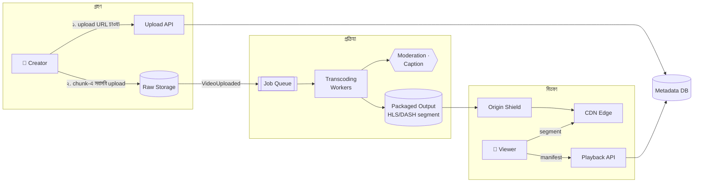
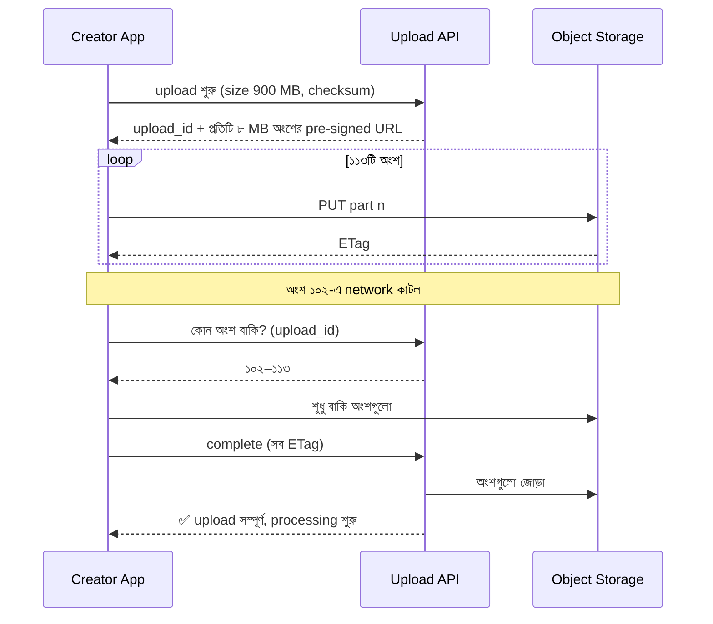
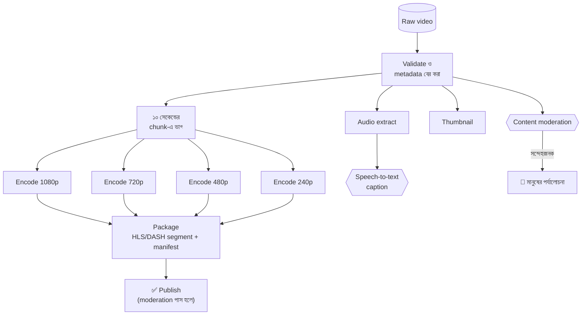
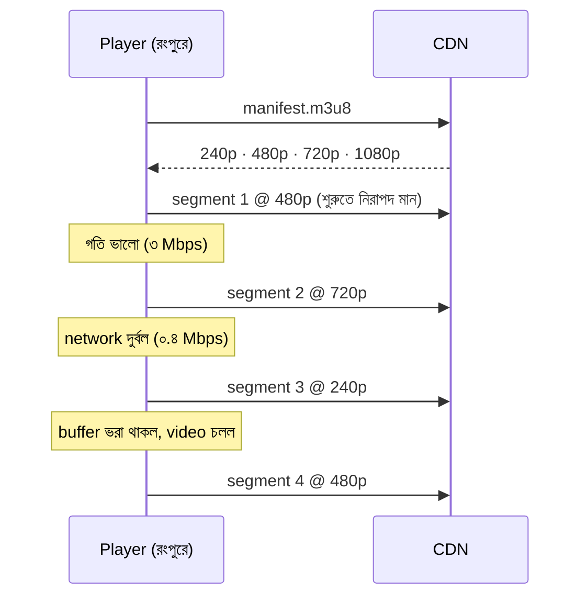
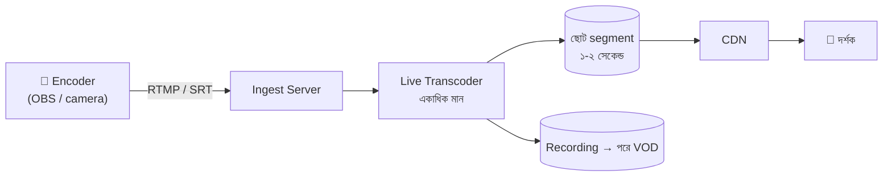

> [!GOALS]
> - Video platform-এর requirement, storage ও bandwidth-এর হিসাব
> - Resumable ও multipart upload
> - Transcoding pipeline: chunk, সমান্তরাল encoding, packaging
> - Adaptive bitrate streaming (HLS/DASH) কীভাবে buffering কমায়
> - CDN, long tail ও origin shield
> - Metadata, view count ও live streaming
> - খরচের মূল চালক এবং AI-এর ভূমিকা (caption, moderation)

> [!STORY] নব্বই শতাংশে আটকে থাকা upload
> নদী বাজারের seller-রা এখন product-এর video দিতে পারেন। নারায়ণগঞ্জের এক জামদানি তাঁতি, যিনি mobile data-য় কাজ করেন, তাঁর তাঁতের কাজের একটি সুন্দর তিন মিনিটের video upload করছিলেন। ফাইল ৯০০ MB। Upload ৯০%-এ পৌঁছানোর পর network একবার কেটে গেল। আবার শূন্য থেকে শুরু। তিনবার চেষ্টার পর তিনি হাল ছেড়ে দিলেন, আর মোবাইলের ডাটা প্যাকও শেষ।
>
> অন্যদিকে যে ক্রেতারা video দেখছিলেন, তাঁদের অনেকে রংপুর আর বরিশালের গ্রাম থেকে। একটিমাত্র ১০৮০p ফাইল, তাই প্রতি কয়েক সেকেন্ডে buffering। গড়ে মানুষ ১১ সেকেন্ডের বেশি দেখছিলেন না।
>
> মিতু data দেখিয়ে বললেন, "আমরা ভাবছিলাম video মানে একটা বড় file upload আর download। আসলে video মানে একটা কারখানা।"

## 23.1 Introduction

YouTube, Netflix, Facebook Watch বা শিক্ষামূলক video platform-এর সবচেয়ে বড় চ্যালেঞ্জ: প্রতিদিন বিপুল পরিমাণ video গ্রহণ করা, প্রক্রিয়া করা, সংরক্ষণ করা, আর বাফারিং ছাড়াই, প্রতিটি device ও প্রতিটি network-এর জন্য উপযুক্ত মানে, পৃথিবীর যেকোনো প্রান্তে পৌঁছানো। Video system আসলে তিনটি আলাদা system: **গ্রহণ (upload)**, **প্রক্রিয়া (transcoding)**, এবং **বিতরণ (delivery)**।

## 23.2 Requirements

**Functional:** Video upload (seller ও user), প্রক্রিয়া শেষে দেখা, thumbnail, title ও বিবরণ, খোঁজা, view count, like ও comment, caption, (পরবর্তী ধাপে) live stream।

**Non-functional:**
- দুর্বল network-এ upload ব্যর্থ হলে যেখানে থেমেছিল সেখান থেকে চালু।
- Playback শুরু হতে (time to first frame) p95 < ২ সেকেন্ড; buffering-এর অনুপাত কম।
- দুর্বল network-এ নিম্নমানে হলেও চলতে থাকা।
- Storage ও bandwidth-এর খরচ নিয়ন্ত্রণে।
- আপত্তিকর বা নিষিদ্ধ content প্রকাশের আগে ছাঁকা।

## 23.3 Capacity Estimation

```text
প্রতিদিন নতুন video          : 20,000 (গড় 3 মিনিট)
প্রতি মিনিট মূল ফাইল          : ~100 MB → দৈনিক মূল ফাইল ≈ 20,000 × 3 × 100 MB = 6 TB
Transcoded rendition         : 240p থেকে 1080p পর্যন্ত মিলিয়ে মূলের প্রায় ৩০-৫০% → ≈ 2-3 TB/day
প্রতিদিন দেখা                 : 50 লাখ view × গড় 1.5 মিনিট × গড় 1.5 Mbps
Egress (বাইরে যাওয়া data)     : 50 লাখ × 90 s × 1.5 Mbps ÷ 8 ≈ 84 TB/day
```

**লক্ষ্য করুন:** দৈনিক বিতরণ (৮৪ TB) সংরক্ষণের চেয়ে অনেক বড়। **Video platform-এর খরচের সবচেয়ে বড় অংশ সাধারণত bandwidth**, তাই CDN-এর কার্যকারিতা আর encoding-এর দক্ষতা সরাসরি টাকা।

## 23.4 High-Level Design



## 23.5 Resumable Upload

বড় file একটি HTTP request-এ পাঠানো দুর্বল network-এ প্রায় অসম্ভব। সমাধান: **multipart / resumable upload**।



- File সরাসরি client থেকে object storage-এ (pre-signed URL), app server-এর মধ্য দিয়ে নয় (অধ্যায় ১-এর file upload সমস্যা)।
- App-এ upload-এর অবস্থা স্থানীয়ভাবে সংরক্ষিত, যাতে app বন্ধ হলেও পরে চালু করা যায়।
- Checksum দিয়ে নিশ্চিত হওয়া যে পুরো ফাইল অক্ষত এসেছে।
- Upload-এর আগে device-এই ছোট করে নেওয়ার বিকল্প (৪K থেকে ১০৮০p), mobile data বাঁচাতে।

## 23.6 Transcoding Pipeline

Upload করা মূল ফাইল সরাসরি চালানো যায় না: ভিন্ন device-এর ভিন্ন format, আর একটি বড় ফাইল দুর্বল network-এ চলবে না। তাই video-কে একাধিক **rendition** (রেজোলিউশন ও bitrate-এর জোড়া)-এ রূপান্তর করা হয়।



- **Chunk-এ ভাগ ও সমান্তরাল encoding:** এক ঘণ্টার video-কে ৩৬০টি ১০ সেকেন্ডের অংশে ভাগ করে অনেক worker একসাথে encode করলে সময় নাটকীয়ভাবে কমে।
- **DAG (directed acyclic graph):** কাজগুলোর নির্ভরতা (encode শেষ → package)। Workflow engine বা queue + state দিয়ে চালানো (অধ্যায় ১১), প্রতিটি ধাপ idempotent ও retry-যোগ্য।
- **অগ্রাধিকার:** দ্রুত দেখানোর জন্য আগে কম মানের rendition (৪৮০p) তৈরি করে প্রকাশ, উচ্চ মান পরে যোগ।
- **খরচ:** Encoding CPU/GPU-নির্ভর; spot বা অগ্রাধিকারহীন compute-এ সস্তায় চালানো যায়, কারণ কাজ retry-যোগ্য।

> [!CASE] Netflix-এর Per-Title Encoding
> ২০১৫ সালে Netflix-এর engineering blog ব্যাখ্যা করে, আগে সব title-এর জন্য একই "bitrate ladder" (কোন রেজোলিউশনে কত bitrate) ব্যবহার হতো। কিন্তু একটি সরল animation আর একটি দ্রুত দৃশ্যের action সিনেমার প্রয়োজন সম্পূর্ণ আলাদা: animation অনেক কম bitrate-এই একই মানে দেখায়। তারা প্রতিটি title-এর জটিলতা বিশ্লেষণ করে আলাদা ladder তৈরি শুরু করে, যাতে একই মানে কম data লাগে, অথবা একই data-য় ভালো মান পাওয়া যায়। পরে এটিকে আরো সূক্ষ্ম করে দৃশ্যভিত্তিক করা হয়।
>
> **শিক্ষা:** Video-তে encoding-এর দক্ষতা সরাসরি bandwidth খরচ আর দুর্বল network-এর user-এর অভিজ্ঞতা। জামদানির ধীর, স্থির video আর ক্রিকেট ম্যাচের দ্রুত video একই নিয়মে encode করার দরকার নেই।

## 23.7 Adaptive Bitrate Streaming

গ্রামের ক্রেতার buffering-এর সমাধান **Adaptive Bitrate (ABR) streaming**। Video-কে ছোট segment (২-৬ সেকেন্ড)-এ ভাগ করে প্রতিটি rendition-এ রাখা হয়। একটি **manifest** file (HLS-এ `.m3u8`, DASH-এ `.mpd`) player-কে জানায় কোন কোন মান আছে। Player প্রতিটি segment নামানোর সময় network-এর গতি মেপে ঠিক করে পরের segment কোন মানে আনবে।



| Protocol | ব্যবহার |
| --- | --- |
| **HLS** | Apple-এর তৈরি; iOS, Safari সহ সর্বত্র ব্যাপক সাপোর্ট |
| **MPEG-DASH** | খোলা standard; Android ও web-এ প্রচলিত |
| **CMAF** | সাধারণ segment format, যাতে একই segment HLS ও DASH দুটোতেই চলে, storage ও CDN cache অর্ধেক |

## 23.8 CDN, Long Tail ও Origin Shield

জনপ্রিয় video (একটি viral বিজ্ঞাপন) CDN-এ প্রায় সবসময় থাকে, hit ratio চমৎকার। কিন্তু বেশিরভাগ video **long tail**: প্রতিটি কম দেখা হয়, তবে মোট সংখ্যায় বিশাল। এগুলো প্রায়ই CDN edge-এ থাকে না, origin পর্যন্ত যেতে হয়।

- **Origin shield:** CDN edge ও origin storage-এর মাঝে একটি কেন্দ্রীয় cache স্তর; অনেক edge-এর miss একত্র হয়ে origin-এ একবার যায়।
- **Pre-warming:** জনপ্রিয় হবে বলে জানা video (ঈদের campaign, convocation-এর live replay) আগে থেকে edge-এ।
- **Storage tier:** পুরনো ও কম দেখা video-র উচ্চ rendition সস্তা storage-এ, প্রয়োজনে আনা।

## 23.9 Metadata ও View Count

- **Metadata (title, seller, rendition-এর অবস্থান, অবস্থা):** Relational database, video ID দিয়ে shard (অধ্যায় ৫)।
- **View count:** প্রতিটি view-এ database row update করলে hot row। বদলে event stream-এ view event, batch করে যোগ (অধ্যায় ৬-এর write-behind), দেখানো সংখ্যা কয়েক সেকেন্ড বা মিনিট পিছিয়ে থাকা গ্রহণযোগ্য। ভুয়া view ঠেকাতে deduplication ও যাচাই।
- **খোঁজা:** Title, বিবরণ ও caption search index-এ।

> [!CASE] YouTube ও Vitess
> YouTube-এর দ্রুত বৃদ্ধির সময় তাদের metadata রাখা MySQL database-গুলো চাপে পড়ছিল। এই সমস্যা সমাধানে YouTube-এর engineer-রা ২০১০ সালের দিকে **Vitess** তৈরি করেন: MySQL-এর সামনে একটি স্তর, যা application-কে একটি database দেখায় কিন্তু ভেতরে data অনেক shard-এ ভাগ করে রাখে, query route করে, connection pool সামলায় (অধ্যায় ৫-এর ধারণাগুলো একটি product হিসেবে)। Vitess পরে open-source হয় এবং অন্যান্য বড় প্রতিষ্ঠানও এটি ব্যবহার করে। **শিক্ষা:** অনেক বড় প্রতিষ্ঠান নতুন database উদ্ভাবনের বদলে পরিচিত database-কে scale করার স্তর বানিয়েছে।

## 23.10 Live Streaming

VOD (আগে রেকর্ড করা video) আর live stream-এর পার্থক্য: live-এ transcoding চলে real-time-এ, আর latency (ঘটনা থেকে দর্শকের চোখ পর্যন্ত সময়) একটি নতুন requirement।



| Latency স্তর | আনুমানিক দেরি | কোথায় |
| --- | --- | --- |
| সাধারণ HLS | ১০-৩০ সেকেন্ড | Convocation, সভা |
| Low-latency HLS/DASH | ২-৫ সেকেন্ড | খেলা, live শপিং |
| WebRTC | < ১ সেকেন্ড | Video call, নিলাম, দ্বিমুখী অনুষ্ঠান |

কম latency মানে বেশি জটিলতা ও খরচ। বিশ্ববিদ্যালয়ের convocation-এর জন্য ২০ সেকেন্ড দেরি সম্পূর্ণ গ্রহণযোগ্য; live নিলামে নয়।

## 23.11 Security

- **Signed URL / token:** Segment-এ সাময়িক বৈধতার URL, যাতে অন্য site সরাসরি link করে আপনার bandwidth খরচ করাতে না পারে।
- **DRM (Widevine, FairPlay, PlayReady):** কপিরাইটযুক্ত premium content-এর জন্য।
- **Upload-এ যাচাই:** ফাইলের ধরন ও আকার, malware scan।
- **প্রকাশের আগে moderation।**

## 23.12 Real Production Experience

নদী বাজারের নতুন pipeline: ৮ MB অংশে resumable upload, upload-এর আগে device-এ ৭২০p-তে রূপান্তরের বিকল্প, আগে ৪৮০p প্রকাশ, তারপর বাকি মান, HLS + ABR, origin shield। ফলাফল: video upload-এর সাফল্যের হার ৬২% থেকে ৯৭%; গড় দেখার সময় ১১ সেকেন্ড থেকে ৪৮ সেকেন্ড; buffering-এর অভিযোগ প্রায় শূন্য। জামদানি তাঁতির video এখন নদী বাজারের হস্তশিল্প বিভাগের সবচেয়ে বেশি দেখা video-গুলোর একটি।

## 23.13 AI কোণ

> [!AI] Video-তে AI: caption, moderation, সারাংশ
> - **স্বয়ংক্রিয় caption:** Speech-to-text model দিয়ে caption, যা শ্রবণপ্রতিবন্ধী দর্শক, শব্দ বন্ধ করে দেখা মানুষ, আর search সবার জন্য উপকারী। বাংলা speech recognition-এর মান আগের চেয়ে অনেক ভালো, কিন্তু আঞ্চলিক উচ্চারণ ও মিশ্র ভাষায় ভুল হয়; গুরুত্বপূর্ণ video-তে মানুষের সম্পাদনা।
> - **Moderation:** ফ্রেম ও শব্দ বিশ্লেষণ করে আপত্তিকর বা নিষিদ্ধ content শনাক্ত; প্রতিটি ফ্রেম নয়, নির্দিষ্ট বিরতিতে নমুনা নিয়ে খরচ নিয়ন্ত্রণ; সন্দেহজনক হলে মানুষ।
> - **Thumbnail, অধ্যায় ও সারাংশ:** AI দিয়ে আকর্ষণীয় thumbnail বেছে নেওয়া, দীর্ঘ শিক্ষামূলক video-কে অধ্যায়ে ভাগ, বিবরণের খসড়া।
> - **খরচ:** Video-র উপর AI চালানো ব্যয়বহুল। প্রতিটি video-র জন্য সব AI ধাপ না চালিয়ে অগ্রাধিকার দিন: সব video-তে moderation, জনপ্রিয় বা অনুরোধকৃত video-তে caption।

## 23.14 Common Mistakes

- বড় ফাইল একক request-এ, app server-এর মধ্য দিয়ে upload।
- শুধু একটি rendition (১০৮০p) রাখা।
- Transcoding synchronous বা একটি worker-এ পুরো video।
- Bandwidth-কে খরচের হিসাবে না ধরা।
- প্রতিটি view-এ database update।
- Segment URL সুরক্ষিত না রাখা।
- Live-এর জন্য অপ্রয়োজনীয়ভাবে অতি-কম latency বেছে নেওয়া।

## 23.15 Interview Questions

> [!INTERVIEW]
> 1. YouTube-এর মতো একটি system-এর high-level design আঁকুন।
> 2. বড় video upload দুর্বল network-এ কীভাবে নির্ভরযোগ্য করবেন?
> 3. Transcoding pipeline কীভাবে design করবেন যাতে দ্রুত হয়?
> 4. Adaptive bitrate streaming কীভাবে কাজ করে?
> 5. Video platform-এর খরচের সবচেয়ে বড় অংশ কী এবং কীভাবে কমাবেন?
> 6. View count কীভাবে রাখবেন?
> 7. Live streaming-এ latency ও জটিলতার trade-off কী?

## 23.16 নিজে করে দেখুন

> [!EXERCISE] বিশ্ববিদ্যালয়ের Online Class Platform
> একটি বিশ্ববিদ্যালয় প্রতিদিন ২০০টি ক্লাস live করে এবং পরে রেকর্ডিং রাখে। ৫০,০০০ শিক্ষার্থী, অনেকে গ্রামে দুর্বল network-এ।
> 1. Live-এর latency স্তর কী হবে? প্রশ্নোত্তর অংশের জন্য আলাদা কিছু লাগবে?
> 2. রেকর্ডিং-এর rendition ladder ঠিক করুন (শিক্ষকের slide আর মুখের video-র জন্য আলাদা হতে পারে কি?)।
> 3. দৈনিক storage ও bandwidth হিসাব করুন।
> 4. বাংলা caption ও অধ্যায়-ভাগ কীভাবে যোগ করবেন, খরচ নিয়ন্ত্রণে রেখে?
> 5. পরীক্ষার আগের রাতে রেকর্ডিং দেখার ভিড় কীভাবে সামলাবেন?

## 23.17 Summary

- **তিন অংশ:** গ্রহণ, প্রক্রিয়া, বিতরণ; খরচের বড় অংশ বিতরণে।
- **Resumable upload:** অংশে ভাগ, সরাসরি object storage-এ, ব্যর্থ অংশ আবার।
- **Transcoding:** Chunk-এ সমান্তরাল encoding, DAG, আগে কম মান প্রকাশ; per-title দক্ষতা।
- **ABR:** Segment ও manifest; network অনুযায়ী মান বদলায়, video থামে না।
- **CDN:** Long tail, origin shield, pre-warming।
- **Metadata ও count:** Shard করা database, batch-এ count।
- **Live:** Latency-র স্তর বেছে নেওয়া প্রয়োজন অনুযায়ী।
- **AI:** Caption, moderation, সারাংশ; খরচ অনুযায়ী অগ্রাধিকার।

> [!ARCHITECT] নুসরাতের নোটবুক · জামদানির video
> সবচেয়ে বড় পরিবর্তন technology-তে নয়, দৃষ্টিভঙ্গিতে: আমাদের user অফিসের WiFi-তে নয়, mobile data-য়, গ্রামে। Resumable upload, ABR, আগে ৪৮০p। এখন সময় হয়েছে পুরো বইয়ের শিক্ষা একসাথে প্রয়োগ করার। করিম সাহেব জানিয়েছেন: বিশ্ববিদ্যালয় এবার পুরো Admission & Result Portal নতুন করে বানাতে চায়, পাঁচটি নতুন ক্যাম্পাস যোগ হচ্ছে। সেই রেজাল্টের সকালের ক্ষত এখনো সবার মনে।
