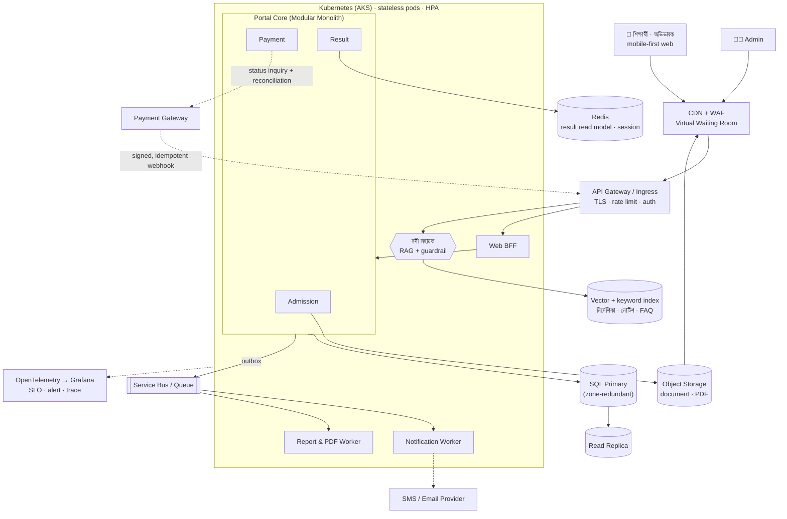
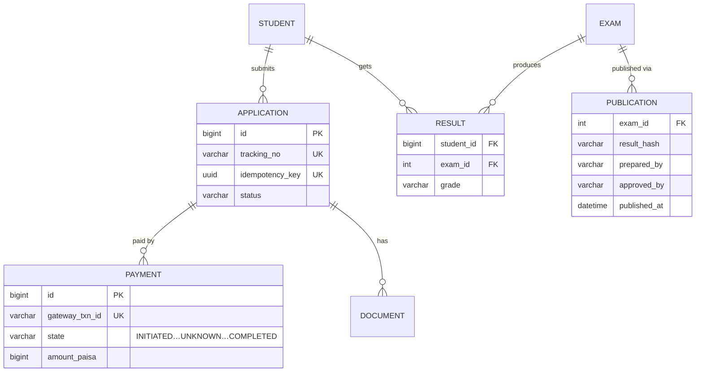
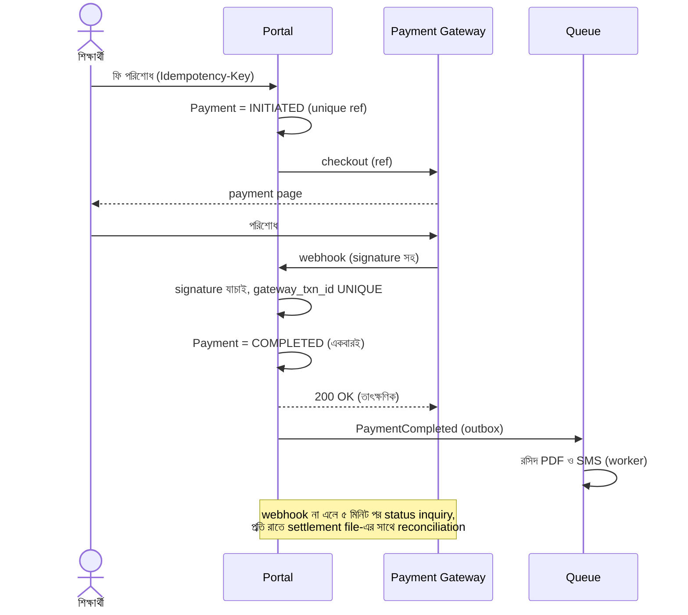
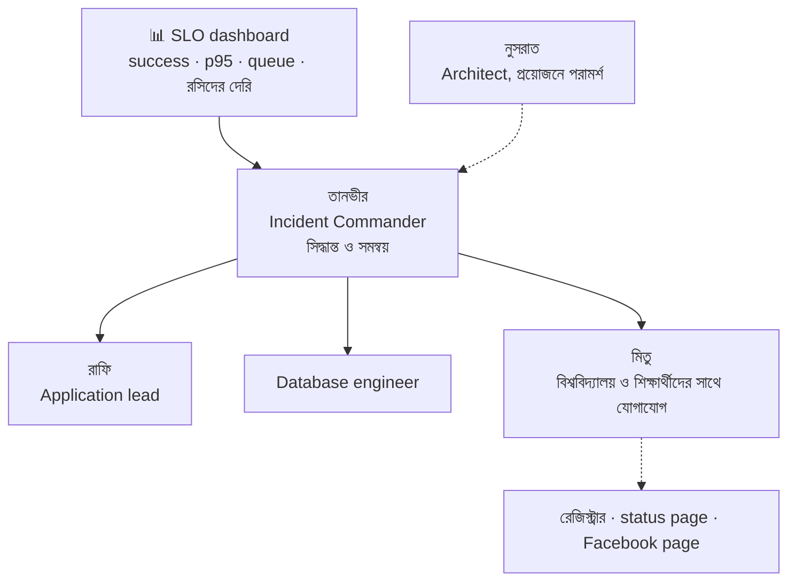

> [!GOALS]
> - অধ্যায় ১-এর ব্যর্থ portal-কে শুরু থেকে নতুন করে design করা
> - Requirement ও capacity থেকে architecture-এ যাওয়ার পূর্ণ যাত্রা
> - প্রতিটি component-এর সিদ্ধান্ত এবং কোন অধ্যায় থেকে এসেছে
> - Result day-র প্রস্তুতির timeline ও runbook
> - নিরাপত্তা, খরচ, observability ও AI সহায়ক একসাথে
> - ADR লেখার বাস্তব উদাহরণ

> [!STORY] এক বছর পর
> করিম সাহেবের ঘরে বিশ্ববিদ্যালয় গ্রুপের রেজিস্ট্রার আর ভিসি-র প্রতিনিধি। "এ বছর আরো পাঁচটি ক্যাম্পাস যোগ হচ্ছে। সতেরোটি ক্যাম্পাস, আড়াই লাখ শিক্ষার্থী। গত বছরের সেই সকালের কথা আমরা ভুলিনি। আপনারা কি পারবেন?"
>
> করিম সাহেব নুসরাতের দিকে তাকালেন। নুসরাত notebook খুললেন, অধ্যায় ১-এর পাতাটা, যেখানে লেখা ছিল: "পরের বার প্রথম দিনেই জিজ্ঞেস করব, 'সবচেয়ে খারাপ দিনটা দেখতে কেমন?'"
>
> তিনি রেজিস্ট্রারের দিকে তাকিয়ে বললেন, "পারব। কিন্তু তার আগে আমাকে আপনার সবচেয়ে খারাপ দিনটার কথা বলুন। মিনিট ধরে।"
>
> সেই বিকেলে design review-তে পুরো team বসল: নুসরাত, রাফি, তানভীর, মিতু, আয়েশা। Whiteboard-এর এক কোণে এখনো আবছা দেখা যাচ্ছে এক বছর আগের সেই বাক্স, যার ভেতরে লেখা ছিল "সব কিছু"।

## 24.1 Problem Statement

অধ্যায় ১-এর portal-এর মূল ব্যর্থতাগুলো (নুসরাতের নোটবুক থেকে):
1. একটি server-এ সব কাজ: web, API, file, report, notification।
2. Index-বিহীন result query; result day-তে database ১০০% CPU।
3. Non-idempotent payment callback; টাকা কাটা, receipt নেই।
4. Synchronous SMS ও email; restart-এ pending কাজ হারানো।
5. Local disk-এ file; disk I/O-তে request আটকে যাওয়া।
6. কোনো cache, CDN, load test, monitoring বা alert ছিল না।
7. Capacity হিসাব করা হয়নি; সাধারণ দিনের জন্য design।

নতুন system-এর লক্ষ্য: **এই প্রতিটি সমস্যা design স্তরেই অসম্ভব করে তোলা**, আর ভবিষ্যতের বৃদ্ধির জন্য জায়গা রাখা।

## 24.2 Requirements

**Functional:**
- ভর্তি আবেদন: ফর্ম, ছবি ও document upload, আবেদন ফি পরিশোধ, রসিদ।
- আবেদনের অবস্থা দেখা; admit card; ভর্তি পরীক্ষার ফল; মেধাতালিকা।
- সেমিস্টার রেজাল্ট ও marksheet PDF।
- Admin: আবেদন যাচাই, ফল আপলোড ও প্রকাশ, report।
- SMS ও email notification।
- **নদী সহায়ক:** ভর্তি-সংক্রান্ত প্রশ্নের AI উত্তর, বাংলা ও ইংরেজিতে, মানুষের কাছে হস্তান্তরসহ।

**Non-functional (রেজিস্ট্রারের "সবচেয়ে খারাপ দিন" থেকে):**

| বিষয় | লক্ষ্য |
| --- | --- |
| Result day peak | প্রথম ১০ মিনিটে ≈ ৪.৫ লাখ request; design target ২,০০০ RPS |
| Result API latency | p95 < ৩০০ ms, p99 < ১ সেকেন্ড, peak-এ |
| Admission-এর শেষ দিন | ঘণ্টায় ২০,০০০ আবেদন ও payment |
| Payment | শূন্য duplicate charge; প্রতিটি সফল payment-এর রসিদ ১০ মিনিটের মধ্যে |
| Availability | ভর্তি মৌসুম ও result day-তে ৯৯.৯৫% |
| RPO / RTO | ১ মিনিট / ১৫ মিনিট |
| নিরাপত্তা | শিক্ষার্থীর তথ্য সুরক্ষিত; ফল প্রকাশে দুই-ব্যক্তির অনুমোদন; সম্পূর্ণ audit |
| Accessibility | Mobile-first, দুর্বল network-এ ব্যবহারযোগ্য, বাংলা interface |

**Constraint:** Team-এর .NET ও SQL Server দক্ষতা; মাসিক infrastructure budget সীমিত (বিশ্ববিদ্যালয়ের অনুমোদিত অঙ্কের মধ্যে); শিক্ষার্থীর তথ্য দেশের বাইরে রাখা নিয়ে বিশ্ববিদ্যালয়ের নীতি মানতে হবে; result day-র তারিখ বিশ্ববিদ্যালয় ঠিক করে, team নয়।

## 24.3 Capacity Estimation

```text
শিক্ষার্থী                      : 2,50,000 (17 ক্যাম্পাস)
Result day, প্রথম ঘণ্টায় দেখবে  : 75% → 1,87,500 জন
প্রতিজন request                : 5 (login, result, PDF link, refresh), অভিভাবকসহ ×1.3
প্রথম ঘণ্টার request            : 1,87,500 × 5 × 1.3 ≈ 12.2 লাখ
প্রথম ১০ মিনিটে (৪০%)           : ≈ 4.9 লাখ → গড় ≈ 815 RPS → spike ×2.5 → design target 2,000 RPS
Little's Law (p95 300 ms)       : 2,000 × 0.3 = 600 concurrent request
Marksheet PDF                   : 2.5 লাখ × 200 KB = 50 GB (আগের রাতে তৈরি, CDN থেকে)
Result read model               : 2.5 লাখ × 2 KB = 500 MB → পুরোটা Redis-এ রাখা সম্ভব
ভর্তি মৌসুমে document           : দিনে 15,000 আবেদন × 3 ফাইল × 400 KB ≈ 18 GB/day
AI সহায়ক                       : দিনে 25,000 প্রশ্ন; শেষ দিনে ×5
```

## 24.4 High-Level Design



## 24.5 Detailed Design: প্রতিটি সিদ্ধান্ত ও তার উৎস

| Component | সিদ্ধান্ত | কেন | অধ্যায় |
| --- | --- | --- | --- |
| Edge | CDN, WAF, virtual waiting room | Static ও PDF origin থেকে সরানো; spike-এ সারি | ৬, ৯ |
| Application | Modular monolith + আলাদা worker | ছোট team, স্পষ্ট সীমানা, worker-এর আলাদা scaling | ১০ |
| Platform | AKS, stateless pod, HPA, scheduled scale-up | Result day-র ১,০০০ গুণ spike | ১৩ |
| Auth | OIDC, স্বল্পমেয়াদি JWT, login rate limit | Stateless scaling, brute force প্রতিরোধ | ৭, ৮ |
| Database | Managed SQL, zone-redundant HA, read replica | Team-এর দক্ষতা, RPO/RTO | ৪, ৫, ৯ |
| Result read | Redis-এ আগে থেকে তৈরি read model | ৯৯%+ request database ছোঁবে না | ৫, ৬ |
| File | Object storage, pre-signed upload, CDN | Web server-এ disk I/O নয় | ১, ২৩ |
| Payment | Idempotent webhook, state machine, reconciliation | শূন্য duplicate, শূন্য হারানো | ৭, ১৯ |
| Notification | Outbox → queue → priority worker, provider rate limit | Restart-এ কিছু হারায় না | ১০, ১১ |
| Report ও PDF | Queue-ভিত্তিক worker, replica থেকে | Transaction ধীর হয় না | ৫, ১১ |
| AI সহায়ক | RAG, উৎসসহ উত্তর, grounding, handoff | ভুল ফি-র মতো ভুল আর নয় | ১৫, ১৬ |
| Observability | OTel, SLO-ভিত্তিক alert, synthetic check | সমস্যা user-এর আগে team জানবে | ১২ |
| Delivery | CI/CD, canary, feature flag, deploy freeze | নিরাপদ পরিবর্তন | ১৪ |

### Data Model (মূল অংশ)



`Results` table exam অনুযায়ী partitioned; প্রতিটি exam-এর ফল প্রকাশের আগে চূড়ান্ত হয়ে **read-only** হয়ে যায়।

### Payment Flow



### Result Publication: দুই-ব্যক্তির নিয়ম

ফল প্রকাশ সবচেয়ে সংবেদনশীল কাজ: একটি ভুল বা কারচুপি হাজারো শিক্ষার্থীর জীবন ছোঁয়।
1. পরীক্ষা নিয়ন্ত্রকের দপ্তর ফল upload করেন (maker)।
2. System ফলের একটি **hash** তৈরি করে, যেটা চূড়ান্ত ফলের "সিল"।
3. দ্বিতীয় কর্মকর্তা নমুনা যাচাই করে অনুমোদন দেন (checker), অনুমোদনও hash-এর বিপরীতে।
4. অনুমোদনের পর ফল read-only; read model ও PDF ওই hash-এর data থেকেই তৈরি।
5. প্রকাশের মুহূর্তে শুধু একটি feature flag চালু হয়।
6. প্রকাশের পর কোনো সংশোধন হলে নতুন version, নতুন অনুমোদন, audit-এ কারণসহ।

## 24.6 Result Day: প্রস্তুতির Timeline

```mermaid
%% caption: Result day-র প্রস্তুতি: আসল কাজ ঘটে ৯টার অনেক আগে
gantt
    title Result Day Runbook (T = সকাল ৯:০০)
    dateFormat HH:mm
    axisFormat %H:%M
    section আগের দিন
    ফল চূড়ান্ত ও দুই-ব্যক্তির অনুমোদন     :done, 10:00, 3h
    Read model ও PDF তৈরি (worker)          :done, 14:00, 4h
    Load test (production-সদৃশ)             :done, 19:00, 2h
    Deploy freeze শুরু                     :milestone, 21:00, 0m
    section Result-এর সকাল
    Pod scale-up (৪ → ৪০)                   :active, 08:00, 20m
    Redis warm-up যাচাই, CDN pre-warm       :08:20, 25m
    Waiting room সক্রিয়, war room চালু      :08:45, 15m
    Feature flag ON (প্রকাশ)                :milestone, 09:00, 0m
    Peak পর্যবেক্ষণ                         :crit, 09:00, 60m
    SMS bulk queue (৩০০/s)                 :09:00, 15m
    Scale-down ও postmortem-ধরনের review    :11:00, 60m
```



**War room:** তানভীর (incident commander), রাফি (application), একজন database engineer, মিতু (বিশ্ববিদ্যালয় ও শিক্ষার্থীদের সাথে যোগাযোগ)। Dashboard-এ চারটি SLO: result API সফলতার হার, p95 latency, waiting room-এ গড় অপেক্ষা, payment রসিদের দেরি। প্রতিটির জন্য পূর্বনির্ধারিত সিদ্ধান্ত: কোন সংখ্যায় কী করা হবে।



## 24.7 Scalability Consideration

- **Result path-এ database প্রায় শূন্য:** Redis-এ read model, PDF CDN-এ; Redis miss হলে single-flight দিয়ে replica থেকে।
- **App tier:** Stateless, HPA + scheduled scale-up; PodDisruptionBudget; N+1।
- **Waiting room:** Origin-এর ক্ষমতার বাইরে গেলে user সারিতে, স্পষ্ট অবস্থান ও সময়সহ।
- **Load shedding-এর অগ্রাধিকার:** Result ও payment সর্বোচ্চ; AI সহায়ক ও report সর্বনিম্ন (peak-এ AI সহায়ক FAQ mode-এ)।
- **ভর্তির শেষ দিন:** Upload সরাসরি object storage-এ; আবেদন জমা idempotent; payment queue-ভিত্তিক রসিদ।

## 24.8 Security Consideration

- শিক্ষার্থীর NID/জন্মনিবন্ধন ও phone field-level encrypted; log-এ mask।
- Result দেখতে roll + জন্মতারিখ + OTP (প্রয়োজনে); অনুমানযোগ্য URL নয়; অন্যের ফল দেখার চেষ্টায় rate limit ও alert (অধ্যায় ৮-এর IDOR)।
- Admin action-এ MFA; ফল প্রকাশে maker-checker; সব admin কাজ audit-এ।
- Payment webhook-এ signature যাচাই; gateway-এর IP allowlist।
- AI সহায়ক কখনো ব্যক্তিগত ফল দেখায় না; শুধু portal-এর লগইন পাতায় পাঠায়।
- Secret key vault-এ; dependency ও image scan; বার্ষিক penetration test।

## 24.9 খরচের আনুমানিক কাঠামো

| অংশ | চালক | কৌশল |
| --- | --- | --- |
| Compute (AKS) | স্বাভাবিক দিনে ছোট, peak-এ বড় | Scheduled scaling; peak-এর ঘণ্টাগুলোর জন্যই শুধু বড় |
| Database | HA ও replica | Managed tier, reserved capacity |
| Redis | Result মৌসুমে বড় | মৌসুমভিত্তিক আকার |
| CDN ও bandwidth | PDF ও static | Compression, ছোট PDF, দীর্ঘ cache |
| Object storage | Document | পুরনো মৌসুমের document সস্তা tier-এ |
| SMS | প্রতি বার্তা | একটি SMS-এ সব দরকারি তথ্য; অপ্রয়োজনীয় বার্তা নয় |
| AI | Token | Semantic cache, ছোট model routing, দৈনিক budget |

> [!ARCHITECT] খরচ নিয়ে করিম সাহেবের প্রশ্ন
> করিম সাহেব জিজ্ঞেস করলেন, "Result day-র জন্য ৪০টি pod সারা বছর রাখব?" নুসরাত দেখালেন, বছরের ৩৬০ দিন portal চলে ৪টি pod-এ; শুধু result ও ভর্তির শেষ দিনগুলোতে কয়েক ঘণ্টার জন্য বড়। পুরনো design-এর একটি বিশাল server সারা বছরের চেয়ে নতুন design-এর মোট খরচ কম, আর নির্ভরযোগ্যতা তুলনাহীন। "Cloud-এর আসল সুবিধা বড় server নয়, ভাড়ার নমনীয়তা।"

## 24.10 Architecture Decision Record-এর উদাহরণ

```text
ADR-007: Result-এর জন্য Redis read model, database query নয়
অবস্থা : গৃহীত (নুসরাত, তানভীর; পর্যালোচনা: রাফি)
প্রসঙ্গ : Result day-তে 2,000 RPS; ৯৯% request একই ধরনের read; গত বছর database ১০০% CPU।
বিকল্প  : (ক) শুধু index ও বড় database  (খ) Read replica  (গ) আগে থেকে তৈরি Redis read model
সিদ্ধান্ত : (গ), সাথে replica fallback ও single-flight।
কারণ   : ফল প্রকাশের পর অপরিবর্তনীয়, তাই cache invalidation-এর জটিলতা নেই; 500 MB সহজে memory-তে;
          latency < 5 ms; database-এর ঝুঁকি দূর।
পরিণতি  : আগের দিন read model তৈরির job ও যাচাই লাগবে; Redis-এর HA বাধ্যতামূলক;
          ফল সংশোধন হলে read model পুনর্নির্মাণের runbook।
```

```text
ADR-011: AI সহায়ক কখনো ব্যক্তিগত ফল দেখাবে না
অবস্থা : গৃহীত (নুসরাত, আয়েশা; অনুমোদন: রেজিস্ট্রার অফিস)
প্রসঙ্গ : শিক্ষার্থীরা chat-এ "আমার result কী?" জিজ্ঞেস করবে।
বিকল্প  : (ক) chat-এ লগইন করিয়ে ফল দেখানো  (খ) portal-এর result পাতায় পাঠানো
সিদ্ধান্ত : (খ)।
কারণ   : Prompt injection ও ভুল ব্যক্তিকে ফল দেখানোর ঝুঁকি; ফল দেখানোর একটি পরীক্ষিত পথ ইতিমধ্যে আছে;
          AI-এর কাজ সাধারণ তথ্য, ব্যক্তিগত তথ্য নয়।
পরিণতি  : User-এর এক ধাপ বেশি; chat-এ স্পষ্ট link ও ব্যাখ্যা।
```

## 24.11 Real Production Experience: নতুন Result Day

> [!STORY] সকাল ৯টা
> সকাল ৮টা ৫০। War room-এ চা। তানভীর scale-up যাচাই করলেন: ৪০টি pod ready, Redis-এ ২,৫০,০০০ result, CDN-এ PDF। Waiting room-এ ইতিমধ্যে ৩১,০০০ জন অপেক্ষায়।
>
> ৯টা ০০। মিতু রেজিস্ট্রারের সাথে phone-এ: "চালু করছি।" রাফি feature flag চালু করল। তার হাত একটু কাঁপছিল।

তানভীরের incident log, এবার একটু অন্যরকম:

```text
08:45 AM  Waiting room সক্রিয়; 31,000 জন সারিতে।
09:00 AM  Feature flag ON। Result প্রকাশিত।
09:01 AM  Result API 1,640 RPS; p95 41 ms; Redis hit 99.8%।
09:03 AM  Waiting room: প্রতি মিনিটে 9,000 জন প্রবেশ; গড় অপেক্ষা 2 মিনিট 10 সেকেন্ড।
09:05 AM  Peak 2,310 RPS। HPA: 40 → 46 pod। Database CPU 18%।
09:07 AM  SMS queue: 300/s; সবচেয়ে পুরনো message-এর বয়স 4 মিনিট (প্রত্যাশিত)।
09:12 AM  Waiting room খালি। সবাই সরাসরি প্রবেশ করছেন।
09:15 AM  14 জন শিক্ষার্থী অন্যের roll দিয়ে চেষ্টা করায় rate limit; alert, নিরাপত্তা team অবগত।
09:30 AM  Payment (পুনর্মূল্যায়ন ফি) 3,212টি; duplicate 0; রসিদ গড় 52 সেকেন্ডে।
10:00 AM  AI সহায়ক: 6,800 প্রশ্ন; "জানি না" + handoff 4.1%; ভুল ফি/তারিখ রিপোর্ট 0।
11:00 AM  Scale-down শুরু। কোনো page আসেনি।
```

> [!STORY] রাত এগারোটা
> এক বছর আগে এই দিনটিতে রাত এগারোটায় করিম সাহেব নুসরাতকে জিজ্ঞেস করেছিলেন, "ভুলটা কোথায়?" আজ রাত এগারোটায় তিনি team-এর group chat-এ একটি ছবি পাঠালেন: রেজিস্ট্রারের পাঠানো ধন্যবাদের চিঠি। নিচে লিখলেন, "আজ কোনো খবর হয়নি। এটাই সবচেয়ে বড় খবর।"
>
> তানভীর সেই রাতে ন'টায় ঘুমিয়ে পড়েছিলেন। Phone একবারও বাজেনি। আর রাফি, যে এক বছর আগে বিভ্রান্ত হয়ে dashboard-এর দিকে তাকিয়ে ছিল, আজ ছিল war room-এর application lead।

## 24.12 সমস্যা থেকে সমাধান: পূর্ণ মানচিত্র

| অধ্যায় ১-এর সমস্যা | নতুন design-এ সমাধান | অধ্যায় |
| --- | --- | --- |
| সাধারণ দিনের জন্য design | Worst-day requirement, ২,০০০ RPS লক্ষ্য, load test | ২ |
| এক server, SPOF | Stateless pod, HA database, multi-zone | ৩, ৯, ১৩ |
| Index-বিহীন query | ERD, constraint, index, partition | ৪, ৫ |
| Result day-তে database ১০০% | Redis read model, replica fallback | ৫, ৬ |
| PDF ও static file server থেকে | Object storage ও CDN | ৬, ২৩ |
| Duplicate ও pending payment | Idempotency, state machine, reconciliation | ৭, ১৯ |
| দুর্বল নিরাপত্তা | OIDC, IDOR প্রতিরোধ, MFA, maker-checker, audit | ৮ |
| Restart-এ হারানো SMS | Outbox, queue, priority worker | ১০, ১১ |
| সমস্যা কোথায় অজানা | OTel, SLO, alert, synthetic check | ১২ |
| ভয়ের deploy | CI/CD, canary, feature flag, freeze | ১৪ |
| ভুল তথ্য দেওয়া chatbot (সম্ভাব্য) | RAG, grounding, উৎস, handoff | ১৫, ১৬ |
| "আরো বড় server" চিন্তা | Elastic scaling, খরচের নমনীয়তা | ৩, ১৩ |

## 24.13 Common Mistakes (এই ধরনের প্রকল্পে)

- Result day-র তারিখ ও সময় engineering team-কে আগে না জানানো।
- Load test production-এর চেয়ে ছোট পরিবেশে, ভিন্ন data দিয়ে।
- Scale-up-এর সময় database connection-এর সীমা ভুলে যাওয়া।
- Waiting room ছাড়া "আশা করি সামলে নেব"।
- ফল প্রকাশের দিন নতুন feature deploy।
- War room-এ কে সিদ্ধান্ত নেবেন, তা আগে ঠিক না করা।

## 24.14 Interview Questions

> [!INTERVIEW]
> 1. একটি জাতীয় পরীক্ষার result portal design করুন (২০ লাখ পরীক্ষার্থী, সকাল ১০টায় প্রকাশ)।
> 2. Result-এর মতো "একবার লেখা, লাখোবার পড়া" data-র জন্য কোন কৌশল সবচেয়ে কার্যকর?
> 3. Virtual waiting room কীভাবে কাজ করে এবং কখন দরকার?
> 4. ফল প্রকাশে কারচুপি ঠেকাতে system-এ কী কী নিয়ন্ত্রণ রাখবেন?
> 5. এই design-এর সবচেয়ে বড় অবশিষ্ট ঝুঁকি কী বলে আপনি মনে করেন?

## 24.15 নিজে করে দেখুন

> [!EXERCISE] জাতীয় পরীক্ষার Result Portal
> ২০ লাখ পরীক্ষার্থী, সারা দেশ, সকাল ১০টায় প্রকাশ, SMS-এর মাধ্যমেও ফল জানার সুবিধা (নির্দিষ্ট format-এ SMS পাঠালে ফল ফেরত)।
> 1. Capacity হিসাব করুন: web ও SMS আলাদাভাবে।
> 2. এই অধ্যায়ের design-এর কোন অংশ বদলাতে হবে, কেন?
> 3. SMS-ভিত্তিক ফলের জন্য queue ও provider-এর সীমা কীভাবে সামলাবেন?
> 4. একাধিক শিক্ষা বোর্ডের ফল একসাথে: data কীভাবে ভাগ করবেন?
> 5. একটি পূর্ণ result day runbook (Gantt বা timeline) লিখুন।
> 6. তিনটি ADR লিখুন।

## 24.16 Summary

- **শুরু worst day থেকে:** Requirement-এর সবচেয়ে গুরুত্বপূর্ণ সংখ্যাগুলো আসে stakeholder-এর "সবচেয়ে খারাপ দিন"-এর বর্ণনা থেকে।
- **প্রতিটি কাজের নিজস্ব জায়গা:** Web, API, worker, file, report, notification, AI আলাদা, আলাদাভাবে scale।
- **Read-heavy peak:** আগে থেকে তৈরি read model, CDN, waiting room।
- **টাকা ও ফল:** Idempotency, state machine, reconciliation; maker-checker ও hash-সিল।
- **প্রস্তুতিই আসল কাজ:** Runbook, load test, scale-up, war room, পূর্বনির্ধারিত সিদ্ধান্ত।
- **মানুষ:** Team-এর ভূমিকা, শান্ত on-call, আর শেখার সংস্কৃতি; একটি ব্যর্থ সকাল থেকে একটি নিঃশব্দ সফল সকাল।

> [!ARCHITECT] নুসরাতের নোটবুক · শেষ পাতা
> এক বছর আগে এই নোটবুকের প্রথম পাতায় লিখেছিলাম: "ভুলটা design-এ।" আজ শেষ পাতায় লিখছি: "ঠিকটাও design-এ, আর design মানুষের কাজ।" কোনো একটি technology আমাদের বাঁচায়নি। বাঁচিয়েছে সঠিক প্রশ্ন, সঠিক সংখ্যা, প্রতিটি কাজকে তার নিজের জায়গা দেওয়া, ব্যর্থতাকে আগে থেকে কল্পনা করা, আর একটি team যারা একে অপরকে দোষ না দিয়ে শিখেছে। রাফি এখন নিজের notebook রাখে। পরের অধ্যায়টা ওর জন্য: interview, কারণ গত সপ্তাহে ও প্রথমবার অন্য কারো interview নিয়েছে।
