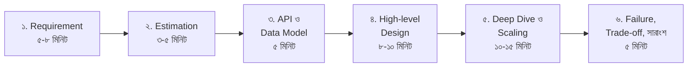
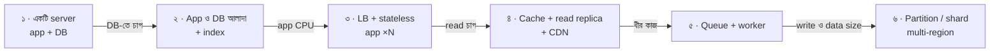
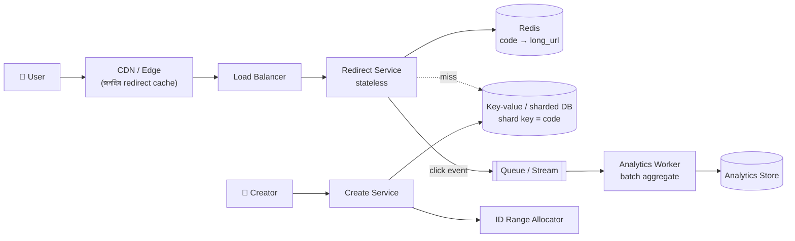
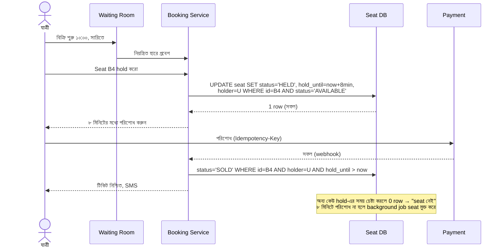
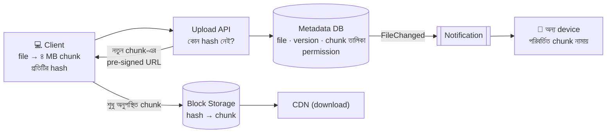

> [!GOALS]
> - Interviewer আসলে কী মূল্যায়ন করেন
> - ৪৫ মিনিটের একটি নির্ভরযোগ্য framework ও সময় ভাগ
> - সঠিক প্রশ্ন করা ও দ্রুত estimation
> - সম্পূর্ণ worked example: URL Shortener ও ঈদের Bus Ticket Booking
> - প্রচলিত প্রশ্নের মানচিত্র: কোন অধ্যায়ে কী আছে
> - Trade-off বলার ভাষা, যোগাযোগের কৌশল ও সাধারণ ভুল
> - Junior, Senior ও Staff স্তরের প্রত্যাশার পার্থক্য
> - AI system-এর interview প্রশ্ন এবং AI দিয়ে প্রস্তুতি

> [!STORY] টেবিলের অন্য পাশে
> রাফি জীবনে প্রথমবার interviewer। সামনে একজন প্রার্থী, তিন বছরের অভিজ্ঞতা, CV-তে Kafka, Kubernetes, microservices।
>
> "একটি URL shortener design করুন।"
>
> প্রার্থী সাথে সাথে বোর্ডে আঁকতে শুরু করলেন: API Gateway, পাঁচটি microservice, Kafka, Cassandra, Redis cluster, Kubernetes। দশ মিনিট পর রাফি জিজ্ঞেস করলেন, "দিনে কতগুলো URL তৈরি হবে বলে ধরে নিয়েছেন?" প্রার্থী থেমে গেলেন। তারপর বললেন, "অনেক।"
>
> রাফির মনে পড়ল তিন বছর আগের নিজের প্রথম interview। সে-ও ঠিক এটাই করেছিল। পরে নুসরাত তাকে বলেছিলেন, "Interview-এ কেউ তোমার মুখস্থ technology-র তালিকা শুনতে চায় না। তারা দেখতে চায়, একটি অস্পষ্ট সমস্যা হাতে পেলে তুমি কীভাবে ভাবো। প্রথম প্রশ্নটা তোমার, উত্তর নয়।"
>
> Interview শেষে রাফি প্রার্থীকে সেই পরামর্শটাই দিল। নুসরাতের মতো করে।

## 25.1 Introduction

System Design interview শুধু theory-র পরীক্ষা নয়। এটি একটি **অস্পষ্ট সমস্যাকে কাঠামোবদ্ধ, বাস্তবসম্মত architecture-এ রূপান্তর করার দক্ষতার** পরীক্ষা। Interviewer সাধারণত বলবেন না কোন database বা কোন technology; বলবেন, "X-এর জন্য একটি scalable system design করুন।" বাকিটা আপনার: requirement বের করা, সংখ্যা ঠিক করা, নকশা আঁকা, trade-off ব্যাখ্যা করা।

সবচেয়ে গুরুত্বপূর্ণ কথা: **এটি একটি কথোপকথন, পরীক্ষার খাতা নয়।** Interviewer একজন সহকর্মীর মতো, যার সাথে আপনি একসাথে একটি সমস্যা ভাবছেন।

## 25.2 Interviewer কী দেখেন

| মাপকাঠি | দুর্বল সংকেত | শক্তিশালী সংকেত |
| --- | --- | --- |
| **Requirement** | সরাসরি সমাধানে ঝাঁপ | প্রশ্ন করে scope ও NFR স্পষ্ট করা |
| **Estimation** | "অনেক user" | মোটামুটি সংখ্যা, এবং সংখ্যা থেকে সিদ্ধান্ত |
| **High-level design** | Buzzword-এর তালিকা | সরল, পরিষ্কার, প্রতিটি বাক্সের কারণ |
| **Deep dive** | সব কিছু অগভীরভাবে | এক-দুটি অংশে গভীরতা (data model, scaling) |
| **Trade-off** | "এটাই best" | "X বেছে নিচ্ছি কারণ…, দাম হলো…" |
| **Failure ও operations** | শুধু happy path | ব্যর্থতা, monitoring, rollback নিয়ে ভাবা |
| **যোগাযোগ** | নীরবে আঁকা | চিন্তা জোরে বলা, interviewer-কে সাথে রাখা |

## 25.3 Framework: ৪৫ মিনিটে ছয় ধাপ



1. **Requirement:** Functional (কী করবে), non-functional (কত দ্রুত, কতটা নির্ভরযোগ্য, কত user), scope-এর বাইরে কী।
2. **Estimation:** RPS, read:write, storage, bandwidth (অধ্যায় ২)। সংখ্যা থেকে কী সিদ্ধান্ত আসে, সেটা বলুন।
3. **API ও data model:** মূল endpoint ও মূল entity।
4. **High-level design:** Client থেকে data পর্যন্ত পথ; প্রথমে সরল, তারপর প্রয়োজন অনুযায়ী জটিল।
5. **Deep dive:** Interviewer যেদিকে আগ্রহী, অথবা সবচেয়ে কঠিন অংশ (ID generation, fanout, consistency, hot key)।
6. **Failure ও সারাংশ:** কী ভাঙতে পারে, কীভাবে টের পাবেন, কী trade-off নিলেন, আরো সময় পেলে কী করতেন।

### শূন্য থেকে লাখো user: বিবর্তনের গল্প বলুন

অনেক interviewer দেখতে চান আপনি system-কে ধাপে ধাপে বাড়াতে জানেন কি না। শুরুতেই চূড়ান্ত architecture নয়; প্রতিটি ধাপ একটি নির্দিষ্ট সমস্যার উত্তর।



### প্রথম পাঁচ মিনিটের প্রশ্ন

- কারা ব্যবহার করবে? কতজন (DAU), কোথা থেকে (একটি দেশ না বিশ্বজুড়ে)?
- মূল use case কোনটি? কোনগুলো এই আলোচনার বাইরে?
- Read বেশি না write বেশি?
- Latency-র প্রত্যাশা কেমন? কতটা পুরনো data চলবে (consistency)?
- Data কতদিন রাখতে হবে?
- কোনো বিশেষ peak (উৎসব, নির্দিষ্ট সময়)?

> [!TIP]
> প্রশ্ন করার পর নিজের অনুমান স্পষ্ট করে লিখুন: "ধরে নিচ্ছি দিনে ১০ কোটি redirect, ১০ লাখ নতুন URL, read:write = ১০০:১।" Interviewer অন্য সংখ্যা চাইলে বলবেন। স্পষ্ট অনুমান দুর্বলতা নয়, পরিপক্বতা।

## 25.4 Worked Example ১: URL Shortener

### Requirement

- লম্বা URL দিলে ছোট URL (`nodi.link/aZ3k9Q`)।
- ছোট URL-এ গেলে মূল URL-এ redirect, খুব দ্রুত।
- ঐচ্ছিক custom alias; মেয়াদ; মৌলিক analytics (কতবার click)।
- **NFR:** Redirect p99 < ৫০ ms; উচ্চ availability (redirect কাজ না করলে সব link ভাঙা); ছোট URL অনুমান করা কঠিন হওয়া ভালো।

### Estimation

```text
নতুন URL/day   : 1 কোটি → ≈ 116 write/s (peak ×3 ≈ 350)
Redirect/day   : 100 কোটি (read:write = 100:1) → ≈ 11,600 read/s (peak ≈ 35,000)
প্রতি record    : ≈ 500 byte → দিনে 5 GB → 5 বছরে ≈ 9 TB
ID-এর জায়গা    : 5 বছরে ≈ 1,825 কোটি URL
Base62, 7 অক্ষর : 62^7 ≈ 3.5 লাখ কোটি (3.5 × 10^12) → যথেষ্ট
```

সংখ্যা থেকে সিদ্ধান্ত: **read-heavy, তাই cache সবচেয়ে বড় হাতিয়ার**; write তুলনামূলক কম; storage বড় কিন্তু সরল key-value।

### API ও Data Model

```text
POST /api/urls        { "longUrl": "...", "alias?": "...", "expiresAt?": "..." }  → 201 { "shortUrl": "..." }
GET  /{code}          → 302 Location: <longUrl>
GET  /api/urls/{code}/stats → { "clicks": 1240, "createdAt": "..." }

Table urls: code (PK, varchar 7) · long_url · owner_id · created_at · expires_at
```

### ID Generation: Deep Dive

| পদ্ধতি | কীভাবে | সুবিধা | অসুবিধা |
| --- | --- | --- | --- |
| Long URL-এর hash (MD5/SHA) থেকে প্রথম ৭ অক্ষর | Hash → base62 | একই URL একই code | সংঘর্ষ সামলাতে হয় |
| Counter + base62 | Auto-increment ID → base62 | সংঘর্ষ নেই, ছোট | ক্রমিক, অনুমানযোগ্য; একক counter-এর bottleneck |
| Range allocation | প্রতিটি server আগে থেকে ID-এর একটি পরিসর নেয় (যেমন ১০ লাখ) | দ্রুত, distributed | পরিসর নষ্ট হতে পারে (server বন্ধ হলে), গ্রহণযোগ্য |
| Snowflake-ধরনের ID + base62 | সময় + machine + sequence | Distributed, সংঘর্ষহীন | কিছুটা লম্বা |

একটি ভালো উত্তর: **range allocation + base62**, আর অনুমানযোগ্যতা কমাতে ID-কে একটি গোপন permutation দিয়ে এলোমেলো করা। Custom alias আলাদা পথে, uniqueness যাচাইসহ।

### High-Level Design



### গুরুত্বপূর্ণ Trade-off

- **301 না 302?** 301 (স্থায়ী) browser নিজে cache করে, তাই পরের click আপনার server-এ আসে না: দ্রুত ও সস্তা, কিন্তু analytics হারায় এবং link বদলানো যায় না। 302 (অস্থায়ী) প্রতিবার server-এ আসে: analytics ও নিয়ন্ত্রণ, কিন্তু বেশি load। Analytics লাগলে 302, সাথে cache।
- **Analytics synchronous না:** Click গণনা redirect-এর পথে লিখলে latency বাড়ে; event queue-তে, batch-এ যোগ।
- **Hot link:** একটি viral link-এর জন্য edge cache ও local cache (অধ্যায় ৬)।
- **অপব্যবহার:** Phishing link তৈরি ঠেকাতে URL যাচাই ও rate limit; ক্ষতিকর link রিপোর্টের পথ।

### Failure

- Redis বন্ধ হলে database থেকে (ধীর কিন্তু চালু), circuit breaker সহ।
- ID allocator বন্ধ হলে প্রতিটি server-এর হাতে থাকা অবশিষ্ট পরিসর দিয়ে কিছু সময় চলে।
- Region ব্যর্থ হলে: redirect data read-only replica হিসেবে অন্য region-এ, কারণ redirect-ই সবচেয়ে গুরুত্বপূর্ণ।

## 25.5 Worked Example ২: ঈদের Bus Ticket Booking

ঈদের আগে অনলাইনে বাসের টিকিট বিক্রি শুরু হলে প্রথম কয়েক মিনিটে হাজারো মানুষ একই জনপ্রিয় route-এর একই seat কিনতে চান। বাংলাদেশের প্রেক্ষাপটে একটি চমৎকার interview সমস্যা।

**মূল চ্যালেঞ্জ:** একই seat দুজনের কাছে বিক্রি হবে না (কঠোর consistency); seat বাছাই থেকে payment পর্যন্ত কয়েক মিনিট লাগে; শুরুর মুহূর্তে বিশাল spike।



**আলোচনার বিষয়:** Atomic conditional update (অধ্যায় ৪), hold-এর TTL, payment-এর idempotency ও `UNKNOWN` অবস্থা (অধ্যায় ১৯), hold শেষ হওয়ার পরে payment সফল হলে কী (refund নীতি), waiting room ও bot প্রতিরোধ (অধ্যায় ৯), seat map cache (শুধু দেখানোর জন্য; চূড়ান্ত যাচাই database-এ)।

## 25.6 প্রচলিত প্রশ্নের মানচিত্র

| প্রশ্ন | মূল ধারণা | এই বইয়ে |
| --- | --- | --- |
| WhatsApp / Chat | WebSocket, ordering, offline sync, E2EE | অধ্যায় ২২ |
| News Feed / Twitter | Fanout, celebrity, ranking | অধ্যায় ২১ |
| YouTube / Netflix | Upload, transcoding, ABR, CDN | অধ্যায় ২০, ২৩ |
| Uber / Pathao-ধরনের ride | Geospatial index, matching, surge | অধ্যায় ২০ |
| Payment / Wallet | Ledger, idempotency, reconciliation | অধ্যায় ১৯ |
| ERP / Payroll | Multi-tenancy, batch, closing | অধ্যায় ১৮ |
| Rate Limiter | Token bucket, distributed counter | অধ্যায় ৭ |
| Notification System | Queue, priority, provider limit, DLQ | অধ্যায় ১১ |
| Distributed Cache | Consistent hashing, eviction, stampede | অধ্যায় ৬, ৯ |
| Result / Exam Portal | Read model, waiting room, peak | অধ্যায় ১, ২, ২৪ |
| RAG Chatbot / AI Assistant | Retrieval, guardrail, eval, cost | অধ্যায় ১৫, ১৬ |
| Google Drive / File Storage | Chunking, metadata, sync, dedup | অধ্যায় ২৩-এর upload + নিচের গল্প |

**Real Production Interview Story:** একজন প্রার্থীকে বলা হয়েছিল "Google Drive-এর মতো একটি file storage system design করুন।" দুর্বল উত্তর: upload API, download API, একটি database। শক্তিশালী উত্তর: ফাইলকে chunk-এ ভাগ করা (resumable upload, ও শুধু পরিবর্তিত chunk sync), chunk-এর hash দিয়ে deduplication, metadata database আলাদা, object storage-এ chunk, CDN, version history, শেয়ারিং-এর permission model, আর একাধিক device-এ সংঘর্ষ হলে কী হবে। পার্থক্যটা ছিল **system thinking**: শুধু "ফাইল রাখা" নয়, "মানুষ কীভাবে ফাইল ব্যবহার করে আর কোথায় ভাঙতে পারে।"



## 25.7 Trade-off বলার ভাষা

| সিদ্ধান্ত | লাভ | দাম |
| --- | --- | --- |
| Cache | গতি, database-এর load কম | পুরনো data-র ঝুঁকি, invalidation |
| Microservices | স্বাধীন team ও scaling | জটিলতা, network ব্যর্থতা, consistency |
| Sharding | Write ও storage scale | Cross-shard query, resharding |
| Async / queue | দ্রুত response, peak শোষণ | Eventual consistency, debugging |
| Strong consistency | সঠিকতা | Latency, availability |
| Denormalization | দ্রুত read | Write জটিল, duplicate data |
| Managed service | কম operations | খরচ, vendor lock-in |
| বড় LLM | ভালো উত্তর | খরচ ও latency |

**একটি ভালো trade-off বাক্যের গঠন:** "আমি **X** বেছে নিচ্ছি, কারণ এই system-এ **Y** সবচেয়ে গুরুত্বপূর্ণ (requirement থেকে)। এর দাম হলো **Z**, যা আমরা **W** দিয়ে সামলাব। যদি requirement বদলায় (যেমন…), তাহলে **V** ভালো হবে।"

## 25.8 Diagram আঁকার কৌশল

- বাম থেকে ডানে বা উপর থেকে নিচে: client → edge → service → data।
- প্রতিটি বাক্সের নাম তার **দায়িত্ব** দিয়ে ("Redirect Service"), technology দিয়ে নয় ("Spring Boot App")।
- তীরে কী যাচ্ছে লিখুন (sync call, event, replication)।
- প্রথমে সরল diagram, তারপর আলোচনার সাথে সাথে বাক্স যোগ করুন; শুরুতেই বিশ বাক্স নয়।
- Online interview-এ আগে থেকে একটি whiteboard tool-এ অভ্যস্ত হোন (Excalidraw, draw.io)।

## 25.9 সাধারণ ভুল

- **Requirement না বুঝে সমাধানে ঝাঁপ।**
- **Scaling আলোচনা নেই:** শুধু মৌলিক design।
- **Trade-off নেই:** প্রতিটি সিদ্ধান্তকে "best" বলা।
- **ব্যর্থতা নিয়ে কিছু না বলা:** বাস্তব system ব্যর্থ হয়ই।
- **Bottleneck বিশ্লেষণ নেই।**
- **Buzzword-এর ভিড়:** কারণ ছাড়া Kafka, Kubernetes, microservices।
- **নীরবে আঁকা:** Interviewer আপনার চিন্তা দেখতে পান না।
- **Interviewer-এর ইঙ্গিত উপেক্ষা:** "Database নিয়ে আরেকটু বলুন" মানে সেদিকে যান।
- **সময় নষ্ট:** একটি ছোট বিষয়ে পনেরো মিনিট।

## 25.10 স্তরভেদে প্রত্যাশা

| স্তর | প্রত্যাশা |
| --- | --- |
| **Junior / Mid** | সঠিক মৌলিক component (LB, cache, DB, queue), যুক্তিসঙ্গত data model, সাধারণ scaling-এর ধারণা |
| **Senior** | সংখ্যা দিয়ে সিদ্ধান্ত, গভীর trade-off, ব্যর্থতা ও operations, নিজে আলোচনা পরিচালনা |
| **Staff / Principal** | একাধিক সম্ভাব্য পথের তুলনা, খরচ ও team-এর বাস্তবতা, migration পরিকল্পনা, প্রতিষ্ঠান জুড়ে প্রভাব, অনিশ্চয়তা কমানোর কৌশল (prototype, phased rollout) |

## 25.11 AI System-এর Interview প্রশ্ন

এখন অনেক interview-তে AI-সংক্রান্ত design প্রশ্ন আসে: "একটি company-র document-এর উপর RAG chatbot design করুন", "Customer support-এ AI agent কীভাবে আনবেন?"

**উত্তরের রূপরেখা (অধ্যায় ১৫-১৬ থেকে):**
1. Use case ও ঝুঁকি: ভুল উত্তরের ক্ষতি কতটা? কে দায়ী?
2. Data: কোন উৎস, কত document, কত ঘন ঘন বদলায়, কার কী permission।
3. Ingestion ও retrieval: chunking, embedding, hybrid search, permission filter।
4. Generation: prompt, grounding, citation, structured output।
5. Guardrail ও human handoff।
6. Evaluation: golden set, metric, CI-তে eval, production feedback।
7. Latency, খরচ, AI gateway, fallback।
8. Observability ও নিরাপত্তা: prompt injection, PII।

> [!INTERVIEW] AI tool ব্যবহার নিয়ে প্রশ্ন
> "আপনি কাজে AI কীভাবে ব্যবহার করেন?" প্রশ্নের ভালো উত্তর নির্দিষ্ট ও সৎ: কোন কাজে সাহায্য পান (খসড়া, review checklist, পুরনো code বোঝা), কীভাবে যাচাই করেন, আর একটি উদাহরণ যেখানে AI-এর ভুল আপনি ধরেছিলেন (অধ্যায় ১৭)। আর interview চলাকালীন AI tool ব্যবহারের নিয়ম প্রতিষ্ঠানভেদে আলাদা; নিয়ম না জেনে ব্যবহার করবেন না, এবং নিয়ম অনুযায়ী অনুমতি না থাকলে কখনো নয়।

## 25.12 প্রস্তুতির পরিকল্পনা

- **প্রতি সপ্তাহে ২-৩টি সমস্যা** কাগজে, ৪৫ মিনিটের timer ধরে।
- **জোরে বলে অনুশীলন:** একা হলেও; অথবা বন্ধুর সাথে mock interview।
- **AI-কে mock interviewer:** "তুমি একজন senior interviewer, আমাকে একটি design প্রশ্ন দাও, আমার উত্তরের পর follow-up প্রশ্ন করো, আর শেষে মাপকাঠি অনুযায়ী মূল্যায়ন দাও।" তবে AI-এর মূল্যায়ন একটি মতামত, রায় নয়।
- **বাস্তব incident পড়ুন:** অধ্যায় ১২-এর মতো postmortem পড়া interview-এ "failure" আলোচনার সবচেয়ে ভালো প্রস্তুতি।
- **নিজের কাজের গল্প প্রস্তুত রাখুন:** একটি সিদ্ধান্ত যা আপনি নিয়েছিলেন, একটি ভুল যা থেকে শিখেছেন, একটি incident যা সামলেছেন।

## 25.13 নিজে করে দেখুন

> [!EXERCISE] Online Exam System
> একটি online পরীক্ষার system design করুন: ৫০,০০০ পরীক্ষার্থী একই সময়ে ৯০ মিনিটের MCQ ও লিখিত পরীক্ষা দেবেন।
> 1. Requirement-এর প্রশ্ন লিখুন (কমপক্ষে আটটি)।
> 2. Estimation: পরীক্ষা শুরুর মুহূর্ত আর শেষের পাঁচ মিনিটের spike।
> 3. উত্তর হারানো ঠেকাতে autosave কীভাবে (দুর্বল network সহ)?
> 4. নকল ঠেকানোর ব্যবস্থা (প্রশ্নের ক্রম এলোমেলো, সময় সীমা, প্রয়োজনে AI-ভিত্তিক proctoring এবং তার নৈতিক প্রশ্ন)।
> 5. Result processing ও প্রকাশ (অধ্যায় ২৪)।
> 6. ৪৫ মিনিটের timer ধরে নিজে উত্তর দিন, রেকর্ড করুন, তারপর এই অধ্যায়ের মাপকাঠি দিয়ে নিজেকে মূল্যায়ন করুন।

## 25.14 Chapter Summary

- **Interview একটি কথোপকথন:** প্রথম প্রশ্নটা আপনার।
- **ছয় ধাপ:** Requirement → Estimation → API ও data → High-level → Deep dive → Failure ও সারাংশ।
- **সংখ্যা থেকে সিদ্ধান্ত:** Read-heavy হলে cache, write-heavy হলে partition ও queue।
- **Trade-off-এর ভাষা:** কী বেছে নিলেন, কেন, কী দাম, কীভাবে সামলাবেন।
- **ব্যর্থতা ও operations:** Senior হওয়ার সবচেয়ে স্পষ্ট সংকেত।
- **AI প্রশ্ন:** RAG ও agent-এর design, ঝুঁকি, evaluation।
- **প্রস্তুতি:** নিয়মিত অনুশীলন, জোরে বলা, বাস্তব incident পড়া, নিজের গল্প।

## 25.15 শেষ কথা

এই বইয়ের শুরু হয়েছিল একটি রেজাল্টের সকাল দিয়ে, যেদিন একটি portal ভেঙে পড়েছিল আর একজন junior developer বুঝতে পারছিল না তার নির্ভুল code কেন যথেষ্ট ছিল না। শেষ হচ্ছে সেই developer-কে interviewer-এর আসনে রেখে, যে এখন অন্য একজনকে শেখাচ্ছে প্রথম প্রশ্নটা করতে।

মাঝখানে আমরা দেখেছি database কেন আটকে যায়, cache কখন মিথ্যা বলে, payment কেন idempotent হতে হয়, queue কীভাবে সময় কিনে দেয়, monitoring ছাড়া কেন আমরা অন্ধ, Kubernetes কী সহজ করে আর কী করে না, AI কোথায় সাহায্য করে আর কোথায় বিপদ ডাকে। দেখেছি GitLab-এর মুছে যাওয়া database, Knight Capital-এর পঁয়তাল্লিশ মিনিট, Bangladesh Bank-এর বানান ভুল, Air Canada-র chatbot।

কিন্তু প্রতিটি গল্পের নিচে একটি একই সত্য ছিল: **system মানুষের তৈরি, মানুষের জন্য, আর মানুষই তাকে বাঁচিয়ে রাখে।** সবচেয়ে ভালো architecture হলো সেটা, যা ব্যবহারকারীর বাস্তবতা বোঝে, team-এর সীমাবদ্ধতা মানে, ব্যর্থতাকে আগে থেকে কল্পনা করে, আর ভুল হলে শেখার সুযোগ রাখে।

পরের বার যখন কেউ আপনাকে বলবে, "আমাদের শুধু একটা ছোট্ট system লাগবে," notebook খুলুন, আর জিজ্ঞেস করুন:

> [!QUOTE]
> সবচেয়ে খারাপ দিনটা দেখতে কেমন?

শুভকামনা। আপনার production শান্ত থাকুক, আর on-call phone নীরব।

> [!ARCHITECT] নুসরাতের নোটবুক · রাফির জন্য
> রাফি আজ তার প্রথম interview নিয়েছে। প্রার্থী Kafka দিয়ে শুরু করেছিলেন, রাফি তাঁকে প্রশ্ন দিয়ে শুরু করতে শিখিয়েছে। এক বছর আগে যে ছেলেটি রেজাল্টের সকালে dashboard-এর দিকে তাকিয়ে ছিল, সে এখন অন্যকে পথ দেখায়। এটাই এই কাজের সবচেয়ে বড় পুরস্কার। আমার নোটবুক এখানেই শেষ। রাফির নোটবুক শুরু হলো।
